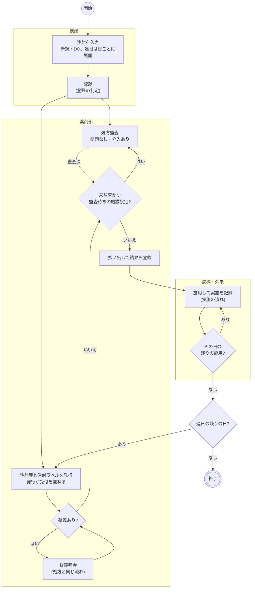
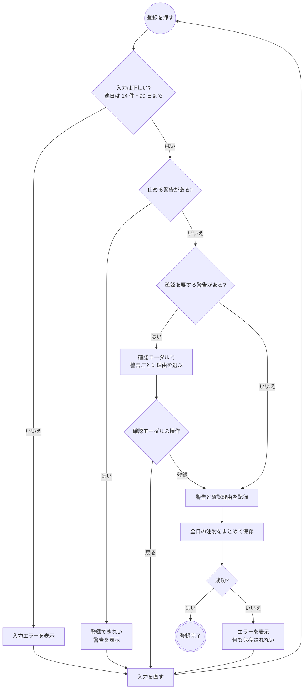
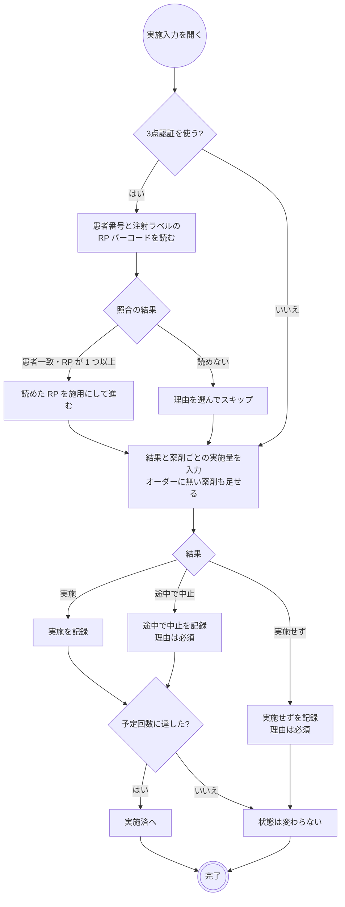

# 注射オーダーの業務フロー

<!-- ../fhir-client/docs/order-flows/injection.md から scripts/sync-flows.mjs で作る。直接編集しない。 -->

注射オーダーの登録から払出・実施までの流れです。
化学療法の日オーダーは[化学療法の業務フロー](chemotherapy.md)を読みます。

医師 薬剤部 病棟・外来

## 区分ごとの違い

| 注射 | 処方監査 | 注射箋・注射ラベル | 払出登録 | 実施の記録 | 医事会計への送信 |
|---|---|---|---|---|---|
| 入院(定時・臨時・緊急) | あり | あり | あり | あり | なし(外来のみ) |
| 外来 | あり | あり | あり | あり | 実施の記録から |

注射は 1 日 1 オーダーです。連日の指示は登録のときに日ごとのオーダーへ展開します。処方監査は連日をまとめて 1 回、それ以外(注射箋発行・払出・実施)は日ごとに進みます。

## 注射の状態

薬剤部と実施の進み具合を示す状態です。

| 状態 | 変わるきっかけ | 注射一覧のメニューからできること |
|---|---|---|
| 依頼済 | 医師の登録、受付取消、中止取消、実施取消 | 中止 |
| 受付済 | 注射箋発行、疑義照会の回答・取下げ、払出取消 | 受付取消(依頼済へ)、中止 |
| 照会中・処方変更待ち | 疑義照会 | なし(疑義照会の操作で変わる) |
| 払出済 | 払出登録 | 払出取消(受付済へ。払出の記録は残る)、中止 |
| 実施済 | 実施の記録が予定回数に達する | なし(カルテの実施取消で依頼済へ) |
| 中止 | 中止 | 中止取消(依頼済へ) |

実施取消は実施の記録をすべて消します。実施済だった注射は、払い出し済みだったかどうかに関わらず依頼済へ戻ります。

## 全体の流れ

- 監査と注射箋発行は並行して進みます。既定では未監査でも払出登録でき、施設設定「監査済まで調剤登録・払出登録を出さない」のときだけ待ちます。
- 疑義照会は依頼済からも送れます(図は受付済からの経路だけを示します)。照会は日ごとのオーダーに対して行います。
- 払出登録は受付済の注射にだけ出ます。注射ラベルは進捗を動かさず、中止以外のどの状態でも刷れます。
- 予定は登録した時点で注射カレンダー・経過表・看護ワークシートに出ます。
- 実施は払出・監査・疑義照会を待ちません。止まるのは中止した注射だけです。薬剤部から病棟へ薬を届ける作業は記録の対象ではありません。

## 登録の判定

処方と違い、外部の判断支援への問い合わせはありません。

## 実施の流れ

- 開く場所はカルテのカード、注射カレンダー、経過表の注射欄、看護ワークシート、血糖インスリン指示患者一覧、パスのタスク、注射バーコード実施です。
- 3点認証は施設設定で有効にしたときに出ます。実施者はログイン中の医療従事者で代替します。
- 注射バーコード実施は、患者番号と RP バーコードを読んだ状態で実施入力を開き、施設設定に関わらず照合を記録します。
- 予定回数は RP の開始時刻の数です(複数の RP なら最も多いもの。時刻が無ければ 1 回)。「実施」「途中で中止」の記録だけを数えます。
- インスリンのスケールは、前後の血糖値・主食の摂取量から案内量を出します。案内と違う量にしたら理由が必須です。

## 変更・中止・削除・継続

| 操作 | できる場所 | 範囲 | できないとき |
|---|---|---|---|
| 変更 | カルテのカード、注射カレンダー | この日のみ / この日以降すべて | |
| 中止 | カルテのカード、注射カレンダー | この日のみ / この日以降すべて | 実施済 |
| 中止 | 注射一覧のメニュー | その日のみ | 実施済、照会中・処方変更待ち |
| 中止取消 | カルテのカード、注射カレンダー、注射一覧のメニュー | 中止と同じ | |
| 削除 | カルテのカード、注射カレンダー | この日のみ / この日以降すべて。理由は必須 | 実施の記録がある |
| 継続 | 注射カレンダーの行のメニュー | 連日の最後の日に、同じ内容の日を足す | |

- 変更と継続は、監査済でも未監査へ戻り、再監査になります。
- 変更・中止は薬剤部へ通知しません。変更は再監査で、中止は注射一覧の状態で見えます。払い出した薬剤の返品・再払出はシステムの記録の対象外です。
- 注射ラベルの読み取りは内容の変更を見分けません。変更した注射はラベルを刷り直します。
- 「この日以降すべて」の中止は実施済の日を除きます。中止取消は中止した日だけを戻します。
- 中止した注射は医事会計へ送られません。1 日に複数回の注射で、中止の前に実施した分は送られます。会計を送ったあとに中止したときは医事へ連絡し、医事が送り直します。

## 疑義照会の流れ

処方と同じです([処方オーダーの疑義照会の流れ](prescription.md#疑義照会の流れ))。「調剤登録」を「払出登録」に読み替えます。
