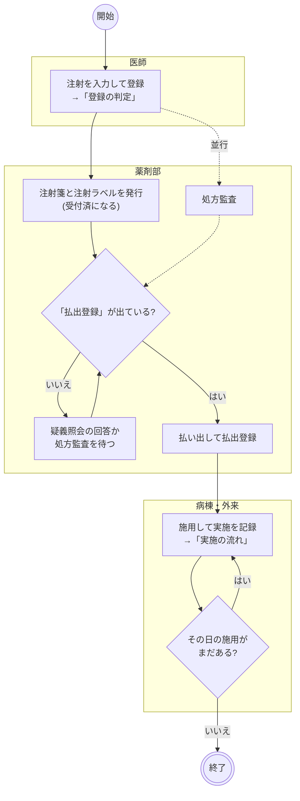
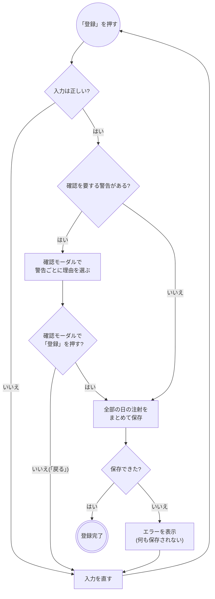
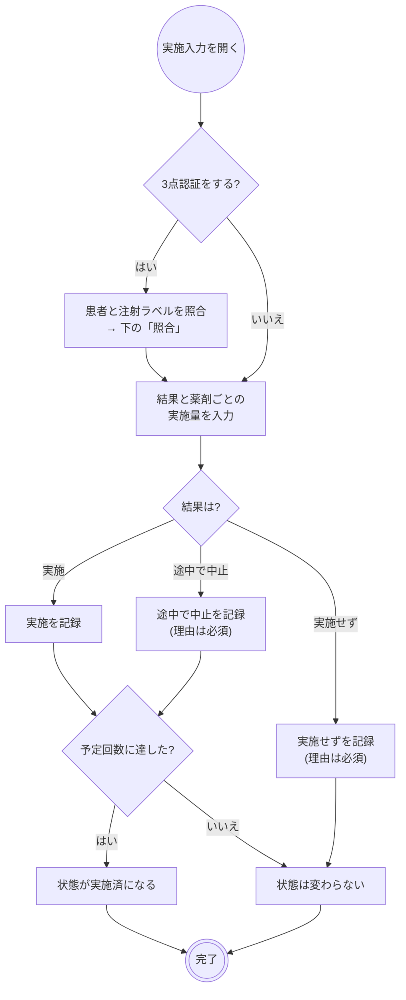
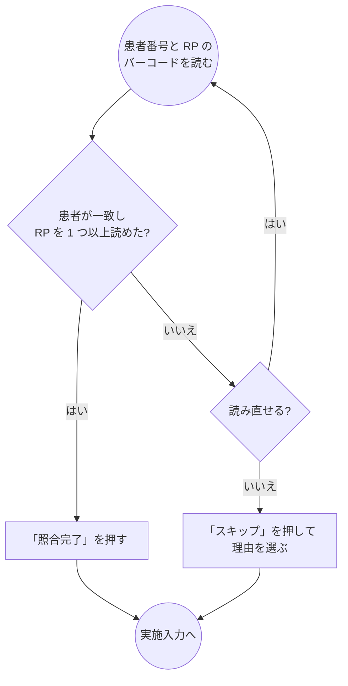

# 注射オーダーの業務フロー

<!-- ../fhir-client/docs/order-flows/injection.md から scripts/sync-flows.mjs で作る。直接編集しない。 -->

注射オーダーの登録から払出・実施までの流れです。
化学療法のレジメンから出た注射は、レジメンの適用や投与可否の確認が加わるので[化学療法の業務フロー](chemotherapy.md)を読みます。

医師 薬剤部 病棟・外来

このページで使う呼び名です。

- **RP**: 同じルートから同時に投与する薬剤の組(混注)です。注射ラベルは RP ごとに 1 枚で、RP のバーコードが付きます。
- **施用**: 1 回の投与です。1 日に開始時刻が複数ある注射は、1 日に複数回の施用があります。
- **連日の注射**: 期間と実施パターン(毎日・N 日ごと・曜日指定)で登録した注射です。登録すると、日ごとに 1 つずつのオーダーに分かれます。
- **状態**: 薬剤部の作業と実施がどこまで進んだかを示します(依頼済・受付済・払出済・実施済など)。

## 区分ごとの違い

入院(定時・臨時・緊急)も外来も、処方監査・注射箋と注射ラベルの発行・払出登録・実施の記録を同じように通ります。
違いは医事会計への送信だけで、外来は実施の記録から送り、入院は送りません。

注射は 1 日 1 オーダーです。処方監査は連日の注射をまとめて 1 回、注射箋発行・払出・実施は日ごとに進みます。

## 全体の流れ

1 日ぶんの流れです。連日の注射は、日ごとに注射箋の発行から繰り返します。

「払出登録」が出ないのは次のときです。

| とき | 「払出登録」が出るようになる条件 |
|---|---|
| 依頼済(注射箋を発行していない) | 注射箋発行で受付済にする |
| 照会中・処方変更待ち | 疑義照会の回答か取下げで受付済に戻る(→「疑義照会の流れ」) |
| 未監査で、施設設定「監査済まで調剤登録・払出登録を出さない」が有効 | 処方監査で監査済にする |

- **入力**: 新規のほか、カルテの注射カードの DO(前回と同じ内容で出し直す)からも登録できます。
- **処方監査と注射箋発行**: 並行して進みます。施設設定を有効にしていなければ、未監査でも払出登録できます。
- **処方監査の結果**: 「問題なし」か「介入あり」を記録します。介入ありのときは介入の種別・内容と医師の対応を残します。どちらでも監査済になります。
- **注射ラベル**: 発行しても状態は変わりません。中止以外のどの状態でも刷れます。
- **予定の表示**: 登録した時点で、注射カレンダー・経過表・看護ワークシートに予定が出ます。
- **実施**: 払出・処方監査・疑義照会を待たずに記録できます。実施できないのは中止した注射だけです。
- **システムの外の作業**: 薬剤部から病棟へ薬を届ける作業は記録しません。

## 注射の状態

| 状態 | 変わるきっかけ | 注射一覧の行のメニューからできること |
|---|---|---|
| 依頼済 | 医師の登録、受付取消、中止取消、実施取消 | 中止 |
| 受付済 | 注射箋発行、疑義照会の回答・取下げ、払出取消 | 受付取消(依頼済へ)、中止 |
| 照会中・処方変更待ち | 疑義照会 | なし(疑義照会の操作で変わる) |
| 払出済 | 払出登録 | 払出取消(受付済へ)、中止 |
| 実施済 | 実施の記録が予定回数に達する | なし |
| 中止 | 中止 | 中止取消(依頼済へ) |

- 「照会中」は薬剤師が疑義照会を送って回答を待っている状態、「処方変更待ち」は医師が「処方を変更する」と回答して、注射の編集を待っている状態です。
- 「払出取消」は状態だけを戻します。払出登録で入れた記録は残ります。
- 実施済の注射は、カルテの「実施取消」で依頼済に戻します。実施取消は実施の記録をすべて消します。払出済だった注射も、払出済ではなく依頼済に戻ります。

## 登録の判定

- **連日の注射の上限**: 一度に登録できるのは 14 日ぶん、期間は 90 日までです。超えると入力エラーになります。
- **警告の重さ**: 処方と同じ 2 段階です。「表示のみ」(橙)はそのまま登録でき、「確認を要する」(赤。アレルギーの一致・併用禁忌・用量の上限超過など)は確認モーダルで 1 件ずつ理由を選びます([処方オーダーの業務フロー](prescription.md)「[登録の判定](prescription.md#登録の判定)」)。
- **登録を止める警告**: いまはありません。
- **外部の判断支援**: 処方と違い、注射では問い合わせません。

## 疑義照会の流れ

薬剤師が医師に問い合わせ、回答を受けるまでの流れです。処方と同じ仕組みで、注射では日ごとのオーダーに対して照会します。

- 薬剤師が「部門業務 > 薬剤部門 > 注射一覧」の行の「疑義照会」から照会を送ると、状態が照会中になり、「払出登録」が消えます。
- 医師は通知かカルテの注射カードから回答します。「処方どおり」「薬剤部で変更してよい」なら受付済に戻ります。
- 「処方を変更する」と回答すると処方変更待ちになり、医師が注射を編集して保存すると受付済に戻ります。
- 回答の前なら、薬剤師が照会を取り下げられます。依頼済の注射にも照会できます。

図と細かい決まりは [処方オーダーの業務フロー](prescription.md)「[疑義照会の流れ](prescription.md#疑義照会の流れ)」にあります。「調剤登録」を「払出登録」に読み替えます。

## 実施の流れ

実施入力を開ける場所は次のとおりです。

- カルテの注射カード
- 注射カレンダー
- 経過表の注射欄
- 看護ワークシート
- 血糖インスリン指示患者一覧
- クリニカルパスのタスク
- 「看護業務 > 注射バーコード実施」(患者番号と RP のバーコードを読んでから実施入力を開く画面)

入力について。

- **オーダーに無い薬剤**: 実施入力で RP ごとに足せます。
- **予定回数**: RP の開始時刻の数です。RP が複数あれば最も多いもの、開始時刻が無ければ 1 回です。「実施」と「途中で中止」の記録だけを数えます。
- **インスリンのスケール**: 前後の血糖値や主食の摂取量から、案内の量を出します。案内と違う量にしたら理由が必須です。

### 照合(3点認証)

3点認証は、患者・薬剤(注射ラベルの RP)・実施者の 3 つを確かめる照合です。施設設定「注射の3点認証」を有効にすると、実施入力の前に出ます。
「注射バーコード実施」から開いたときは、施設設定に関わらず照合します。

| 確かめるもの | 読むもの | 一致しないとき |
|---|---|---|
| 患者 | リストバンドか注射ラベルの患者番号 | 「患者番号 … はこの患者ではありません。」と出て、「照合完了」を押せない |
| 薬剤 | 注射ラベルの RP のバーコード | 「別のオーダーのラベルです。」「このオーダーに RP… はありません。」と出て、読んだことにならない |
| 実施者 | 読まない(ログイン中の医療従事者を実施者とする) | 医療従事者と結び付いていないログインでは、スキップしかできない |

- **読む順**: 患者番号と RP のバーコードは、どちらから読んでもかまいません。
- **不一致のとき**: 患者が一致しないあいだは先へ進めません。正しいリストバンドやラベルを読み直します。
- **読んでいない RP**: 施用の対象から外れます。その RP も施用するときは、照合に戻って読みます。
- **スキップ**: 照合できないときは、理由(緊急・急変、リストバンド未装着・読取不可、ラベル未発行・読取不可、リーダー不調、その他)を選んで入力へ進みます。「その他」は理由の記入が必須です。
- **記録**: 照合の結果は実施の記録に残り、カルテの注射カードに「照合済」「照合スキップ(理由)」と出ます。

## 変更・中止・削除・継続

| 操作 | できる場所 | 範囲 | できないとき |
|---|---|---|---|
| 変更 | カルテの注射カード、注射カレンダー | この日のみ / この日以降すべて | |
| 中止 | カルテの注射カード、注射カレンダー | この日のみ / この日以降すべて | 実施済 |
| 中止 | 注射一覧の行のメニュー | その日のみ | 実施済、照会中・処方変更待ち |
| 中止取消 | カルテの注射カード、注射カレンダー | この日のみ / この日以降すべて | 中止以外 |
| 中止取消 | 注射一覧の行のメニュー | その日のみ | 中止以外 |
| 受付取消・払出取消 | 注射一覧の行のメニュー | その日のみ | 受付済・払出済以外 |
| 削除 | カルテの注射カード、注射カレンダー | この日のみ / この日以降すべて | 実施の記録がある |
| 継続 | 注射カレンダーの行のメニュー | 連日の最後の日の後ろに日を足す | |

- **再監査**: 変更と継続をすると、監査済でも未監査に戻り、処方監査をやり直します。
- **薬剤部への連絡**: 変更・中止をしても、薬剤部へ通知は届きません。薬剤部は、変更を再監査の一覧で、中止を注射一覧の状態で知ります。
- **払い出した薬剤**: 変更・中止のあとの返品と再払出は記録しません。運用で決めます。
- **注射ラベル**: 内容を変更した注射は、ラベルを刷り直します。古いラベルを読んでも、内容が変わったことは分かりません。
- **「この日以降すべて」の中止**: 実施済の日は除きます。中止取消の「この日以降すべて」は、中止した日だけを戻します。
- **中止取消**: 中止の前の状態ではなく、依頼済に戻ります。
- **削除**: 理由の入力が必須です。実施の記録があるときは、先に「実施取消」をします。
- **継続**: 最後の日と同じ内容で、選んだ終了日まで日を足します。
- **医事会計**: 中止した注射は医事会計へ送られません。1 日に複数回の施用があり、中止の前に実施した分は送られます。会計を送ったあとに中止したときは医事課へ連絡し、医事課が送り直します。

## 帳票

| 帳票 | 出す場所 | 内容 |
|---|---|---|
| 注射箋 | 注射一覧の行の「注射箋発行」 | 注射指示票を兼ねる。A5 |
| 注射ラベル | 注射一覧の行の「注射箋発行」、行のメニューの「注射ラベル発行」 | RP ごとに 1 枚。患者番号と RP のバーコード |

- 依頼済の注射の「注射箋発行」は、注射箋と注射ラベルを 1 つのタブに並べて開き、状態を受付済にします。用紙が違うので、それぞれ印刷します。
- 注射箋の再発行と、注射ラベルだけの発行は、行のメニューから行います。状態は変わりません。
