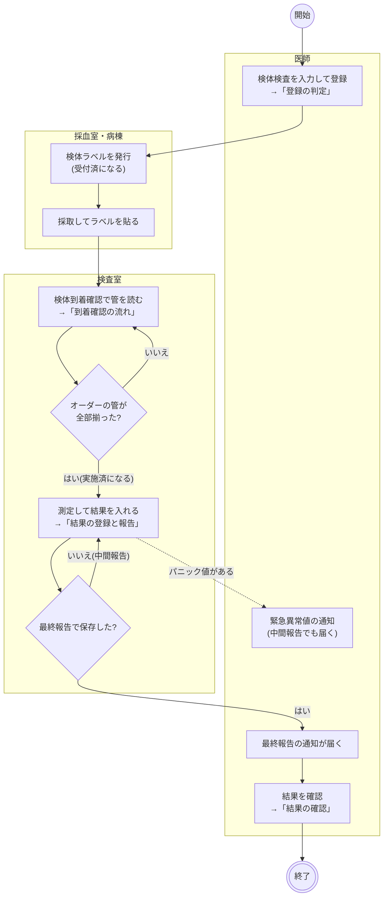
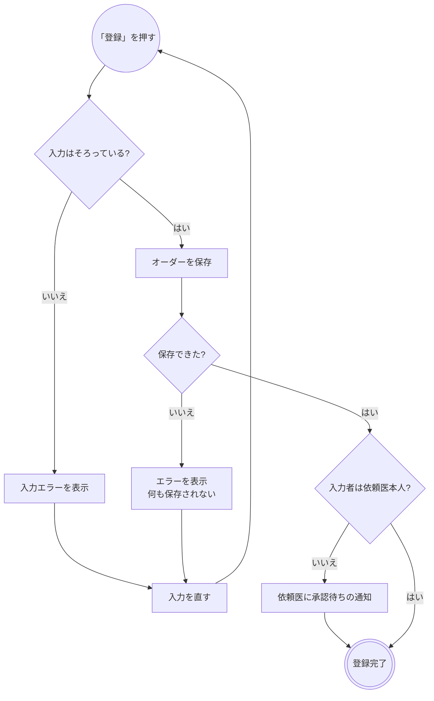
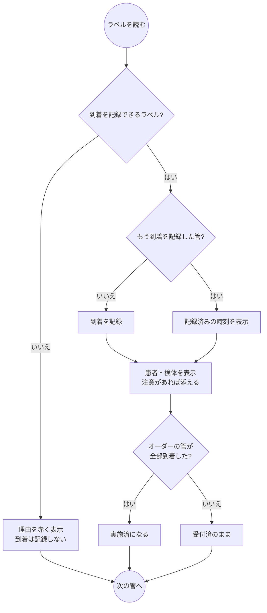
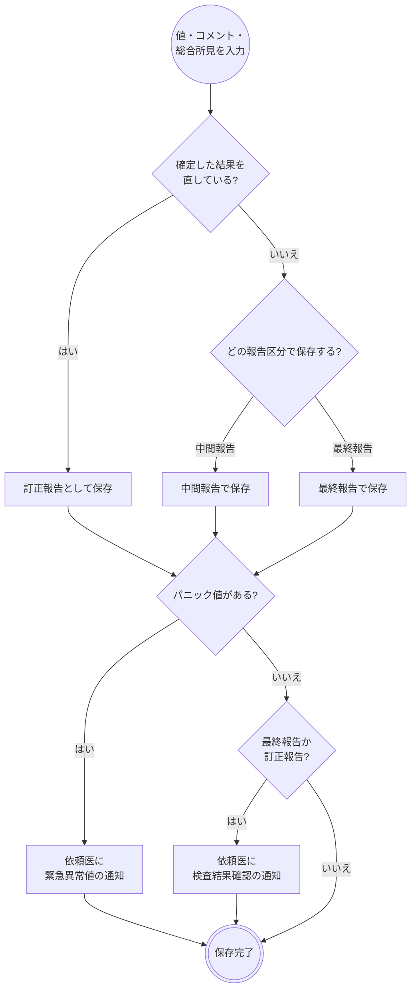
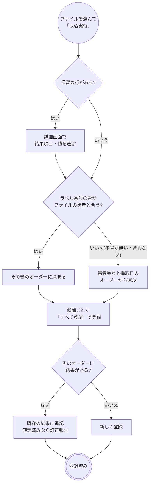
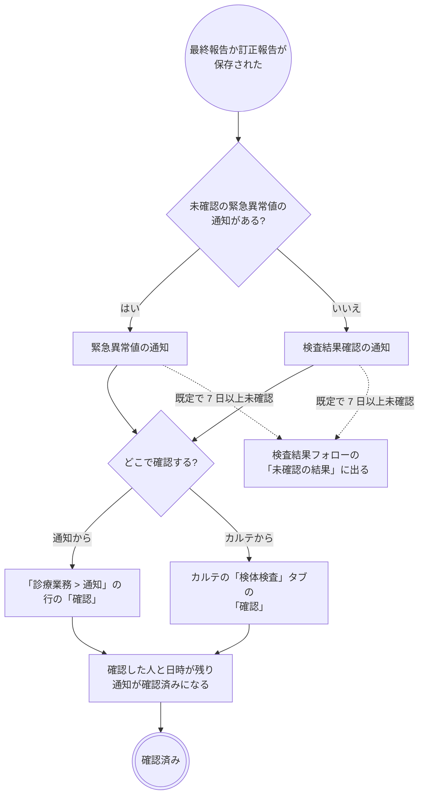

# 検体検査オーダーの業務フロー

<!-- ../fhir-client/docs/order-flows/lab.md から scripts/sync-flows.mjs で作る。直接編集しない。 -->

検体検査オーダーの登録から採取・到着・結果報告・結果確認までの流れです。
細菌検査・病理検査は状態の考え方が同じですが、容器・採取の記録・レポートが違うので別の文書で扱います。

医師 採血室・病棟 検査室

このページで使う呼び名です。

- **管(採取管)**: 検体を入れる容器 1 本です。ラベルは管 1 本に 1 枚刷り、到着も管ごとに記録します。
- **依頼医**: オーダーを指示した医師です(画面では「依頼医師」「指示医師」)。結果の通知の宛先になります。
- **状態**: 採血室・検査室の作業がどこまで進んだかを示します(依頼済・受付済・実施済・中止)。検体検査一覧の「ステータス」の列に出ます。
- **パニック値**: 結果項目ごとに決めた、すぐに知らせるべき危険な値の範囲です。外れると判定が HH / LL になり、依頼医に「緊急異常値」の通知が届きます。

## 区分ごとの違い

| 検体検査 | ラベル発行 | 到着確認 | 結果の登録 | 医事会計への送信 |
|---|---|---|---|---|
| 入院 | 病棟ごとに一括で発行する | する | する | 送らない |
| 外来 | 患者が来てから行で発行する | する | する | 送る |

- **入院のラベル**: 前日か当日の朝に、病棟ごとに「ラベル一括発行」でまとめて刷ります。検体検査一覧の行から 1 件ずつ刷ることもできます。
- **外来のラベル**: 患者が採血室に来てから、検体検査一覧の行の「ラベル発行」で刷ります。
- **医事会計への送信**: 外来だけです。検査日のオーダーから送り、血液の検体があれば採血料を 1 回足します。
- **検査日**: 検体検査オーダーは検査日(検体を採る日)を持ち、時刻は持ちません。予約枠は使いません。日付未定にはできません。

## 全体の流れ

- **ラベル発行**: 入院はラベルを前にまとめて刷り、外来は患者が来てから刷ります。どちらも発行で受付済になります。
- **採取**: 採取そのものは記録しません。誰がいつ採ったかは残りません。採取を記録するのは細菌検査と病理検査です。
- **看護ワークシート**: 採取の印は、ラベルを刷ると「ラベル済」、管が全部届くと「到着済」になります。
- **到着の前の結果**: 到着を待たずに、カルテの「検体検査」タブから結果を登録することもできます。
- **報告区分**: 中間報告は何度でも出し直せます。最終報告にすると、依頼医に通知が届きます。確定した結果を直すと訂正報告になり、通知は未確認に戻ります。
- **パニック値**: 報告区分に関わらず、緊急異常値の通知が届きます。中間報告のうちに確認しても、結果の確認は済みません(「結果の確認」)。
- **結果の入れ方**: 手入力のほか、分析装置・外注のファイルを取り込めます(「結果取込の流れ」)。

## 検体検査の状態

採血室・検査室の進み具合を示す状態です。結果の登録では変わりません。

| 状態 | 変わるきっかけ | 検体検査一覧の行のメニューからできること |
|---|---|---|
| 依頼済 | 医師の登録、受付済からの「取消」、「中止取消」 | 「受付」、「中止」 |
| 受付済 | 「ラベル発行」(行・一括)、「受付」、実施済からの「取消」、到着の取消 | 「実施」、「取消」、「中止」 |
| 実施済 | 到着確認でオーダーの全部の管が揃う、「実施」 | 「取消」 |
| 中止 | 「中止」 | 「中止取消」 |

- **行に直接出るボタン**: 「ラベル発行」(依頼済・受付済の行)、「結果登録」(実施済の行)、「表示」です。
- **「受付」**: ラベルを刷れない環境のための代わりの操作です。ふだんは「ラベル発行」が受付を兼ねます。
- **「実施」**: スキャナが使えないときの代わりの操作です。管ごとの到着は記録されません。
- **一覧の「取消」**: 押し間違いを直すために、1 つ前の状態へ戻します(実施済 → 受付済、受付済 → 依頼済)。管の到着の記録は消えません。
- **「中止」**: 検査を取りやめます。「中止取消」で依頼済に戻ります。

管 1 本ごとにも状態があり、未発行 → 発行済 → 到着済と進みます。検体検査一覧の検査内容の欄に出ます。
オーダーの状態は作業がどこまで進んだかを、管の状態は現物がどこにあるかを示します。ラベルを刷り直しても、管の状態は変わりません。

## 登録の判定

| 項目 | 条件 |
|---|---|
| 検査項目 | 1 つ以上 |
| 検査日 | 必須(オーダーセット・クリニカルパスの内容として作るときは不要) |

- **警告**: 処方・注射で出る重複・回数・施設の規則の警告は、検体検査では出ません。外部の判断支援への問い合わせもありません。
- **検査項目の選び方**: 検査伝票(レイアウト)のタブか「検査項目検索」から選びます。「肝機能セット」のような項目のまとまりも、ほかの項目と同じくここから選びます。オーダーセットは、カルテの右ペインの「セット」から出します。
- **パネル**: パネルを選ぶと、その構成項目も一緒に入ります。構成項目を外すと、その項目だけを除いてオーダーできます。
- **承認待ち**: 承認待ちのあいだも、オーダーは検体検査一覧に出ます。承認は通知の一覧か、カルテの詳細から行います。
- **セット・パス・レジメン**: オーダーセット・クリニカルパス・レジメンから出した検体検査も、ここと同じ判定で登録されます。

## 到着確認の流れ

画面は「部門業務 > 臨床検査部門 > 検体到着確認」です。管のラベルを 1 本ずつ読みます。

到着を記録しないラベルと、画面に出る文言です。

| 読んだラベル | 画面の文言 |
|---|---|
| 番号の形式が違う(11 桁でない、末尾の 1 桁が合わない) | 「番号の形式が正しくありません(読み取りエラーの可能性)」 |
| 発行していない番号 | 「この番号の発行記録がありません」 |
| 病理検査のラベル | 「病理検査の検体です(病理の受付で読んでください)」 |
| 細菌検査の取り下げたラベル | 「取り下げたラベルです(刷り直したラベルを読んでください)」 |
| 通信が切れた | 「到着を記録できませんでした(通信エラー)。もう一度スキャンしてください」 |

到着は記録したうえで、注意を添えるラベルです。

| 読んだラベル | 画面の注意 |
|---|---|
| 中止したオーダーの管 | 「このオーダーは中止されています」 |
| 訂正で外れた検体の管 | 「オーダーにこの検体はありません(訂正で外れた可能性)」 |
| 削除したオーダーの管 | 「オーダーが見つかりません(削除された可能性)」 |

- **番号**: ラベルの番号は 11 桁で、末尾の 1 桁は読み間違いを見つけるための検査用の数字です。手で打ち込むこともできます。
- **並び**: 読んだ順に上から積みます。貼り間違いに気付けるよう、患者氏名と検体を必ず出します。
- **実施済になるとき**: オーダーが受付済で、全部の管が届いたときです。もう記録した管を読み直したときも、揃っていれば実施済に進みます。
- **中止したオーダーの管**: 現物が届いた事実を残すため、到着は記録します。要らなければ、行の「取消」で消します。
- **到着の取消**: 行の「取消」は、その管の到着を消します。実施済まで進んでいたオーダーは受付済に戻ります。検体検査一覧の「取消」とは別の操作です。
- **細菌検査**: 細菌検査の容器も同じ画面で読みます。細菌検査は、容器が揃うと実施済ではなく受付済になります。

## 結果の登録と報告

結果を入れる場所は 3 つあります。

| 入れる場所 | 入れる人 | 対象のオーダー |
|---|---|---|
| 検体検査一覧の「結果登録」 | 検査室 | 実施済の行で、結果がまだ無いオーダー。オーダーは行で決まる |
| カルテの「検査結果」>「検体検査」タブの「新規登録」「DO」「編集」 | 医師・検査室 | オーダーを選んで紐付けるか、紐付けずに登録する |
| 「検査結果取込」 | 検査室 | →「結果取込の流れ」 |

**判定と報告区分**

- 基準値で H / L、パニック値で HH / LL を自動で付けます。
- 中間報告では、検査結果確認の通知は出ません。緊急異常値の通知は出ます。
- 確定した結果を直して保存すると、訂正報告になります。確認済みの通知は未確認に戻ります。

**緊急異常値と検査結果確認**

- 同じ結果に、2 つの通知を並べて出しません。未確認の緊急異常値の通知があるあいだは、検査結果確認の通知を出しません。
- 訂正で値が直ってパニック値でなくなると、緊急異常値の通知は取り下げられます。訂正でまたパニック値になると、同じ通知が未確認に戻ります。

**入れる場所ごとの違い**

- 検体検査一覧の「結果登録」は、オーダーの検査項目が並んだ状態で開きます。結果が付いたオーダーでは押せません。確定・訂正はカルテから行います。
- カルテでオーダーに紐付けずに登録すると、依頼医が決まらないので、通知の宛先がありません。
- DO(前回の結果と同じ検査項目で、新しく登録する)は、カルテの「検体検査」タブで選んだ結果から始めます。

**記録されること**

- 実施施設は自院、実施者はログインした人が入ります。編集しても、最初の実施者が残ります。
- 報告日時は、保存のたびに更新されます。

**印刷**

- 結果の内容表示の「印刷」で、検査結果報告書を刷ります。1 件 1 枚で、材料は刷りません。

## 結果取込の流れ

検査室の分析装置・外注ラボから受け取った結果のファイルを読み込み、手入力と同じ形で結果を登録します。画面は「部門業務 > 臨床検査部門 > 検査結果取込」です。

**読み込み**

- ファイルの文字コードは自動で判定します。外れるときは、取込の画面で文字コードを指定できます。
- 結果項目は、ファイルの検査項目コード(JLAC)で結果項目マスタから引き当てます。

**保留の行**

- 結果項目が決まらない行と、値が選択肢に無い行は保留になります。詳細画面で結果項目と値を選びます。
- 結果項目を選ぶとき、その JLAC を結果項目マスタに書き込めます。次からは自動で当たります。

**患者とオーダー**

- ファイル 1 件の中の検査ごとに、結果 1 件の候補ができます。
- ラベル番号の管の患者がファイルの患者と違うときは、番号を使わず、患者番号で照合し直します。
- 採取日のオーダーが無ければ、オーダーに紐付けずに登録します。複数あれば画面で選びます。

**登録**

- 読み込んだだけでは、結果は登録されません。人が確かめて、登録を押します。
- 登録は手入力と同じなので、パニック値の通知・検査結果確認の通知・報告区分の扱いも同じです。
- H / L は施設の基準値で付け直します。基準値の無い項目だけ、ファイルの判定を写します。
- 中間報告か最終報告かは、ファイルに書かれた報告区分で決まります。
- 前に読み込んだファイルと同じ識別番号(メッセージ ID)のファイルは、詳細画面で知らせます。訂正版が同じ番号で届くことがあるので、読み込みは止めません。
- 結果のあるオーダーへの登録は追記になるので、同じ結果が 2 件にはなりません。

## 結果の確認

最終報告か訂正報告が保存されると、依頼医に通知が届きます。医師が結果を読んで「確認」を押すと、確認した人と日時が残ります。

**誰が確認するか**

- 宛先は依頼医ですが、確認は誰でもできます(当直医・主治医が先に読むことがあるため)。記録には確認した本人が残ります。

**確認した場所ごとに残ること**

- **緊急異常値の通知で確認したとき**: 通知が確認済みになります。最終報告・訂正報告なら、結果の確認も同時に残ります。
- **中間報告のうちに緊急異常値を確認したとき**: 結果の確認は残りません。最終報告にしたときに、検査結果確認の通知が改めて届きます。
- **カルテで確認したとき**: 結果の確認が残り、未確認の緊急異常値の通知も確認済みになります。

**確認できないとき**

- 中間報告のうちは、結果の確認はできません。訂正報告になると、未確認に戻ります。
- 検査結果フォローの「未確認の結果」の一覧からは確認できません。カルテで内容を見て確認します。

## 変更・中止・削除

| 操作 | できる場所 | できるとき |
|---|---|---|
| 変更 | カルテのカード | いつでも(結果があってもできる) |
| 中止 | 検体検査一覧の行のメニュー | 依頼済・受付済 |
| 中止取消 | 検体検査一覧の行のメニュー | 中止 |
| 一覧の「取消」 | 検体検査一覧の行のメニュー | 受付済・実施済 |
| 到着の取消 | 検体到着確認の行の「取消」 | 管の到着を記録したあと |
| 削除 | カルテのカード | 結果が無いとき |
| 結果の削除 | カルテの「検体検査」タブ | 結果があるとき |

- **変更**: 代行入力のときは、もう一度承認が要ることがあります。検査室への通知は出ず、検体検査一覧の内容が変わります。
- **検体を足す変更**: ラベルを刷った後に検体を足したら、新しい管のラベルを刷ります。
- **検体を外す変更**: 刷ったラベルの管は記録に残ります。到着確認で読むと「オーダーにこの検体はありません(訂正で外れた可能性)」と出ます。
- **中止**: 到着した管の記録はそのまま残ります。医事会計の対象から外れます。会計を送ったあとの中止は、医事課が送り直します。
- **中止取消**: 依頼済に戻ります。受付済・実施済には戻りません。
- **一覧の「取消」と到着の取消**: 一覧の「取消」は状態を 1 つ戻すだけで、管の到着は消えません。到着の取消は管の到着を消し、実施済のオーダーは受付済に戻ります。
- **削除**: 結果があるオーダーは、先に結果を削除します。オーダーを削除すると状態も消えますが、発行した管の記録は残ります。
- **結果の削除**: 結果と通知が消え、検体検査一覧の「結果登録」がまた押せるようになります。管の記録は残ります。

## 帳票

| 帳票 | 出す場所 | 内容 |
|---|---|---|
| 検体ラベル | 検体検査一覧の行の「ラベル発行」、「ラベル一括発行」 | 管 1 本に 1 枚 |
| 検査結果報告書 | カルテの「検体検査」タブの内容表示の「印刷」 | 結果 1 件に 1 枚(A4 縦・2 段) |

検体ラベルに刷る内容です。

- バーコード(番号)
- 患者番号・カナ・性別・生年月日
- 検体・採取管(色)
- 検査日・至急
- 検査項目の略称

検査結果報告書には、検査項目・結果値・判定・単位・基準値と、コメント・総合所見を刷ります。
