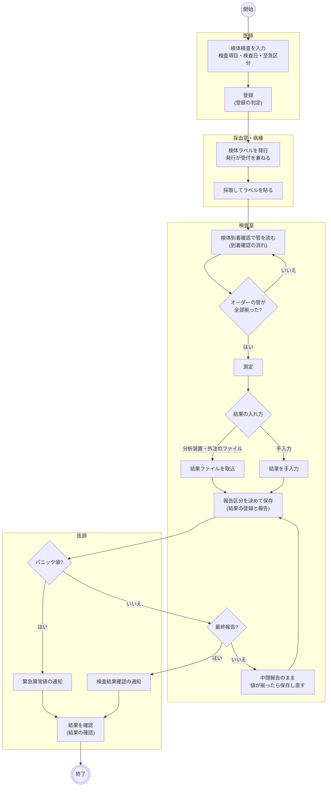
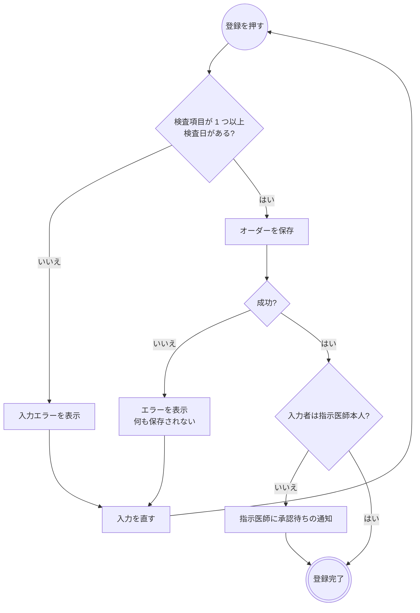
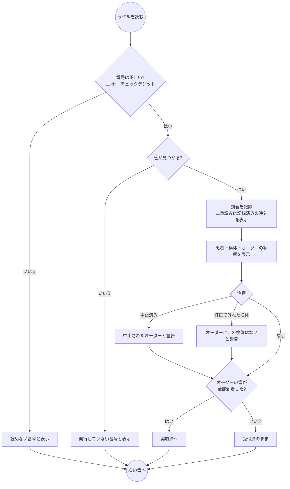
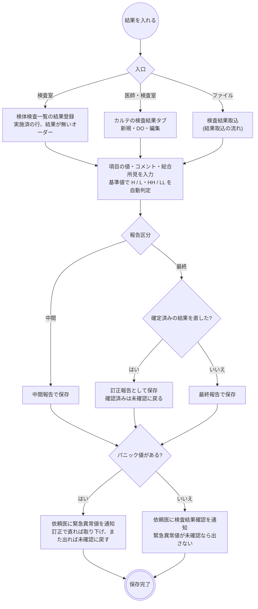
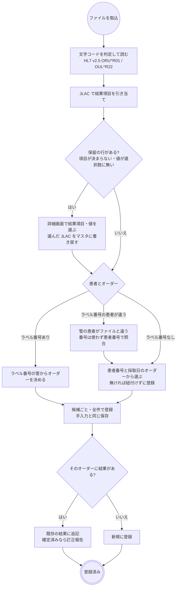
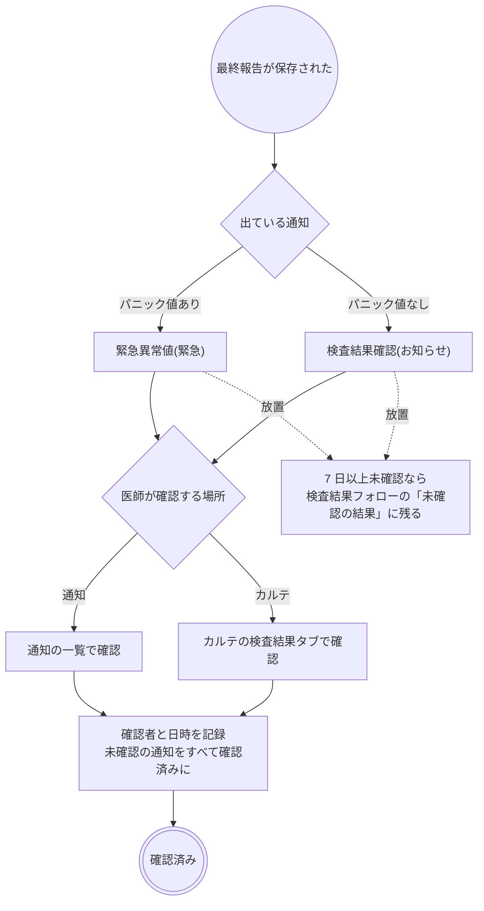

# 検体検査オーダーの業務フロー

<!-- ../fhir-client/docs/order-flows/lab.md から scripts/sync-flows.mjs で作る。直接編集しない。 -->

検体検査オーダーの登録から採取・到着・結果報告・結果確認までの流れです。
細菌検査・病理検査は進捗の考え方が同じですが、容器・採取の記録・レポートが違うので別の文書で扱います。

医師 採血室・病棟 検査室

## 区分ごとの違い

| 検体検査 | ラベル発行 | 到着確認 | 結果の登録 | 医事会計への送信 |
|---|---|---|---|---|
| 入院 | 病棟ごとに一括発行(前日・当日の朝)。行からも発行できる | あり | あり | なし(外来のみ) |
| 外来 | 患者が採血室に来てから行で発行 | あり | あり | 検査日のオーダーから。採血料は血液の検体があれば 1 回 |

検体検査オーダーは検査日(検体を採る日)を持ち、時刻は持ちません。予約枠は使いません。日付未定にはできません。

## 検体検査の状態

採血室・検査室の進み具合を示す状態です。結果の登録では変わりません。

| 状態 | 変わるきっかけ | 検体検査一覧のメニューからできること |
|---|---|---|
| 依頼済 | 医師の登録、取消、中止取消 | 受付(ラベルを刷れない環境の代替)、中止 |
| 受付済 | ラベル発行(行・一括)、到着確認の取消 | 実施(スキャナが使えないときの代替。管ごとの到着は残らない)、取消(依頼済へ)、中止 |
| 実施済 | 到着確認でオーダーの全部の管が揃う | 取消(受付済へ) |
| 中止 | 中止 | 中止取消(依頼済へ) |

管(採取管)1 本ごとに別の状態があります。**未発行 → 発行済 → 到着済**で、検体検査一覧の検査内容の欄に出ます。
オーダーの状態は部門の作業がどこまで進んだか、管の状態は現物がどこにあるかを指します(再発行しても管の状態は変わりません)。

## 全体の流れ

- 入院はラベルを前にまとめて刷り、外来は患者が来てから刷ります。どちらも発行で受付済になります。
- 採取そのものは記録しません(誰がいつ採ったかは残りません。細菌検査だけ採取の記録があります)。看護ワークシートの採取の印は、ラベルを刷れば「ラベル済」、検査室に届けば済になります。
- 到着確認は管ごとに行い、オーダーの管が全部揃うと実施済になります。到着を待たずに結果を登録することもできます(カルテの検査結果タブから)。
- 中間報告は何度でも出し直せます。最終報告にすると医師への通知が出ます。確定した結果を直すと訂正報告になり、通知が未確認に戻ります。
- パニック値は報告区分に関わらず通知します。中間報告のうちは通知を確認しても既読にはなりません。

## 登録の判定

- 薬剤と違い、重複・回数・施設の規則の警告は出ません。判断支援への問い合わせもありません。
- 検査項目は検査伝票(レイアウト)・セット・検索から選びます。パネル(セット項目)は 1 行で、構成項目はオーダーに展開して持ちます。
- 承認待ちでもオーダーは部門に流れます。承認は通知の一覧かカルテの詳細から行います。
- オーダーセット・クリニカルパス・レジメンからの適用も同じ保存を通ります。

## 到着確認の流れ

- 画面は**部門業務 > 臨床検査部門 > 検体到着確認**です。読んだ順に上から積み、患者氏名と検体を必ず出します(貼り間違いに気付くため)。
- 中止されたオーダーの管も到着は記録します(現物が届いた事実を残すため)。要らなければ行の「取消」で消します。
- 「取消」は管の到着を消し、実施済まで進んでいたオーダーは受付済へ戻します。
- 細菌検査の容器も同じ画面で読みます(揃ったときの進捗は受付済)。

## 結果の登録と報告

- 検体検査一覧の「結果登録」はオーダーが行で決まっているので、検査項目を結果項目に展開した状態で開きます。結果が付いたオーダーは押せません(確定・訂正はカルテから)。
- カルテからはオーダーを選んで紐付けるか、紐付けずに登録できます。紐付けないと通知の宛先(依頼医)が決まりません。
- 実施施設は自院、実施者はログインユーザーが入ります。編集しても最初の実施者が残ります。報告日時は保存のたびに更新されます。
- 結果の印刷(検査結果報告書)は内容表示の「印刷」から。1 件 1 枚で、材料は刷りません。

## 結果取込の流れ

- 画面は**部門業務 > 臨床検査部門 > 検査結果取込**。取込は台帳に載せるまでで、上流への登録は人が確認して押します。
- H/L は施設の基準値で付け直します。基準値の無い項目だけファイルの異常フラグを写します。
- 報告区分はファイルの値(OBR-25)から決めます(`P` は中間、`F` / `C` は最終)。
- 同じメッセージ ID のファイルは知らせますが止めません。二重登録は「結果があるオーダーは追記になる」ことで防ぎます。

## 結果の確認

- 宛先は依頼医ですが、確認は誰でもできます(当直医・主治医が先に読む)。記録には確認した本人が残ります。
- 緊急異常値と検査結果確認は同じ結果に 2 件出しません。緊急異常値を確認すれば最終報告なら既読も残り、カルテで確認すれば緊急異常値も確認済みになります。
- 中間報告のうちは確認できません。訂正報告になると未確認に戻ります。
- 確認は通知の一覧からもカルテからもできますが、「未確認の結果」の一覧からはできません(カルテで内容を見て確認します)。

## 変更・中止・削除

| 操作 | できる場所 | できないとき・注意 |
|---|---|---|
| 変更 | カルテのカード | 結果が付いていても止まりません。ラベル発行後に検体を足したら、新しい管のラベルを刷り直します |
| 中止 | 検体検査一覧のメニュー | 到着した管はそのまま残ります。医事会計の対象から外れ、SS-MIX2 に取消が出ます |
| 中止取消 | 検体検査一覧のメニュー | 依頼済に戻ります(受付済・実施済には戻りません) |
| 取消 | 検体検査一覧のメニュー | 1 つ前の状態へ戻す訂正。管の到着記録は消えません |
| 削除 | カルテのカード | 結果が付いているとできません(結果を削除してから)。進捗は一緒に消え、発行済みの管の記録は残ります |
| 結果の削除 | カルテの検査結果タブ | 結果と通知が消え、一覧の「結果登録」が押せるようになります。管の記録は残ります |

- 変更は再度の承認を要する場合があります(代行入力のとき)。部門への通知はなく、一覧の内容で見えます。
- 検体を外す変更をしても、刷ってしまったラベルの管は記録に残ります。到着確認で読むと「オーダーにこの検体はありません」と警告します。

## 帳票

| 帳票 | 出す場所 | 内容 |
|---|---|---|
| 検体ラベル | 検体検査一覧の行、ラベル一括発行 | 管 1 本 1 枚。バーコード(番号)・患者番号・カナ・性別・生年月日・検体・採取管(色)・検査日・至急・項目の略称 |
| 検査結果報告書 | カルテの検査結果の内容表示 | 1 件 1 枚(A4 縦・2 段)。項目・結果値・判定・単位・基準値、コメント、総合所見 |
