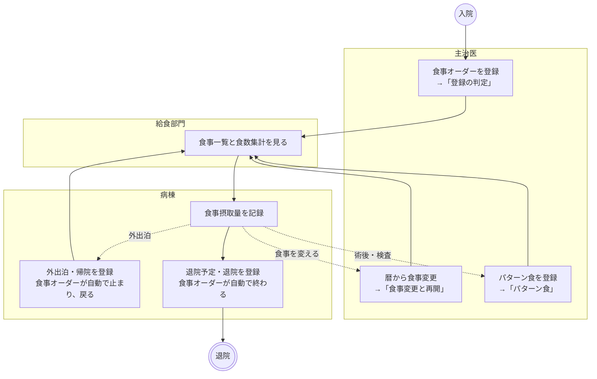
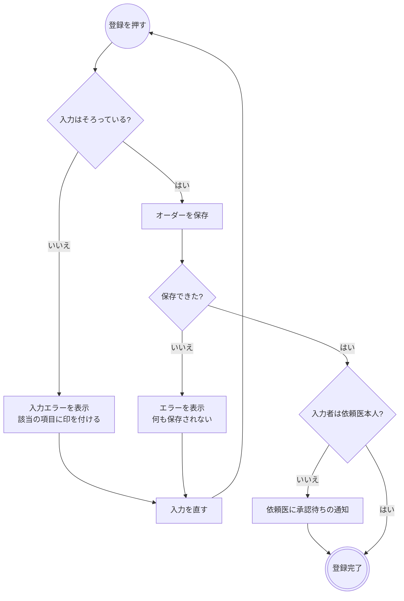
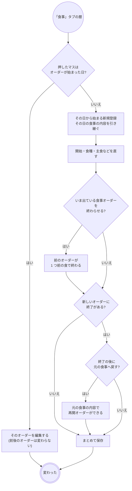
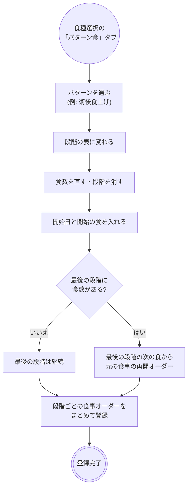
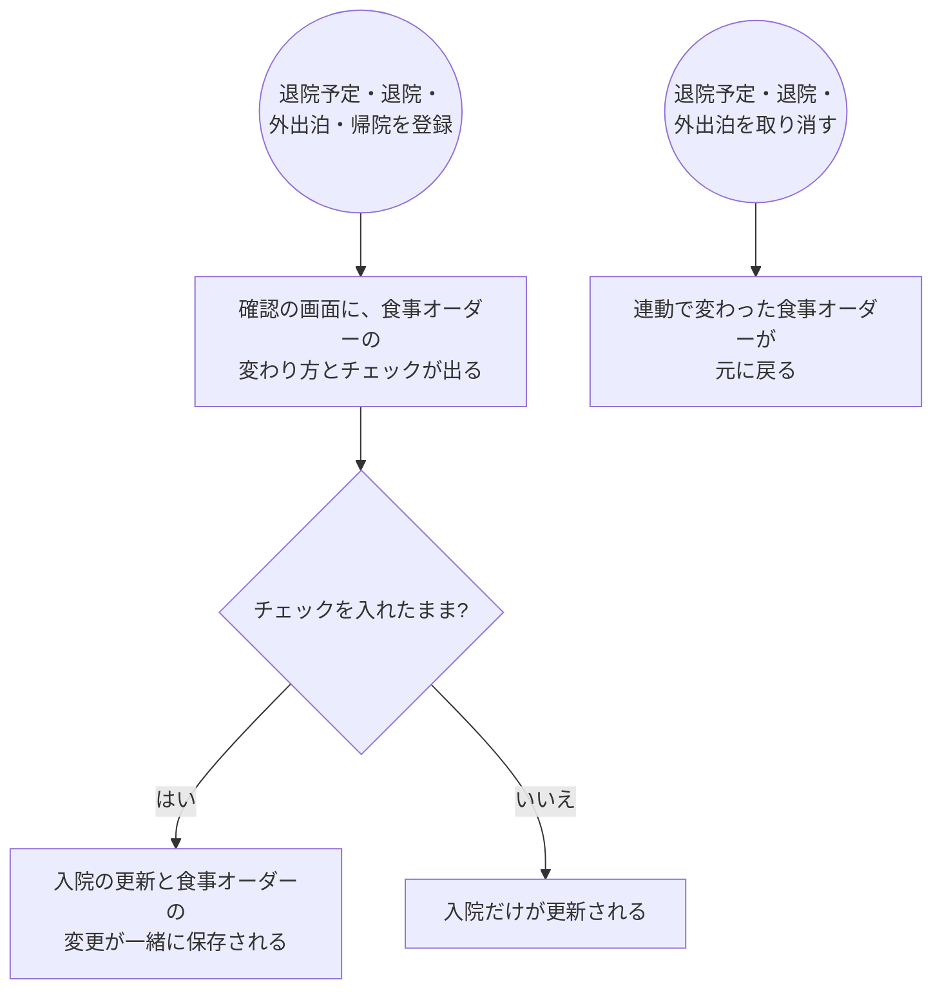
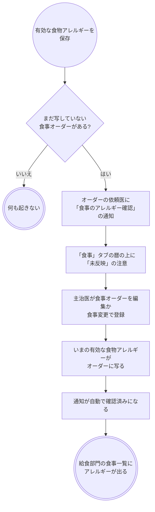
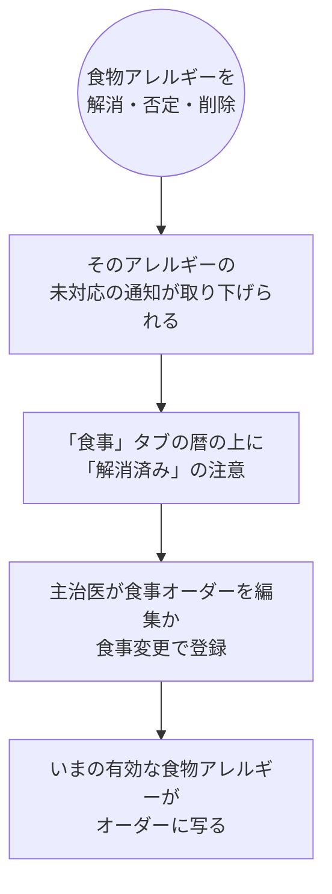
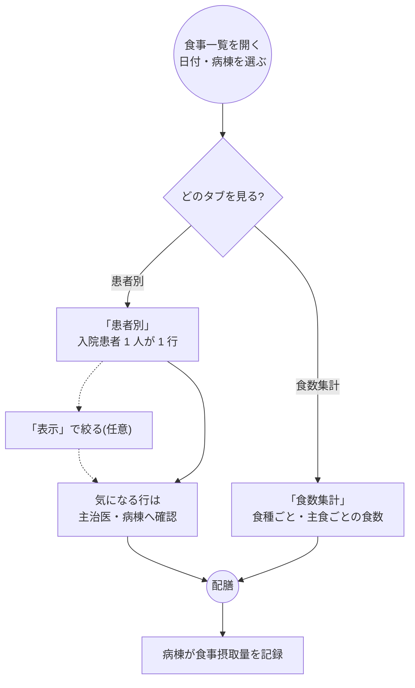

# 食事オーダーの業務フロー

<!-- ../fhir-client/docs/order-flows/meal.md から scripts/sync-flows.mjs で作る。直接編集しない。 -->

入院患者の食事オーダーを、入院時の開始から食事変更・パターン食・外出泊・退院までの流れと、給食部門の食事一覧・病棟の摂取量の記録まで追います。
食事オーダーは**始まった食から次の指示まで続く**オーダーで、同時に出ているのは 1 本だけが正しい状態です。食事を変えるときは、新しいオーダーを出して、前のオーダーを新しいオーダーが始まる 1 つ前の食で終わらせます。
部門の受付・実施・予約はありません。給食部門はその日の一覧と食数を見るだけで、オーダーの状態は動かしません。

主治医 給食部門 病棟

## 全体の流れ

この文書で使う呼び名は次のとおりです。

| 呼び名 | 指すもの |
|---|---|
| 食(1 食) | 朝食・昼食・夕食のどれか 1 回。オーダーの開始と終了は、日付と朝・昼・夕で決める |
| 食事オーダー | 始まった食から終わりの食まで続く、食事の指示 1 本 |
| いま出ている食事オーダー | その食を出しているオーダー |
| 欠食 | 朝・昼・夕のうち一部の食を出さないこと。主食の欄で選ぶ |
| 食止め | 3 食とも出さないこと。食種で「食止め」を選ぶ |
| 暦 | カルテの「食事」タブに出るカレンダー。1 日が 1 マス |
| カード | カルテに出る、そのオーダーのカード |
| 連動 | 入退院・外出泊の操作に合わせて、食事オーダーが自動で止まり、戻ること |
| 給食部門 | 食事を用意する部門。画面のメニューでは「栄養部門」の下にある |

- **入口**: カルテの右ペイン(右側のオーダー入力)の「食事」と、カルテの「食事」タブの暦です。入院中でない患者には登録できません。
- **部門の画面**: 「部門業務 > 栄養部門 > 食事一覧」です。
- **カード**: オーダーが始まった日のカルテに 1 枚出ます。見出しは「9/1 朝〜 継続中」のような期間で、食種・主食・副食形態・塩分制限・食物アレルギーが出ます。
- **続いている日**: 続いている日のカルテには何も出ません。その日に何を食べているかは「食事」タブの暦で見ます。
- **暦の 1 マス**: その日の朝・昼・夕を出しているオーダーが並びます。1 日の途中で食事が変わった日だけ、2 つ以上並びます。
- **オーダーセット・クリニカルパス**: 食事オーダーはオーダーセットに入れられます。クリニカルパスでは、タスク分類「食事」から出せます。

## オーダーの種別と暦の印

食事オーダーには、依頼済・実施済のような状態がありません。登録から削除まで「有効」のままです。終了を決めても「有効」のままで、終わりの食を過ぎると暦と食事一覧に出なくなります。
代わりに、どういうきっかけで出たオーダーかを種別として持ち、暦のマスの印とカードに出します。

| 種別 | 出るきっかけ | 暦の印 |
|---|---|---|
| 開始 | いま出ている食事オーダーが無いときの登録(入院時など) | 開始 |
| 変更 | いま出ている食事オーダーを終わらせての登録 | 変更 |
| | パターン食の 2 段階目以降 | 変更 |
| 再開 | 期限付きのオーダーの後に、元の食事へ戻すオーダー | 再開 |
| 外泊食止め | 外出泊の登録で自動で出る食止め | 外泊食止め |

- **期限付きのオーダー**: 外泊中の食止めや検査前の絶食のように、終了を決めて出すオーダーです。
- **終わり方の理由**: 退院予定・退院で終わったオーダーは、最後の日のマスに「退院食止め」の印が付きます。カードの期間は「9/2 昼まで(退院食止め)」と出ます。「退院食止め」はオーダーの種別ではなく、終わり方の理由です。
- **手で入れた終了**: オーダーの編集で手で入れた終了には、理由が付きません。

## 登録の判定

食事オーダーのフォームは、入院中の患者にだけ出ます。入院中でない患者では「食事オーダーは入院中の患者にだけ登録できます。」と出ます。

依頼医は、オーダーを指示した医師です。登録のときに確かめる項目は次のとおりです。

| 項目 | 条件 |
|---|---|
| 食種 | 必須 |
| 主食 | 3 食すべてを欠食にはできない(食止めの食種を除く) |
| 塩分制限 | 空か、0 以上の数値 |
| 開始日 | 必須(オーダーセット・クリニカルパスの内容として作るときは不要) |
| 終了 | 空か、開始と同じか後 |

**食種と主食**

- 食種は「食種選択」の表から選びます。表には主成分量(熱量・蛋白質など)と適応が並びます。
- 表の上に、患者の身長・体重・BMI と、熱量・蛋白質の目安(標準体重 × 係数)が出ます。選んだ食種が目安を外れると「目安未満」「目安超」の印が付きます。
- 主食は朝・昼・夕の 3 行で選び、末尾の選択肢が「欠食」です。3 食とも出さないときは、欠食ではなく食種で「食止め」を選びます。
- 食止めの食種を選ぶと、主食・副食形態・塩分制限は入力できなくなり、保存もされません。

**欠食理由**

- 食止めのときと、1 食でも欠食があるときだけ欄が出ます。
- 選択肢は、絶食(NPO)・手術絶食・検査絶食・外泊・退院・その他です。
- 給食部門の食事一覧と暦に出ます。

**期間**

- 開始と終了は、日付と朝・昼・夕で選びます。終了が空なら、次の指示まで続きます。
- いま出ている食事オーダーがあるときは、それを終わらせるチェックがフォームに出ます(「食事変更と再開」)。

**食物アレルギー**

- 食物アレルギーはフォームで選びません。保存した時点の、患者の有効な食物アレルギーが全件オーダーに写ります。食止めにも写ります。

**そのほか**

- 施設が食事オーダーに出すと決めた警告があれば、フォームの上に出ます。登録は止まりません。警告は「管理 > 警告の集計と設定」で決めます。
- 承認待ちのあいだも、食事は給食部門の食事一覧に出ます。

## 食事変更と再開

フォームの「いま出ている食事」の欄に、チェックが 2 つ出ます。どちらも初めからチェックが入っています。

| チェック | 出るとき | 入れたままにすると |
|---|---|---|
| 前のオーダーを終了する | いま出ている食事オーダーがあるとき | 前のオーダーが、新しいオーダーの 1 つ前の食で終わる |
| 終了後、この食事に戻す | 新しいオーダーに終了があるとき | 終了の次の食から、元の食事の再開オーダーができる |

前のオーダーが終わる食は、新しいオーダーが始まる食で決まります。

| 新しいオーダーが始まる食 | 前のオーダーが終わる食 |
|---|---|
| 朝 | 前日の夕 |
| 昼 | 同じ日の朝 |
| 夕 | 同じ日の昼 |

再開オーダーが始まる食は、新しいオーダーが終わる食で決まります。

| 新しいオーダーが終わる食 | 再開オーダーが始まる食 |
|---|---|
| 朝 | 同じ日の昼 |
| 昼 | 同じ日の夕 |
| 夕 | 翌日の朝 |

例: 8/1 朝から一般食が続いていて、8/10 朝〜8/11 夕の食止めを出すと、一般食は 8/9 夕で終わり、8/12 朝から一般食の再開オーダーができます。再開しないと、8/12 以降の食事が無くなります。

- **直せるマス**: オーダーは、自分が始まった日のマスからだけ直せます。続いている途中の日を押すと「その日から変える」新規登録になるので、過去の食事がさかのぼって変わることはありません。
- **再開オーダー**: 元のオーダーの続きではなく、別のオーダーです。元のオーダーが継続なら再開も継続になり、元に終了があればそれを引き継ぎます。
- **右ペインからの登録**: カルテの右ペインの「食事」から新規に登録しても、いま出ている食事オーダーがあれば同じチェックが出ます。
- **オーダーセット**: オーダーセットから出した食事オーダーは、前のオーダーを終わらせません。適用の後に、「食事」タブで重なりを直します。
- **クリニカルパス**: パスから出した食事オーダーも、いま出ている食事オーダーを終わらせません。パスが続く病日に出す食事オーダーは、次の食事オーダーの 1 つ前の食で終わります。

## パターン食

術後の食上げや検査食のように、段階を追って変わる食事をまとめて登録します。

- **段階の表**: 段階ごとの食種・食数・期間が並びます。登録のときに直せるのは食数と段階の削除で、食種と主食はマスタで直します。
- **段階の長さ**: 日数ではなく食数で数えます。昼から始めても「3 食」は昼・夕・翌朝です。
- **最後の段階**: 最後の段階だけ食数を空にでき、そのときは次の指示まで続きます。途中の段階は空にできません。
- **いま出ている食事オーダー**: 最初の段階の 1 つ前の食で終わります。
- **登録の後**: 段階ごとに別々の食事オーダーになります。暦とカードに「術後食上げ 2/5」のように出ます。パターン単位でまとめて直す・消す操作はないので、1 段階ずつ暦から直します。
- **パターンの用意**: パターンは施設がマスタで作ります。はじめから「術後食上げ」「大腸検査食」が入っています。

## 入退院・外出泊との連動

入院患者一覧・病棟マップで退院予定・退院・外出泊・帰院を登録すると、食事オーダーも一緒に変わります。

| 操作 | 確認の画面のチェック | 食事オーダーに起きること |
|---|---|---|
| 退院予定の登録・変更 | 「食事オーダーを … 食までで止める(退院食止め)」 | 予定時刻までに出る最後の食で終わる |
| 退院 | 「食事オーダーを … 食までで終了する」 | 退院時刻までに出る最後の食で終わる |
| 外出泊の登録 | 「食事オーダーを外出泊に合わせる」 | 出発までの最後の食で終わり、外泊食止めが出る |
| 帰院 | 「食事を … 食から元に戻す」 | 帰院後の最初の食から再開する |
| 各取消 | なし(確認の文に、食事オーダーも元に戻ると出る) | 連動で付いた終了が元に戻る |

チェックの「…」には、日付と朝・昼・夕が入ります。

**どの食まで・どの食から**

- 手では選びません。施設設定の「食事の提供時刻」(既定は 08:00 / 12:00 / 18:00)と、退院・出発・帰院の時刻から決まります。
- 例: 11:00 に退院なら朝食まで、14:00 に帰院なら夕食からです。

**退院予定・退院**

- 退院では食事オーダーが終わるだけで、新しいオーダーは出ません。
- 退院予定で終わらせた後に予定の日時を変えると、退院予定を登録する前の終了に戻してから、新しい日時で終わらせ直します。
- 退院予定のまま退院した後で取り消しても、戻る先は退院予定を登録する前の終了です。
- 退院の画面では、食事のほかにリハビリ・栄養指導・服薬指導・看護指示も同じ操作で止められます。

**外出泊・帰院**

- 外出泊を登録すると、帰院までのあいだは外泊食止めのオーダーが出ます。帰院の日時が決まっていれば、再開オーダーも一緒にできます。
- 帰院を登録すると、外泊食止めが帰院の 1 つ前の食で終わり、帰院後の最初の食から再開します。
- 帰院が早くて 1 食も抜けないときは、外泊食止めのオーダーは消えます。
- 外泊食止めには、食種マスタの「食止め」を使います。食止めの食種がマスタに無い施設では、食止めオーダーだけが出ず、終了と再開は行われます。
- 外出泊の期間を後から直す操作はありません。外出泊を取り消して登録し直すと、食事オーダーもいったん元に戻ってから、新しい期間で変わります。

**取消**

- 取消で元に戻るのは、連動で付いた終了だけです。外出泊で出た食止めと再開オーダーは消えます。
- 連動で付いた終了を、オーダーの編集で手で変えると、取消をしても元に戻らなくなります。

**連動しない操作**

- 入院取消(誤登録の取り消し)・転床・転科転棟では、食事オーダーは変わりません。
- 転棟した後、給食部門の食事一覧には新しい病棟で出ます。

## 食物アレルギー

食事オーダーには、保存した時点の有効な食物アレルギーが写ります。後からアレルギーが変わったときは、次のように知らせます。

新しく有効な食物アレルギーを保存したときです。

食物アレルギーを解消・否定・削除したときです。

- **見るオーダー**: 通知の対象は、今日の朝以降も食事を出す食事オーダーです。
- **通知の強さ**: アレルギーの重篤化リスクが「高」のときは、通知がアラートになります。
- **通知の数**: オーダー 1 件とアレルギー 1 件の組ごとに 1 通です。同じ組の未対応の通知があれば、新しくは作りません。
- **手で閉じる**: 通知は、通知一覧の「確認」で手で閉じることもできます。
- **確かめる内容**: 確かめるのは、「未反映」(有効なのにオーダーに写っていない)と「解消済み」(写っているのに有効でなくなった)の 2 つだけです。食種の中身(卵を使うかなど)とは突き合わせません。
- **除去の内容**: 何を除くかは、オーダーのコメントに書きます。

## 給食部門の食事一覧と病棟の摂取量

**「患者別」のタブ**

- 列は、病棟・病室・患者・朝・昼・夕・副食形態・塩分・アレルギー・欠食理由・コメントです。
- その日に在院した入院患者が 1 人 1 行で出ます。入院中で食事オーダーの無い患者は、「—」(オーダーなし)として出ます。
- 退院済みの患者は、終了の無い食事オーダーが残っていても出ません。
- 病棟は、いまのベッドの病棟です。食事オーダーを登録した後に転棟しても、新しい病棟で出ます。
- その食から食事が変わった欄には「変更」の印が付きます。
- 「表示」で「変更あり」「オーダーなし」に絞れます。
- 患者名を押すと、その患者の「食事」タブが開きます。

**「食数集計」のタブ**

- 食種ごと・主食ごとに、朝・昼・夕と計の食数が出ます。欠食とオーダーなしの数も出ます。

**病棟の食事摂取量**

- 経過表か一括入力で、主食と副食をそれぞれ 0〜10 割で記録します。
- 摂取量は、その食を出している食事オーダーの記録として残ります。カルテのカードには出ません。
- オーダーの無い食・食止め・欠食の食には、記録の枠が出ません。

**まだ無いもの**

- 配膳の進み具合の記録、はい膳表・食札の印刷、栄養量の合計は、まだありません。

## 変更・削除

| 操作 | できる場所 |
|---|---|
| 変更 | 暦の、オーダーが始まった日のマス。または、カードのメニューの編集 |
| 食事を変える | 暦の、続いている途中の日のマス(「食事変更と再開」) |
| 終わらせる | オーダーの編集で終了を入れる |
| 削除 | カードのメニュー |

- **変更**: 変わるのはそのオーダーだけで、前後のオーダーの開始・終了は変わりません。
- **終わらせる**: 食事オーダーに中止はありません。終わらせるときは終了を入れます。
- **削除できないとき**: 摂取量の記録が付いたオーダーは消せません。先に摂取量の記録を消します。
- **食事変更を取り消すとき**: 新しいオーダーを削除しても、前のオーダーの終了は元に戻りません。前のオーダーを編集して、終了を外します。
- **DO(前回と同じ内容で出し直す)**: カードに DO はありません。暦の続いている途中の日を押すと、その日の食事の内容を引き継いだ登録が開きます。終了は引き継ぎません。

## 他のオーダーとの違い

| | 検査・処置・リハビリ | 食事 |
|---|---|---|
| オーダーの単位 | 検査 1 回 / 期間(日) | 期間(始まりの食〜終わりの食) |
| 時刻の刻み | 日時・日 | 日付と朝・昼・夕 |
| 入外区分・至急 | 選ぶ | 無い(入院中の患者だけに出す) |
| 部門の受付・実施 | ある | 無い(給食部門は一覧と食数を見る) |
| 変える | オーダーの編集 | 新しいオーダーを出す(食事変更) |
| 入退院との関係 | 退院で打ち切る(リハビリ・栄養指導) | 退院・外出泊で自動で止まり、戻る |
| 実施の記録 | 部門の実施記録 | 病棟の食事摂取量 |
| 医事会計 | 実施記録から送る | 送らない |

食事オーダーで入力する項目は次のとおりです。

- 食種
- 主食(朝・昼・夕ごと。欠食もここで選ぶ)
- 副食形態・塩分制限
- 欠食理由
- 開始・終了
- 対象プロブレム・コメント

施設がマスタで用意するのは、食種(食止めを含む)・主食・副食形態・食種の種別・パターン食です。

## 帳票

専用の帳票はありません。はい膳表・食札は、まだ印刷できません。
