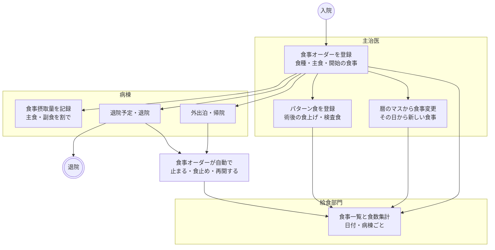
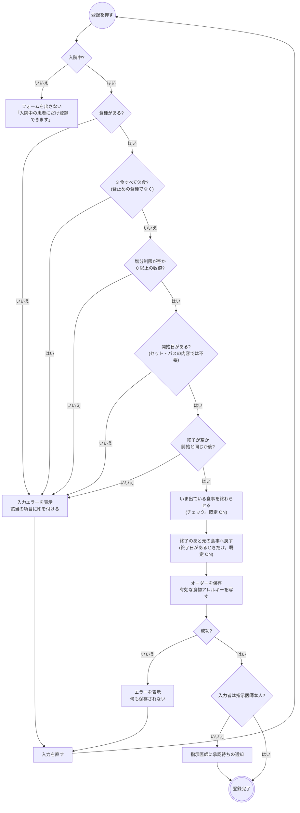
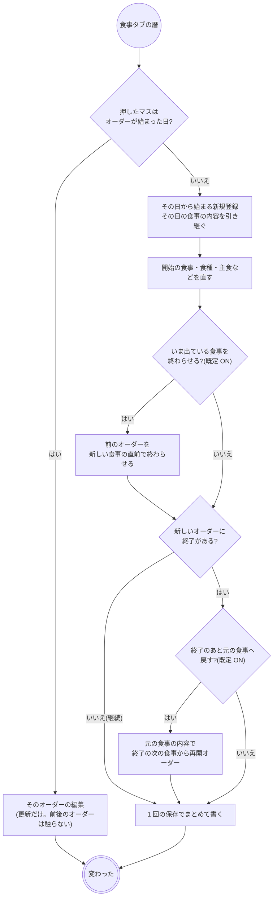
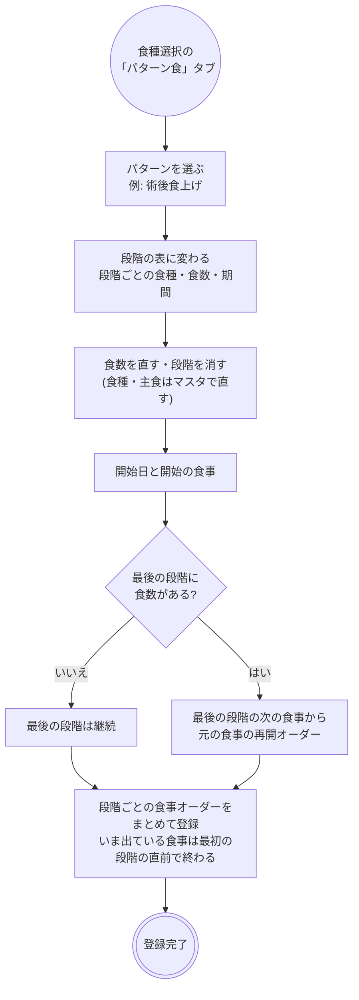
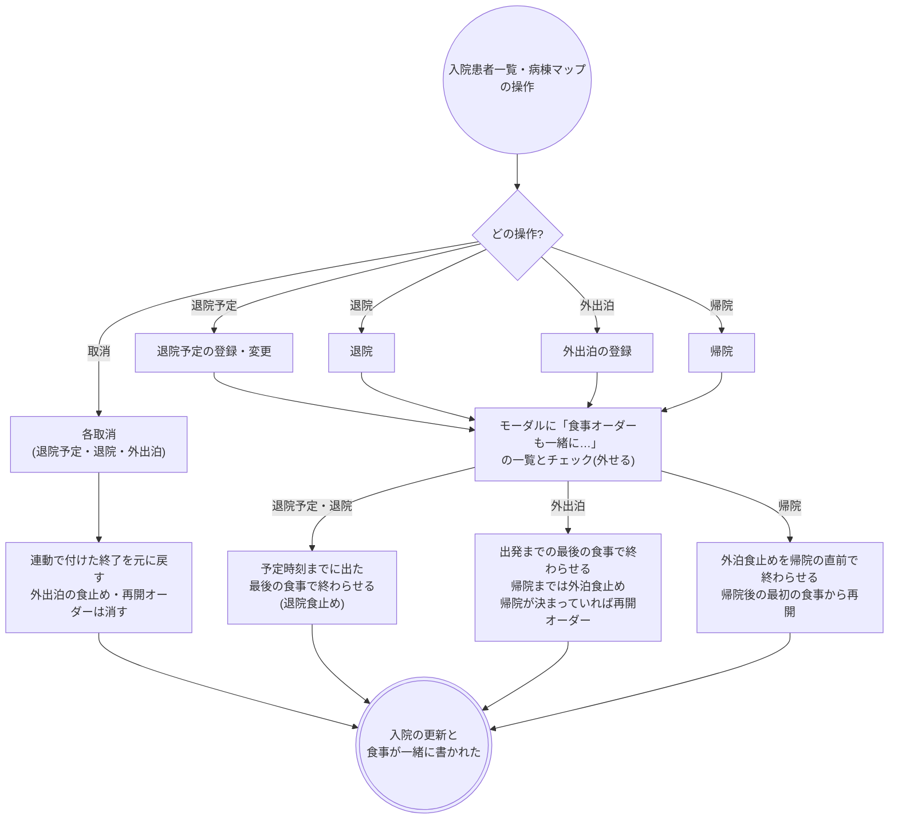
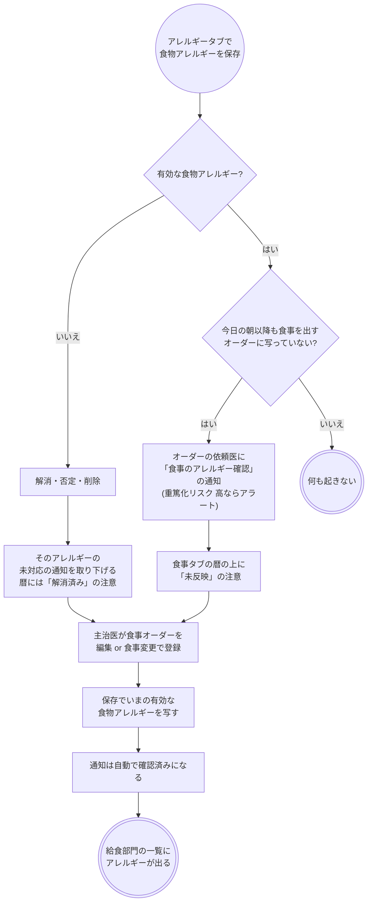
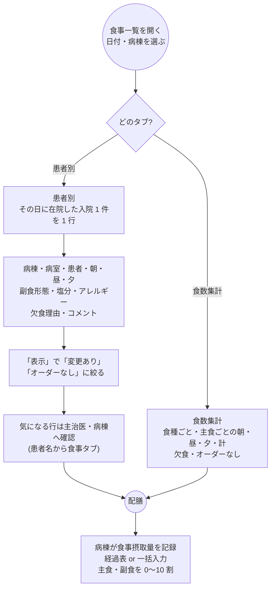

# 食事オーダーの業務フロー

<!-- ../fhir-client/docs/order-flows/meal.md から scripts/sync-flows.mjs で作る。直接編集しない。 -->

入院患者の食事オーダーを、入院時の開始から食事変更・パターン食・外出泊・退院までの流れと、給食部門の食事一覧・病棟の摂取量の記録まで追います。
食事は**開始した食事から次の指示まで続く**オーダーで、同時に出ているのは 1 本だけが正しい状態です。食事を変えるときは、新しいオーダーを出して前のオーダーをその直前の食事で終わらせます。
部門の受付・実施・予約はありません。給食部門はその日の一覧と食数を見るだけで、オーダーの状態は動かしません。

主治医 病棟 給食部門

## 他のオーダーとの違い

| | 検査・処置・リハビリ | 食事 |
|---|---|---|
| オーダーの単位 | 検査 1 回 / 期間(日) | 期間(開始の食事〜終了の食事。終了が無ければ次の指示まで続く) |
| 時刻の刻み | 日時・日 | 日付 + 朝・昼・夕 |
| 入力する項目 | 項目・部位・量など | 食種・主食(朝・昼・夕ごと。欠食もここ)・副食形態・塩分制限・欠食理由・開始・終了・対象プロブレム・コメント |
| マスタ | 項目マスタ・伝票 | 食種(食止めを含む)・主食・副食形態・食種の種別・パターン食 |
| 入外区分・至急 | 選ぶ | 無い(入院中の患者だけに出す) |
| 部門の受付・実施 | ある | 無い。給食部門はその日の一覧と食数を見る |
| 変える | オーダーの編集 | 新しいオーダーを出し、前のオーダーを直前の食事で終わらせる(食事変更) |
| 入退院との関係 | 退院で打ち切る(リハビリ・栄養指導) | 退院予定・退院・外出泊・帰院とその取消で、自動で止まり・戻る |
| 実施の記録 | 部門の実施記録 | 病棟の食事摂取量(主食・副食を割で) |
| 医事会計 | 実施記録から送る | 送らない |

- 入口はカルテの右ペイン「食事」と、カルテの「食事」タブの暦です。入院中でない患者では登録できません。
- クリニカルパスのタスク分類「食事」の既定のオーダー種別です。オーダーセットにも入れられます。
- 部門の画面は「部門業務 > 栄養部門 > 食事一覧」です。

## オーダーの種別と暦の印

食事オーダーは進捗を持ちません。代わりに、どの文脈で出たかを種別として持ち、暦のマスの印とカードに出します。

| 種別 | 出どころ | 暦の印 |
|---|---|---|
| 開始 | いま出ている食事が無いときの登録(入院時など) | 開始 |
| 変更 | いま出ている食事を終わらせての登録、パターン食の 2 段階目以降 | 変更 |
| 再開 | 期限付きのオーダー(外泊中の食止め・検査前の絶食など)のあとに元の食事へ戻すオーダー | 再開 |
| 外泊食止め | 外出泊の登録で自動で出る食止め | 外泊食止め |

- 終わり方にも理由が付きます。退院予定・退院で止めたオーダーは最後の日のマスに「退院食止め」の印が付き、カードの期間は「9/2 昼まで(退院食止め)」と出ます。
- 手で入れた終了には理由を付けません。連動の取消で戻るのは、連動が付けた終了だけです。

## 全体の流れ

- オーダーのカードはカルテの開始日の日に 1 枚載り、「9/1 朝〜 継続中」のように期間を見出しに、食種・主食・副食形態・塩分制限・食物アレルギーを出します。続いている日のカルテには何も出ないので、その日に何を食べているかは食事タブの暦で見ます。
- 暦の 1 マスには、その日の朝・昼・夕を担当するオーダーが並びます。1 日の途中で食事が変わった日だけ 2 つ以上並びます。
- オーダーの状態はずっと「有効」のままです。終了を決めても状態は変わらず、終了の食事を過ぎると暦と一覧に出なくなるだけです。

## 登録の判定

- 食種は「食種選択」の表から選びます。表には主成分量(熱量・蛋白質など)と適応が並び、上に患者の身長・体重・BMI と熱量・蛋白質の目安(標準体重 × 係数)が出ます。選んだ食種が目安を外れると「目安未満」「目安超」の印が付きます。
- 主食は朝・昼・夕の 3 行で選び、末尾の選択肢が「欠食」です。3 食すべて欠食にするときは、欠食ではなく食種で「食止め」を選びます。
- 食止めの食種を選ぶと、主食・副食形態・塩分制限は無効になり、保存でも落とします。
- 欠食理由(絶食(NPO)・手術絶食・検査絶食・外泊・退院・その他)は、食止めか 1 食でも欠食があるときだけ欄が出ます。給食部門の一覧と暦に出ます。
- 開始・終了は日付と朝・昼・夕で選びます。終了が空なら次の指示まで続きます。
- 食物アレルギーは選ばせません。保存した時点の患者の有効な食物アレルギーを全件、オーダーに写します(食止めにも写します)。
- 施設の規則(管理 > 警告の集計と設定)で食事に出す規則があれば、フォームの上に出します。登録は止めません。
- 承認待ちでも食事は給食部門の一覧に出ます。

## 食事変更と再開

| 新しい食事の開始 | 前のオーダーの終了 | | このオーダーの終了 | 再開オーダーの開始 |
|---|---|---|---|---|
| 朝 | 前日の夕 | | 朝 | 同じ日の昼 |
| 昼 | 同じ日の朝 | | 昼 | 同じ日の夕 |
| 夕 | 同じ日の昼 | | 夕 | 翌日の朝 |

- オーダーは自分が始まった日のマスからだけ直せます。続いている途中の日を押すと「その日から変える」新規登録になり、過去の食事が遡って変わる事故が起きません。
- 例: 8/1 朝から一般食が継続中で、8/10 朝〜8/11 夕に食止めを出すと、一般食は 8/9 夕で終わり、8/12 朝から一般食の再開オーダーが立ちます。再開しないと 8/12 以降の食事が無くなります。
- 再開オーダーは元のオーダーの延長ではなく別のオーダーです。元のオーダーが継続なら再開も継続、元に終了があればそれを引き継ぎます。
- 右ペインの「食事」から新規に登録しても、いま出ている食事があれば同じチェックが出ます。
- オーダーセット・クリニカルパスから出す食事は前の食事を終わらせません(パスは続く病日の食事を次の食事の直前で終わらせます)。セット適用のあとは食事タブで重なりを直します。

## パターン食

- 段階の長さは日数ではなく食数で数えます。昼から始めても「3 食」は昼・夕・翌朝です。
- 最後の段階だけ食数を空にでき、そのときは次の指示まで続きます。途中の段階を空にはできません。
- 展開したあとは段階ごとに独立した食事オーダーです。暦とカードに「術後食上げ 2/5」のように出ますが、パターン単位でまとめて直す・消す操作はありません(1 段階ずつ暦から直します)。
- パターンは施設がマスタで作ります。初期値として「術後食上げ」「大腸検査食」が入っています。

## 入退院・外出泊との連動

- 「どの食事まで / どの食事から」は手で選ばせず、施設設定の**食事の提供時刻**(既定 08:00 / 12:00 / 18:00)と、退院・出発・帰院の時刻から決めます。11:00 に退院なら朝食まで、14:00 に帰院なら夕食からです。
- 退院予定で止めたあとに予定を動かすと、止める前の終了を基準に立て直します。予定のまま退院しても、取消で戻る先は連動の前の終了です。
- 退院では食事を止めるだけで新しいオーダーは出しません。退院の画面では食事のほか、リハビリ・栄養指導・服薬指導・看護指示も同じ操作で止められます。
- 外泊食止めは食種マスタの「食止め」を使います。食止めの食種がマスタに無い施設では食止めオーダーだけを省き、終了と再開は行います。
- 帰院が早く 1 食も抜けないときは、外泊食止めのオーダーは消えます。
- 外出泊の期間を後から直す操作はありません。外出泊を取り消して登録し直すと、食事も戻ってから掛かり直ります。
- 入院取消(誤登録)・転床・転科転棟では食事に触りません。転棟後の病棟は、給食部門の一覧がベッドから引き直します。

## 食物アレルギー

- 照合は「有効なのにオーダーに写っていない(未反映)」と「写っているのに有効でなくなった(解消済み)」の 2 つだけです。食種の中身(卵を使うかなど)との突き合わせはしません。除去の具体はコメントに書きます。
- 通知はオーダー 1 件 × アレルギー 1 件ごとに 1 通です。同じ組の未対応の通知があれば作りません。
- 通知は通知一覧から「確認」で手で閉じることもできます。

## 給食部門の食事一覧と病棟の摂取量

- 行の元は入院です。退院済みの患者に終了の無いオーダーが残っていても出ず、入院中でオーダーの無い患者は「—」(オーダーなし)として出ます。
- 病棟は入院のいまのベッドから決めます。オーダーに残る病棟は登録時のもので、転棟後は合わないため使いません。
- その食事から食事が変わった欄には「変更」の印が付きます。
- 配膳の進捗、はい膳表・食札の印刷、栄養量の合計はありません。
- 摂取量はその食事を出しているオーダーの記録として残ります。オーダーの無い食事・食止め・欠食の食事には記録の枠が出ません。摂取量はカルテのカードには出しません。

## 変更・削除

| 操作 | できること |
|---|---|
| 変更 | 暦の「オーダーが始まった日」のマス、またはカードのメニューの編集。更新するのはそのオーダーだけで、前後のオーダーの開始・終了は動きません。終了を手で変えると、連動で付いた終了の理由は外れます(連動の取消で戻らなくなります) |
| 食事を変える | 暦の続いている途中の日のマスから新規登録(「食事変更と再開」) |
| 終わらせる | オーダーの編集で終了を入れる。中止はありません |
| 削除 | カードのメニュー。摂取量の記録が付いたオーダーは消せません(記録を消してから)。前のオーダーの終了は戻らないので、変更を取り消すときは前のオーダーの終了も編集で外します |
| DO | カードに DO はありません。暦の続いている途中の日を押すと、その日の食事の内容を引き継いだ登録が開きます(終了は引き継がない) |

## 帳票

専用の帳票はありません。はい膳表・食札の印刷も未実装です。
