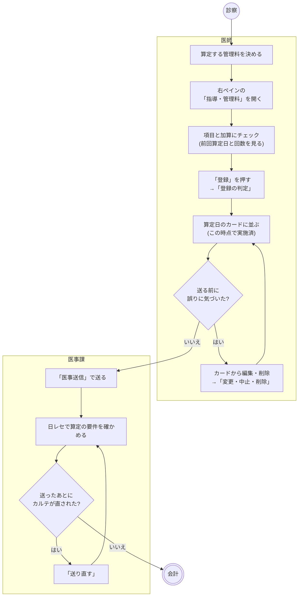
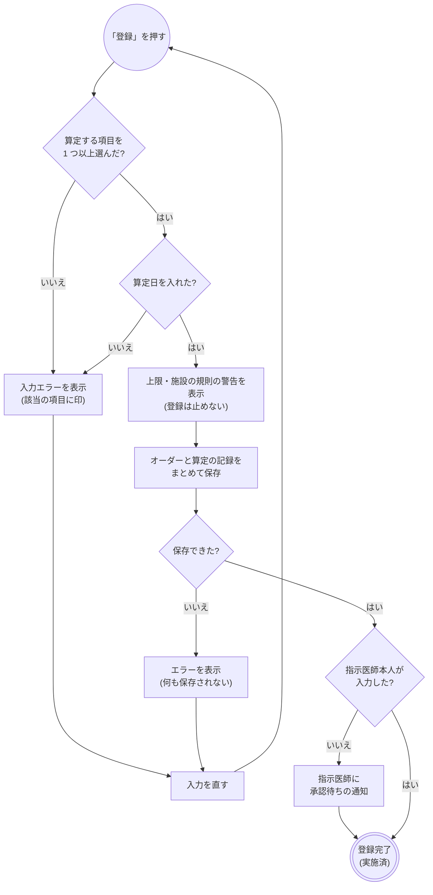
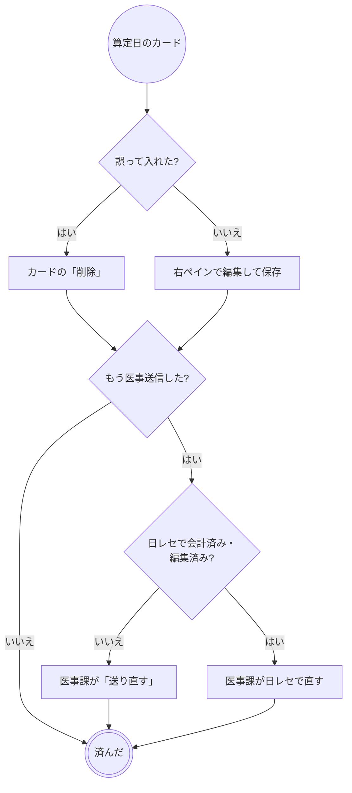
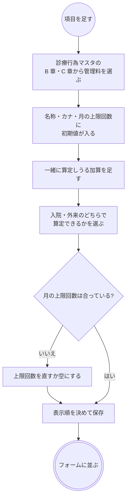

# 指導・管理料の業務フロー

<!-- ../fhir-client/docs/order-flows/medical-management.md から scripts/sync-flows.mjs で作る。直接編集しない。 -->

医師がカルテで指導・管理料を算定してから、医事会計へ送るまでの流れです。
対象は、点数表 B 章の医学管理料(特定疾患療養管理料・生活習慣病管理料・診療情報提供料など)と、C 章の在宅(在宅自己注射指導管理料・訪問診療など)です。
指導・管理料は、部門が受けて実施する依頼ではありません。医師が「この日にこの管理料を算定した」ことを記録するものなので、**登録と同時に実施済**になり、受付・予約・部門の一覧を持ちません。

医師 医事課

このページで使う呼び名です。

- **算定日**: その管理料を算定した日です。1 件の登録に 1 日だけ持ちます。
- **加算**: 管理料と一緒に算定する加算です。項目ごとに、施設が候補を決めておきます。
- **算定の記録**: 登録した項目と加算の 1 つずつの記録です。医事会計へ送るのはこの記録です。
- **日レセ**: 医事課が使うレセプトコンピュータです。カルテの「医事送信」で、その日の診療行為を日レセへ送ります。算定できるかの最終判断は日レセで行います。
- **カルテの右ペイン**: カルテの右側のオーダー入力です。指導・管理料は、右ペインの「指導・管理料」から入れます。

## 全体の流れ

- **算定する管理料を決める**: 主病・指導の内容・文書の作成などから、医師が決めます。
- **算定日**: 初期値は今日です。後日まとめて入れるときは、算定日を変えます。
- **入外区分**: 初期値は、入院中なら入院、そうでなければ外来です。並ぶ項目は入外区分で絞られるので、入院中の患者に外来の管理料を入れるときは、入外区分を外来に変えます。
- **入院の算定**: 医事送信で日レセへ送れるのは、外来の分だけです。入外区分が入院の管理料は送られないので、医事課が日レセで入力します。画面には、送られないことはまだ出ません。
- **対象プロブレム**: 選べます。日レセへ主病名を送るものではありません。主病名などの算定の要件は、医事課が日レセで付けます。
- **備考**: カルテのカードと詳細にだけ出ます。日レセへのコメントにはなりません。
- **代行入力**: 医師以外や研修医が入力したときは、指示医師に承認待ちの通知が出ます。ほかのオーダーの代行入力と同じく、承認を待たずに医事送信できます。

## 登録の判定

- **複数の項目**: 1 回の登録で、複数の項目を入れられます。カードの見出しは「特定疾患療養管理料 ほか1件」のようにまとめます。
- **加算の候補**: 項目にチェックを入れると、その下に出ます。初めはどれもチェックされていません。
- **警告**: どれも表示のみで、理由を選ぶ必要もありません。算定できるかの最終判断は日レセに任せます。
- **オーダーセット・クリニカルパスの中身**: 中身として作るときは、算定日を入れません。適用した日・病日が算定日になります(→「入口ごとの算定日と対象プロブレム」)。

## 前回算定日と上限

見るのは、算定日の月の回数だけです。週 1 回・初回のみ・6 か月に 1 回などの月以外の期間の上限と、施設基準・届出は見ていません。

フォームを開くと、その患者のこれまでの算定の記録から、項目ごとに次の値を出します。

| 表示 | 意味 |
|---|---|
| 前回 9/12 | その項目を最後に算定した日。加算も同じ |
| 当月 1/2回 | 算定日の月にもう算定した回数 / 項目に登録した月の上限 |
| 当月 1回 | 上限を登録していない項目で、その月にもう算定した回数 |

- **上限の警告**: 「当月の回数 + 今回の 1 回」が上限を超える項目を選ぶと、「○○は当月すでにN回算定しています(上限M回)」と出ます。
- **数える月**: 算定日の月です。算定日を変えると数え直します。
- **編集中**: 編集しているオーダー自身の記録は数えません。
- **古い記録**: 新しいほうから 500 件まで読みます。それより古い記録がある患者では「前回算定日は直近 500 件の記録から求めています」と出ます。

## 変更・中止・削除

| 操作 | できる場所 | 結果 |
|---|---|---|
| 編集 | カードから右ペインで | 項目・加算・算定日・入外区分・対象プロブレム・備考を直せる |
| 削除 | カードの「削除」 | オーダーと算定の記録がまとめて消える |
| 中止 | ない | 算定を取り消すときは削除する |
| DO(前回と同じ内容で出し直す) | カードの「DO」 | 新しく登録する(下の表) |

- **編集で外した項目**: 外した項目・加算は、算定の記録から消えます。
- **同時に編集したとき**: 編集を開いているあいだに、ほかの人が同じオーダーを書き換えていると、保存がエラーで止まります。ほかの人の変更を上書きしないためです。
- **無効にした項目**: 保存済みの項目は、あとで項目を無効にしたり入外区分が合わなくなったりしても、編集の画面に行として残ります。チェックを外すと消えます。
- **医事送信のあとの直し**: カルテを直しても、日レセの側は自動では直りません。医事課が「医事送信」で「送り直す」と、その日の診療行為が入れ替わります。
- **送り直せないとき**: 日レセで会計済み・編集済みのときは、送り直せません。医事課が日レセ側で直します。

## 入口ごとの算定日と対象プロブレム

| 入口 | 算定日 | 対象プロブレム |
|---|---|---|
| 右ペインの「指導・管理料」 | 入力どおり(初期値は今日) | 入力どおり |
| カードの「DO」 | 今日 | 元のオーダーのもの |
| オーダーセットの適用 | 適用した日 | 持ち込まない |
| クリニカルパスの適用 | そのタスクを置いた病日 | 持ち込まない |

- **DO で引き継ぐもの**: 項目・加算・備考です。入外区分は、いまの状態になります。
- **オーダーセット・クリニカルパス**: オーダーセットと、クリニカルパスのタスクのオーダー雛形に入れられます。出したものも、登録した時点で実施済です。
- **先の病日に置いた管理料**: パスを適用した時点で、その病日に算定した記録として入ります。外来の分は、その日の医事送信で送られます。算定しないことになったら、カードから削除します。
- **パスの適用の取消**: その適用で作った指導・管理料は、算定の記録ごと消えます。

## ほかの画面とのつながり

| 画面 | 指導・管理料の出方 |
|---|---|
| カルテ | 算定日にカードを置く。項目と加算(字下げ)と備考を並べ、状態は出さない |
| 外来患者一覧 | 当日のオーダーの列に「管」の印 |
| 文書作成(紹介状など) | カルテのカードから転記すると、項目と加算の名前が並ぶ |
| 医事送信 | 外来の分を、算定日の診療行為として、ほかのオーダーと一緒に送る |
| 警告の集計と設定 | 施設の規則で、出す場所に「指導・管理料」を選べる |

## 帳票

専用の帳票はありません。生活習慣病療養計画書など、算定の要件になる文書は文書作成で書きます。

## 算定の要件になる文書

項目に「要件の文書」を設定しておくと、算定と文書作成が互いを確かめます。

- **算定するとき**: 項目の横に、その文書を最後に作った日が出ます。文書が足りない項目を登録すると、指示医師に文書作成の督促が届きます。督促からカルテを開くと、その文書の作成画面が開きます。文書を作ると督促は消えます。
- **文書を作るとき**: 「作成」を押すと、その文書が要件になっている管理料が「算定」の一覧に出ます。チェックした管理料は、文書と一緒に、文書の診療日で登録されます。
- **チェックの初期値**: 候補が 1 つならチェック済みです。候補が 2 つ以上あるとき、当月の上限に達しているとき、先に算定して文書を待っているときは、外れた状態で出ます。
- **文書の有効月数**: 療養計画書のように毎回は要らない文書は、有効月数を設定します。4 なら、算定する月を含めて 4 か月の間に作った文書があれば足ります。空にすると、算定日の当日に作った文書が要ります。
- **対象にならないもの**: オーダーセット・クリニカルパスから登録した管理料には督促が出ません。文書を削除しても、一緒に登録した管理料は残ります。

## 項目の準備

施設のマスタを設定する人の作業です。施設が算定する管理料だけを、「マスタメンテ > 医学管理 > 指導・管理料項目」に登録しておきます。カルテのフォームには、ここに登録した有効な項目だけが並びます。

- **月の上限回数の初期値**: 診療行為マスタの算定回数の上限が入ります。週 1 回・初回のみなど、月で数えられない上限のものは直すか空にします。空にすると、上限の警告は出ません。
- **加算**: 管理料と同じく、診療行為マスタから選びます。
- **要件の文書**: 算定の要件になる文書を、文書テンプレートから選びます。初回用と継続用のように複数選ぶと、どれか 1 つで足ります。
- **最初から入っている項目**: 主な管理料・文書料・在宅の 29 件が登録されています。
- **特定疾患療養管理料**: 施設の規模でコードが分かれます。最初から入っているのは 100 床以上 200 床未満の病院のコードなので、施設に合わせて選び直します。
- **名称と点数**: 診療行為マスタのものを出します。点数改定で診療行為マスタを取り込み直せば、項目を直さなくても点数が変わります。
- **使わなくなった項目**: 無効にします。無効にしても、それを算定した過去の記録はそのまま残ります。
- **入れない項目**: 栄養指導料・薬剤管理指導料・退院時薬剤情報管理指導料は、栄養指導・服薬指導の実施から送るものなので入れません。栄養指導料はいまも栄養指導の実施から送っています。薬剤管理指導料・退院時薬剤情報管理指導料は、服薬指導から送る形がまだできていないので、いまは医事課が日レセで入力します。
- **日レセが自動で算定するもの**: 薬剤情報提供料、初診料・再診料は、日レセが自動で算定するので入れません。入れると二重に算定されます。

## 他のオーダーとの違い

| | 部門オーダー(処置・リハビリなど) | 指導・管理料 |
|---|---|---|
| 受ける人 | 部門(処置室・リハ部門など) | いない |
| 状態 | 受付・実施済などと進む | 持たない(登録した時点で実施済) |
| 日付 | 実施予定日・予約日 | 算定日(1 日) |
| 選ぶもの | 部門のマスタの項目 | 施設が登録した管理料と、その加算 |
| 算定回数の確かめ方 | 項目ごとの規則・施設の規則 | 前回算定日と当月の回数を出す |
| カルテでの見え方 | 状態つきのカード | 算定日のカード(状態は出さない) |
| 削除 | 実施記録があればできない | 算定の記録ごと消せる |
| 医事会計 | 部門の実施記録から送る | 登録した項目を送る |

- **受ける人がいない**: 登録した医師の算定の記録になります。
- **算定回数**: 月の上限に達している項目を選ぶと、警告(表示のみ)が出ます(→「前回算定日と上限」)。
- **医事会計**: 項目 1 つずつを、日レセの 1 つの診療行為の組として送ります。加算は同じ組に入ります。
