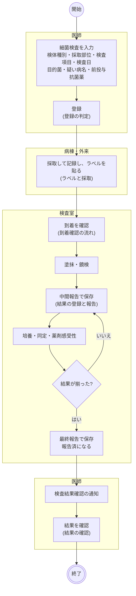
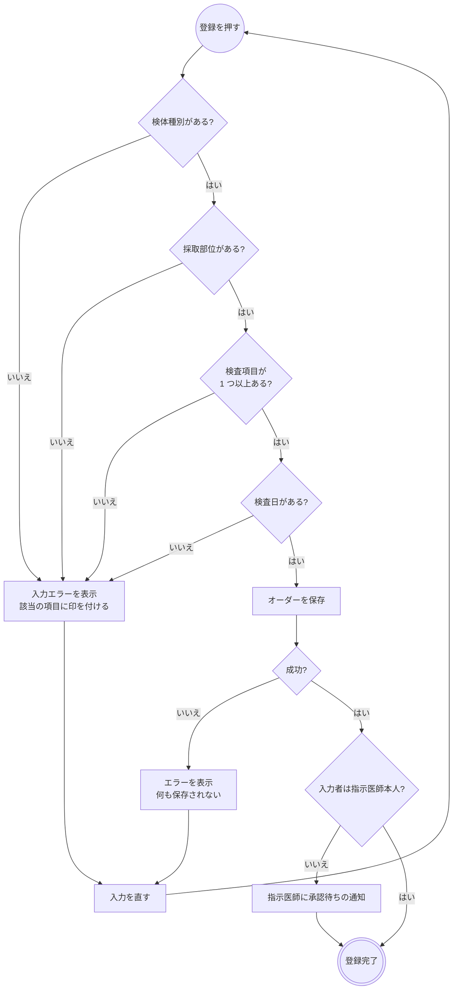
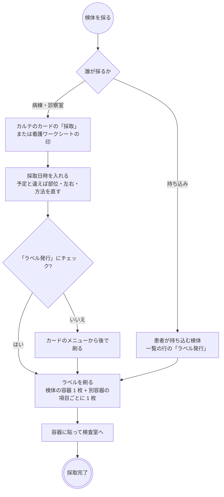
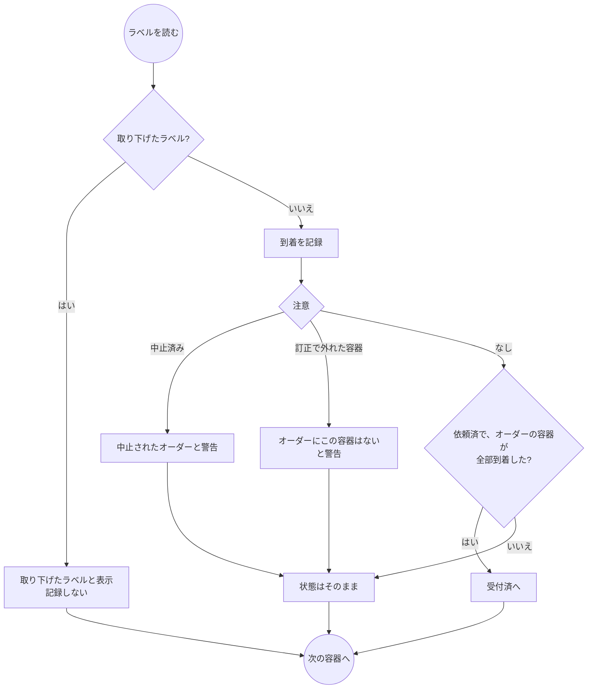
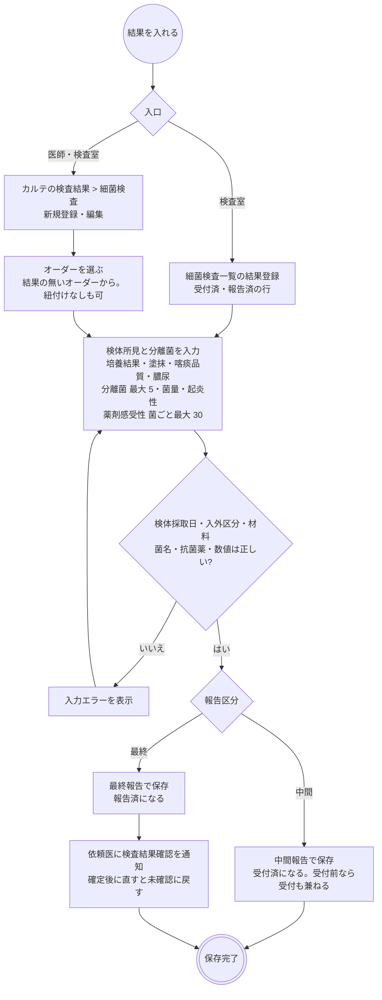
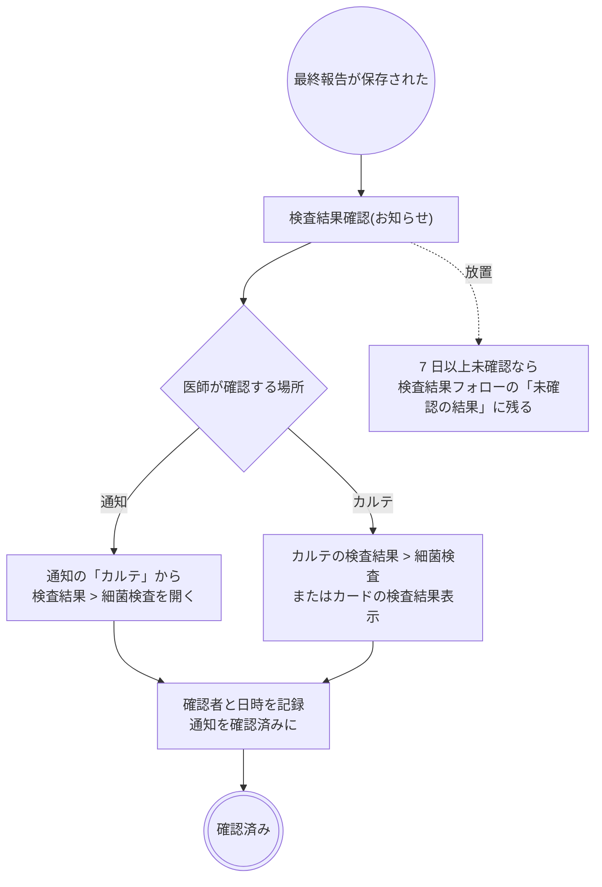

# 細菌検査オーダーの業務フロー

<!-- ../fhir-client/docs/order-flows/micro.md から scripts/sync-flows.mjs で作る。直接編集しない。 -->

細菌検査オーダーの登録からラベル発行・採取・到着・中間報告・最終報告・結果確認までの流れです。
進捗の考え方は検体検査と同じなので、この文書は [検体検査オーダーの業務フロー](lab.md) との違いを中心に書きます。
迅速抗原・毒素・PCR は検体検査オーダーで扱います。判断の基準は、培養・鏡検の流れに乗るかどうかです。

医師 病棟・外来 検査室

## 検体検査との違い

| | 検体検査 | 細菌検査 |
|---|---|---|
| オーダーの単位 | 検体をまたいで 1 オーダー | **1 オーダー = 1 検体**。血液培養の 2 セット目は DO して採取部位を変える |
| ラベル発行 | 発行が受付を兼ねる。病棟は一括発行 | **進捗を動かさない**。カルテのカードか一覧の行から 1 件ずつ |
| 採取の記録 | なし | **あり**。採取日時・採取者・部位・方法 |
| 受付済 | ラベルを発行した | **検体が検査室に届いた** |
| 終わりの状態 | 全部の管が届くと実施済 | **最終報告で報告済**。培養の間は受付済のまま |
| 報告区分 | 中間・最終・訂正 | 中間・最終。確定後に直しても最終のまま |
| 緊急の通知 | パニック値 | なし |
| 結果の入れ方 | 手入力とファイル取込 | 手入力だけ |

検査日は必須で、予約枠は使いません。日付未定・即実施・事後はありません。登録時の警告もありません。

## 細菌検査の状態

検査室の進み具合を示す状態です。中間報告はこの状態に含めず、一覧の「結果」の列とカードの印で見せます。

| 状態 | 変わるきっかけ | 細菌検査一覧からできること |
|---|---|---|
| 依頼済 | 医師の登録、取消、到着の取消、中止取消 | 受付、ラベル発行、中止 |
| 受付済 | 全容器の到着、受付、中間報告の保存、結果の削除 | 結果登録・結果編集、ラベルの刷り直し、取消(依頼済へ)、中止 |
| 報告済 | 最終報告の保存 | 結果編集、ラベルの刷り直し |
| 中止 | 中止 | 中止取消(依頼済へ) |

- 報告済へは手で進めません。結果の保存が報告区分に合わせて状態を動かします。
- 一覧の「日数」は、検査日を 1 日目として今日が何日目かを依頼済・受付済の行に出します。「未完了(14日)」で、選んだ日までの 14 日ぶんの依頼済・受付済を古い順に見られます。

容器 1 つごとに別の状態があります。**未発行 → 発行済 → 到着済**で、一覧の「表示」に番号と一緒に出ます。

## 全体の流れ

- 中間報告は任意です。塗抹の所見がすぐ要らなければ、最終報告だけでも構いません。
- 医師は中間報告の内容をカルテで読めますが、通知は出ず、確認の記録も残せません。
- 外来の診察終了で、当日の細菌検査が依頼済・受付済のまま残っていると「一時終了」を選べます。
- 看護ワークシートの採取の印は、記録すると「採取済」、ラベルだけなら「ラベル済」、全容器が届くか受付済で「到着済」になります。

## 登録の判定

- 検査項目はマスタの全項目をチェックボックスで並べます。伝票とセットはありません。検体種別と検査項目の組み合わせは検査しません。
- 目的菌は頻用菌のチェックと全件検索から複数選べます。
- 前投与抗菌薬は培養の解釈に使う情報です。「処方取込」で直近の処方・注射の抗菌薬を文字に取り込み、そのまま直せます。
- 検査目的は診断目的と監視培養から選びます。
- 承認待ちでもオーダーは部門に流れます。オーダーセット・クリニカルパスからの適用も同じ保存を通ります。

## ラベルと採取

- 容器は検体の容器 1 つと、別容器の項目 1 つごとです。血液培養の好気・嫌気ボトルが別容器で、ボトルだけのオーダーに検体の容器のラベルは出ません。
- 採取者は記録したログインユーザーです。入力欄はなく、直しても最初に記録した人のままです。
- 採取の記録は依頼済・受付済のあいだ書けます。受付後に足すこともできます。
- 採取日時はカード・ラベルに出ます。未記録ならラベルは「予定」の日時です。結果登録の検体採取日にも写ります。
- 同じ容器は刷り直しても同じ番号です。項目を外して刷り直すと、外した容器のラベルは取り下げになります。戻すと同じ番号で復帰します。
- 検体検査の「ラベル一括発行」に細菌検査は入りません。中止したオーダーには発行できません。

## 到着確認の流れ

画面は検体検査と同じ**部門業務 > 臨床検査部門 > 検体到着確認**で、番号の検査と二重読みの扱いも同じです([検体検査オーダーの業務フロー](lab.md)「到着確認の流れ」)。読んだ後の進み方だけが違います。

- 「取消」は到着を消し、受付済を依頼済へ戻します。結果が付いていれば検体は届いているので、状態は戻しません。
- ラベルの無い検体は一覧の「受付」で受付済にします。
- 病理のラベルを読むと「病理の受付で読んでください」と出して記録しません。

## 結果の登録と報告

- 一覧から開くとオーダーは行で決まり、材料・依頼科・検体採取日をオーダーから写します。
- オーダーに紐付けない結果は状態を動かしません。
- 分離菌と感受性の抗菌薬は JANIS のコードから選びます。頻用薬は直接並び、ほかは検索します。
- 1 オーダーに結果は 1 件です。中間報告を編集して最終報告に切り替えます。
- 最終報告を中間報告に直すと受付済に戻ります。出ている検査結果確認の通知はそのまま残ります。
- 中止したオーダーは、結果を保存しても中止のままです。
- 分離菌の結果を使う機能は 2 つあります。AST 一覧の血液培養タブは入院中の患者の血液培養の陽性を出し、データ抽出の細菌検査タブは分離菌 1 株を 1 行にして出します。感染症の発生届の検知には結び付いていません。

## 結果の確認

確認の仕組みは検体検査と同じです([検体検査オーダーの業務フロー](lab.md)「結果の確認」)。細菌検査に緊急の通知はないので、最終報告の検査結果確認だけです。

- 宛先は依頼医ですが、確認は誰でもできます。記録には確認した本人が残ります。
- 中間報告のうちは確認できません。確定後に編集すると未確認に戻ります。

## 変更・中止・削除

| 操作 | できる場所 | できないとき・注意 |
|---|---|---|
| 変更 | カルテのカード | 進捗では止まりません。項目を足し引きしたら、ラベルを刷り直します |
| 採取の修正 | カルテのカードの「採取修正」 | 依頼済・受付済のあいだ。採取者は最初に記録した人のままです |
| 中止 | 細菌検査一覧のメニュー | 依頼済・受付済から。報告済からはできません。結果が付いていても止まらず、結果は残ります |
| 中止取消 | 細菌検査一覧のメニュー | 依頼済に戻ります |
| 取消 | 細菌検査一覧のメニュー | 受付済を依頼済へ戻す訂正です。容器の到着記録は消えません |
| 削除 | カルテのカード | 結果が付いているとできません(結果を削除してから)。進捗は一緒に消え、発行済みの容器の記録は残ります |
| 結果の削除 | カルテの検査結果 > 細菌検査 | 分離菌・感受性と結果側の検体を消し、報告済は受付済に戻ります。**検査結果確認の通知は取り下げません** |

- 変更は再度の承認を要する場合があります(代行入力のとき)。部門への通知はなく、一覧の内容で見えます。
- 報告済の結果を直すときは、最終報告のまま編集します。報告済から戻す操作は、中間報告への変更か結果の削除だけです。
- DO はオーダーの内容だけを写します。採取の記録・ラベル・結果は写りません。

## 帳票

| 帳票 | 出す場所 | 内容 |
|---|---|---|
| 検体ラベル | カルテのカード、採取の記録、細菌検査一覧の行 | 容器 1 つ 1 枚。バーコード(番号)・患者番号・氏名・カナ・検体か項目・採取日時または予定 |

細菌検査結果の報告書はありません。検査結果報告書は検体検査だけです。
