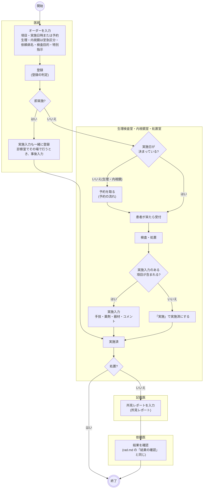
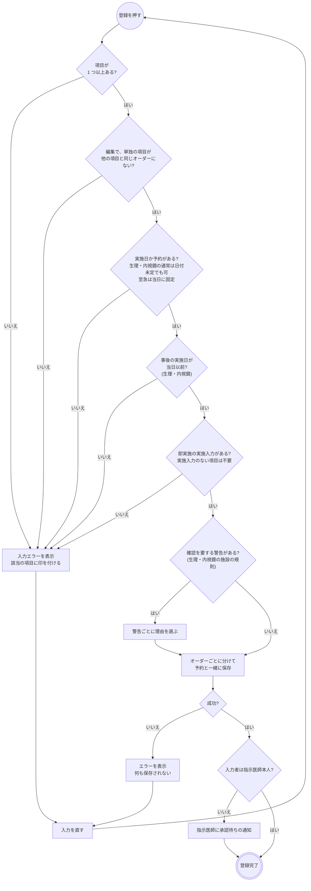
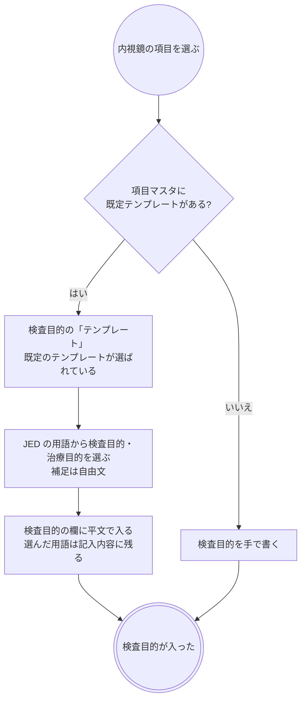
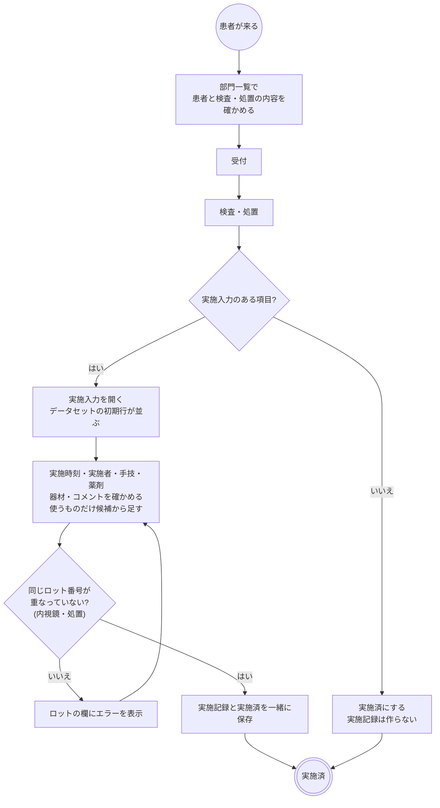

# 生理検査・内視鏡・処置オーダーの業務フロー

<!-- ../fhir-client/docs/order-flows/physio-endoscopy-treatment.md から scripts/sync-flows.mjs で作る。直接編集しない。 -->

生理検査・内視鏡・処置オーダーの登録から予約・受付・実施・所見レポート・結果確認までの流れです。
3 種別とも放射線検査と同じ形(項目マスタ・伝票・部門一覧・実施入力・予約枠)なので、この文書は [放射線検査オーダーの業務フロー](rad.md) との違いを中心に書きます。
内視鏡で採った組織は、別に病理検査オーダーを出します([病理検査オーダーの業務フロー](patho.md))。

医師 生理検査室・内視鏡室・処置室 記載医 依頼医

## 放射線検査との違い

| | 放射線検査 | 生理検査 | 内視鏡 | 処置 |
|---|---|---|---|---|
| 項目の分類 | モダリティ(JJ1017) | 検査種別(施設が登録。初期値 8 件) | 検査種別(JED の 4 区分と対応。初期値 6 件) | なし |
| 部位・左右 | あり | なし(項目名に含める) | なし | なし |
| 至急区分 | 通常・至急・事後 | 同じ | 同じ | **なし**(すべて通常として扱い、事後もない) |
| 日付未定 | できる | できる | できる | **できない** |
| 依頼病名・検査目的・特別指示 | 項目ごと | 項目ごと | 項目ごと。検査目的は JED 用語のテンプレートで選ぶ | **なし**(対象プロブレムだけ) |
| 登録時の警告 | 造影・MRI・妊娠・感染症・施設の規則 | 感染症・施設の規則 | 感染症・施設の規則 | **なし** |
| 実施入力 | 手技・造影剤・器材・被曝線量・コメント | 手技・薬剤・器材・コメント | 手技・薬剤・器材・コメント | 手技・薬剤・器材・コメント |
| ロット番号の欄 | 造影剤で出る | **出ない** | 出る | 出る |
| 器材の選び方 | 施設の器材マスタ | 特定保険医療材料を直接(名称の手入力も可) | 同じ | 同じ |
| 結果 | 読影レポート | 所見レポート(「判定」) | 所見レポート(「診断」) | **なし** |
| 外来の診察終了の「一時終了」 | 対象 | 対象 | 対象 | **対象外** |

- 項目の 3 つの設定(オーダー単位・予約・実施入力)は放射線と同じで、流れの分かれ方も同じです([放射線検査オーダーの業務フロー](rad.md)「区分ごとの違い」)。
- 薬剤の投与経路の選択肢は種別ごとに違います。生理検査は吸入(負荷試験・気道可逆性試験)、内視鏡は静注・筋注・外用・直腸内(鎮静・鎮痙・咽頭麻酔・前処置)、処置は外用を先頭に置きます。
- 処置は至急・日付未定・検査目的を持たないので、フォームの「選択中」の枠は実施日時(または予約)と即実施だけです。
- 入口はカルテの右ペイン「生理検査」「内視鏡」「処置」の伝票と項目検索、オーダーセット、クリニカルパスです。

## 進捗の状態

3 種別とも放射線と同じ 4 状態です。所見レポートの進み具合はこの状態に含めず、一覧の「所見」の列に報告区分で出します。

| 状態 | 変わるきっかけ | 部門一覧からできること |
|---|---|---|
| 依頼済 | 医師の登録、取消、中止取消 | 受付、中止、予約(生理・内視鏡の日付未定のとき) |
| 受付済 | 受付、実施の取消 | 実施、取消(依頼済へ)、中止、予約(生理・内視鏡の日付未定のとき) |
| 実施済 | 実施登録、即実施 | 所見(生理・内視鏡)、取消(受付済へ) |
| 中止 | 中止 | 中止取消(依頼済へ) |

- 部門一覧は**部門業務 > 生理検査一覧 / 内視鏡一覧 / 処置一覧**です。実施日ごとに実施時刻の順に並び、時刻の無いオーダーは後ろです。
- 生理検査一覧・内視鏡一覧は「実施日別」と「日付未定」のタブを持ち、検査種別で絞り込めます。至急の行は色が変わります。処置一覧は実施日別だけで、検査種別の絞り込みと至急の色はありません。
- 3 つとも入外区分・病棟・診療科・状態で絞り込め、患者の列に注意区分・アレルギー・感染症の印が出ます。通知は出ません。

## 全体の流れ

- 処置は実施済で終わります。処置の所見(創部の状態・写真)を残す報告書は無く、実施コメントに書きます。
- 外来の診察終了で、当日の生理検査・内視鏡が依頼済・受付済のまま残っていると「一時終了」を選べます。処置は対象にしません。
- 心電計・超音波装置・内視鏡システムとは接続しません。検査の事実は実施入力で記録し、波形や画像は所見レポートに添付します。

## 登録の判定

| 判定 | 生理検査・内視鏡 | 処置 |
|---|---|---|
| 実施日 | 通常は実施日か日付未定。至急は当日に固定。事後は当日以前 | 必須 |
| 予約必須の項目 | 通常は予約か日付未定。至急・事後は予約を取らない | 予約が必須 |
| 即実施 | 予約必須の項目を含む通常のオーダーと日付未定はできない。事後は必ず即実施 | 予約必須の項目を含むオーダーはできない |
| 警告 | 感染症(表示のみ)と、「警告の規則マスタ」で出す場所に生理検査・内視鏡を選んだ規則 | なし |

- 予約必須の項目は、至急区分の無い処置では「予約を取らずに今日行う」ことができません。その場で行う処置は、予約不要の項目にしておきます。
- 検査目的・特別指示は項目マスタの既定テンプレートから記入できます(内視鏡は「内視鏡の検査目的」)。
- 承認待ちでもオーダーは部門に流れます。オーダーセットの適用も同じフォームを通ります。

## 内視鏡の検査目的

- テンプレートは検査種別ごとの 4 本(「上部内視鏡 検査目的」「下部内視鏡 検査目的」「小腸内視鏡 検査目的」「ERCP 検査目的」)です。JED 用語集の表記をそのまま選択肢にしてあります。
- 前処置・鎮静の指示は特別指示のテンプレート(「上部内視鏡 前処置・鎮静指示」など)で書きます。抗血栓薬の休薬は登録の判定に入りません。
- 予定性(予定 / 緊急)は至急区分で表します。
- DO すると検査目的の文言は写りますが、テンプレートの記入内容との結び付きは外れます。

## 予約の流れ

放射線と同じです([放射線検査オーダーの業務フロー](rad.md)「予約の流れ」)。枠は項目マスタの枠表から所要時間ぶん連続して押さえ、枠の日時が実施日時になります。

| 予約を取る場面 | 生理検査・内視鏡 | 処置 |
|---|---|---|
| 登録時にフォームで枠を選ぶ | できる | できる |
| 日付未定で登録した後、部門一覧の日付未定タブの「予約」 | できる | なし(日付未定が無い) |
| 登録後にカルテのカードの編集で選び直す | できる | できる |

- 予約タブには検査予約も並び、「日時変更・取消は検査オーダーから」と出ます。変更はオーダーの編集、取消はオーダーの中止か削除で行います。
- 検査予約は外来一覧に出ません。

## 受付と実施

- 実施時刻の初期値は現在時刻、実施者はログイン中の医療従事者です。
- 手技(手技料)は医科診療行為マスタから選びます。検索の既定の章は、生理検査・内視鏡が画像診断(E)、処置が処置(J)です。会計に送る手技はここで選んだものなので、データセットの初期行に手技を入れておきます。
- 器材は特定保険医療材料から選び、マスタに無いものは名称を手で入れられます。名称だけの器材は会計に送れず、送信前の確認に「送れない項目」として出ます。
- ロット番号の欄は、内視鏡・処置で薬剤付加情報のロット管理の薬を入れたときだけ出ます。生理検査には出ません。
- 日付未定のオーダーは受付できますが、実施はできません。
- 途中でやめた記録を残す操作はありません。行わなかった検査・処置は中止にします。

## 所見レポート(生理検査・内視鏡)

入力・画像・描き込み・報告区分・重要所見・フォロー推奨・確認の流れは放射線の読影レポートと同じです([放射線検査オーダーの業務フロー](rad.md)「読影と報告」「結果の確認」)。違いだけを書きます。

| | 読影レポート(放射線) | 生理検査 | 内視鏡 |
|---|---|---|---|
| 一覧のボタン | 「読影」 | 「所見」 | 「所見」 |
| 書く人の呼び方 | 読影医 | 記載医 | 記載医 |
| 最終報告に要るもの | 診断 | 判定 | 診断 |
| 描き込みの色 | 暗い画像向け | 既定の色(白地の波形) | 暗い画像向け |
| 既定テンプレート | 撮影項目マスタの「読影所見」 | 「心電図 所見」など | 「上部内視鏡 所見」「大腸内視鏡 所見」など(検査時情報・偶発症は JED の表記) |
| 重要所見の通知 | 重要所見(放射線) | 重要所見(生理検査) | 重要所見(内視鏡) |
| カルテのタブ | 検査結果 > 放射線検査 | 検査結果 > 生理検査 | 検査結果 > 内視鏡 |

- 入口は部門一覧の実施済の行の「所見」(登録済みなら「所見編集」)、カルテのカードのメニュー「所見レポート登録 / 編集」、カルテの検査結果タブ(実施済でレポートの無いオーダーを選んでから書く)です。
- 所見レポートのある検査は、実施の取消とオーダーの削除ができません。先にレポートを削除します。
- 心電図の各間隔・心エコーの EF のような計測値は項目として持たず、所見の文章とテンプレートに書きます。

## 変更・中止・削除

放射線と同じです([放射線検査オーダーの業務フロー](rad.md)「変更・中止・削除」)。違いは次のとおりです。

| 操作 | 生理検査・内視鏡 | 処置 |
|---|---|---|
| 変更 | 放射線と同じ。受付済・実施済でも止まりません | 同じ |
| 中止 | 部門一覧のメニュー。実施済からはできません(先に取消)。有効な検査予約を取り消して枠を空きに戻します | 同じ |
| 実施の取消 | 実施記録(薬剤を含む)を消します。所見レポートがあるとできません | 実施記録を消します |
| 削除 | 実施記録か所見レポートがあるとできません。検査予約を取り消し、検査目的・特別指示のテンプレートの記入内容も一緒に消えます | 実施記録があるとできません。検査予約を取り消します |

- DO はオーダーの内容だけを写します。予約・実施記録・所見レポートは写りません。

## 帳票

専用の帳票はありません。
