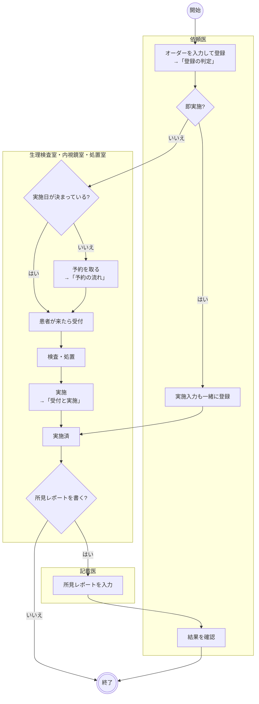
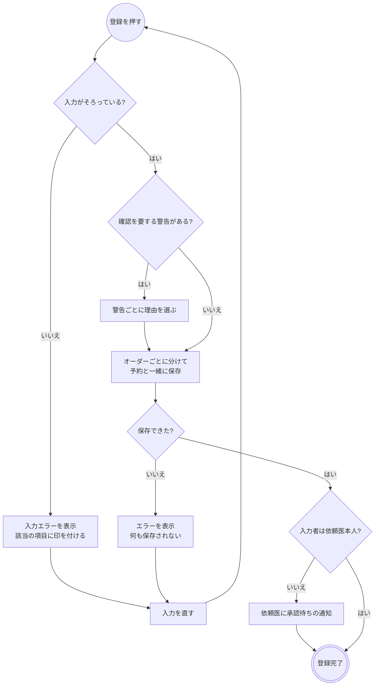
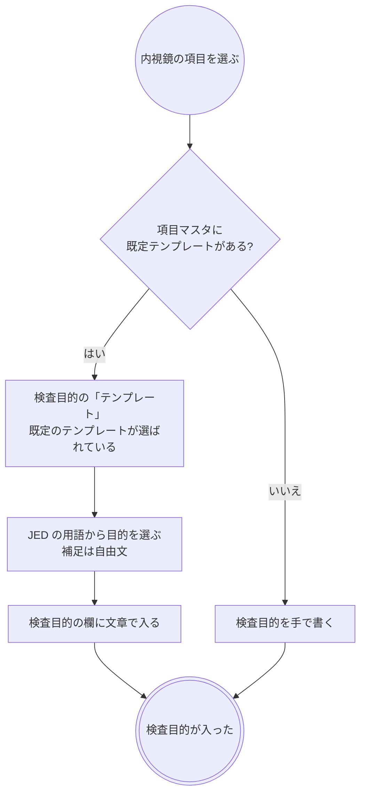
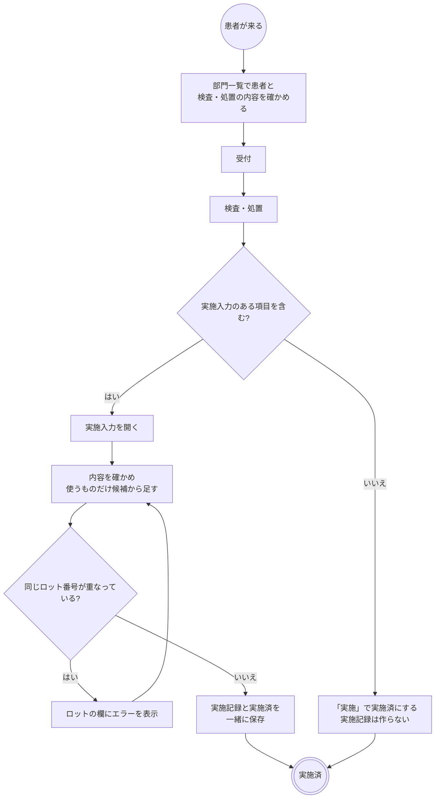

# 生理検査・内視鏡・処置オーダーの業務フロー

<!-- ../fhir-client/docs/order-flows/physio-endoscopy-treatment.md から scripts/sync-flows.mjs で作る。直接編集しない。 -->

生理検査・内視鏡・処置オーダーの登録から予約・受付・実施・所見レポート・結果確認までの流れです。
3 種別とも放射線検査と同じ形(項目マスタ・伝票・部門一覧・実施入力・予約枠)なので、この文書は [放射線検査オーダーの業務フロー](rad.md) との違いを中心に書きます。先に [放射線検査オーダーの業務フロー](rad.md) を読むと、流れをつかみやすくなります。
内視鏡で採った組織は、別に病理検査オーダーを出します([病理検査オーダーの業務フロー](patho.md))。

依頼医 生理検査室・内視鏡室・処置室 記載医

## 全体の流れ

この文書で使う呼び名です。

| 呼び名 | 意味 |
|---|---|
| 依頼医 | オーダーを出した医師。結果の通知の宛先になる |
| 記載医 | 所見レポートを書く医師 |
| 部門一覧 | 「部門業務 > 生理検査一覧」「部門業務 > 内視鏡一覧」「部門業務 > 処置一覧」 |
| 即実施 | 登録と一緒に実施入力も済ませる。診察室でその場で行うときと、事後の入力に使う |
| 事後 | 終わった検査を後から入れるための至急区分 |
| 日付未定 | 実施日を決めずに登録すること |
| カード | カルテに出る、オーダー 1 件ぶんの表示 |
| 取消 | 状態を 1 つ前へ戻す訂正(実施済 → 受付済、受付済 → 依頼済) |
| 中止 | 検査・処置をやめる。「中止取消」で依頼済に戻せる |
| 削除 | オーダーそのものを消す |

- **入口**: 依頼医はカルテの右ペイン(右側のオーダー入力)の「生理検査」「内視鏡」「処置」で、伝票か項目検索から項目を選びます。オーダーセット、クリニカルパスからも出せます。
- **入力する項目**: 項目と、実施日時(または予約)です。生理検査・内視鏡は、至急区分・依頼病名・検査目的・特別指示も入れます。
- **処置の入力**: 処置は至急・日付未定・検査目的を持たないので、フォームの「選択中」の枠は実施日時(または予約)と即実施だけです。
- **日付未定**: 日付未定で登録できるのは生理検査・内視鏡だけです。処置は実施日が必ず決まっています。
- **所見レポート**: 所見レポートがあるのは生理検査・内視鏡だけです。処置は実施済で終わります。
- **処置の所見**: 処置の所見(創部の状態・写真)を残す報告書は無く、実施コメントに書きます。
- **外来の一時終了**: 外来の診察終了で、当日の生理検査・内視鏡が依頼済・受付済のまま残っていると「一時終了」を選べます。処置は対象にしません。
- **装置との接続**: 心電計・超音波装置・内視鏡システムとは接続しません。検査の事実は実施入力で記録し、波形や画像は所見レポートに添付します。

## 進捗の状態

3 種別とも放射線検査と同じ 4 つの状態です。所見レポートの進み具合はこの状態に含めず、部門一覧の「所見」の列に報告区分で出します。

| 状態 | 変わるきっかけ | 部門一覧からできること |
|---|---|---|
| 依頼済 | 依頼医の登録、受付済からの取消、中止取消 | 受付、中止、予約 |
| 受付済 | 受付、実施済からの取消 | 実施、取消(依頼済へ)、中止、予約 |
| 実施済 | 実施登録、即実施 | 所見、取消(受付済へ) |
| 中止 | 中止 | 中止取消(依頼済へ) |

- 「予約」ができるのは、生理検査・内視鏡の日付未定のオーダーだけです。
- 「所見」ができるのは、生理検査・内視鏡だけです。

**部門一覧の見え方**

- 部門一覧は、実施日ごとに実施時刻の順に並びます。時刻の無いオーダーは後ろです。
- 生理検査一覧・内視鏡一覧は「実施日別」と「日付未定」のタブを持ち、検査種別で絞り込めます。至急の行は色が変わります。
- 処置一覧は実施日別だけで、検査種別の絞り込みと至急の色はありません。
- 3 つとも入外区分・病棟・診療科・状態で絞り込め、患者の列に注意区分・アレルギー・感染症の印が出ます。
- オーダーが登録されても、部門への通知は出ません。

## 登録の判定

「入力がそろっている?」で確かめるのは次の項目です。

| 項目 | 生理検査・内視鏡 | 処置 |
|---|---|---|
| 項目 | 1 つ以上ある | 1 つ以上ある |
| 単独の項目(編集のとき) | 他の項目と同じオーダーにない | 他の項目と同じオーダーにない |
| 実施日 | 通常は実施日か日付未定。至急は当日に固定。事後は当日以前 | 必須 |
| 予約必須の項目 | 通常は予約か日付未定。至急・事後は予約を取らない | 予約が必須 |
| 即実施の実施入力 | 即実施のとき、実施入力がある | 即実施のとき、実施入力がある |

即実施の実施入力は、実施入力のない項目には要りません。

即実施にできないオーダーは次のとおりです。

| 種別 | 即実施にできないオーダー |
|---|---|
| 生理検査・内視鏡 | 予約必須の項目を含む通常のオーダーと、日付未定のオーダー。事後は必ず即実施 |
| 処置 | 予約必須の項目を含むオーダー |

- **警告(生理検査・内視鏡)**: 感染症の警告は表示のみです。ほかに、施設の規則(「警告の規則マスタ」で出す場所に生理検査・内視鏡を選んだ規則)が出ます。確認を要する警告は、理由を選べば登録できます。
- **警告(処置)**: 処置に登録時の警告はありません。
- **項目の設定**: 項目の 3 つの設定(オーダー単位・予約・実施入力)は放射線検査と同じで、流れの分かれ方も同じです([放射線検査オーダーの業務フロー](rad.md)「[区分ごとの違い](rad.md#区分ごとの違い)」)。
- **テンプレート**: 検査目的・特別指示は項目マスタの既定テンプレートから記入できます(内視鏡は「内視鏡の検査目的」)。
- **承認**: 入力者が依頼医本人でないとき(代行入力)は、依頼医の承認待ちになります。承認待ちでもオーダーは部門に出ます。
- **オーダーセット**: オーダーセットの適用も同じフォームで登録します。

設定する人へ: 処置には至急区分が無いので、予約必須の項目は予約を取らずに今日行うことができません。その場で行う処置は、予約不要の項目にしておきます。

## 内視鏡の検査目的

- **選ぶもの**: JED の用語から、検査目的・治療目的を選びます。選んだ用語は、テンプレートの記入内容として残ります。
- **テンプレート**: 検査種別ごとの 4 本(「上部内視鏡 検査目的」「下部内視鏡 検査目的」「小腸内視鏡 検査目的」「ERCP 検査目的」)です。JED 用語集の表記をそのまま選択肢にしてあります。
- **前処置・鎮静**: 前処置・鎮静の指示は特別指示のテンプレート(「上部内視鏡 前処置・鎮静指示」など)で書きます。抗血栓薬の休薬は登録の判定に入りません。
- **予定性**: 予定性(予定 / 緊急)は至急区分で表します。
- **DO**: DO(前回と同じ内容で出し直す)では、検査目的の文言は写りますが、テンプレートの記入内容は写りません。

## 予約の流れ

放射線検査と同じです。要点は次の 3 つです。

- 枠は項目マスタの枠表から、所要時間ぶん連続して押さえます。枠の日時が実施日時になります。
- 予約とオーダーは一緒に動きます。予約の変更はオーダーの編集、取消はオーダーの中止か削除で行います。
- 詳しくは [放射線検査オーダーの業務フロー](rad.md)「[予約の流れ](rad.md#予約の流れ)」を読みます。

| 予約を取る場面 | 生理検査・内視鏡 | 処置 |
|---|---|---|
| 登録時にフォームで枠を選ぶ | できる | できる |
| 日付未定で登録した後、部門一覧の「日付未定」タブの「予約」 | できる | できない(日付未定が無い) |
| 登録後にカルテのカードの編集で選び直す | できる | できる |

- カルテの予約タブには検査予約も並び、「日時変更・取消は検査オーダーから」と出ます。
- 検査予約は外来一覧に出ません。

## 受付と実施

実施入力で確かめる項目は次のとおりです。

| 項目 | 内容 |
|---|---|
| 実施時刻 | 初期値は現在時刻 |
| 実施者 | 初期値はログイン中の医療従事者 |
| 手技(手技料) | 医科診療行為マスタから選ぶ |
| 薬剤 | 投与経路の選択肢は種別ごとに違う |
| 器材 | 特定保険医療材料から選ぶ |
| コメント | 実施のコメント |

- **初期の行**: 実施入力を開くと、項目に紐付けた実施入力データセットの初期の行が並びます。
- **手技**: 会計に送る手技は、実施入力で選んだものです。
- **器材**: マスタに無い器材は、名称を手で入れられます。名称だけの器材は会計に送れず、送信前の確認に「送れない項目」として出ます。
- **ロット番号**: ロット番号の欄は、内視鏡・処置で薬剤付加情報のロット管理の薬を入れたときだけ出ます。生理検査には出ません。
- **日付未定**: 日付未定のオーダーは受付できますが、実施はできません。
- **途中でやめたとき**: 途中でやめた記録を残す操作はありません。行わなかった検査・処置は中止にします。

薬剤の投与経路の選択肢は、種別ごとに次のものを先頭に置きます。

| 種別 | 先頭に置く投与経路 | 使う場面 |
|---|---|---|
| 生理検査 | 吸入 | 負荷試験・気道可逆性試験 |
| 内視鏡 | 静注・筋注・外用・直腸内 | 鎮静・鎮痙・咽頭麻酔・前処置 |
| 処置 | 外用 | — |

設定する人へ: 手技の検索の既定の章は、生理検査・内視鏡が画像診断(E)、処置が処置(J)です。会計に送る手技は実施入力で選んだものなので、データセットの初期行に手技を入れておきます。

## 所見レポート(生理検査・内視鏡)

入力・画像・描き込み・報告区分・重要所見・フォロー推奨・確認の流れは、放射線検査の読影レポートと同じです。要点は次のとおりです。

- **報告区分**: 暫定報告・最終報告で保存します。確定済み(最終報告・訂正報告)のレポートを直すと、訂正報告になります。
- **通知**: 重要所見があれば重要所見の通知が、重要所見のない最終報告・訂正報告なら検査結果確認の通知が、依頼医に出ます。
- **結果の確認**: 依頼医は、通知の一覧かカルテで結果を確認します。確認者と日時が残ります。
- 詳しくは [放射線検査オーダーの業務フロー](rad.md)「[読影と報告](rad.md#読影と報告)」「[結果の確認](rad.md#結果の確認)」を読みます。

放射線検査の読影レポートとの違いは次のとおりです。

| | 読影レポート(放射線検査) | 生理検査 | 内視鏡 |
|---|---|---|---|
| 一覧のボタン | 「読影」 | 「所見」 | 「所見」 |
| 書く人の呼び方 | 読影医 | 記載医 | 記載医 |
| 最終報告に要るもの | 診断 | 判定 | 診断 |
| 描き込みの色 | 暗い画像向け | 既定の色(白地の波形) | 暗い画像向け |
| 既定テンプレート | 撮影項目マスタの「読影所見」 | 「心電図 所見」など | 「上部内視鏡 所見」「大腸内視鏡 所見」など |
| 重要所見の通知 | 重要所見(放射線) | 重要所見(生理検査) | 重要所見(内視鏡) |
| カルテのタブ | 「検査結果 > 放射線検査」 | 「検査結果 > 生理検査」 | 「検査結果 > 内視鏡」 |

所見レポートを開く入口は 3 つです。

| 入口 | 開き方 |
|---|---|
| 部門一覧 | 実施済の行の「所見」(登録済みなら「所見編集」) |
| カルテのカード | カードのメニュー「所見レポート登録 / 編集」 |
| カルテの検査結果タブ | 実施済でレポートの無いオーダーを選んでから書く |

- 内視鏡の所見のテンプレートは、検査時情報・偶発症が JED の表記です。
- 所見レポートのある検査は、実施済からの取消とオーダーの削除ができません。先にレポートを削除します。
- 心電図の各間隔・心エコーの EF のような計測値は項目として持たず、所見の文章とテンプレートに書きます。

## 変更・中止・削除

放射線検査と同じです。要点は次のとおりです。詳しくは [放射線検査オーダーの業務フロー](rad.md)「[変更・中止・削除](rad.md#変更中止削除)」を読みます。

| 操作 | できる場所 | できないとき |
|---|---|---|
| 変更 | カルテのカード | なし(受付済・実施済でもできる) |
| 中止 | 部門一覧の行のメニュー | 実施済のとき(先に取消) |
| 中止取消 | 部門一覧の行のメニュー | なし |
| 取消 | 部門一覧の行のメニュー | 所見レポートがあるとき(生理検査・内視鏡) |
| 削除 | カルテのカード | 実施記録か所見レポートがあるとき |

- **中止**: 有効な検査予約を取り消して、枠を空きに戻します。
- **実施済からの取消**: 実施記録(薬剤を含む)を消します。
- **削除**: 検査予約を取り消します。生理検査・内視鏡は、検査目的・特別指示のテンプレートの記入内容も一緒に消えます。
- **DO**: DO はオーダーの内容だけを写します。予約・実施記録・所見レポートは写りません。

## 放射線検査との違い

| | 放射線検査 | 生理検査 | 内視鏡 | 処置 |
|---|---|---|---|---|
| 項目の分類 | モダリティ | 検査種別(施設が登録) | 検査種別 | なし |
| 部位・左右 | あり | なし(項目名に含める) | なし | なし |
| 至急区分 | 通常・至急・事後 | 通常・至急・事後 | 通常・至急・事後 | なし |
| 日付未定 | できる | できる | できる | できない |
| 依頼病名・検査目的・特別指示 | 項目ごと | 項目ごと | 項目ごと | なし(対象プロブレムだけ) |
| 登録時の警告 | 造影・MRI・妊娠・感染症・施設の規則 | 感染症・施設の規則 | 感染症・施設の規則 | なし |
| 実施入力 | 手技・造影剤・器材・被曝線量・コメント | 手技・薬剤・器材・コメント | 手技・薬剤・器材・コメント | 手技・薬剤・器材・コメント |
| ロット番号の欄 | 造影剤で出る | 出ない | 出る | 出る |
| 器材の選び方 | 施設の器材マスタ | 特定保険医療材料 | 特定保険医療材料 | 特定保険医療材料 |
| 結果 | 読影レポート | 所見レポート(「判定」) | 所見レポート(「診断」) | なし |
| 外来の診察終了の「一時終了」 | 対象 | 対象 | 対象 | 対象外 |

- 放射線検査のモダリティは JJ1017 の分類です。
- 生理検査の検査種別の初期値は 8 件です。内視鏡の検査種別は JED の 4 区分と対応し、初期値は 6 件です。
- 処置は、至急区分が無いので、すべて通常として扱います。事後もありません。
- 内視鏡の検査目的は、JED 用語のテンプレートで選びます。
- 生理検査・内視鏡・処置の器材は、特定保険医療材料を直接選びます。名称の手入力もできます。

## 帳票

専用の帳票はありません。
