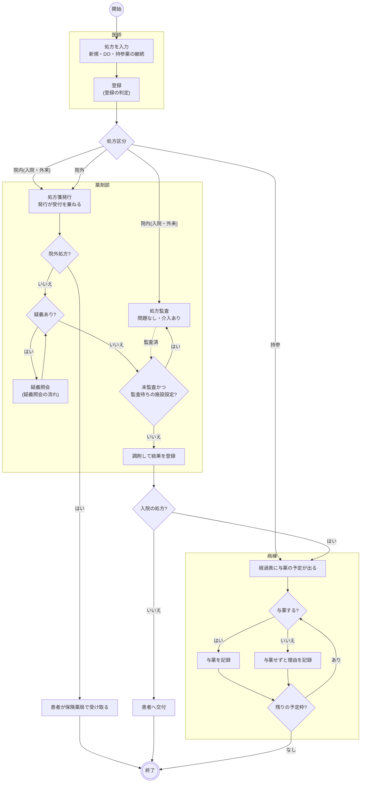
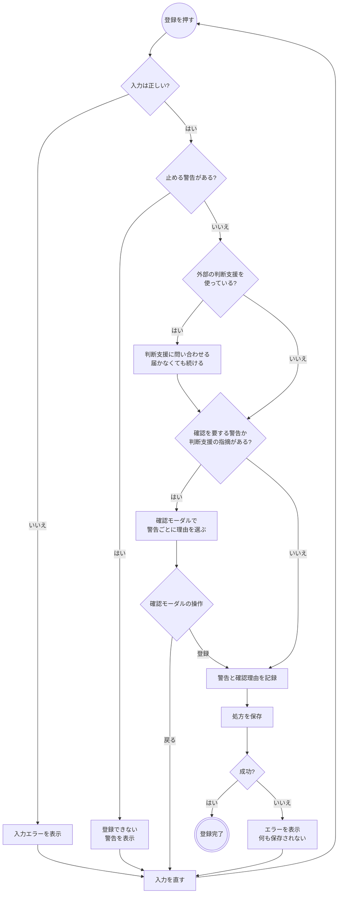
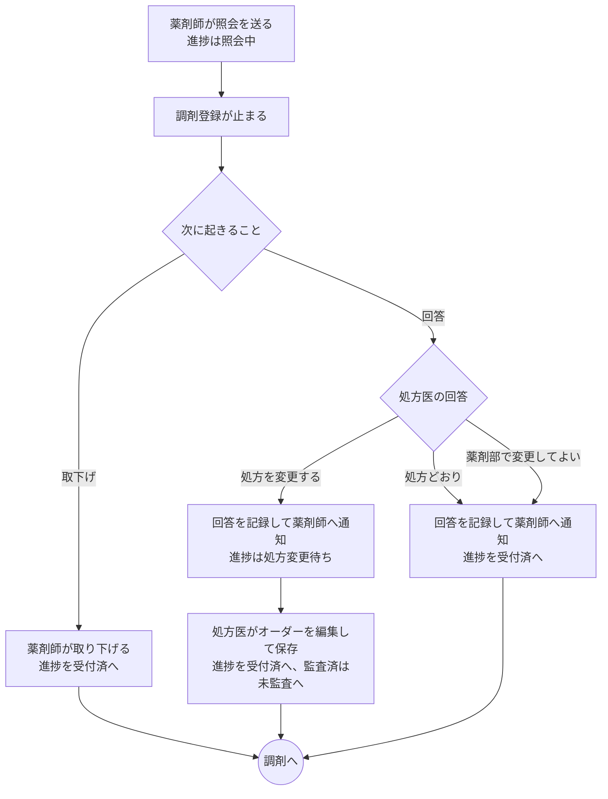

# 処方オーダーの業務フロー

<!-- ../fhir-client/docs/order-flows/prescription.md から scripts/sync-flows.mjs で作る。直接編集しない。 -->

処方オーダーの登録から調剤・与薬までの流れです。

医師 薬剤部 病棟

## 区分ごとの違い

| 処方 | 処方監査 | 処方箋 | 調剤登録 | 与薬の記録 | 医事会計への送信 |
|---|---|---|---|---|---|
| 入院(定期・継続・臨時・退院・緊急) | あり | 院内様式 | あり | 内服の RP を経過表で | なし(外来のみ) |
| 外来・院内 | あり | 院内様式 | あり | なし | あり |
| 外来・院外 | なし(保険薬局が監査) | 様式第2号 | 保険薬局が調剤 | なし | あり |
| 持参(持参薬の継続) | なし(持参薬鑑別で確認) | 刷らない | なし | 経過表で | なし |

## 処方の状態

薬剤部の進み具合を示す状態です。与薬の記録では変わりません。

| 状態 | 変わるきっかけ | 処方一覧のメニューからできること |
|---|---|---|
| 依頼済 | 医師の登録 | 中止 |
| 受付済 | 処方箋発行、疑義照会の回答・取下げ | 取消(依頼済へ)、中止 |
| 照会中・処方変更待ち | 疑義照会 | なし(疑義照会の操作で変わる) |
| 調剤済 | 調剤登録 | 取消(受付済へ。調剤の記録は残る) |
| 中止 | 中止 | 中止取消(依頼済へ) |

中止した処方は医事会計への送信から外れます。会計を送ったあとに中止したときは医事へ連絡し、医事が送り直します。

## 全体の流れ

- 監査と処方箋発行は並行して進みます。既定では未監査でも調剤登録でき、施設設定「監査済まで調剤登録・払出登録を出さない」のときだけ待ちます。
- 疑義照会は依頼済からも送れます(図は受付済からの経路だけを示します)。
- 与薬の予定が出るのは入院の内服だけです。頓用と時刻指定の用法は予定が出ません。
- 「患者へ交付」「患者が保険薬局で受け取る」はシステムの外の作業です。薬剤部から病棟へ薬を届ける作業は記録の対象ではなく、調剤済かどうかに関わらず与薬を記録できます。

## 登録の判定

## 疑義照会の流れ

