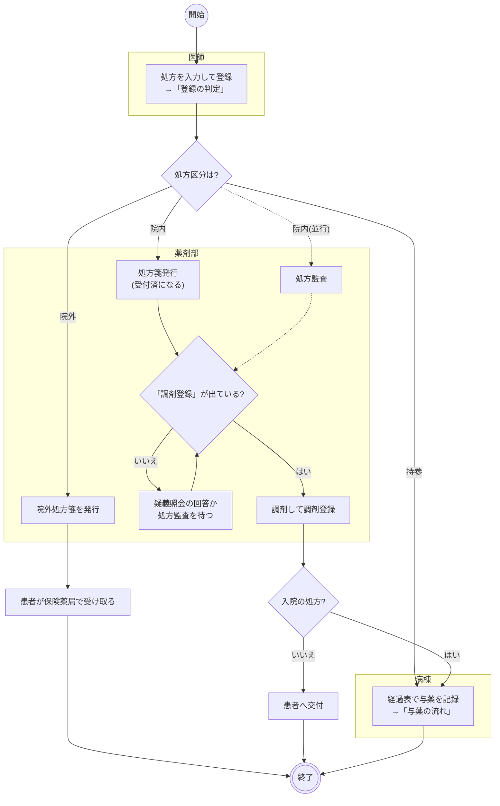
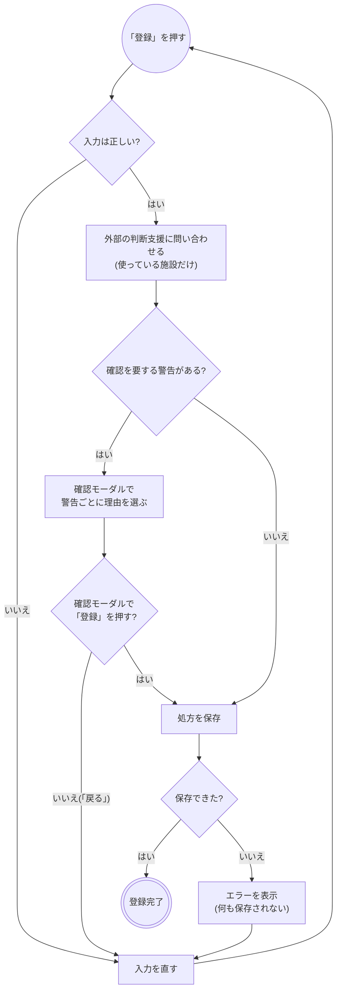
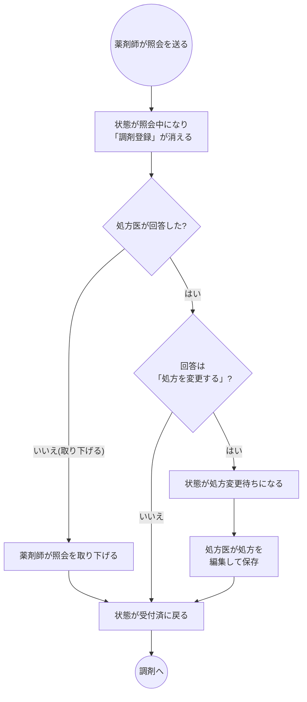
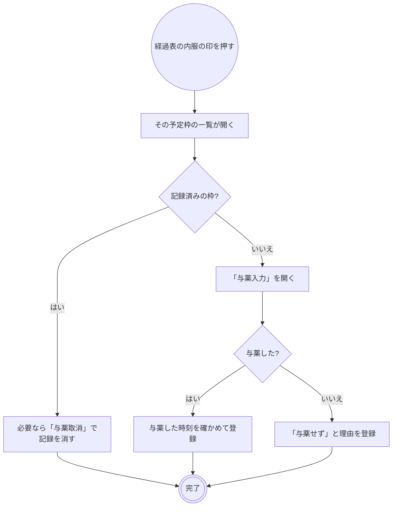

# 処方オーダーの業務フロー

<!-- ../fhir-client/docs/order-flows/prescription.md から scripts/sync-flows.mjs で作る。直接編集しない。 -->

処方オーダーの登録から調剤・与薬までの流れです。

医師 薬剤部 病棟

このページで使う呼び名です。

- **RP**: 1 つの用法でまとめた薬剤の組です。処方は RP ごとに用法と日数(頓用は回数)を持ちます。
- **処方医**: その処方を出した医師です。疑義照会の宛先になります。
- **状態**: 薬剤部の作業がどこまで進んだかを示します(依頼済・受付済・調剤済など)。処方一覧の「ステータス」の列に出ます。

## 区分ごとの違い

処方区分によって、通る段が違います。

| 処方区分 | 処方監査 | 処方箋 | 調剤登録 | 与薬の記録 | 医事会計への送信 |
|---|---|---|---|---|---|
| 入院(定期・継続・臨時・退院・緊急) | する | 院内の様式 | する | 内服を経過表で記録 | 送らない |
| 外来・院内 | する | 院内の様式 | する | しない | 送る |
| 外来・院外 | しない | 院外処方箋 | しない | しない | 送る |
| 持参 | しない | 刷らない | しない | 内服を経過表で記録 | 送らない |

- 院外処方は保険薬局が監査と調剤をします。
- 持参は、入院時に持ってきた薬を続けるための処方です。カルテの「持参薬」タブの「継続」からだけ作り、薬剤部は持参薬鑑別で内容を確かめます。
- 医事会計への送信は外来だけです。

## 全体の流れ

院内処方(入院と外来・院内)を中心に描いています。院外と持参は途中の段を通りません。

「調剤登録」が出ないのは次のときです。

| とき | 「調剤登録」が出るようになる条件 |
|---|---|
| 依頼済(処方箋を発行していない) | 処方箋発行で受付済にする |
| 照会中・処方変更待ち | 疑義照会の回答か取下げで受付済に戻る(→「疑義照会の流れ」) |
| 未監査で、施設設定「監査済まで調剤登録・払出登録を出さない」が有効 | 処方監査で監査済にする |

- **処方監査と処方箋発行**: 並行して進みます。施設設定を有効にしていなければ、未監査でも調剤登録できます。
- **処方監査の結果**: 「問題なし」か「介入あり」を記録します。介入ありのときは介入の種別・内容と処方医の対応を残します。どちらでも監査済になります。
- **疑義照会**: 依頼済の処方にも送れます(図は受付済からの経路だけを描いています)。
- **与薬**: 予定が出るのは入院の内服だけです。調剤済かどうかに関わらず記録できます。
- **システムの外の作業**: 「患者へ交付」「患者が保険薬局で受け取る」と、薬剤部から病棟へ薬を届ける作業は記録しません。

## 処方の状態

薬剤部の作業の進み具合です。与薬の記録では変わりません。

| 状態 | 変わるきっかけ | 処方一覧の行のメニューからできること |
|---|---|---|
| 依頼済 | 医師の登録 | 中止 |
| 受付済 | 処方箋発行、疑義照会の回答・取下げ | 取消(依頼済へ)、中止 |
| 照会中・処方変更待ち | 疑義照会 | なし(疑義照会の操作で変わる) |
| 調剤済 | 調剤登録 | 取消(受付済へ) |
| 中止 | 中止 | 中止取消(依頼済へ) |

- 「照会中」は薬剤師が疑義照会を送って回答を待っている状態、「処方変更待ち」は処方医が「処方を変更する」と回答して、処方の編集を待っている状態です。
- 調剤済の「取消」は状態だけを戻します。調剤登録で入れた記録は残ります。

## 登録の判定

警告は薬剤の行に出ます。重さは 2 段階です。

| 重さ | 例 | 登録のとき |
|---|---|---|
| 表示のみ(橙) | 確認を要する警告以外の注意 | そのまま登録できる |
| 確認を要する(赤) | アレルギーの一致、併用禁忌、用量の上限超過、許可制の抗菌薬、病名禁忌、採用外の薬 | 確認モーダルで 1 件ずつ理由を選ぶ |

- **登録を止める警告**: いまはありません。確認を要する警告も、理由を選べば登録できます。
- **理由の記録**: 選んだ理由は、オーダーの詳細の「警告の確認」に残ります。
- **外部の判断支援**: 施設が外部の判断支援サービスをつないでいるときだけ問い合わせます。入力中にも問い合わせ、返ってきた指摘を入力欄の前に並べます(登録は止めません)。
- **判断支援の指摘の重さ**: 「登録」のときの指摘のうち「重要」のものは、確認モーダルで理由を選ぶまで登録できません。サービスから応答が無いときは、そのまま登録します。

## 疑義照会の流れ

薬剤師が処方医に問い合わせ、回答を受けるまでの流れです。

| 誰が | 操作 | 場所 |
|---|---|---|
| 薬剤師 | 照会を送る、取り下げる | 「部門業務 > 薬剤部門 > 処方一覧」の行の「疑義照会」 |
| 処方医 | 回答する | 通知の「カルテ」か、カルテの処方カードの「疑義照会中」から開く詳細の「回答」 |

- **回答の選択肢**: 「処方どおり」「薬剤部で変更してよい」「処方を変更する」の 3 つです。前の 2 つは回答した時点で受付済に戻ります。
- **薬剤師への通知**: 処方医が回答すると、照会した薬剤師に回答の通知が届きます。「処方を変更する」のときも、回答した時点で届きます。
- **処方を変更する**: 処方医が処方を編集して保存すると受付済に戻ります。監査済だった処方は未監査に戻ります。
- **照会できる数**: 1 つの処方に同時に出せる照会は 1 件です。処方医が決まっていない処方には照会できません。
- **取下げ**: 回答の前だけできます。
- **依頼済から照会したとき**: 回答や取下げのあとは、依頼済ではなく受付済になります。

## 与薬の流れ

入院の内服を、病棟が経過表で記録します。

- **予定枠**: 用法(1 日 3 回・食後など)と、施設設定「内服の与薬の時刻」から、与薬の予定の時刻を出します。頓用と、時刻が決まらない用法は予定が出ません。
- **記録の単位**: 押した予定枠 1 つを記録します。与薬した時刻の初期値は予定枠の時刻です。
- **一部の薬だけ与薬しなかったとき**: 与薬入力で、その薬のチェックを外します。与薬の量は変えられません(処方の 1 回量です)。
- **与薬せず**: 理由が必須です。
- **状態との関係**: 与薬を記録しても、処方の状態(薬剤部の作業)は変わりません。

## 変更・中止・削除

| 操作 | できる場所 | できないとき |
|---|---|---|
| 編集 | カルテの処方カード | |
| DO(前回と同じ内容で出し直す) | カルテの処方カード | |
| 削除 | カルテの処方カード(理由を入力) | 与薬の記録がある |
| 取消(状態を 1 つ戻す) | 処方一覧の行のメニュー | 依頼済、照会中・処方変更待ち、中止 |
| 中止 | 処方一覧の行のメニュー | 調剤済、照会中・処方変更待ち |
| 中止取消 | 処方一覧の行のメニュー | 中止以外 |

- **編集**: 監査済の処方を編集すると未監査に戻り、処方監査の一覧に「再監査」の印で並びます。
- **削除**: 与薬の記録があるときは、先に経過表で「与薬取消」をします。
- **取消と中止の違い**: 「取消」は押し間違いなどで状態を 1 つ前に戻す操作、「中止」は処方そのものの取りやめです。
- **中止取消**: 中止の前の状態ではなく、依頼済に戻ります。
- **中止した処方の編集**: カルテで編集しても中止のままです。
- **医事会計**: 中止した処方は医事会計へ送られません。会計を送ったあとに中止したときは医事課へ連絡し、医事課が送り直します。
- **持参の処方**: 中止は処方一覧からもできます。

## 帳票

| 帳票 | 出す場所 | 内容 |
|---|---|---|
| 処方箋(院内の様式) | 処方一覧の行の「処方箋発行」、「処方箋一括発行」 | 入院と外来・院内の処方。A5 |
| 院外処方箋 | 処方一覧の行の「処方箋発行」 | 外来・院外の処方。国の様式(様式第2号)、A5 |

- **発行と状態**: 依頼済の処方は、発行すると受付済になります。再発行は同じ内容を刷り、状態は変わりません。
- **処方箋一括発行**: 病棟を選んで、その病棟の処方箋を 1 つにまとめて刷ります。外来の処方、照会中・中止の処方、持参の処方は対象になりません。
- **QR コード**: 施設設定「処方箋の印刷」の「院外処方箋にQRコードを印字する」を入れると、院外処方箋が A4 横になり、右半分に処方内容の QR コードが付きます。
- **持参の処方**: 処方箋は刷りません。
