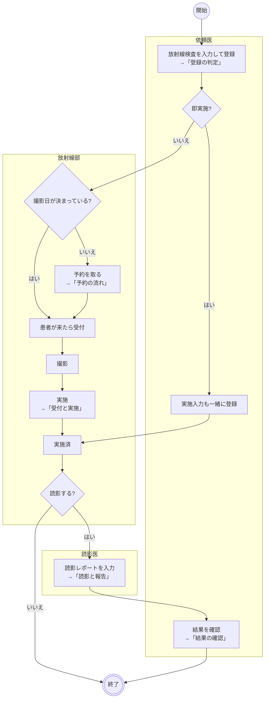
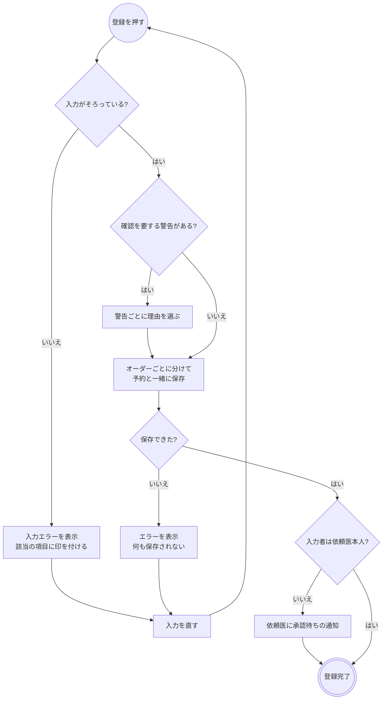
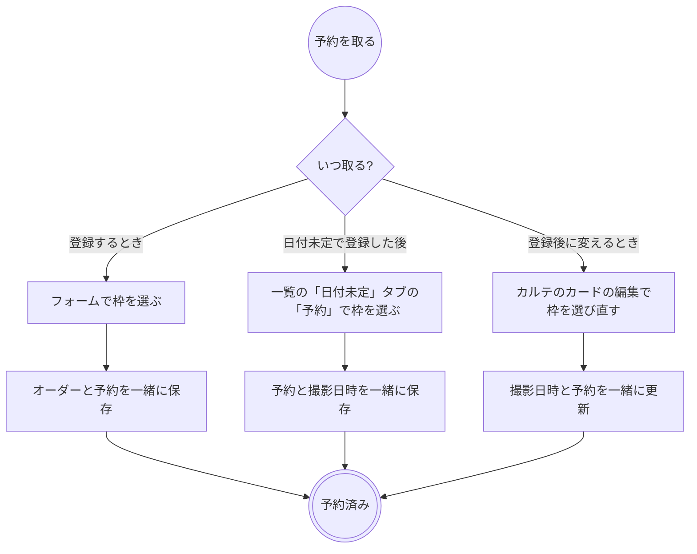
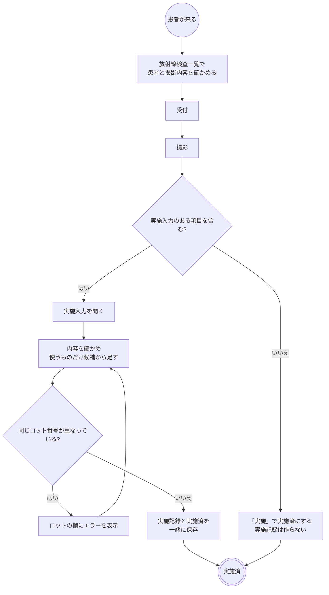
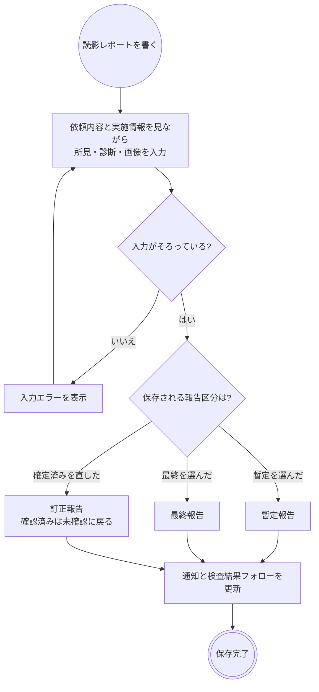
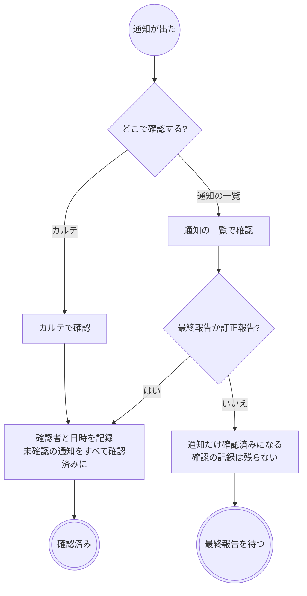

# 放射線検査オーダーの業務フロー

<!-- ../fhir-client/docs/order-flows/rad.md から scripts/sync-flows.mjs で作る。直接編集しない。 -->

放射線検査オーダーの登録から予約・受付・実施・読影・結果確認までの流れです。
放射線治療は[放射線治療の業務フロー](radiotherapy.md)で扱います。

依頼医 放射線部 読影医

## 全体の流れ

この文書で使う呼び名です。

| 呼び名 | 意味 |
|---|---|
| 依頼医 | オーダーを出した医師。結果の通知の宛先になる |
| 即実施 | 登録と一緒に実施入力も済ませる。診察室でその場で撮るときと、事後の入力に使う |
| 事後 | 撮り終えた検査を後から入れるための至急区分 |
| 日付未定 | 撮影日を決めずに登録すること |
| カード | カルテに出る、オーダー 1 件ぶんの表示 |
| 取消 | 状態を 1 つ前へ戻す訂正(実施済 → 受付済、受付済 → 依頼済) |
| 中止 | 検査をやめる。「中止取消」で依頼済に戻せる |
| 削除 | オーダーそのものを消す |

- **入口**: 依頼医はカルテの右ペイン(右側のオーダー入力)の「放射線検査」で、撮影伝票か項目検索から撮影項目を選びます。オーダーセット、クリニカルパスからも出せます。
- **入力する項目**: 撮影項目・至急区分・撮影日時(または予約)・依頼病名・検査目的・特別指示です。
- **放射線部の画面**: 放射線部は「部門業務 > 放射線検査一覧」を撮影日ごとに見ます。撮影時刻の順に並び、時刻の無いオーダーは後ろです。
- **一覧の印**: 至急の行は色が変わり、患者の列に注意区分・アレルギー・感染症の印が出ます。オーダーが登録されても、放射線部への通知は出ません。
- **読影**: 読影レポートは任意です。読影しない検査は実施済のまま終わります。
- **外来の一時終了**: 外来の診察終了で、当日の放射線検査が依頼済・受付済のまま残っていると「一時終了」を選べます。患者が撮影に行き、戻ってから診察を再開します。
- **撮影装置との接続**: 撮影装置・画像管理システム(PACS)とは接続しません。撮影の事実は実施入力で記録し、画像は読影レポートに添付します。
- **DICOM**: カルテの「DICOMビューア」タブは持ち込みの DICOM を見る画面で、オーダーとは結び付きません。

## 放射線検査の状態

放射線部の進み具合を示す状態です。読影の進み具合はこの状態に含めず、一覧の「読影」の列に報告区分(暫定報告・最終報告・訂正報告)で出します。

| 状態 | 変わるきっかけ | 放射線検査一覧からできること |
|---|---|---|
| 依頼済 | 依頼医の登録、受付済からの取消、中止取消 | 受付、中止、予約(日付未定のとき) |
| 受付済 | 受付、実施済からの取消 | 実施、取消(依頼済へ)、中止、予約(日付未定のとき) |
| 実施済 | 実施登録、即実施 | 読影、取消(受付済へ) |
| 中止 | 中止 | 中止取消(依頼済へ) |

- 受付は「患者が放射線部に来て撮影待ちになった」ことを指します。受付を飛ばして実施はできません。
- 日付未定のオーダーは受付・中止・予約はできますが、実施はできません(撮影日が無いため)。
- 読影レポートの有無は状態を変えません。

## 区分ごとの違い

至急区分(通常・至急・事後)と、撮影項目ごとの設定で、流れが分かれます。

| 至急区分 | 撮影日時 | 予約必須の項目 | 日付未定 | 即実施 |
|---|---|---|---|---|
| 通常 | 撮影日は必須、時刻は任意 | 予約か日付未定を選ぶ | できる | 選べる |
| 至急 | 当日に固定、時刻は任意 | 予約を取らない | できない | 選べる |
| 事後 | 当日以前の日付、時刻は任意 | 予約を取らない | できない | 必ず即実施 |

- 通常でも、予約必須の項目を含むオーダーと日付未定のオーダーは、即実施にできません。

撮影項目ごとの次の 3 つの設定が、流れを分けます。

| 設定 | 値 | 流れへの影響 |
|---|---|---|
| オーダー単位 | まとめられる / 単独 | 単独の項目は 1 項目 1 オーダーに分かれる |
| 予約 | 不要 / 必須 | 必須の項目は撮影室の枠を所要時間ぶん押さえる |
| 実施入力 | あり / なし | なしの項目だけのオーダーは「実施」を押すと入力なしで実施済になる |

- 単独の項目は、一度に選んでも、登録すると別のオーダー(別のカード・一覧の別の行)になります。
- 予約必須の項目は、枠の日時がそのまま撮影日時になります。
- たとえば単純撮影は「まとめられる・予約不要」、CT・MRI は「単独・予約必須」に設定します。

## 登録の判定

「入力がそろっている?」で確かめるのは次の項目です。

| 項目 | 条件 |
|---|---|
| 撮影項目 | 1 つ以上ある |
| 撮影日・予約 | 撮影日か予約がある。至急区分が通常なら日付未定でもよい |
| 事後の撮影日 | 至急区分が事後のとき、当日以前 |
| 即実施の実施入力 | 即実施のとき、実施入力がある。実施入力のない項目は不要 |

**警告**

警告は撮影項目を選ぶとフォームに出ます。カルテの記録から拾うので、依頼医が打ち込む必要はありません。

| 対象 | 警告 | 重さ |
|---|---|---|
| 造影(手技が造影、血管撮影) | 造影の注意区分、造影剤アレルギー、eGFR 30 未満 | 確認を要する |
| 造影(手技が造影、血管撮影) | eGFR 45 未満、eGFR を出せない、ビグアナイド系の内服中 | 表示のみ |
| MRI | 体内金属の注意区分 | 確認を要する |
| すべて | 妊娠・授乳、感染症 | 表示のみ |
| 施設の規則 | 「警告の規則マスタ」の規則 | 規則の設定による |

- 確認を要する警告は、理由を選べば登録できます。登録を止める警告はありません。
- 「eGFR を出せない」は、クレアチニンが無いなどで eGFR を出せないときです。
- 施設の規則は、「警告の規則マスタ」で出す場所に放射線を選んだ規則です。

**入力**

- 依頼病名・検査目的・特別指示は撮影項目ごとに入れます。セットは親に入れます。
- CT の造影の確認項目・MRI の安全確認は、特別指示のテンプレート(「CT検査 特別指示」「MRI検査 安全確認・特別指示」)で記入できます。
- オーダーセットの適用も同じフォームで登録します。日付は一括で入りますが、予約必須の項目は適用時に枠を選びます。

**承認**

- 入力者が依頼医本人でないとき(代行入力)は、依頼医の承認待ちになります。承認待ちでもオーダーは放射線部に出ます。

設定する人へ: 特別指示のテンプレートは、撮影項目マスタの既定テンプレートに設定すると最初から選ばれます。

## 予約の流れ

- **枠**: 枠は撮影室の枠表から、所要時間ぶん連続して押さえます。枠の日時が撮影日時です。予約とオーダーは必ず一緒に動きます。
- **日付未定からの予約**: 予約を取ると、カードと一覧の行が予約日へ移ります。
- **枠の選び直し**: 枠を選び直すと、元の枠は空きに戻ります。
- **日付未定タブ**: 放射線検査一覧の「日付未定」タブには日付の無いオーダーが並び、件数がタブ名に出ます。日付は依頼医の側の編集でも決められます。
- **予約タブ**: カルテの予約タブには検査予約も並びますが、そこから日時変更・取消はできません。変更はオーダーの編集、取消はオーダーの中止か削除で行います。
- **外来の受付との違い**: 放射線検査の受付は外来の受付とは別です。検査予約は外来一覧に出ません。

## 受付と実施

実施入力で確かめる項目は次のとおりです。

| 項目 | 内容 |
|---|---|
| 実施時刻 | 初期値は現在時刻 |
| 実施者 | ログイン中の医療従事者 |
| 手技・造影剤・器材 | 撮影項目ごとに決めてある初期の行が並ぶ |
| 被曝線量 | 撮影の種類で欄が変わる |
| コメント | 実施のコメント |

- **初期の行**: 手技・造影剤・器材の初期の行は、撮影項目に紐付けた実施入力データセットから出ます。データセットの候補に無いものだけ全件検索で足します。
- **入力なしで終わる検査**: 造影剤も器材も無い単純撮影は、そのまま「実施登録」で終わります。
- **被曝線量**: CT は CTDIvol・DLP、血管撮影と透視は DAP・透視時間です。単純撮影には欄が出ません。
- **ロット番号**: 造影剤のロット番号の列は、薬剤付加情報で記録対象にした薬のときだけ出ます。
- **途中でやめたとき**: 撮影を途中でやめた記録を残す操作はありません。撮らなかった検査は中止にします。

## 読影と報告

読影レポートを開く入口は 3 つです。どれも実施済のオーダーが対象です。

| 入口 | 開き方 |
|---|---|
| 放射線検査一覧 | 実施済の行の「読影」 |
| カルテのカード | カードのメニュー |
| カルテの「検査結果 > 放射線検査」 | 実施済でレポートの無いオーダーから選ぶ |

「入力がそろっている?」で確かめるのは次の項目です。

| 項目 | 条件 |
|---|---|
| 所見・診断・画像 | どれか 1 つは入っている |
| 診断 | 報告区分が最終のとき必要(「最終報告には診断が必要です。」と出る) |
| 重要所見 | 「重要所見あり」のとき、要点を 1 行書く |
| フォロー推奨 | 「フォロー推奨あり」のとき、内容と期限を書く |

保存すると、報告区分に応じて通知と検査結果フォローが変わります。この文書では、最終報告と訂正報告を合わせて「確定」と呼びます。

| 保存の結果 | 重要所見の通知 | 検査結果確認の通知 | 検査結果フォロー |
|---|---|---|---|
| 暫定報告 | 「重要所見あり」なら出す | 出さない | 載せない |
| 最終報告・訂正報告 | 「重要所見あり」なら出す | 重要所見が未確認の間は出さない | 「フォロー推奨あり」なら載せる |

- **報告区分**: 暫定報告は所見だけでも保存できます(当直帯の速報)。確定済みのレポートを直して保存すると、訂正報告になります。
- **検査結果確認の通知**: 確定のとき、重要所見が未確認で残っていなければ出します。
- **読影医**: 読影医と発行施設は入力欄を持たず、保存時にログイン中の医療従事者と自院が入ります。
- **画像**: 画像はファイル選択・ドラッグ&ドロップ・貼り付けで足し、元画像を残したまま矢印などを描き込めます。1 回に送れる量には上限があるので、超えたら分けて保存します。
- **テンプレート**: 所見は撮影項目マスタの既定テンプレートから記入できます。診断もテンプレートを選べます。
- **読影待ちの一覧**: 読影の担当割当と、日付をまたいだ読影待ちの一覧はありません。一覧は撮影日ごとです。

## 結果の確認

読影レポートが保存されると、依頼医に通知が出ます。重要所見と検査結果確認は、同じレポートに 2 件出しません。

| レポート | 出る通知 |
|---|---|
| 重要所見あり | 重要所見(アラート) |
| 重要所見なしの最終報告・訂正報告 | 検査結果確認(お知らせ) |

- **カルテで確認する場所**: カルテのカードの詳細か、「検査結果 > 放射線検査」です。
- **確認できる人**: 宛先は依頼医ですが、確認は誰でもできます。記録には確認した本人が残ります。
- **暫定報告のうち**: カルテに「確認」は出ません。通知の一覧で重要所見を確認しても確認の記録は残らず、最終報告になると検査結果確認の通知が出ます。
- **要点を書き換えたとき**: 重要所見は未確認に戻ります。
- **「重要所見あり」を外したとき**: 未確認の通知は取り下げます。確認済みの通知はそのまま残ります。
- **訂正報告**: 訂正報告になると未確認に戻ります。
- **未確認のまま 7 日**: 7 日以上未確認なら、検査結果フォローの「未確認の結果」に残ります。
- **フォロー推奨**: 対応を記録するまで、検査結果フォローに残ります。

## 変更・中止・削除

| 操作 | できる場所 | できないとき |
|---|---|---|
| 変更 | カルテのカード | なし(受付済・実施済でもできる) |
| 予約の変更 | カルテのカードの編集 | なし |
| 中止 | 放射線検査一覧の行のメニュー | 実施済のとき(先に取消) |
| 中止取消 | 放射線検査一覧の行のメニュー | なし |
| 取消 | 放射線検査一覧の行のメニュー | 読影レポートがあるとき(先にレポートを削除) |
| 削除 | カルテのカード | 実施記録か読影レポートがあるとき(取消・レポートの削除が先) |
| レポートの削除 | 読影レポートの編集 | なし |

- **変更**: 単独の項目は、他の撮影項目と同じオーダーにできません。変更しても放射線部への通知は出ず、一覧の内容で見えます。代行入力のときは、再度の承認を要する場合があります。
- **予約の変更**: 撮影日時と一緒に動きます。放射線検査一覧の「予約」は、日付未定のオーダーだけです。
- **中止**: 検査予約を取り消して、枠を空きに戻します。医事会計の対象から外れます。
- **中止取消**: 依頼済に戻ります。撮影日時は残りますが、予約は戻りません。必要ならカルテのカードの編集で枠を取り直します。
- **取消**: 1 つ前の状態へ戻す訂正です。実施済からの取消は、実施記録(造影剤・被曝線量を含む)を消します。
- **削除**: 検査予約を取り消して、枠を空きに戻します。状態と、テンプレートの記入内容も一緒に消えます。
- **レポートの削除**: 所見とテンプレートの記入内容を消し、未確認の通知と未対応のフォロー推奨を取り下げます。添付した画像の実体は残ります。
- **DO**: DO(前回と同じ内容で出し直す)はオーダーの内容だけを写します。予約・実施記録・読影レポートは写りません。

## 帳票

放射線検査の専用の帳票はありません。検査案内・造影剤の同意書・依頼票・照射録はまだ出せません。
