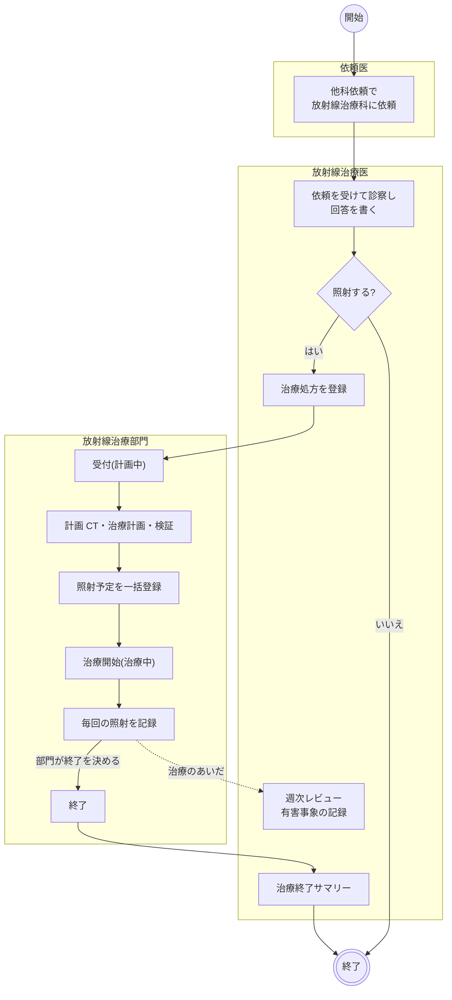
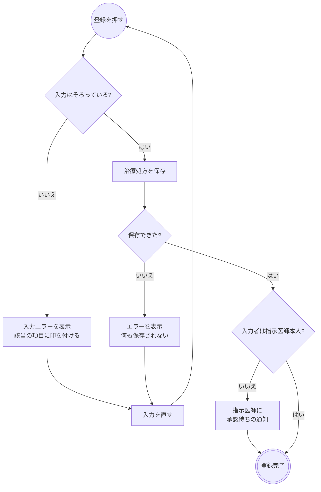
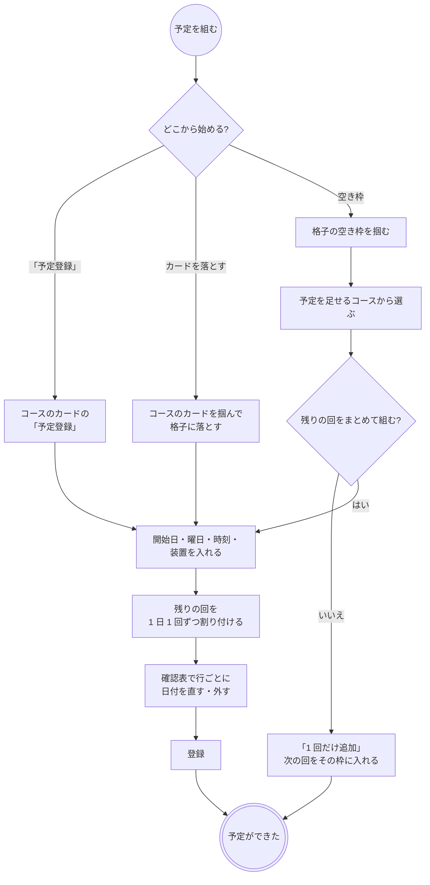
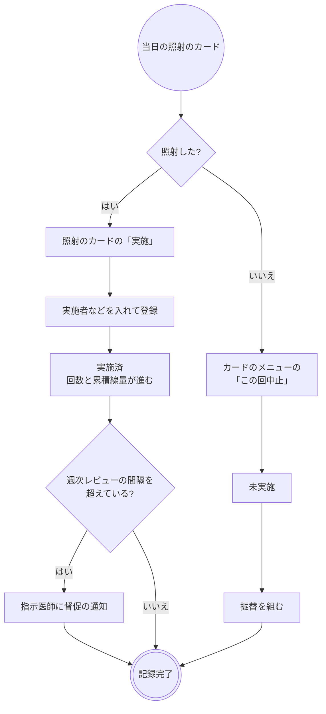
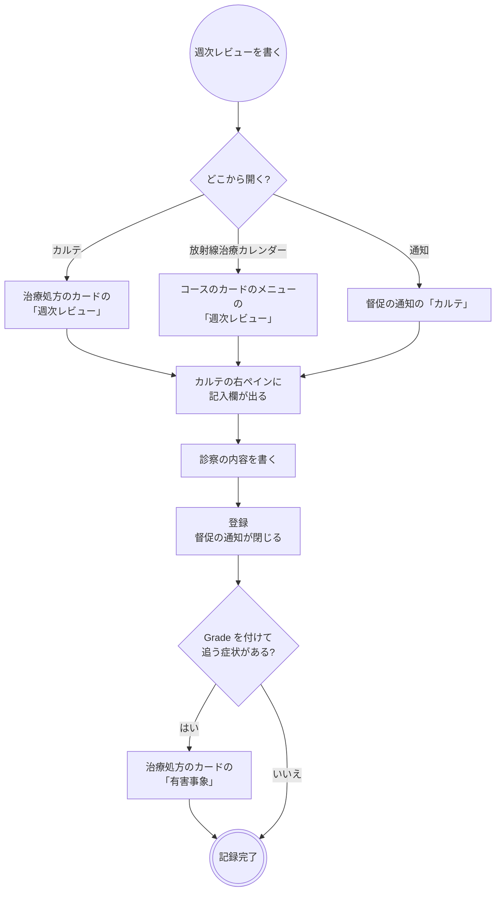
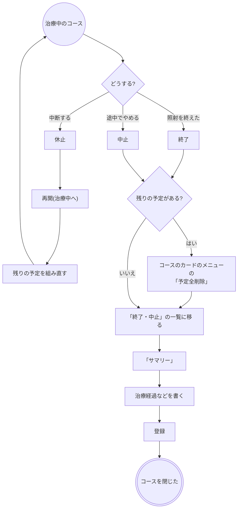

# 放射線治療の業務フロー

<!-- ../fhir-client/docs/order-flows/radiotherapy.md から scripts/sync-flows.mjs で作る。直接編集しない。 -->

放射線治療を、依頼から治療処方・受付・照射予定・毎回の照射・治療中の診察・終了サマリーまで追う流れです。
放射線治療は、臨床医が**他科依頼**で放射線治療科に相談し、放射線治療医が**治療処方**を登録し、放射線治療部門が数週間かけて照射する長い流れです。治療処方 1 件が、治療コース 1 件に当たります。
このシステムでは、依頼・治療処方・毎回の照射を別々に登録します。治療計画の中身(輪郭・ビーム・線量分布)は治療計画装置で扱い、このシステムでは扱いません。
依頼と回答の流れは[他科依頼・チーム依頼](consult-team.md)にあるので、先に読むと分かりやすくなります。

依頼医 放射線治療医 放射線治療部門

## 全体の流れ

| 段 | 行うこと |
|---|---|
| 依頼 | 依頼医が、他科依頼で放射線治療科に依頼する。原発部位・治療目的・照射歴などを書く |
| 回答 | 放射線治療医が、他科依頼一覧で依頼を受けて診察し、回答を書く |
| 治療処方 | 放射線治療医が、標的・Phase・1 回線量・分割回数を登録する |
| 計画 CT・治療計画・検証 | 治療計画装置で行う。このシステムでは扱わない |
| 照射予定 | 部門が、装置・曜日・時刻を決めて一括で登録する |
| 毎回の照射 | 部門が、照射のカードの「実施」で記録する |
| 週次レビュー | 放射線治療医が、治療のあいだ定期的に診察して書く |

この文書で使う呼び名は次のとおりです。

- **治療処方**: 放射線治療医が登録するオーダーです。1 件が治療コース 1 件に当たります。登録と編集の場面では「治療処方」、部門が進める場面では「コース」と呼びます。
- **標的**: 照射する対象です。名称・種別・部位・左右を持ちます。
- **Phase**: 照射の段階です。モダリティ・照射技法・分割回数と、標的ごとの 1 回線量をひとまとまりで決めます。
- **指示医師**: 治療処方を指示した医師です。督促の通知は指示医師に届きます。
- **部門**: 放射線治療部門です。
- **週次レビュー**: 治療中の診察の記録です。画面では「診察」とも出ます。
- **照射記録と照射録**: 照射記録は、このシステムに登録する毎回の照射の記録です。照射録は、法令で保存が求められる照射の記録です。照射記録と治療処方を合わせて、照射録になります。
- **カルテの右ペイン**: カルテの右側のオーダー入力の欄です。

部門が使う画面は「部門業務 > 放射線治療カレンダー」です。

| 場所 | 見えるもの |
|---|---|
| 左の格子(日の表示) | 列が治療装置、縦が時刻。照射 1 回が 1 枚のカードで並ぶ |
| 左の格子(週の表示) | 行が治療装置、列が日 |
| 右の一覧 | 治療コースが 1 件 1 枚のカードで並ぶ。「進行中」と「終了・中止」に分かれる |

カードは 4 種類あります。この文書では次のように呼び分けます。

| 呼び名 | ある場所 | 表すもの |
|---|---|---|
| コースのカード | 放射線治療カレンダーの右の一覧 | 治療コース 1 件 |
| 照射のカード | 放射線治療カレンダーの格子 | 照射 1 回。予定・実施済・未実施のどれか |
| 治療処方のカード | カルテ | 治療処方 1 件 |
| 依頼のカード | カルテ | 他科依頼 1 件 |

- **依頼のテンプレート**: 依頼先に放射線治療科を選ぶと、依頼目的に「他科依頼 放射線治療依頼」のテンプレートが選ばれた状態になります。他院での照射歴は、このテンプレートにだけ書けます。
- **回答と治療処方は別です**: 回答は他科依頼一覧から書きます。治療処方はカルテの右ペインの「放射線治療」(「化学療法」の隣)から登録します。
- **元の依頼**: 治療処方を登録するときに、元の依頼を選べます(任意)。選ぶと、依頼目的がフォームに出ます。
- **行き来**: 依頼のカードの「治療処方表示」と、治療処方のカードの「依頼表示」で行き来できます。
- **部門で代わりに登録するとき**: 放射線治療カレンダーの「新規登録」からも治療処方を登録できます。
- **登録できる医師**: 絞っていません。
- **計画 CT**: 放射線検査オーダーで出します。固定具・呼吸同期・前処置は、放射線検査の特別指示テンプレートで書けます。
- **設定する人へ**: 依頼先の科ごとのテンプレートは施設設定で決めます。

治療処方のカードは、カルテの開始予定日の日に載ります。カードには次のものが出ます。

- 部位・照射技法・併用療法
- 標的ごとのコース合計(「PTV 全乳房 50 Gy / 25 回」のように出ます)
- 照射の回数と累積線量

## 治療コースの状態

| 状態 | 意味 | 変わるきっかけ |
|---|---|---|
| 処方済 | 部門がまだ引き受けていない | 治療処方の登録、受付取消、コースの中止取消 |
| 計画中 | 計画 CT・治療計画・検証のあいだ | 受付、治療開始取消 |
| 治療中 | 初回照射から最終照射まで | 治療開始、再開、終了取消 |
| 休止 | 体調不良・装置の故障などで中断 | 休止 |
| 終了 | 照射を終えた | 終了 |
| 中止 | 途中でやめた | 中止 |

コースのカードからできることは次のとおりです。メニューは、カードの「︙」のメニューです。

| 状態 | カードのボタン | カードのメニュー |
|---|---|---|
| 処方済 | 「受付」 | 「中止」 |
| 計画中 | 「治療開始」「予定登録」 | 「受付取消」「中止」 |
| 治療中 | 「終了」「休止」「予定登録」 | 「照射入力」「治療開始取消」「中止」 |
| 休止 | 「再開」「予定登録」 | 「中止」 |
| 終了 | 「サマリー」 | 「終了取消」 |
| 中止 | 「サマリー」 | 「中止取消」 |

- **状態を動かすのは部門だけ**: 状態は、放射線治療カレンダーのコースのカードから動かします。
- **照射を記録しても状態は変わりません**: 治療処方の回数に達しても、カードに「完了」の印が付くだけです。終了は部門が決めます。
- **日付と理由**: 「終了」は終了日、「休止」は休止日・理由・補足、「中止」は中止日・理由・補足を入れます。
- **「予定登録」が出るとき**: 予定と照射済みの回の合計が、治療処方の回数に届いていないときだけ出ます。
- **押し間違いの訂正**: 「受付取消」「治療開始取消」「終了取消」「中止取消」です。「終了取消」は治療中へ、「中止取消」は処方済へ戻ります。
- **どのカードにもあるメニュー**: 「表示」「週次レビュー」「カルテ表示」です。予定があるときは「予定全削除」も出ます。
- **絞り込み**: 右の一覧は、装置・進捗・患者(氏名と患者番号の部分一致)で絞れます。「進行中」には、処方済・計画中・治療中・休止のコースが並びます。

## 登録の判定

入力する項目と、登録のときに確かめる条件は次のとおりです。

| まとまり | 項目 | 条件 |
|---|---|---|
| コース | 治療目的 | 必須 |
| コース | コース番号 | 必須。新規登録では、その患者の最大の番号 + 1 が入っている |
| コース | 開始予定日 | 必須。オーダーセットやクリニカルパスの内容として入れるときは不要 |
| コース | 担当医・併用療法・元の依頼・対象プロブレム・コメント | 任意 |
| 標的 | 標的 | 1 件以上 |
| 標的 | 名称・部位 | どの標的にも必須 |
| 標的 | 種別・左右 | 任意 |
| Phase | Phase | 1 件以上 |
| Phase | モダリティ・照射技法 | 必須 |
| Phase | 分割回数 | 必須。1〜99 |
| Phase | 使用予定装置 | 任意 |
| Phase | 週あたり回数 | 14 まで |
| Phase | 標的ごとの 1 回線量 | Phase ごとに、どの標的にも必須 |

- **治療プロトコル**: 定型の治療処方です。選ぶと、標的・Phase・治療目的が入ります。
- **部位が決まらないプロトコル**: 「骨転移」のようなプロトコルは部位が空なので、登録のときに選びます。部位の選択肢に無いときは、末尾の「自由記載」で名前を書きます。
- **総線量**: 入力しません。1 回線量 × 分割回数で計算されます。
- **Boost**: Phase 2 に、Boost の標的だけを置きます。
- **同時ブースト(SIB)**: 1 つの Phase に標的を複数置き、1 回線量を変えます。
- **1 日 2 回照射**: 週あたり回数で表します。
- **入力の手間を省くもの**: 治療プロトコルのほかに、DO(前回と同じ内容で出し直す)とオーダーセットが使えます。
- **承認待ち**: 指示医師でない人が代わりに入力すると、指示医師に承認待ちの通知が届きます。研修医が登録したときは、指導医に届きます。承認待ちでも、治療処方は部門に流れます。
- **クリニカルパス**: タスク分類「放射線治療」のタスクには、放射線治療のオーダーが初めから選ばれています。
- **オーダーセット**: 治療処方をオーダーセットに入れられます。開始予定日・担当医・元の依頼は、セットから引き継ぎません。

### 登録のときの警告

警告はフォームの先頭に出ます。カルテの記録から拾うので、医師が打ち込む必要はありません。どれも登録は止めず、理由も聞きません。出ていた警告は、記録に残ります。

| 対象 | 警告 |
|---|---|
| 過去の放射線治療 | この患者の治療コースを表で出し、今回の標的と同じ部位のコースを強調する |
| 妊娠・授乳 | 患者プロファイルの妊娠・授乳 |
| 体内金属・ペースメーカー | 患者プロファイルの注意区分(体内金属のピクトグラム) |
| 施設の規則 | 「警告の規則マスタ」で、出す場所に放射線治療を選んだ規則 |

- **同じ部位**: 部位が一致し、左右が食い違わないコースを、同じ部位として強調します。
- **再照射の強調は気づきのためです**: 隣接部位の重なりや累積線量(EQD2 など)は評価しません。
- **自由記載の部位**: 部位を自由記載した標的は、過去のコースと突き合わせません。

## 照射予定の組み方

| 項目 | 初めの値 |
|---|---|
| 開始日 | 予定か照射記録があれば、その最後の日の翌日。無ければ今日 |
| 照射する曜日 | 月〜金 |
| 開始時刻 | カードを落とした枠・掴んだ枠の時刻 |
| 1 回の所要時間 | 15 分。空き枠を縦に引くと、その長さ |
| 装置 | カードを落とした枠・掴んだ枠の装置 |

- **予定を組めるコース**: 受付後(計画中・治療中・休止)で、残りの回があるコースだけです。処方済のコースは、先に受付します。
- **割り付け**: 残りの回を、Phase の順に、選んだ曜日へ 1 日 1 回ずつ割り付けます。祝日と休診日は飛ばします。
- **装置の点検日**: 割り付けは装置の点検日を考えません。確認表で直してください。割り付け直すと、直した内容は消えます。
- **照射しなかった回の番号**: 「この回中止」にした回の番号は空いたままになります。次に予定を組むとき、その番号から振替として埋まります。「この回中止」は「照射の記録」で説明します。
- **重なり**: 同じ装置・同じ時刻の重なりは止めません。格子で横に並んで見えます。
- **1 日 2 回照射**: 1 日 2 回の割り付けは、まだできません。1 日 1 回で割り付けてから「予定変更」で直します。

予定は、登録したあとも直せます。

- **動かす**: 予定の照射のカードは、掴んで動かせます。日の表示では時刻と装置、週の表示では日と装置を変えられます。
- **長さを変える**: 日の表示では、カードの上下の縁を掴んで、開始・終了時刻を変えられます。刻みは 5 分です。
- **「予定変更」**: 照射のカードのメニューの「予定変更」でも、日時と装置を直せます。
- **残りを後ろへずらす**: 休止などで残りをずらすときは、コースのカードのメニューの「予定全削除」のあと、もう一度「予定登録」します。

## 照射の記録

照射 1 回には、次の 4 つの状態があります。

| 照射 1 回の状態 | 意味 | なるきっかけ |
|---|---|---|
| 予定 | これから照射する | 照射予定の登録、回の「中止取消」 |
| 実施済 | 照射した | 「実施」、「照射入力」 |
| 未実施 | 照射しなかった。理由が残る | 「この回中止」 |
| 取消済 | 誤って登録した実施済を取り消した | 照射記録の「取消」 |

| 項目 | 条件 |
|---|---|
| 照射日・Phase・何回目・実照射線量 | 必須。予定から入っている |
| 実施者 | 必須 |
| 装置 | 予定から入っている |
| 開始・終了時刻 | 入れるなら、終了は開始より後 |
| 位置照合・コメント | 任意 |

- **予定を作らずに入れるとき**: 治療中のコースのカードのメニューの「照射入力」で、1 回ぶんを入れます。何回目・Phase・線量は、治療処方と照射済みの回から入ります。
- **「この回中止」**: 照射しなかった回を、理由を選んで残す操作です。その回は回数に数えず、番号は空きます。
- **コースの「中止」とは別です**: 「この回中止」は 1 回ぶんだけの操作です。コースをやめるときは、コースのカードの「中止」を使います。
- **回の「中止取消」**: 「この回中止」を押し間違えたときは、未実施の照射のカードの「中止取消」で予定に戻します。コースの「中止取消」とは別の操作です。
- **振替**: 「予定登録」か「1 回だけ追加」で組みます。
- **実施済の取消**: コースの詳細を開き、照射記録の「取消」を押します。詳細は、コースのカードの「表示」か、照射のカードの「コース表示」で開きます。カルテの詳細からは取り消せません。
- **取り消した記録**: 消えずに取消済として残り、回数と累積線量から外れます。照射録は保存が求められるためです。
- **照射記録は治療処方なしでは作れません**: 照射録に要る項目は、照射記録と治療処方を合わせてそろえます。項目は、患者の氏名・性別・年齢、照射年月日、照射方法、指示した医師、指示の内容です。

## 治療中の診察(週次レビュー)と有害事象

- **右ペインに出るもの**: そのコースのこれまでの週次レビューの一覧と、記入欄です。記入欄は、前回と同じ様式が選ばれています。初回は施設で決めた様式です。
- **書く内容**: 様式「放射線治療 週次レビュー」では、全身状態・体重・食事摂取、照射野の皮膚・粘膜炎・自覚症状、治療継続の判断と対応・次回予定を書きます。
- **カルテでの表示**: 週次レビューは、カルテのタイムラインにも出ます。
- **週次レビューと有害事象の違い**: 週次レビューは、その日に診てどう判断したかの記録です。有害事象は、症状 1 件ずつの記録です。
- **有害事象の入力**: CTCAE の用語・Grade・発現日・回復日・対処を入れます。入力欄は化学療法と同じです。
- **有害事象の表示**: 治療処方の詳細、カルテのタイムライン(発現日の日)、患者プロファイルの「有害事象」に出ます。

週次レビューが空いたコースは、次のように分かります。

- **カレンダーでの表示**: 治療中のコースのカードに、「診察 09-15(7 日)」のように最後の診察日と経過日数が出ます。間隔を超えたコースと「診察なし」のコースは強調されます。
- **見張るのは治療中だけ**: 処方済・計画中のコースは、照射が始まっていないので見張りません。
- **督促の通知**: 照射を記録したときに、前回の週次レビューから間隔を超えていると、指示医師に督促の通知が届きます。一度も週次レビューが無いときも届きます。
- **督促は重ねません**: そのコースに未対応の督促があれば、新しく出しません。
- **間隔**: 入院・外来を問わず同じ間隔です。
- **設定する人へ**: 間隔は「管理 > 施設設定 > 放射線治療の診察間隔」で決めます。初めは 7 日です。外来放射線照射診療料の「7 日間に 1 回」に合わせた値です。週次レビューの初回の様式も、施設設定で選びます。

## 休止・終了・中止と治療終了サマリー

- **理由**: 休止の理由は休止・中止理由マスタの「休止」用、中止の理由は「中止」用から選びます。
- **再開**: 再開すると、休止日と理由は消えます。残りの予定は、「予定全削除」のあと「予定登録」で組み直します。
- **休止のままやめるとき**: コースの「中止」を使います。
- **中止できる状態**: コースの「中止」は、処方済・計画中・治療中・休止のどれからでもできます。
- **残った予定は消えません**: 終了・中止しても、残っている照射予定はカレンダーに残ります。コースのカードのメニューの「予定全削除」で消します。

治療終了サマリーは、「終了・中止」の一覧のコースのカードから書きます。

| サマリーの内容 | 入り方 |
|---|---|
| 期間・回数 | 照射記録から入っている |
| 標的ごとの実照射線量 | 照射記録から入っている |
| 完遂かどうか | 入っている |
| 中止の理由 | コースの中止から引き継ぐ |
| 治療経過・急性有害事象・今後の方針 | 医師が書く |

- **印**: サマリーを書くまで、コースのカードに「サマリー未作成」と出ます。書くと、カルテの治療処方のカードに「サマリーあり」と出ます。
- **書き直し**: 書き直すと、期間・回数・線量だけが照射記録から入り直します。書いた本文は残ります。
- **標的ごとの回数**: その標的に線量を入れた回を数えます。Boost があると、標的ごとに回数が違います。

## 変更・中止・削除

| 操作 | どこから | できるとき |
|---|---|---|
| 治療処方の変更 | カルテの治療処方のカードの編集 | いつでも |
| コースの中止 | コースのカードのメニューの「中止」 | 処方済・計画中・治療中・休止 |
| 治療処方の削除 | カルテの治療処方のカード | 処方済だけ |
| DO | カルテの治療処方のカード | いつでも |
| 照射予定の削除・移動 | 予定の照射のカード | 予定だけ |

- **変更で保たれるもの**: 状態と、終了・中止・休止の日付と理由は保たれます。
- **治療中・終了の治療処方**: 標的と Phase を消せません。照射記録が、その標的と Phase に対して登録されているためです。
- **中止はカレンダーから**: カルテの治療処方のカードに「中止」はありません。
- **受付後は削除できません**: 計画中以降は、カレンダーでコースを中止するか、受付を取り消します。
- **DO**: 新しいコースとしてコピーされます。コース番号は振り直され、開始予定日は今日になります。元の依頼は引き継がず、打ち切った Phase はコピーされません。
- **実施済・未実施の照射のカード**: 動かせず、日時も変えられません。
- **Phase の打ち切り**: 治療中の Phase の打ち切り(再計画)は、画面からはまだできません。
- **入院と外来の切り替え**: 治療の途中で入院から外来に切り替わったことを表す方法は、まだありません。入院・外来の区分は、登録したときのままです。

## 放射線検査との違い

| | 放射線検査 | 放射線治療 |
|---|---|---|
| 登録する人 | 依頼医 | 放射線治療医 |
| オーダーの単位 | 検査 1 回 | 治療コース 1 件 |
| 入力する項目 | 撮影項目・部位・依頼病名・検査目的 | コース・標的・Phase |
| 入力の手間を省くもの | オーダーセット | 治療プロトコル、DO、オーダーセット |
| 日程 | 予約枠から選ぶ | 受付後に部門が照射予定を組む |
| 実施 | 1 回 | 照射 1 回ごとに記録する |
| 結果 | 読影レポート | 週次レビュー・有害事象・治療終了サマリー |
| 部門の画面 | 放射線検査一覧 | 放射線治療カレンダー |
| 登録時の警告 | 確認を要するものがある | どれも表示だけ |
| 退院 | – | 退院で止めない |
| レセコンへの送信 | 実施記録から送る | 照射記録から、照射 1 回ごとに送る |

- **登録する人**: 依頼医は、他科依頼で放射線治療科に頼みます。
- **オーダーの単位**: 治療コース 1 件は、数週間・数十回の照射になります。
- **入力する項目**: 放射線治療の項目は「登録の判定」の表にあります。
- **日程**: 放射線治療は予約枠を使いません。
- **実施**: 照射しなかった回も、理由つきで残します。
- **部門の画面**: 放射線検査一覧は日付で区切ります。放射線治療カレンダーは「全体の流れ」で説明しています。
- **退院**: 照射は外来で続くのがふつうなので、退院では止めません。

## 帳票

専用の帳票はありません。
