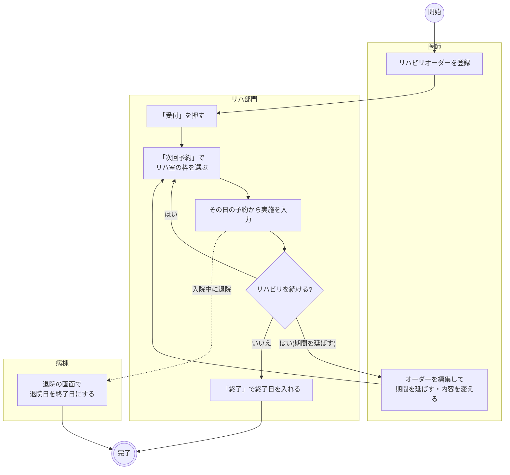
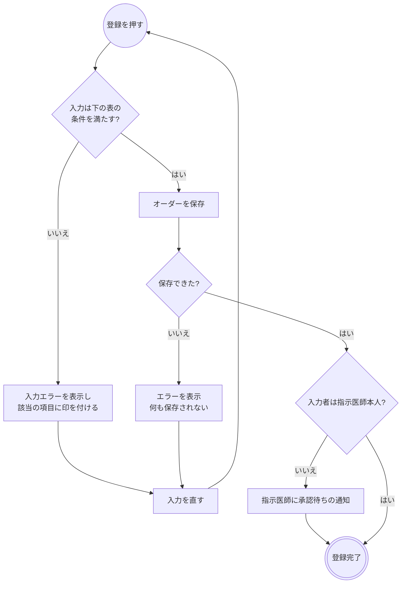
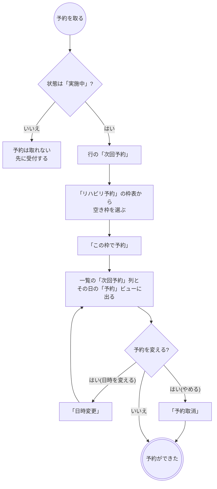
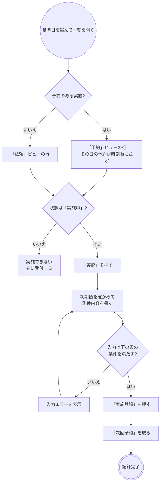
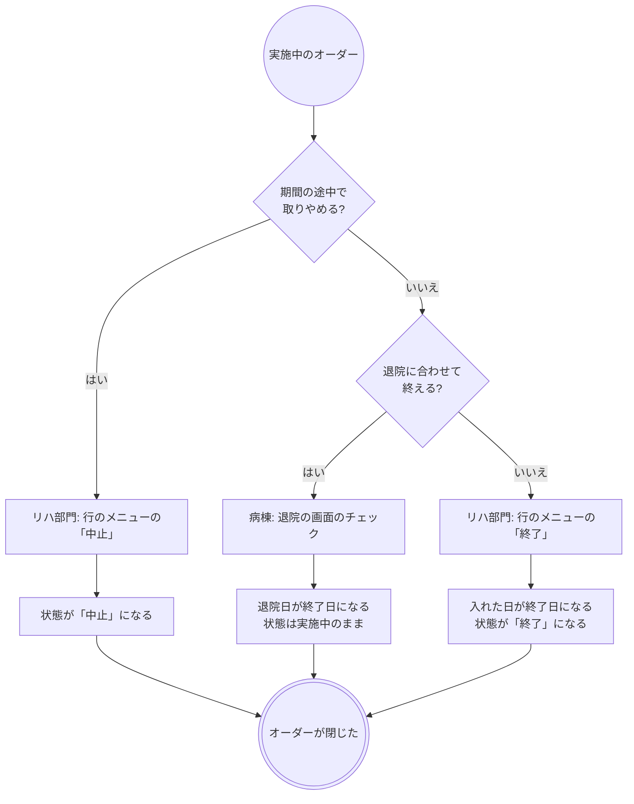

# リハビリオーダーの業務フロー

<!-- ../fhir-client/docs/order-flows/rehab.md から scripts/sync-flows.mjs で作る。直接編集しない。 -->

リハビリオーダーを、登録からリハ部門の受付・次回予約・日々の実施・終了(退院での打ち切り)まで追う流れです。
リハビリは 1 つのオーダーが数週間〜数か月続き、その間に実施が何度も積み上がる**期間継続型**のオーダーです。オーダーで決めるのは「いつからいつまで、どの区分・療法を週何回・1 回何単位」までです。何時に行うかはリハ部門がそのつど取る予約で決め、行った結果は実施記録に残します。

医師 リハ部門 病棟

このページでの呼び名です。

- **状態**: オーダーをリハ部門が受けたかどうかの段階(依頼済・実施中・終了・中止)。一覧では「ステータス」の列に出ます。
- **終了日**: オーダーの期間の終わりの日。状態の「終了」とは別のもので、終了日が付いても状態が「終了」になるとは限りません(→「終了・中止・退院」)。
- **基準日**: リハビリ一覧で選ぶ日付。その日に始まっていて、まだ終わっていないオーダーが並びます。
- **指示医師**: オーダーの指示を出した医師。

## 全体の流れ

- **入口**: オーダーはカルテの右ペイン(右側のオーダー入力)の「リハビリ」から出します。リハ部門の一覧から代わりに出す入口はありません。
- **部門の画面**: 「リハビリ部門 > リハビリ一覧」です。ホームでは理学療法士・作業療法士・言語聴覚士に件数のカードが出ます。
- **終了日を入れないオーダー**: 外来の継続リハビリは終了日を入れずに出し、リハ部門が「終了」で打ち切ります。
- **終了日を入れたオーダー**: その日を過ぎるとリハビリ一覧に出なくなります。状態は実施中のまま残ります。
- **取りやめ**: リハビリを取りやめるときは、リハ部門が一覧で「中止」にします(→「終了・中止・退院」)。

## オーダーの状態

| 状態 | 意味 | 変わるきっかけ | 一覧の行からできること |
|---|---|---|---|
| 依頼済 | リハ部門がまだ受けていない | 医師の登録、受付取消、中止取消 | 受付、中止 |
| 実施中 | 受けた。期間中ずっとこの状態で実施が積み上がる | 受付、終了取消 | 実施、次回予約、終了、受付取消、中止 |
| 終了 | 期間を打ち切った | 終了(終了日) | 終了取消(実施中へ) |
| 中止 | リハビリを取りやめた | 中止 | 中止取消(依頼済へ) |

- 状態を動かすのはリハ部門(リハビリ一覧)だけです。実施を入力しても状態は変わりません。
- ただし、クリニカルパスの画面から依頼済のオーダーを実施したときだけ、同時に実施中になります(終了にはなりません)。
- 一覧の行に直接出るボタンは「受付」「実施」「次回予約」「表示」です。
- 「終了」「受付取消」「終了取消」「中止」「中止取消」は、押し間違えると期間や状態が動くので、行のメニュー(行の右端の「︙」)に入れてあります。

## 登録の判定

| 入力する項目 | 条件 |
|---|---|
| 疾患別リハ区分 | 必須 |
| 療法種別(PT / OT / ST) | 1 つ以上。併用できる |
| 1 回あたりの単位数 | 1〜24 の整数 |
| 週あたりの回数 | 空か、1〜7 の整数 |
| 開始日 | 必須。オーダーセット・クリニカルパスに入れておく内容では不要 |
| 終了日 | 空か、開始日以降 |
| 起算日 | 空か、開始日以前 |
| 対象疾患名 | 必須 |

このほかに入外区分・対象プロブレム・コメントを入れます。

- **対象疾患名**: 疾患別リハの算定要件なので必須です。登録病名から選ぶ対象プロブレムとは別に、リハビリの対象として挙げた疾患を文字で残します。
- **起算日**: 発症日・手術日です。一覧の「起算日」列に出て、医事会計で発症年月日のコメントを付けるときに使います。算定日数の上限(150 日・180 日など)の警告はありません。
- **単位数と回数**: 1 単位は 20 分です。週あたりの回数は目安で、曜日は決めません。
- **入外区分**: 初期値は、入院中なら「入院」です。
- **承認待ち**: 承認待ちでもオーダーはリハ部門に届きます。
- **登録時の警告**: ありません。

## 予約

予約は、リハ部門がオーダーを受付した後に、行の「次回予約」でそのつど取ります。次回をいつにするかは毎回の実施のあとに決めるのが外来リハの実態なので、オーダー登録のときには予約を取りません。

- **変更と取消の場所**: 「日時変更」「予約取消」は、リハビリ一覧の「予約」ビューの行のメニューと、カルテの予約タブから行えます。
- **枠**: リハ室(場所)ごとの「リハビリ予約」の枠表から選びます。療法士ごとの枠はありません(担当療法士は実施記録に残します)。
- **枠の準備**: 枠表は、設定する人が管理画面の「予約枠」で作ります。
- **定員**: 枠の定員は検査と違って 1 に固定しません。同じ時間帯に複数の患者を受け入れられます。
- **1 予約 = 1 枠**: 単位数ぶんの連続枠をまとめて押さえることはできません。
- **カルテの予約タブ**: 「リハビリ」の印が付きます。検査の予約と違い、ここから取消・日時変更ができます(予約がオーダーの日時と連動しないためです)。
- **外来患者一覧**: リハビリの予約は出ません。

## 日々の実施

| 実施で入れる項目 | 開いたときの初期値 | 条件 |
|---|---|---|
| 実施日 | 入っている | 必須 |
| 時刻 | 予約から開いたときは予約の時刻 | – |
| 療法 | オーダーの療法が 1 つならその療法 | 必須。オーダーに載っている療法から選ぶ |
| 単位数 | オーダーの単位数 | 必須。1〜24 |
| 担当療法士 | ログイン中の人 | 必須 |
| 訓練内容 | – | 自由記載 |

- **登録した後**: 一覧の「本日」の列に実施量が出ます。状態は実施中のままです。
- **同じ日に 2 つの療法**: PT と OT を同じ日に行ったときは、療法ごとに 1 回ずつ登録します。
- **担当療法士**: 選べるようにしてあるのは、実施したのがログインした人とは限らないからです。受付の人が代わりに入れる運用があります。
- **「本日」の列**: その日に実施したかを日ごとに見るための列です。「未実施」と出ていても状態は実施中です。
- **入れないもの**: 器材・薬剤・訓練項目の入力はありません(リハビリの算定は単位数で決まるためです)。
- **絞り込み**: 一覧は疾患別リハ区分・療法種別・入外区分・病棟・診療科・ステータスで絞れます。

**実施の取消**

- 一覧の行の「表示」を開き、実施履歴の「取消」を押します。
- 一覧の「表示」は基準日のぶんの実施しか出しません。別の日の実施を取り消すときは、基準日をその日にします。
- カルテの詳細からは取り消せません。

## 終了・中止・退院

オーダーを閉じる方法は 3 つあります。どれも、もう来ない日の予約を同じ操作で取り消して枠を空けます。それより前の予約は通院の記録として残ります。

| 方法 | 操作 | 状態 | 終了日 | 取り消す予約 | リハビリ一覧 |
|---|---|---|---|---|---|
| 終了 | 行のメニューの「終了」で終了日を入れる | 終了 | 入れた日(開始日以降) | 終了日の翌日以降 | 終了日を過ぎると出ない |
| 中止 | 行のメニューの「中止」 | 中止 | 付かない | 今日以降 | 基準日が期間内なら中止の行として並ぶ |
| 退院 | 退院の画面の「リハビリオーダーを退院日で終了する」 | 実施中のまま | 退院日 | 退院日の翌日以降 | 終了日を過ぎると出ない |

- **退院のチェック**: 対象は、退院日より後まで続くオーダーです。外来リハに切り替えて続けることもあるので、食事とは別のチェックにしてあり、外せます。
- **退院と状態**: 退院で止めたオーダーは終了日が付くだけで、状態は「終了」になりません。
- **入院から外来への切り替え**: 切り替えを表す手段はありません。入外区分は登録時の値のままなので、外来で続けるときは新しいオーダーを出します。

**押し間違えたとき**

| 操作 | 戻る状態 | 戻らないもの |
|---|---|---|
| 「終了取消」 | 実施中 | 終了日、取り消した予約 |
| 「中止取消」 | 依頼済 | 取り消した予約 |

- **予約**: 取り消した予約は戻りません(取り消したあとに枠が埋まっていることがあるためです)。続けるときは「次回予約」で取り直します。
- **終了日**: 「終了取消」で終了日を消さないのは、打ち切った期間まで巻き戻すと、その間の実施記録と食い違うためです。期間を延ばしたいときは、オーダーを編集して終了日を直します。
- **中止取消の場所**: 中止のオーダーは、一覧の基準日が期間内なら中止の行として並びます。そこから「中止取消」ができます。

## 変更・削除・DO

| 操作 | できる場所 | 注意 |
|---|---|---|
| 変更 | カルテのカードの編集 | 状態・実施記録・予約は変わりません。中止のオーダーは中止のまま保存します |
| 中止 | リハビリ一覧の行のメニュー | カルテのカードに中止はありません(→「終了・中止・退院」) |
| 削除 | カルテのカード | 実施記録が無いオーダーだけできます |
| DO(前回と同じ内容で出し直す) | カルテのカード | 新しいオーダーとして写します |

- **削除と予約**: 取ってある予約は、削除と同じ操作で取り消して枠を空けます。
- **実施があるとき**: 実施を取り消してから削除するか、削除せずに中止します。
- **DO で写るもの**: 開始日は今日、終了日は空になります。起算日・対象疾患名はそのまま引き継ぎます。

## カルテ・パス・セットとのつながり

**カルテのカード**

- オーダーのカードは、カルテの開始日の所に 1 枚載ります。
- 見出しは「入外区分 / 期間」(例: 期間は「8/29〜継続中」)です。
- 中身は区分・療法・頻度(例:「週 3 回・1 回 2 単位」)と、直近の実施履歴です。
- 実施履歴には件数と合計単位(例:「12回 計24単位」)が添えられます。全件は詳細で見ます。
- 実施履歴をカードに出すのは実施中と終了のときです。依頼済と中止のカードには出しません。

**クリニカルパス・オーダーセット**

- クリニカルパスでは、タスク分類「リハビリ」の既定のオーダー種別がリハビリオーダーです。
- オーダーセットにも入れられます。開始日・終了日・起算日・対象プロブレムはセットに入れません。

## 検査・処置との違い

| | 検査・処置(放射線・生理・処置など) | リハビリ |
|---|---|---|
| オーダーの単位 | 検査・処置 1 回 | 期間(開始日〜終了日。終了日が無ければ継続中) |
| 入力する項目 | 項目・部位・依頼病名など | 区分・療法・単位数・回数・期間など(→「登録の判定」) |
| マスタ | 項目マスタ・伝票 | 持たない(疾患別リハ区分と療法種別は診療報酬の固定の分類) |
| 予約 | オーダー登録と一緒に取る(1 オーダー 1 予約) | リハ部門が受付後に「次回予約」をそのつど取る(1 オーダーに何件も) |
| 実施 | 1 回で状態が「実施済」になる | 何回実施しても状態は「実施中」のまま。実施記録が積み上がる |
| 部門の一覧 | その日に実施予定のオーダー | 基準日に始まっていて、まだ終わっていないオーダー |
| 終わり方 | 実施で終わる | リハ部門の「終了」か、退院での打ち切り |
| 登録時の警告 | 確認を要するものがある | 無い |
| 医事会計 | 実施記録から送る | 実施記録から送る(実施 1 回ごと) |

## 帳票

専用の帳票はありません。リハビリテーション実施計画書の様式も、まだ出せません。
