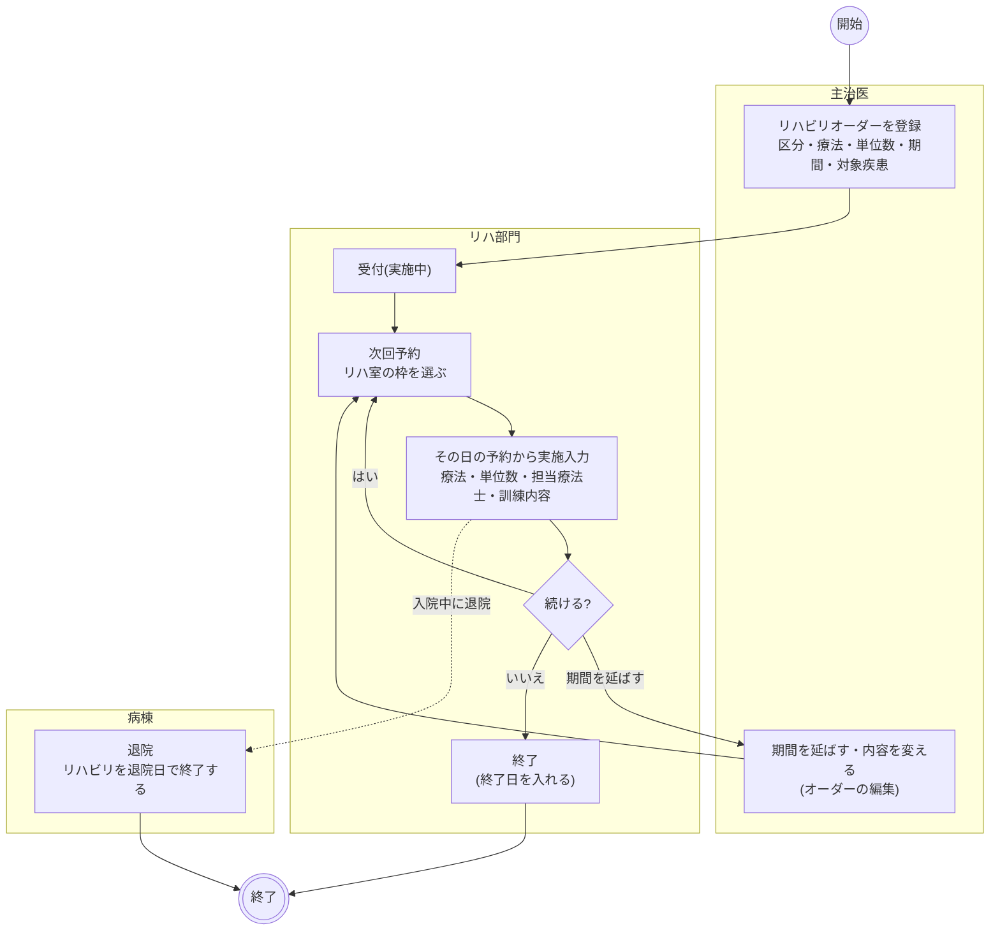
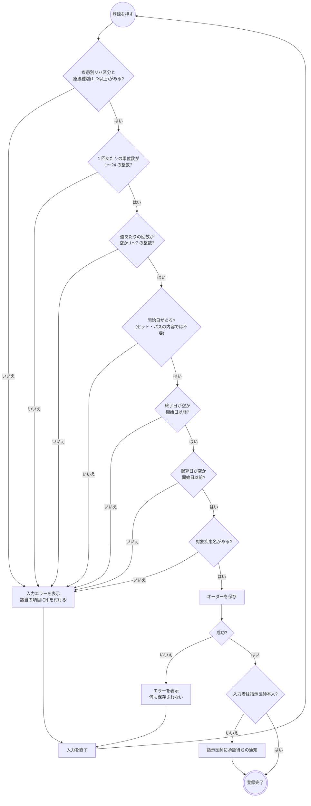
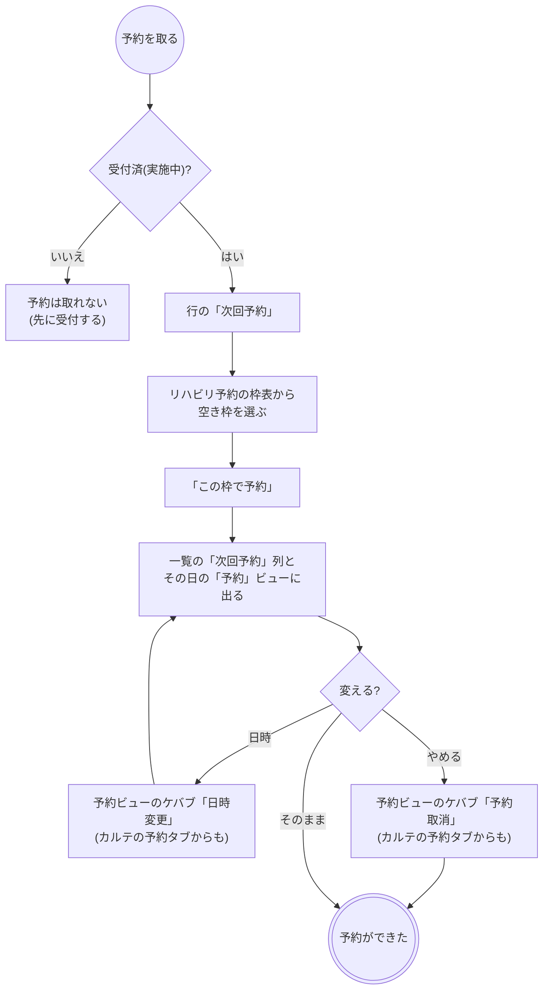
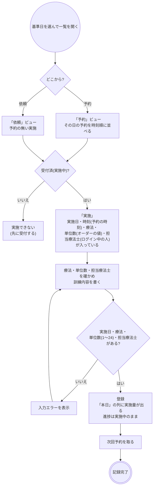
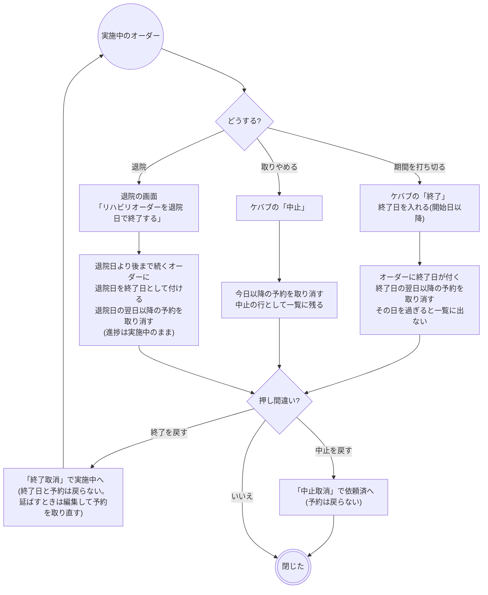

# リハビリオーダーの業務フロー

<!-- ../fhir-client/docs/order-flows/rehab.md から scripts/sync-flows.mjs で作る。直接編集しない。 -->

リハビリオーダーを、登録からリハ部門の受付・次回予約・日々の実施・終了(退院での打ち切り)まで追う流れです。
リハビリは 1 つのオーダーが数週間〜数か月続き、その間に実施が何度も積み上がる**期間継続型**のオーダーです。オーダーは「いつからいつまで、どの区分・療法を週何回・1 回何単位」という処方箋で、何時に行うかは部門が都度取る予約と、実際に行った日の実施記録が担います。

主治医 リハ部門 病棟

## 検査・処置との違い

| | 検査・処置(放射線・生理・処置など) | リハビリ |
|---|---|---|
| オーダーの単位 | 検査・処置 1 回 | 期間(開始日〜終了日。終了日が無ければ継続中) |
| 入力する項目 | 項目・部位・依頼病名など | 入外区分・疾患別リハ区分・療法種別(PT/OT/ST、併用可)・1 回あたりの単位数・週あたりの回数・開始日・終了日・対象疾患名・起算日・対象プロブレム・コメント |
| マスタ | 項目マスタ・伝票 | 持たない(疾患別リハ区分と療法種別は診療報酬の固定の分類) |
| 予約 | オーダー登録と一緒に取る(1 オーダー 1 予約) | 部門が受付後に「次回予約」を都度取る(1 オーダーに何件も) |
| 実施 | 1 回で進捗が「実施済」になる | 何回実施しても進捗は「実施中」のまま。実施記録が積み上がる |
| 部門の一覧 | その日に実施予定のオーダー | 基準日に効いている(始まっていて、まだ終わっていない)オーダー |
| 終わり方 | 実施で終わる | 部門の「終了」(終了日を入れる)か、退院での打ち切り |
| 登録時の警告 | 確認を要するものがある | 無い |
| 医事会計 | 実施記録から送る | 実施記録から送る(実施 1 回ごと) |

- 入口はカルテの右ペイン「リハビリ」です。部門の一覧から代わりに起こす入口はありません。
- クリニカルパスのタスク分類「リハビリ」の既定のオーダー種別です。オーダーセットにも入れられます(開始日・終了日・起算日・対象プロブレムは持ち込みません)。
- 部門の画面は「リハビリ部門 > リハビリ一覧」です。ホームでは理学療法士・作業療法士・言語聴覚士に件数のカードが出ます。

## 進捗の状態

| 状態 | 意味 | 変わるきっかけ | 一覧の行からできること |
|---|---|---|---|
| 依頼済 | リハ部門がまだ受けていない | 医師の登録、受付取消、中止取消 | 受付、中止 |
| 実施中 | 受けた。期間中ずっとこの状態で実施が積み上がる | 受付、終了取消 | 実施、次回予約、終了、受付取消、中止 |
| 終了 | 期間を打ち切った | 終了(終了日) | 終了取消(実施中へ) |
| 中止 | リハビリを取りやめた | 中止 | 中止取消(依頼済へ) |

- 状態を動かすのはリハ部門(リハビリ一覧)だけです。実施しても状態は変わりません。
- 一覧の行に直接出るのは「受付」「実施」「次回予約」「表示」です。終了・各取消・中止は押し間違えると期間や進捗が動くので、行のケバブメニューに畳んであります。
- 例外はクリニカルパスからの実施です。依頼済のオーダーをパスの画面から実施すると、同時に実施中になります(終了にはなりません)。

## 全体の流れ

- オーダーのカードはカルテの開始日の日に 1 枚載り、「入外区分 / 期間(8/29〜継続中)」を見出しに、区分・療法・「週 3 回・1 回 2 単位」と直近の実施履歴を出します。実施は件数と合計単位(「12回 計24単位」)を添え、全件は詳細で見ます。
- 実施履歴をカードに出すのは実施中と終了のときです。依頼済と中止のカードには出しません。
- 外来の継続リハビリは終了日を入れずに出し、部門が「終了」で打ち切ります。終了日を決めて出したオーダーも、その日を過ぎると一覧に出なくなるだけで、進捗は実施中のまま残ります。

## 登録の判定

- 対象疾患名は疾患別リハの算定要件なので必須です。登録病名(対象プロブレム)とは別に、リハビリの対象として挙げた疾患を文字で残します。
- 起算日(発症日・手術日)は任意です。一覧の「起算日」列に出し、医事会計で発症年月日のコメントを付けるときに使います。算定日数の上限(150 日・180 日など)の警告はありません。
- 1 単位は 20 分です。週あたりの回数は目安で、曜日は決めません。
- 入外区分の初期値は、入院中なら「入院」です。
- 承認待ちでもオーダーは部門に流れます。

## 予約

- 枠はリハ室(場所)ごとの「リハビリ予約」の枠表で、管理画面の「予約枠」で作ります。療法士ごとの枠は作りません(担当療法士は実施記録に残します)。
- 枠の定員は検査と違って 1 に固定しません。同じ時間帯に複数の患者を受け入れられます。
- 1 予約 = 1 枠です。単位数ぶんの連続枠をまとめて押さえることはできません。
- 次回をいつにするかは毎回の実施のあとに決めるのが外来リハの実態なので、オーダー登録のときには予約を取りません。
- カルテの予約タブでは「リハビリ」の印が付き、検査予約と違って取消・日時変更ができます(オーダーの日時と連動しないため)。
- 外来患者一覧にはリハビリの予約は出ません。

## 日々の実施

- 療法はオーダーに載っている療法から選びます。1 つだけなら選んだ状態で開きます。PT と OT を同じ日に行ったときは、療法ごとに 1 回ずつ登録します。
- 担当療法士を選ばせるのは、実施したのがログインした人とは限らないからです(受付が代わりに入れる運用があります)。
- 「本日」の列はその日に実施したかを日ごとに見るためのもので、「未実施」と出ていても進捗は実施中です。
- 実施の取消は、一覧の行の「表示」→ 実施履歴の「取消」です。一覧の表示はその日のぶんしか出さないので、別の日の実施を取り消すときは基準日をその日にします。カルテの詳細からは取り消せません。
- 器材・薬剤・訓練項目の入力はありません(リハビリの算定は単位数で決まるため)。訓練内容は自由記載です。
- 絞り込みは疾患別リハ区分・療法・入外区分・病棟・診療科・ステータスで、画面の中で行います。

## 終了・中止・退院

- 終了・中止・退院では、もう来ない日の予約を同じ操作で取り消して枠を空けます。終了は終了日の翌日以降、中止は今日以降、退院は退院日の翌日以降の予約です。それより前の予約は通院の記録として残します。
- 終了取消・中止取消で予約は戻りません(取り消したあとに枠が埋まっていることがあるため)。続けるときは「次回予約」で取り直します。
- 「終了取消」で終了日を消さないのは、打ち切った期間まで巻き戻すとその間の実施記録と食い違うためです。期間を延ばしたいときはオーダーを編集して終了日を直します。
- 退院では、外来リハに切り替えて続けることもあるので、食事とは別のチェックにしてあり外せます。退院で止めたオーダーは終了日が付くだけで、進捗は「終了」になりません。
- 中止のオーダーは一覧の基準日が期間内なら中止の行として並び、そこから中止取消できます。

## 変更・中止・削除

| 操作 | できること |
|---|---|
| 変更 | カルテのカードの編集。進捗・実施記録・予約は変わりません。中止のオーダーは中止のまま保存します |
| 中止 | リハビリ一覧の行のケバブ「中止」。カルテのカードに中止はありません |
| 削除 | 実施記録が無いオーダーだけできます。取ってある予約は同じ操作で取り消し、枠を空けます。実施があるときは実施を取り消してから削除するか、中止します |
| DO | 新しいオーダーとして写します。開始日は今日、終了日は空にし、起算日・対象疾患名はそのまま引き継ぎます |

- 入院 → 外来の切り替えを表す手段はありません。入外区分は登録時の値のままなので、外来で続けるときは新しいオーダーを出します。

## 帳票

専用の帳票はありません。リハビリテーション実施計画書の様式も未実装です。
