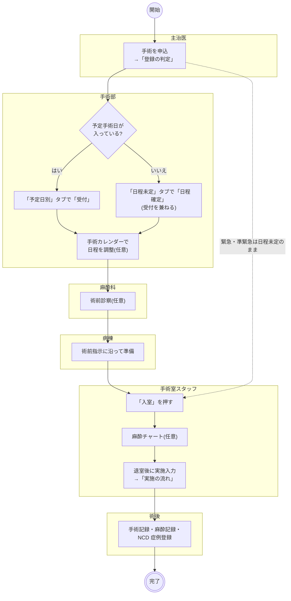
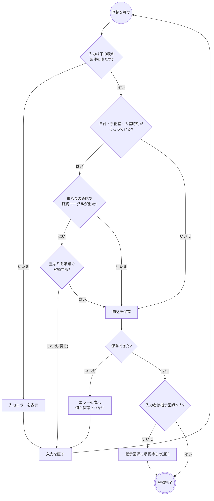
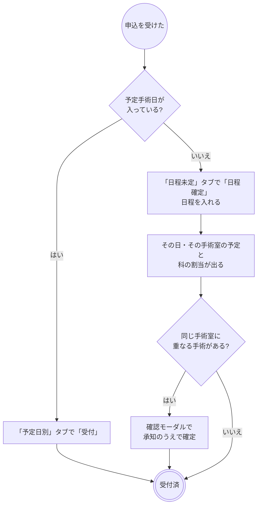
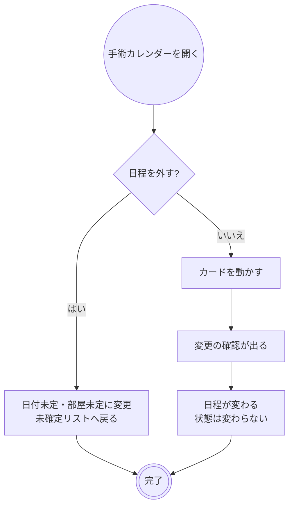
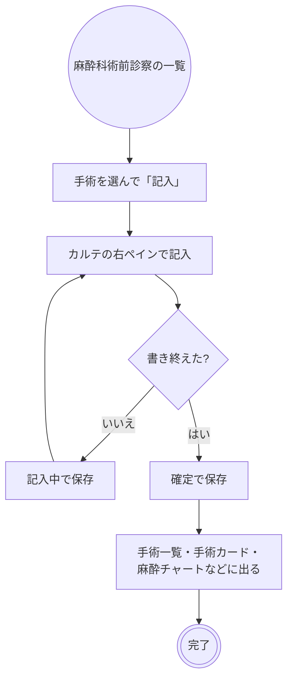
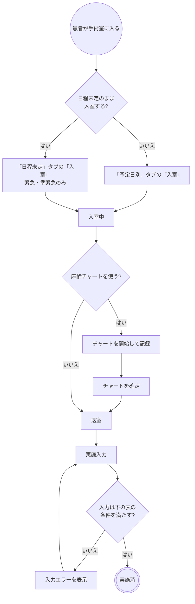

# 手術オーダーの業務フロー

<!-- ../fhir-client/docs/order-flows/surgery.md から scripts/sync-flows.mjs で作る。直接編集しない。 -->

手術の申込から日程の確定・術前診察・入室・実施記録・症例登録までの流れです。

主治医 手術部 麻酔科 病棟 手術室スタッフ

このページでの呼び名です。

- **申込**: 手術オーダーのこと。1 件の申込が手術 1 件です。麻酔は手術の一部(麻酔方法・管理区分)として申込に入れます。
- **日程**: 予定手術日・入室時刻・所要時間・手術室の組です。
- **日程未定**: 予定手術日を入れていない申込。手術一覧の「日程未定」タブに並びます。予定手術日を入れた申込は「予定日別」タブに並びます。
- **「日程確定」**: 「日程未定」タブで日程を決める操作です。押すと受付も済み、状態が受付済になります。手術カレンダーで日程を決めるだけの操作とは別です(→「手術カレンダーでの調整」)。
- **手術部と手術室スタッフ**: 日程を組んで受け付ける側を手術部、入室から実施入力までを行う側を手術室スタッフと書きます。「手術室」は場所(部屋)を指します。
- **指示医師**: 申込の指示を出した医師。
- **K コード**: 診療報酬の手術のコードです。麻酔のコードは L で始まります。

## 全体の流れ

- **申込の入口**: カルテの右ペイン(右側のオーダー入力)の「手術」、手術カレンダーの空き枠、オーダーセット・クリニカルパスの適用です。
- **受付**: 予定手術日を入れた申込は「予定日別」タブの「受付」で、日程未定の申込は「日程未定」タブの「日程確定」で、受付済になります。
- **任意の段**: 術前診察・術前指示・麻酔チャートは必須ではありません。術前診察が済んでいなくても、受付・入室は止まりません。
- **緊急・準緊急**: 日程未定のまま「入室」でき、日程確定を飛ばします。押した日時が予定日時になります。
- **手術室の空き**: 予約枠は使いません。手術室の空きは、申込の予定日時と所要時間から判断します。
- **部門の画面**: 「手術部門 > 手術一覧」「手術部門 > 手術カレンダー」「手術部門 > 麻酔科術前診察」です。

## 手術の状態

手術部と手術室スタッフの進み具合を示す状態です。受付と実施の間に、入室の段があります。

| 状態 | 変わるきっかけ | 手術一覧・カレンダーからできること |
|---|---|---|
| 申込済 | 申込、受付取消、中止取消 | 受付、日程確定、入室(緊急・準緊急)、日程の移動、中止 |
| 受付済 | 受付、日程確定、入室取消 | 入室、日程の移動、受付取消、中止 |
| 入室中 | 入室、実施取消 | 実施、麻酔チャート、入室取消 |
| 実施済 | 実施登録 | 麻酔チャート(閲覧)、実施取消 |
| 中止 | 中止 | 中止取消 |

申込済のときにできることは、申込に予定手術日が入っているかどうかで変わります。

| 申込済の申込 | できること |
|---|---|
| 予定手術日あり(「予定日別」タブ) | 受付、日程の移動、日付未定・部屋未定に戻す、中止 |
| 日程未定(「日程未定」タブ) | 日程確定、中止。緊急・準緊急は入室もできる |

- **取消で戻る先**: 受付取消は申込済へ、入室取消は受付済へ、実施取消は入室中へ、中止取消は申込済へ戻ります。
- **入室**: 状態を進めるだけです。実施記録は、退室後にまとめて 1 回入れます。
- **日程の移動**: 手術カレンダーでのドラッグです。申込済・受付済のときだけでき、状態は変わりません。入室中・実施済は起きた事実なので動かせません。
- **術前診察**: 中止以外のどの状態でも書けます。
- **麻酔チャート**: 入室中に書き始め、実施済では閲覧だけになります。

## 区分ごとの違い

予定区分(予定・準緊急・緊急)による違いは、入室の 1 点だけです。

| 予定区分 | 入室 |
|---|---|
| 予定 | 受付済になってから入室する |
| 準緊急・緊急 | 受付済からの入室に加えて、**日程未定のまま入室できる** |

次の 3 つは、どの予定区分も同じです。

- **日程**: 希望日を書いて申し込むか、日程未定で申し込みます。
- **受付**: 手術部が日程を確定して受け付けます。
- **手術室の重なりの確認**: 日程を入れるたびに確かめます。重なっていれば、承知のうえで登録します。

## 登録の判定

| 入力する項目 | 条件 |
|---|---|
| 術式 | 1 件以上 |
| 左右 | 術式マスタで左右が要るとしてある術式は必須(取り違え防止) |
| 執刀医 | 必須 |
| 麻酔科医 | 麻酔科管理のときは必須 |
| 予定手術日と入室時刻 | 時刻だけ入れて、日付を入れないことはできない |

このほかに、スタッフ・麻酔・準備・同意書・術前指示・希望日を入れます。

- **重なりの確認**: 日付・手術室・入室時刻がそろっているとき、登録の直前にその日の手術を読み直して、同じ手術室の重なりを確かめます。
- **確認モーダルが出るとき**: 重なる手術があるときと、重なりを確かめられなかったときです。重なる手術が並びます。登録は止まらず、承知のうえで登録できます。
- **警告**: 薬剤の相互作用のような警告はありません。出るのは、手術室の重なりと、科の割当(曜日ごとに手術室を科に割り当てたもの)に掛かる時間帯の 2 つです。どちらも登録は止めません。
- **オーダーセット・クリニカルパス**: セットやパスからまとめて登録するときは、重なりの確認が出ません。登録後に手術カレンダーで確かめます。
- **術前指示**: テンプレートから記入でき、申込と一緒に保存されます。

## 日程確定の流れ

- 「日程確定」で入れるのは、日・入室時刻・所要時間・手術室です。
- 重なりがあっても確定は止まりません。緊急の割り込みや、前の手術が早く終わる読みで詰めることがあるためです。承知した事実は、確認の操作として残ります。

## 手術カレンダーでの調整

受付の後も、手術カレンダーで日程を組み直せます。

| したいこと | 操作 |
|---|---|
| 日・部屋・時刻を移す | 格子のカードをドラッグ(5 分刻み) |
| 所要時間を変える | カードの縁を引く |
| 未確定の申込に日程を入れる | 右の未確定リストから格子へドラッグ |
| 日程を外す | 日付未定・部屋未定に変更(申込済のときだけ) |

- **画面**: 日ビュー(手術室 × 時刻)と週ビュー(曜日 × 手術室)があります。右の未確定リストには、日付未定・部屋未定・時間未定の申込が並びます。
- **変更の確認**: 変更前と変更後、重なり、科の割当が出ます。
- **ドラッグと受付は別**: ドラッグで日程を決めても、申込済のままです。受付は別に行います。
- **日程を外せるとき**: 申込済のときだけです。受付済なら、先に「受付取消」をします。
- **読み切れなかった日**: 件数が多くて読み切れなかった日は「重なりなし」と言い切れないので、その旨が出ます。

## 麻酔科術前診察の流れ

- **一覧に出る手術**: 今日から 14 日先までの手術と、日程未定の申込です。
- **「記入」の入口**: 麻酔科術前診察の一覧のほか、手術一覧の行のメニューからも開けます。
- **書く内容**: 評価・気道・手術室への指示・病棟への指示です。予定・身長体重・既往歴・アレルギー・内服薬は初期値で入ります。
- **出る場所**: 手術一覧の列・手術カード・手術の詳細・麻酔チャートの帯です。
- **ASA-PS**: 麻酔記録と NCD 症例登録の初期値に引き継がれます。
- **予測困難気道**: 「あり」は一覧で赤く出ます。麻酔チャートでは赤い枠で出ます。
- **入口に注意**: カルテの「テンプレート」から直接書いたものは、その手術の術前診察として扱われません。
- **削除との関係**: 術前診察を書いた手術は、カルテから削除できません。要らなくなったときは中止します。

## 実施の流れ

| 実施で入れる項目 | 条件 |
|---|---|
| 入室時刻・退室時刻 | 必須 |
| 中間の時刻(麻酔開始・執刀開始・執刀終了・麻酔終了) | 入れた時刻が、入室から退室までの順に並んでいること |
| 実施した術式(K コード)・麻酔(L コード) | 術式が 1 件以上 |
| スタッフ(執刀医・助手・麻酔科医・器械出し・外回り・臨床工学技士) | 執刀医は必須 |
| 出血量・尿量・輸血量 | – |
| 創分類・転帰・合併症 | – |
| カウント | 不一致のときは、実施コメントに経緯を書く |
| 薬剤・材料 | 同じ薬に同じロット番号を重ねない |

- **入口**: 実施入力は、手術一覧と手術カレンダーのカードから開きます。
- **初期値**: 申込の術式・スタッフ・予定入室時刻が入っています。K コードを持たない術式は、初期値の行になりません。
- **実施取消**: 実施記録ごと消します。直すときは「実施取消」をしてから、もう一度実施入力をします。

**麻酔チャート**

- 専用の画面で、手術中は開いたままにします。打点・イベント・薬剤を 1 点ずつ保存します。
- 実施記録とは別の記録です。実施取消をしても、チャートは消えません。
- チャートに入れた薬剤は算定されません。算定する薬剤は、実施入力に入れます。

## 術後の記録

- **手術記録・麻酔記録**: カルテのテンプレートで書きます。手術記録にはシェーマが付きます。
- **NCD 症例登録**: 「データ > NCD症例登録」で、基本項目と術後 30 日の合併症を記入します。
- **入れ直さなくてよい項目**: 時刻・スタッフ・測定値・ASA-PS は、初期値で入ります。テンプレートに入れ直す必要はありません。

## 変更・中止・削除

| 操作 | できる場所 | できないとき・注意 |
|---|---|---|
| 変更 | カルテのカード、カレンダーのカードと未確定リストのメニュー | どの状態でもできます。日程を変えると、重なりの確認が出ます |
| 日程の移動 | 手術カレンダー | 申込済・受付済のときだけできます |
| 中止 | 手術一覧・カレンダーのメニュー | 実施済からはできません。先に「実施取消」をします |
| 中止取消 | 手術一覧・カレンダーのメニュー | 申込済に戻ります |
| 受付取消・入室取消・実施取消 | 手術一覧・カレンダーのメニュー | 1 つ前の状態へ戻す訂正です |
| 削除 | カルテのカード | 実施記録・麻酔チャート・術前診察のどれかがあるとできません |

- **中止すると**: 手術カレンダーと重なりの判定から外れ、医事会計の対象からも外れます。麻酔チャートと術前診察は残ります。
- **実施取消で消えるもの**: 実施記録(術式・スタッフ・測定値・薬剤・材料)です。
- **削除できないとき**: 術前診察がある手術は、削除せずに中止します。
- **削除で一緒に消えるもの**: テンプレートで書いた術前指示です。

## 帳票

| 帳票 | 出す場所 | 内容 |
|---|---|---|
| 手術説明・同意書 | カルテのテンプレート「手術説明・同意書」から帳票 | 術式・麻酔・輸血の説明と同意欄 |
| 手術記録・麻酔記録 | カルテのテンプレート「手術記録」「麻酔記録」 | 記入内容の表示・印刷(テンプレート共通の機能) |
| NCD 症例登録の CSV | 「データ > NCD症例登録」 | 登録済の内容を項目順に出す(NCD の一括取込の形式ではない) |

麻酔チャートの印刷は、まだできません。
