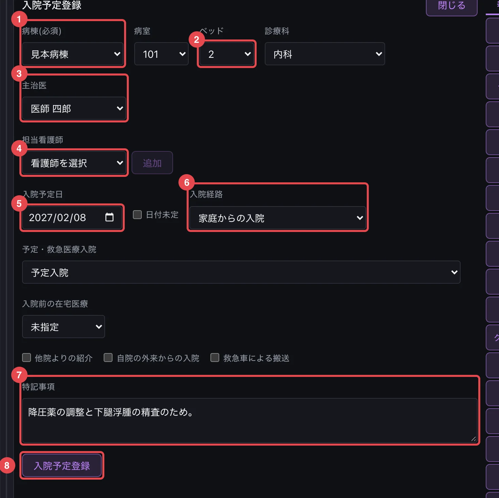

# 入院予定

外来の患者の入院が決まったときに、医師がカルテから入院予定を登録する操作です。病棟だけ決めておき、病室・ベッドや入院日は
あとで決めることもできます。入院の当日に、病棟で「入院実施」をして入院になります。入院から退院までの流れは、
業務フローの[入院から退院まで](../flows/admission-discharge.md)を見てください。

## 入院予定を入れて登録する

患者のカルテを開き、右側の登録のボタンから「入院予定」を押します。右側に「入院予定登録」が開きます。

{ .screen width="734" }

1. 「病棟」を選びます。病棟は必ず選びます。
2. 決まっていれば「病室」と「ベッド」を選びます。いま入院中の患者がいるベッドも選べるので、予定日に空いているかはベッドスケジュールで確かめます。決まっていないときは「未指定」のままにし、入院実施のときに選びます。
3. 「診療科」と「主治医」を選びます。
4. 決まっていれば「担当看護師」を選び、「追加」を押します。何人でも足せます。
5. 「入院予定日」を入れます。日が決まっていないとき(検査待ち・ベッド待ちなど)は「日付未定」に印を付けます。
6. 「入院経路」と「予定・救急医療入院」を選びます。入院経路が家庭・他の病院・介護施設からのときは、「入院前の在宅医療」と、紹介・自院の外来から・救急車による搬送の印が出ます。
7. 伝えることがあれば「特記事項」に入れます。
8. 「入院予定登録」を押します。

## 登録した入院予定を確かめる

入院予定は、ヘッダーの「患者一覧」の入院患者一覧で、病棟を選んで「入院予定」タブを開くと並びます。

{ .screen }

1. 「入院予定」タブを開きます。予定日の順に並び、日付未定の予定は先頭に出ます。
2. 登録した入院予定の行です。入院の当日に「入院実施」を押して入院にします。予定をやめるときは、行の「⋮」の「入院予定取消」を押します。

ベッドまで決めた入院予定は、ベッドスケジュールにも点線の枠(「入予」)で出ます。
