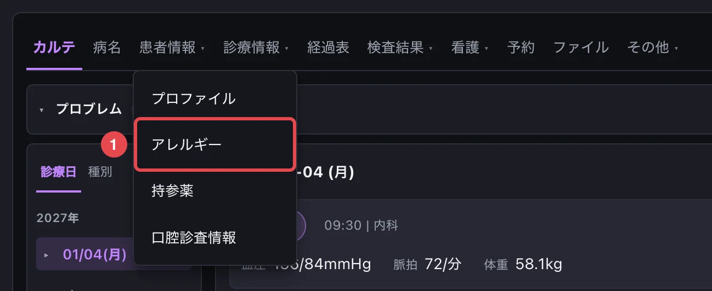
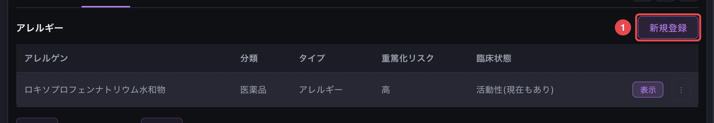
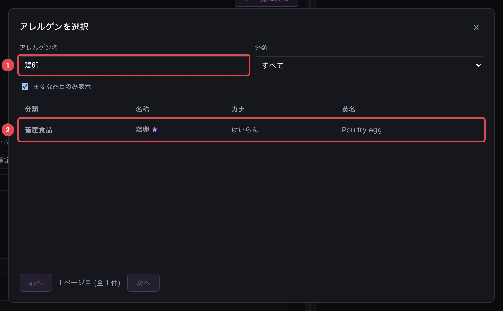
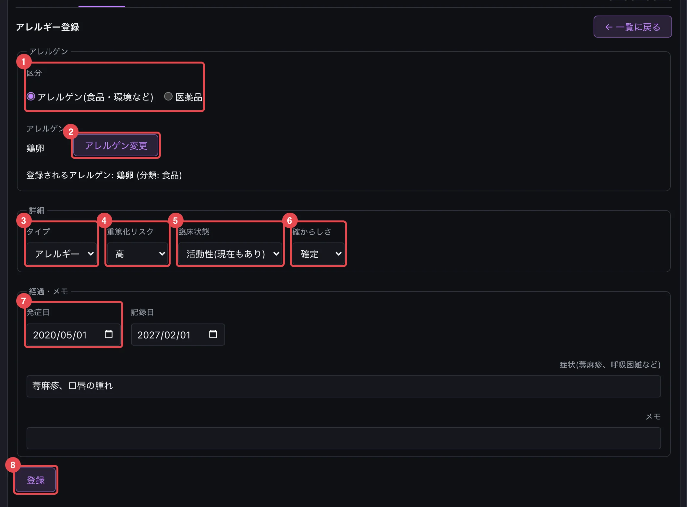
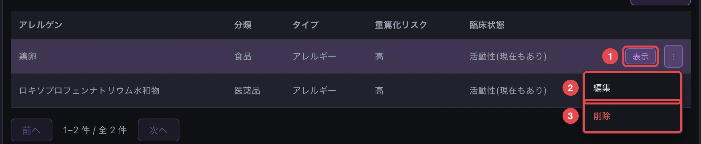
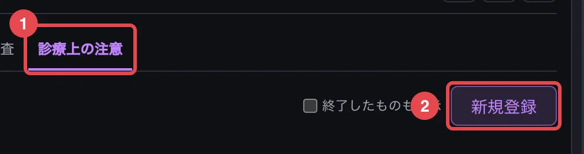
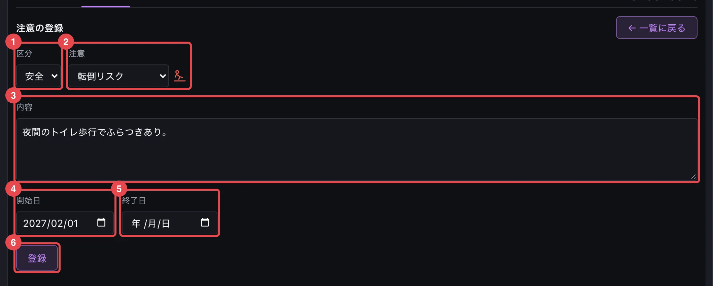
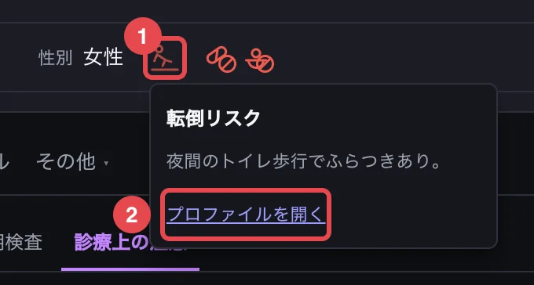

# アレルギー・注意

患者のアレルギーと、診療上の注意(転倒リスク・体内金属など)を登録する操作です。登録したものは、カルテの上の患者の情報に印で出ます。
医薬品のアレルギーは処方・注射で、食物アレルギーは食事オーダーで、照合して警告を出すのに使われます。

## アレルギーを登録する

### アレルギータブを開く

患者のカルテを開いておきます。

{ .screen width="649" }

1. タブの「患者情報」にマウスを載せ、「アレルギー」を押します。

{ .screen width="1059" }

1. 「新規登録」を押します。「アレルギー登録」が開きます。

### アレルゲンを選ぶ

「アレルゲン選択」を押すと、「アレルゲンを選択」が開きます。

{ .screen width="954" }

1. 「アレルゲン名」に名前の一部を入れます。「分類」で食品・環境などに絞り込めます。初めは主要な品目(★)だけが並び、「主要な品目のみ表示」の印を外すとすべてが並びます。
2. 使うアレルゲンの行を押します。

### 詳細を入れて登録する

{ .screen width="1059" }

1. 「区分」で「アレルゲン(食品・環境など)」か「医薬品」を選びます。
2. アレルゲンを選び直すときは「アレルゲン変更」を押します。区分が「医薬品」のときは「医薬品選択」で医薬品を選びます。銘柄が分からないときは「剤形・規格・銘柄不明」に切り替えて、成分で選びます。
3. 「タイプ」で「アレルギー」か「不耐症」を選びます。
4. 「重篤化リスク」を「低」「高」「評価不能」から選びます。
5. 「臨床状態」を選びます。いまもあるものは「活動性(現在もあり)」にします。
6. 「確からしさ」を選びます。
7. 分かれば「発症日」を入れ、「症状」「メモ」を入れます。「記録日」の初期値は今日です。
8. 「登録」を押します。

### 登録したアレルギーを見る・直す

{ .screen width="1043" }

1. 「表示」で、アレルギーの内容を見られます。
2. 「⋮」の「編集」で直します。治ったアレルギーは、削除せずに「臨床状態」を「解消済み」にします。
3. 「⋮」の「削除」は、誤って登録したときに使います。確認のあと削除します。

食物アレルギーを登録すると、続いている食事オーダーに写っていないときに、食事を出した医師に「食事のアレルギー確認」の通知が届きます。

## 診療上の注意を登録する

転倒リスク・体内金属・造影剤注意・DNAR など、診療で気をつけることを登録します。選べる注意は施設で決めてあります。

{ .screen width="495" }

1. タブの「患者情報」の「プロファイル」を開き、「診療上の注意」を押します。
2. 「新規登録」を押します。「注意の登録」が開きます。

初めは有効な注意だけが並びます。「終了したものも表示」に印を付けると、終了した注意も並びます。

{ .screen width="1059" }

1. 「区分」を「安全」「臨床」「意思」「事務」から選びます。
2. 「注意」で注意の種類を選びます。患者の情報に出る印が横に出ます。
3. 「内容」に具体的なことを入れます。
4. 「開始日」を確かめます。初期値は今日です。
5. 期限があれば「終了日」を入れます。終了日が無ければ続いている注意です。
6. 「登録」を押します。

注意は削除できません。いらなくなった注意や誤って登録した注意は、一覧の「編集」で「状態」を「終了」にし、終了日を入れます。

## 患者の情報の印

有効なアレルギーと注意は、カルテの上の患者の情報に印で出ます。

{ .screen width="340" }

1. 印を押すと、名前と内容が出ます。同じ印が複数あるときは、右肩に件数が付きます。
2. 「プロファイルを開く」(アレルギーは「アレルギーを開く」)で、そのタブに移ります。

| 印 | 意味 |
|---|---|
| カプセルに禁止の記号(赤) | 医薬品のアレルギー |
| 皿に禁止の記号(赤) | 食物・環境などのアレルギー |
| 注意ごとの絵(安全は赤、臨床は橙、意思は紫、事務は灰) | 診療上の注意 |

印が出る注意は、施設で絵を決めてあるものだけです。
