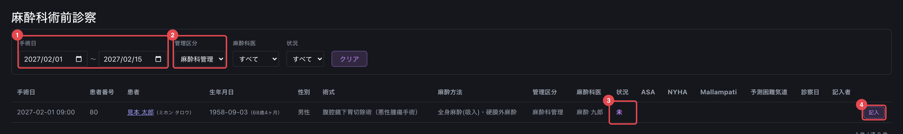
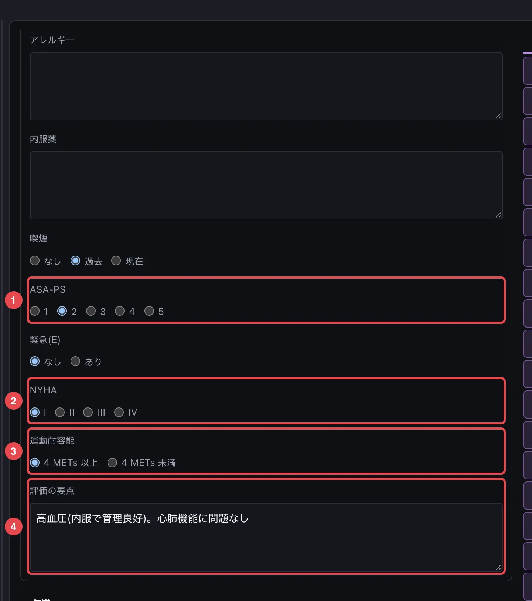
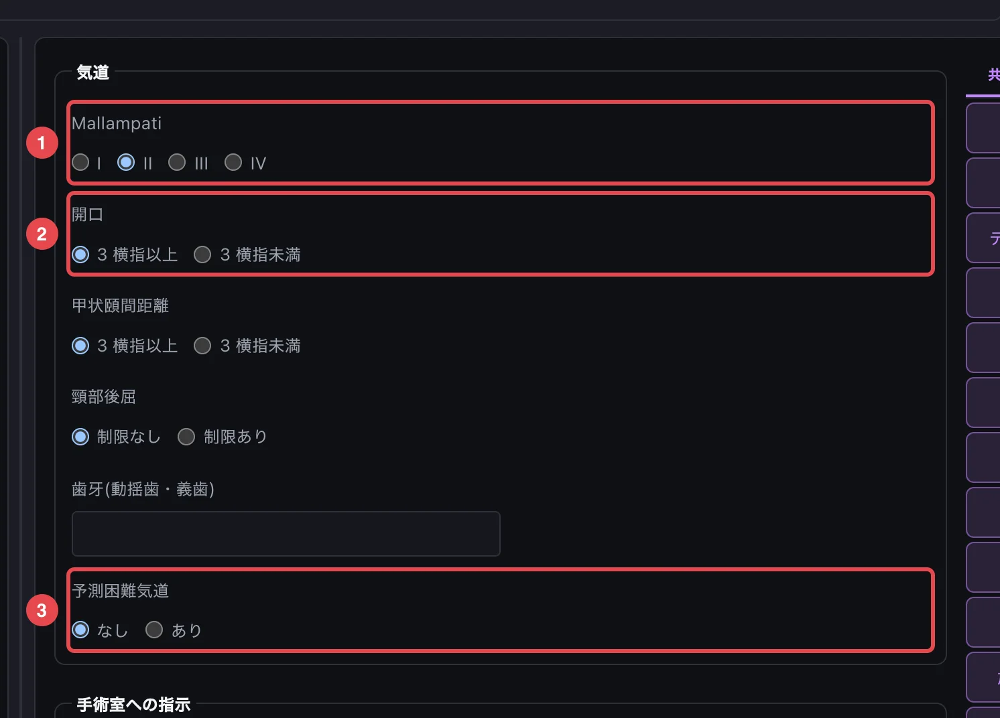
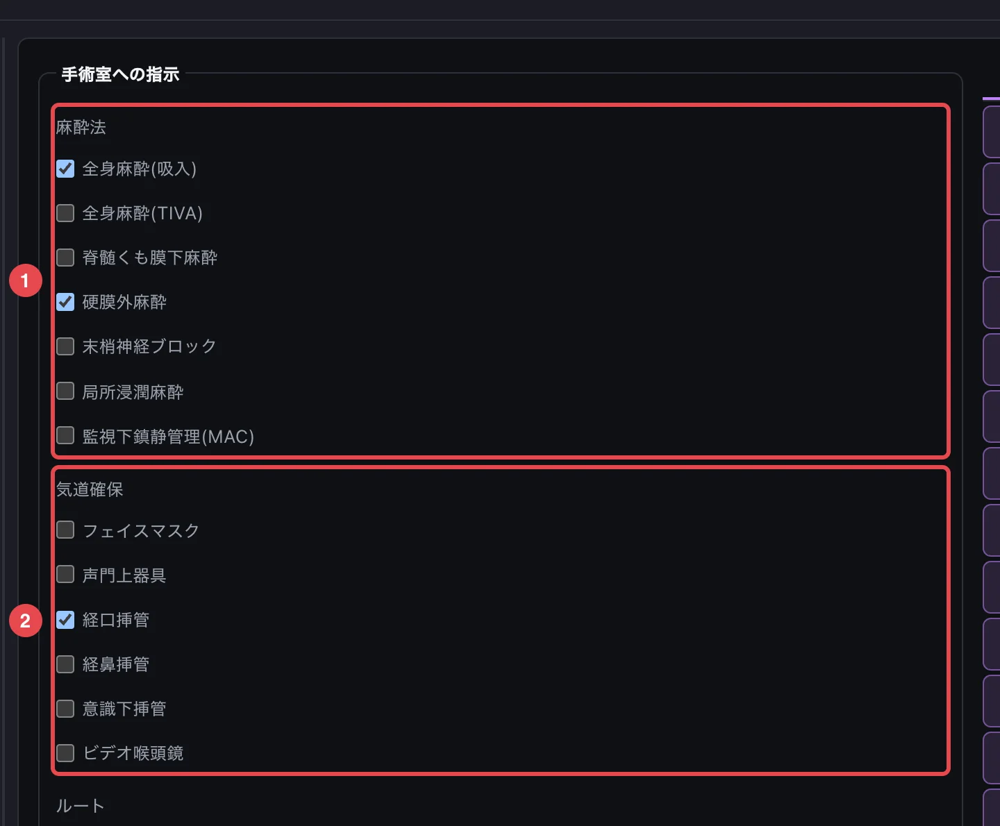
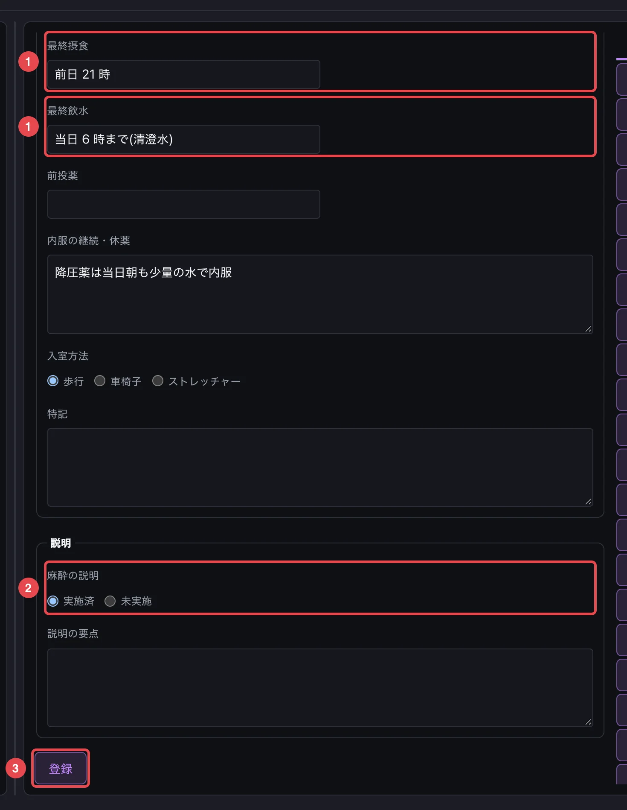
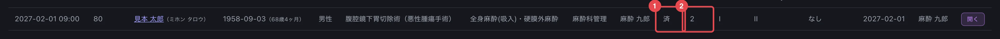
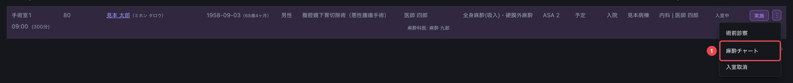
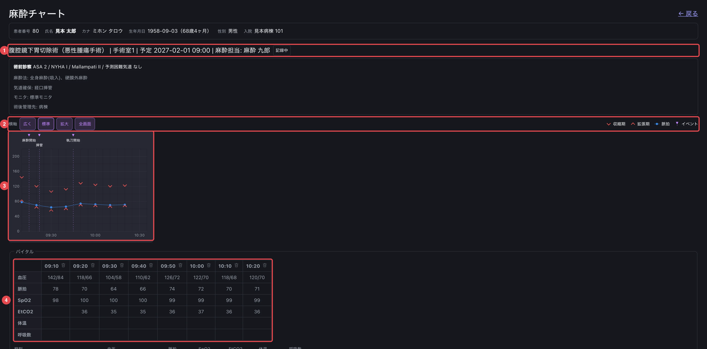
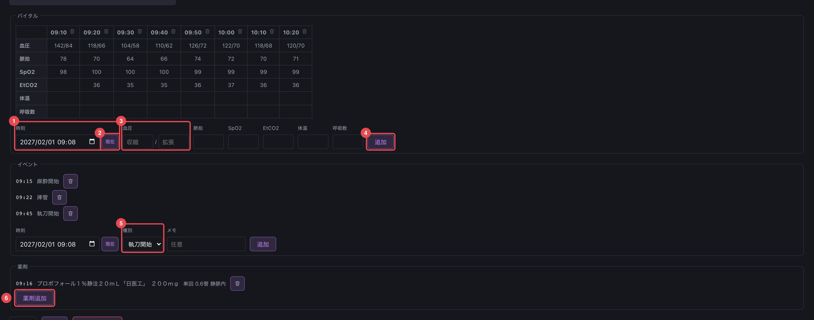
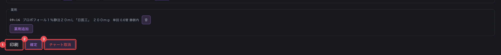

# 麻酔チャート・術前診察

麻酔科医が、手術の前に麻酔科術前診察を書き、手術中に麻酔チャートへバイタル・イベント・薬剤を記録する操作です。
手術の流れ全体は、業務フローの[手術オーダー](../flows/surgery.md)を見てください。手術一覧の操作は[手術一覧・手術カレンダー](surgery-worklist.md)のページです。

- 麻酔科術前診察は、画面の上の「部門業務」>「手術部門」>「麻酔科術前診察」で開きます。手術一覧の行の「⋮」の「術前診察」からも書けます。
- 麻酔チャートは、手術一覧(または手術カレンダーのカード)の「⋮」の「麻酔チャート」で開きます。入室中と実施済の手術に出ます。
- 術前診察と麻酔チャートはどちらも必須ではありません。書いていなくても、受付・入室・実施は止まりません。

## 麻酔科術前診察の一覧

{ .screen }

1. 「手術日」の期間の手術と、日程未定の申込が並びます。開いたときは今日から 14 日先までです。
2. 「管理区分」は麻酔科管理が選ばれています。「麻酔科医」「状況」でも絞り込めます。
3. 「状況」に、未・記入中・済が出ます。書いた術前診察の ASA・NYHA・Mallampati・予測困難気道・診察日・記入者が右の列に並びます。
4. 「記入」を押すと、カルテが開いて右側に術前診察の記入欄が出ます。

## 術前診察を書く

記入欄には、手術予定日・予定術式・申込の麻酔方法と、身長・体重・既往歴・アレルギー・内服薬が初めから入っています。

{ .screen width="720" }

1. 「ASA-PS」を選びます。麻酔記録と NCD 症例登録の初期値に引き継がれます。
2. 「NYHA」を選びます。
3. 「運動耐容能」を選びます。
4. 「評価の要点」に、術前評価のまとめを書きます。手術一覧のカードなどに要点として出ます。

{ .screen width="746" }

1. 「Mallampati」を選びます。
2. 開口・甲状頤間距離・頸部後屈・歯牙を入れます。
3. 「予測困難気道」を選びます。「あり」にすると、一覧で赤く、麻酔チャートで赤い枠で出ます。

{ .screen width="720" }

1. 「麻酔法」を選びます(いくつでも選べます)。
2. 「気道確保」を選びます。続けて、ルート・導入薬・モニタ・術後鎮痛・術後管理先を入れます。

{ .screen width="735" }

1. 病棟への指示として、最終摂食・最終飲水・前投薬・内服の継続と休薬・入室方法を入れます。手術一覧のカードに出て、病棟の看護師が見ます。
2. 「麻酔の説明」が済んだかを選び、説明の要点を書きます。
3. 「登録」を押します。

- 書きかけで残すときは、上の「登録情報」の状態を記入中にして登録します。
- カルテの「テンプレート」から直接書いた記入は、その手術の術前診察として扱われません。一覧の「記入」か、手術一覧の「術前診察」から書きます。
- 術前診察を書いた手術は、カルテから削除できません。要らなくなったときは中止します。

{ .screen }

1. 「状況」が「済」になります。
2. ASA-PS などの評価が一覧に出ます。書き直すときは「開く」を押します。

## 麻酔チャートを開く

患者が入室したら、手術一覧の行の「⋮」から麻酔チャートを開きます。

{ .screen }

1. 「麻酔チャート」を押します。初めて開いたときは「チャート開始」を押すと記録が始まり、麻酔担当にログインしている人が入ります。

麻酔チャートは手術中ずっと開いたままにする画面です。記録は 1 点ずつその場で保存されます。

## 麻酔チャートの見方

{ .screen }

1. 術式・手術室・予定・麻酔担当と、記録の状態(記録中・確定)が出ます。その下に、術前診察の要点と手術室への指示が出ます。
2. 「横軸」で時間の目盛りを変えます。「広く」「標準」「拡大」と、記録の全体を画面の幅に収める「全画面」があります。右に記号の凡例が出ます。
3. グラフに、収縮期血圧(∨)・拡張期血圧(∧)・脈拍(●)と、上端にイベント(▼)が出ます。
4. バイタルの表に、時点ごとの測定値が並びます。時点の見出しのゴミ箱のボタンで、その時点の打点をまとめて消せます。

## 記録を入れる

{ .screen }

1. バイタルの「時刻」を入れます。
2. 「現在」を押すと、今の時刻が入ります。画面を開いた時刻のままにならないよう、記録するたびに押します。
3. 血圧・脈拍・SpO2・EtCO2・体温・呼吸数のうち、測った項目だけ入れます。
4. 「追加」を押すと、グラフと表に出ます。
5. イベントは「時刻」と「種別」(麻酔開始・挿管・執刀開始・執刀終了・抜管・麻酔終了・その他)を選んで「追加」を押します。
6. 薬剤は「薬剤追加」で薬を選び、単回か持続か・量・経路・時刻を入れて「追加」を押します。持続の行は、止めたときに「終了」を押します。

麻酔チャートに入れた薬剤は算定されません。算定する薬剤は、手術の実施入力に入れます。

## 確定する

{ .screen }

1. 「印刷」で、麻酔チャートを紙に出します。
2. 手術が終わったら「確定」を押します。確定すると閲覧だけになります。直すときは「再開」で記録中に戻します。
3. 「チャート取消」は、記録ごと消します。

麻酔チャートは手術の実施記録とは別の記録です。手術の実施取消をしても、チャートは消えません。
