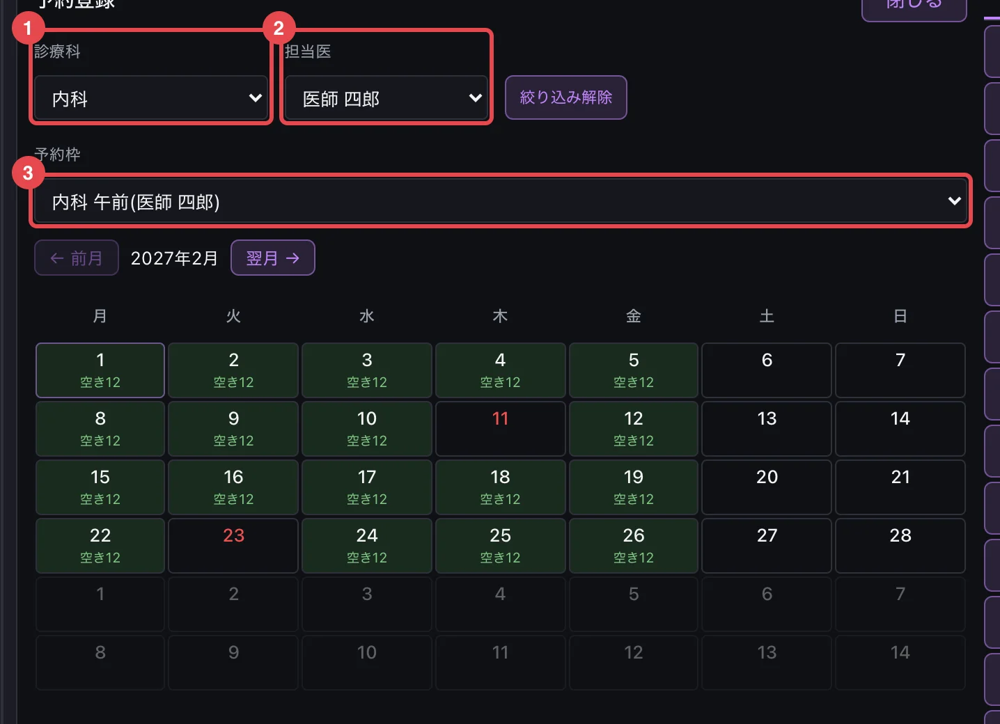
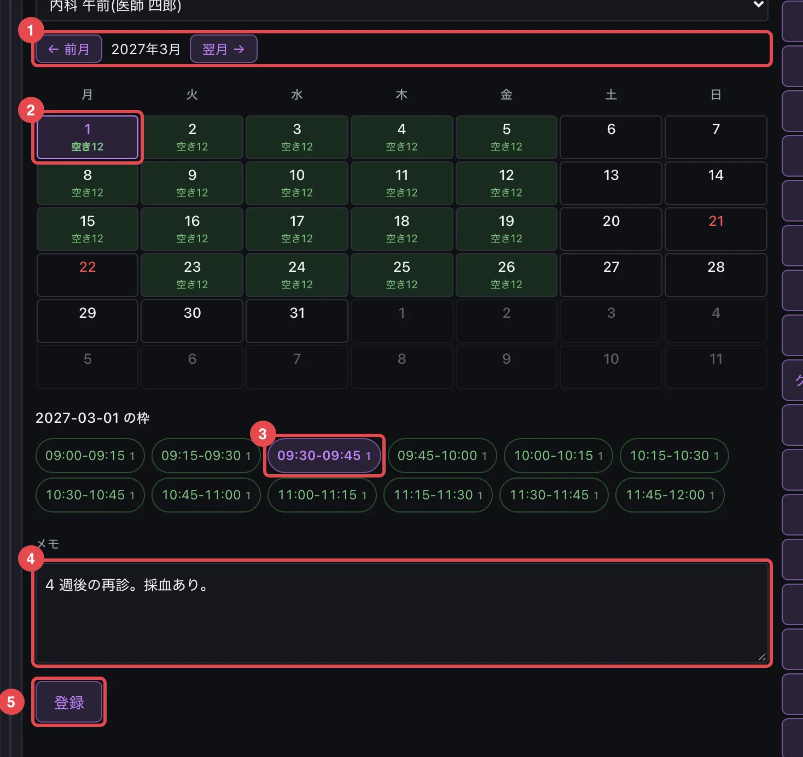
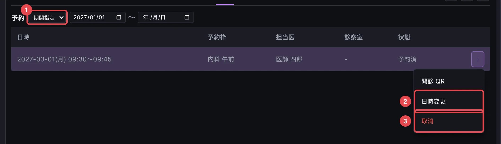

# 予約

カルテから、次回の診察の予約を取る操作です。予約は、あらかじめ作ってある予約枠(担当医ごとの診察の枠)から日と時刻を選んで取ります。
取った予約は、当日に外来患者一覧で受付します。

検査の予約(放射線検査・生理検査など)は、それぞれのオーダーの画面で取ります。

## 予約枠を選ぶ

患者のカルテを開き、右側の登録のボタンから「予約」を押します。右側に「予約登録」が開きます。

{ .screen width="718" }

1. 「診療科」で絞り込みます。初期値は、画面の上の帯で選んでいる診療科です。
2. 「担当医」で絞り込みます。初期値は「すべて」です。「絞り込み解除」で、診療科と担当医の絞り込みを外します。
3. 「予約枠」で、予約を取る枠を選びます。自分の枠があるときは、初めから選ばれています。

枠を選ぶと、月のカレンダーが出ます。空きのある日は色が付き、空きの数が出ます。祝日・休診日の日付は赤で出ます。

## 日と時刻を選んで登録する

{ .screen width="734" }

1. 「← 前月」「翌月 →」で月を切り替えます。
2. 予約する日を押します。その日の枠が時刻ごとに出ます。
3. 予約する時刻を押します。時刻の右の数は、その時刻の空きの数です。空きの無い時刻は押せません。
4. 伝えることがあれば「メモ」に入れます。
5. 「登録」を押します。

## 取った予約を見る・直す

予約は、カルテの「予約」タブに並びます。

{ .screen width="1059" }

1. 表示する期間を「全期間」「期間指定」から選びます。「期間指定」の初期値は、1 か月前から先のすべてです。
2. 行の「⋮」の「日時変更」を押すと、右側で枠を選び直せます。日と時刻を選んで登録すると、元の枠は空きに戻ります。
3. 行の「⋮」の「取消」を押すと、確認のあと予約を取り消します。取り消した予約は「取消」の状態で一覧に残ります。

「問診 QR」は、患者がスマートフォンで事前の問診に答えるための QR コードを出します。

予約の当日に外来で受付すると、カルテの上の患者の情報の右に「診察開始」が出ます。
