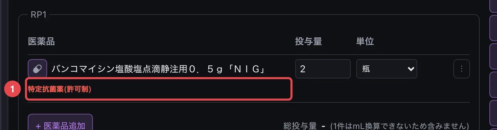
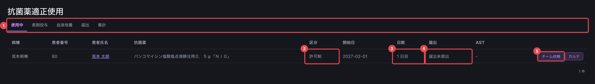
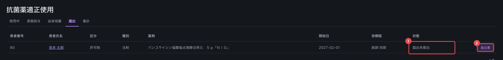
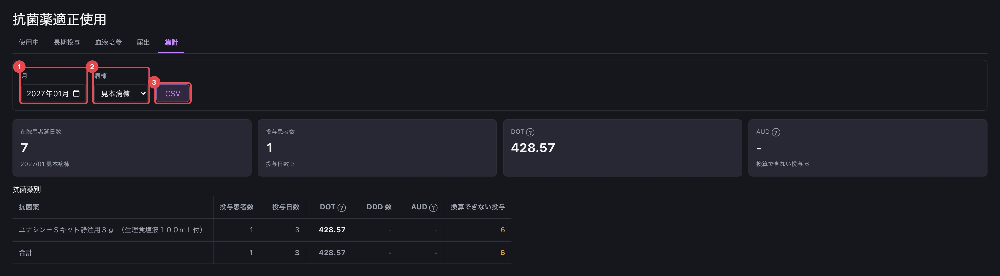

# 抗菌薬適正使用

特定抗菌薬(届出制・許可制の抗菌薬)の使用と届出を見守り、抗菌薬の使用量を集計する操作です。
主に薬剤部と、抗菌薬適正使用支援チーム(AST)が使います。

- 特定抗菌薬は、施設で決めてマスタに設定してあります。区分は「届出制」と「許可制」の 2 つです。
- 特定抗菌薬を含む処方・注射を登録すると、処方医に通知「特定抗菌薬の届出」が届きます。処方医が届出書を書くと、届出制は届出済になり、許可制は AST の許可を待ちます。

## 処方・注射の登録で出る印(医師)

処方・注射の登録で特定抗菌薬を選ぶと、薬の行に印が出ます。登録は止まりません。

{ .screen width="717" }

1. 「特定抗菌薬(届出制)」「特定抗菌薬(許可制)」の印が出ます。

同じ成分の抗菌薬を続けて投与していて、開始から 7 日目以上になると「投与 N 日目」の印も出ます(14 日目以上は強い印)。

## 抗菌薬適正使用の一覧(薬剤部・AST)

画面の上の「部門業務」>「薬剤部門」>「抗菌薬適正使用」を開きます。
薬剤師のホームには、届出の出ていない件数と、許可を待っている件数のカード「特定抗菌薬の届出」が出ます。

{ .screen }

1. タブを切り替えて見ます。

    | タブ | 並ぶもの |
    |---|---|
    | 使用中 | 特定抗菌薬を投与中の入院患者 |
    | 長期投与 | 抗菌薬を 7 日以上続けて投与している入院患者 |
    | 血液培養 | 直近 14 日に血液培養が陽性になった患者と、投与中の抗菌薬 |
    | 届出 | まだ済んでいない届出(届出書の記入と許可) |
    | 集計 | 月・病棟ごとの抗菌薬の使用量 |

2. 「区分」に、届出制か許可制かが出ます。
3. 「日数」に、投与の何日目かが出ます。
4. 「届出」に、届出の状態(届出未提出・許可待ちなど)が出ます。
5. 「チーム依頼」を押すと、AST へのチーム依頼を出せます。操作は[他科依頼・チーム依頼](consult-team.md)を見てください。「カルテ」で患者のカルテを開きます。

AST が介入している患者は、「AST」の列に「介入中」が出ます。

## 届出

「届出」のタブには、まだ済んでいない届出が並びます。

{ .screen }

1. 「状態」に、「届出未提出」か「許可待ち」が出ます。
2. 届出未提出の行の「届出書」を押すと、届出書の記入が開きます。処方医は、通知「特定抗菌薬の届出」からも書けます。

- 届出書を保存すると、届出制は届出が済み、一覧から消えます。許可制は「許可待ち」になります。
- 許可待ちの行には、AST のメンバーに「許可」が出ます。押すと届出が済み、一覧から消えます。
- 届出が済むと、処方医への通知「特定抗菌薬の届出」も対応済みになります。

## 集計

「集計」のタブで、抗菌薬の使用量を月と病棟ごとに集計します。

{ .screen }

1. 「月」で、集計する月を選びます。
2. 「病棟」で病棟を選びます。「全体」で病院全体になります。
3. 「CSV」を押すと、抗菌薬別の表をファイルに書き出します。

- 上のタイルに、在院患者延日数・投与患者数と、全体の DOT・AUD が出ます。
- 下の表は抗菌薬ごとの投与患者数・投与日数・DOT・DDD 数・AUD です。DOT・AUD の計算式は、見出しの「?」に出ます。
- 1 日規定用量(DDD)が設定されていない抗菌薬は AUD に換算できず、「換算できない投与」に数えます。
