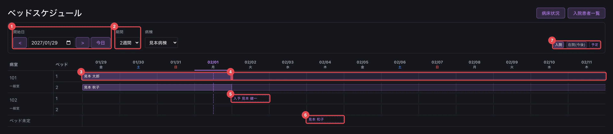
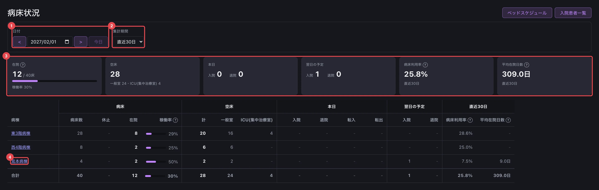

# ベッドスケジュール・病床状況

ベッドスケジュールは、病棟のベッドごとに入院と入院予定を日付の帯で見て、空くベッドと入るベッドを確かめる画面です。
病床状況は、病棟ごとの在院・空床・その日の入退院と、病床利用率・平均在院日数を一覧にする画面です。どちらも見るだけの画面で、入院や予定はここでは入れません。
入院予定の入れ方は[入院予定](admission-plan.md)、入院と転床は[入院患者一覧・病棟マップ](inpatient.md)のページです。

- 画面の上の「患者一覧」>「ベッドスケジュール」「病床状況」で開きます。入院患者一覧の右上の「⋮」からも開けます。

## ベッドスケジュール

{ .screen }

1. 「開始日」を選びます。開いたときは 3 日前から始まります。「<」「>」で 1 日ずつ動かし、「今日」で今日から始まる表示になります。
2. 「期間」で 2 週間か 4 週間を選び、「病棟」を選びます。
3. 入院した日から今日までは、塗りの帯で出ます。
4. 入院が続いている患者は、明日から先が薄い帯で出ます。退院予定があればその日で止まり、無ければ右端まで続きます。
5. ベッドまで決まっている入院予定(名前に「入予」)と、転科・転棟予定の移り先(「転予」)は、点線の枠で出ます。
6. ベッドが決まっていない入院予定は、いちばん下の「ベッド未定」に予定日の列で並びます。
7. 帯の見方の凡例です。

- 今日の列は、見出しの印と縦の点線で分かります。
- 帯にカーソルを合わせると、入院日〜退院日(予定)・診療科・主治医が出ます。帯を押すと、その患者のカルテが開きます。
- 転床・転棟した入院は、ベッドごとに帯が分かれます。同じベッドで帯が重なる日(退院する患者と入院予定の患者など)は、段を分けて並びます。
- 使っていないベッド・病室には「休止」が付きます。

## 病床状況

{ .screen }

1. 「日付」を選びます。在院はその日の 24 時の人数です。
2. 「集計期間」で、病床利用率と平均在院日数を数える期間(直近 30 日・90 日)を選びます。
3. 上の段に、病院全体の在院と稼働率・空床(病室の区分ごと)・本日の入院と退院・翌日の入院予定と退院予定・病床利用率・平均在院日数が出ます。
4. 表に病棟ごとの値が並びます。病棟名を押すと、その病棟のベッドスケジュールが開きます。

- 見出しの「?」にカーソルを合わせると、稼働率・病床利用率・平均在院日数の計算式が出ます。
- 0 は薄い「-」で出ます。病棟が 2 つ以上あると、いちばん下に合計の行が出ます。
- 病棟の転入・転出は、ほかの病棟から移ってきた・移っていった人数です。同じ病棟の中の転床は数えません。
- 病床利用率と平均在院日数は、施設基準の届出の計算とは別の簡易な計算です。
