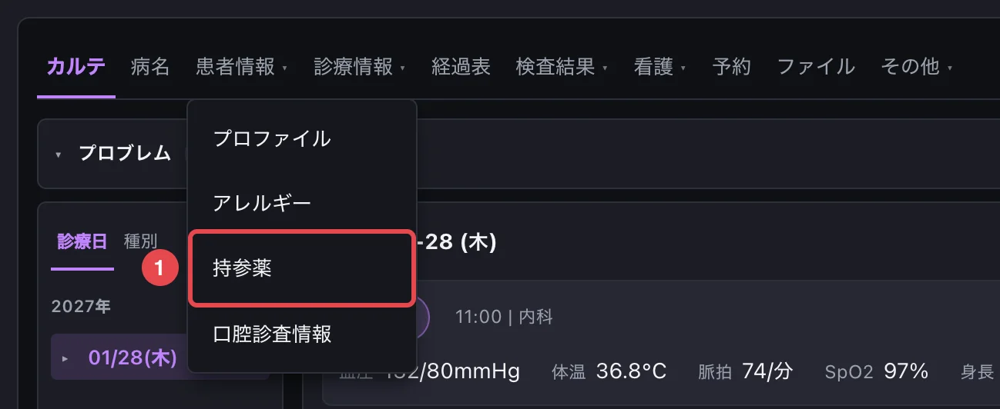
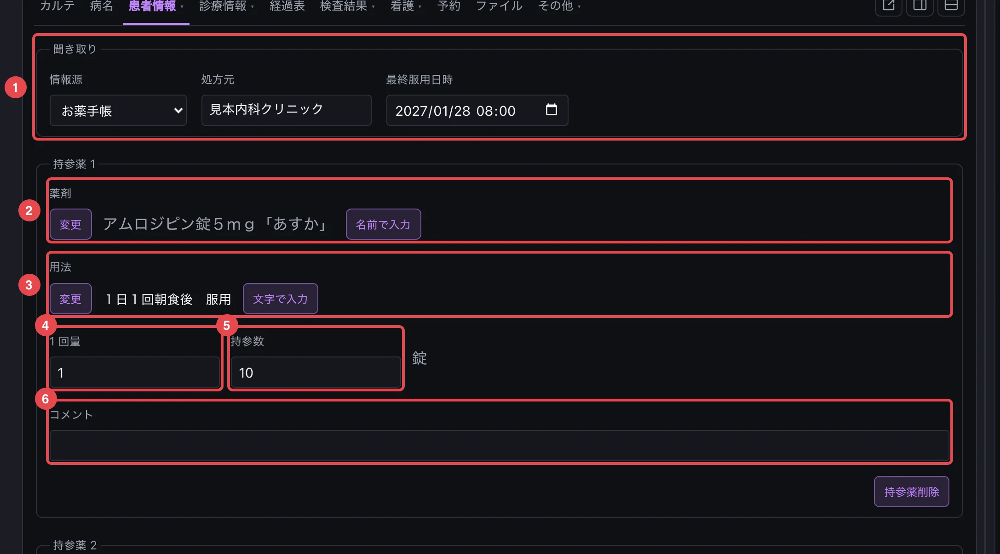
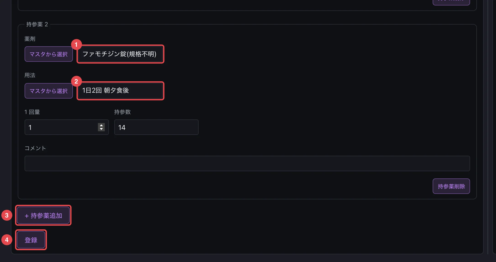
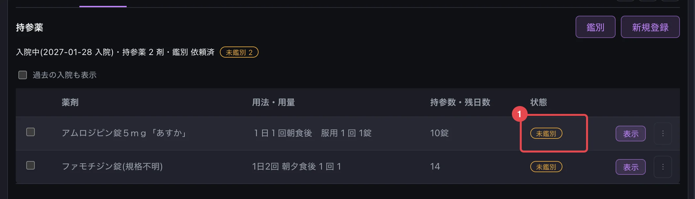
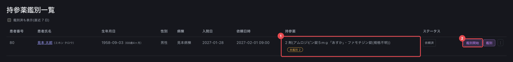
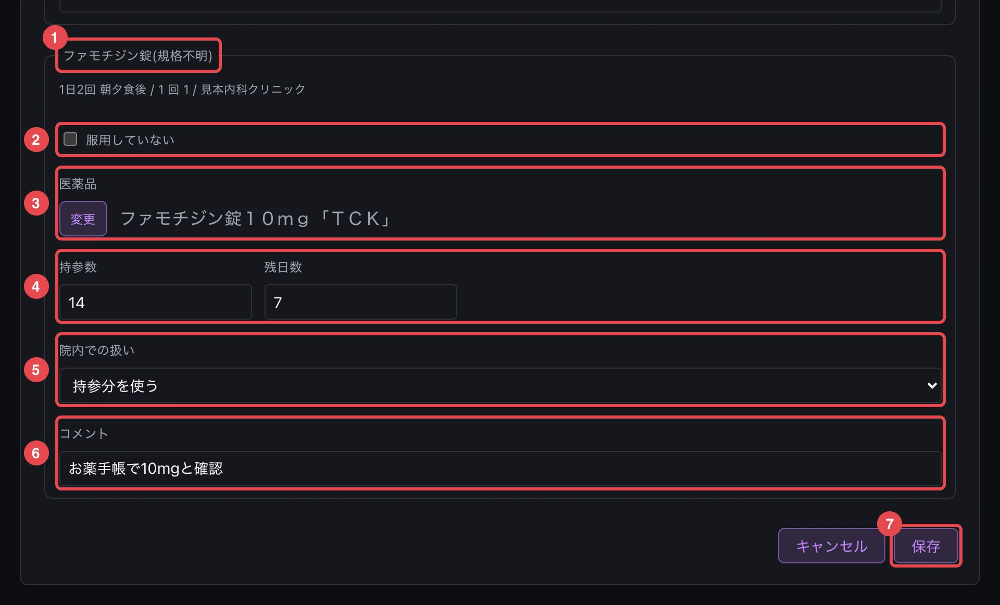
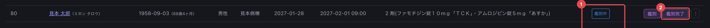
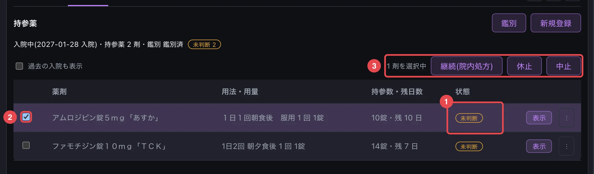
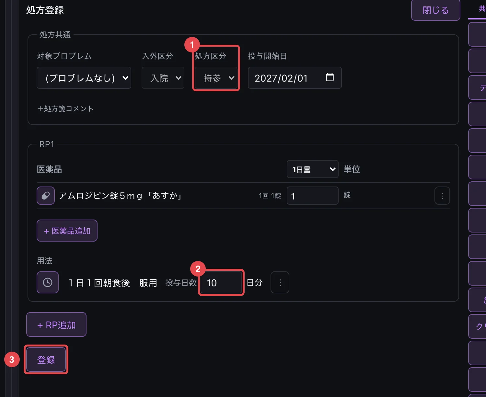

# 持参薬鑑別

入院の患者が持ってきた薬(持参薬)を、病棟がカルテに登録し、薬剤部が鑑別し、医師が入院中に続けるかどうかを決める操作です。

- 持参薬は 1 剤ずつ登録し、1 剤ずつ「未鑑別」→「未判断」(鑑別済)→「継続」「休止」「中止」と進みます。
- 持参薬を登録すると、薬剤部の「持参薬鑑別一覧」に鑑別の依頼が入ります(入院 1 件につき 1 行)。
- 続ける持参薬は、院内の処方(処方区分「持参」)に起こします。薬剤部は調剤せず、持参した薬をそのまま使います。

## 持参薬を登録する(病棟)

入院中の患者のカルテで、「患者情報」のタブから「持参薬」を開きます。

{ .screen width="649" }

1. 「患者情報」にマウスを乗せ、「持参薬」を押します。

「新規登録」を押すと、持参薬登録が開きます。1 回の登録で何剤でも入れられます。

{ .screen width="1087" }

1. 「聞き取り」に、「情報源」(本人・家族・お薬手帳など)、「処方元」の医療機関、入院前の「最終服用日時」を入れます。
2. 「薬剤」の「マスタから選択」で、医薬品を選びます。
3. 「用法」の「マスタから選択」で、用法を選びます。
4. 「1 回量」を入れます。
5. 「持参数」(持ってきた数)を入れます。
6. 補足があれば「コメント」に入れます。

医薬品や用法がマスタで見つからないときは、文字で入れられます。

{ .screen width="1089" }

1. 薬の名前を文字で入れます(マスタから選んだあとは「名前で入力」で切り替えます)。薬剤部が鑑別で医薬品を特定します。
2. 用法も文字で入れられます(マスタから選んだあとは「文字で入力」)。
3. 「+ 持参薬追加」で、次の薬の欄を足します。要らない欄は「持参薬削除」で消します。
4. 「登録」を押します。

{ .screen width="1059" }

1. 登録した持参薬が「未鑑別」で並びます。上の行に、入院中の持参薬の数と、鑑別の進み具合が出ます。

## 鑑別する(薬剤部)

画面の上の「部門業務」>「薬剤部門」>「持参薬鑑別一覧」を開きます。ホームの「持参薬鑑別」のカードからも開けます。

{ .screen }

1. 入院ごとに 1 行で、持参薬の数と名前、未鑑別の数が出ます。
2. 鑑別を始めるときに「鑑別開始」を押します。ステータスが「鑑別中」になり、「鑑別」で入力できます。

鑑別を終えた入院は一覧から消えます。「鑑別済も表示(直近 7 日)」にチェックを付けると、終えたものも並びます。

「鑑別」を押すと、その入院の持参薬をまとめて鑑別する画面が開きます。持参薬ごとに入れます。

{ .screen width="960" }

1. 登録したときの薬の名前と、用法・1 回量・処方元が出ます。
2. 処方されていたが飲んでいなかった薬は、「服用していない」にチェックを付けます。医師の判断は要らなくなります。
3. 「医薬品」で、実物やお薬手帳から特定した医薬品を選びます(「選択」「変更」)。
4. 「持参数」を確かめ、「残日数」(持参した分で飲める日数)を入れます。
5. 「院内での扱い」を選びます。「同じ薬が院内にある」「院内の代替薬」「持参分を使う」から選び、「院内の代替薬」のときは「代替薬」を選びます。
6. 医師へ伝えることがあれば「コメント」に入れます。
7. 「保存」を押します。

{ .screen }

1. ステータスは「鑑別中」です。持参薬の列には、鑑別で特定した医薬品の名前が出ます。
2. 「鑑別完了」を押します。主治医に通知「持参薬鑑別済」が届きます。

- 鑑別していない持参薬が残っていると、「鑑別完了」は押せません。
- 鑑別はカルテの持参薬タブの「鑑別」からもできます。
- 行の「⋮」で、ステータスを戻す「取消」と、依頼をやめる「依頼取下げ」ができます。

## 続けるかどうかを決める(医師)

鑑別が済むと、持参薬タブの持参薬が「未判断」になります。

{ .screen width="1059" }

1. 鑑別の済んだ持参薬は「未判断」です。「持参数・残日数」に鑑別の結果が出ます。
2. 判断する持参薬の左のチェックを付けます。いくつでも選べます。
3. 「継続(院内処方)」「休止」「中止」を押します。休止・中止は理由を入れて決めます。

「継続(院内処方)」を押すと、右側に処方登録が開きます。

{ .screen width="750" }

1. 処方区分は「持参」で、変えられません。代替薬を選んだ持参薬は、代替薬で入ります。
2. 投与日数には、鑑別の残日数が入ります。
3. 「登録」を押すと、処方が登録され、持参薬が「継続」になります。

- その入院の持参薬がすべて判断されると、通知「持参薬鑑別済」は自動で対応済みになります。
- 休止・中止した持参薬は、行の「⋮」の「判断取消」で未判断に戻せます。継続した持参薬は、起こした処方を中止して止めます。
- 退院するときに、継続中・休止中の持参薬は終了になります。
