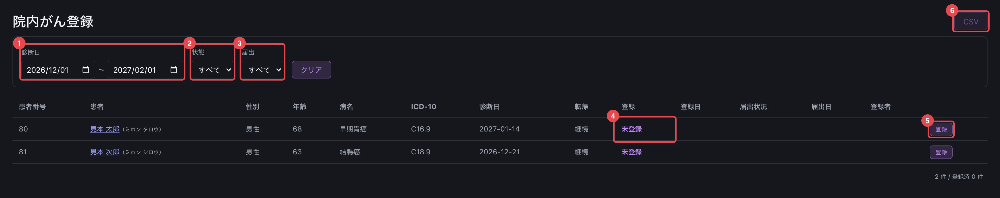
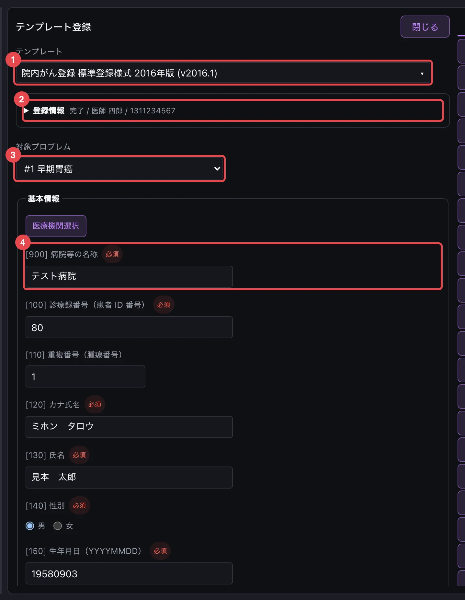

# 院内がん登録

院内がん登録(全国がん登録の届出項目を含む)の対象になる腫瘍を一覧にし、標準登録様式で 1 腫瘍ずつ登録する操作です。

- 院内がん登録は、画面の上の「データ」>「院内がん登録」で開きます。
- 一覧に並ぶのは、悪性新生物(続発性を除く)・上皮内癌・中枢神経系の腫瘍・骨髄異形成症候群などに当たる病名です。疑い病名は並びません。
- 登録は、標準登録様式(2016 年版)のテンプレートに記入して行います。登録 1 件が 1 腫瘍です。使うテンプレートは施設設定で決めます。

## 登録対象を見る

{ .screen }

1. 「診断日」(病名の開始日)の期間で絞ります。
2. 「状態」で、未登録・登録中・登録済に絞ります。
3. 「届出」で、未届出の行に絞ります。
4. 登録の状態です。登録していない病名は「未登録」、記入の途中は「登録中」、書き終えたものは「登録済」です。
5. 「登録」で、その病名の登録を始めます。登録中・登録済の行は「開く」になり、登録した内容が開きます。
6. 「CSV」で、表示している行のうち登録済の登録を、標準登録様式の項目の順に 1 行 1 腫瘍で出します。選択肢はコードで出ます。

- 登録した行には、登録日・届出状況([920] の値)・届出日・登録者が出ます。
- 患者の氏名を押すと、その患者のカルテが開きます。
- 下に、表示している件数と登録済の件数が出ます。

## 登録する

一覧の「登録」を押すと、その患者のカルテが開き、右ペインに標準登録様式のテンプレートが出ます。

{ .screen width="718" }

1. 施設設定の院内がん登録のテンプレートが選ばれています。
2. 「登録情報」を押すと、ステータス・記入者名・保険医療機関番号を直せます。
3. 「対象プロブレム」に、一覧で選んだ病名が入っています。登録はこの病名(腫瘍)に結び付きます。
4. 分かる項目には初期値が入っています。

- 初期値は、患者の基本情報、腫瘍の病名・診断日、病理診断(病理レポートがシノプティックレポートなら形態コード・病期も)、
  手術・化学療法・放射線治療の開始日、生存状況・最終受診日などから入ります。
- 入れ方は[テンプレート](template.md)と同じです。書き終えたら、下の「登録」を押します。
- 「必須」の付いた項目が空のままだと、ステータスを「入力中」にしても登録できません。
- 全国がん登録に届け出たら、一覧の「開く」で登録を開いて編集し、届出状況([920])を届出済にします。
