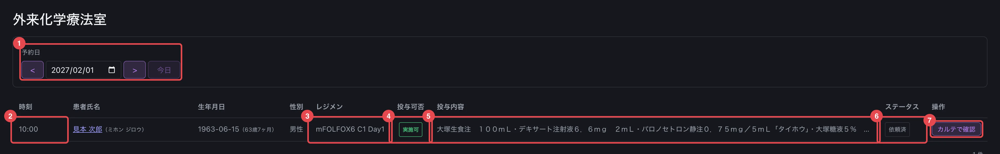
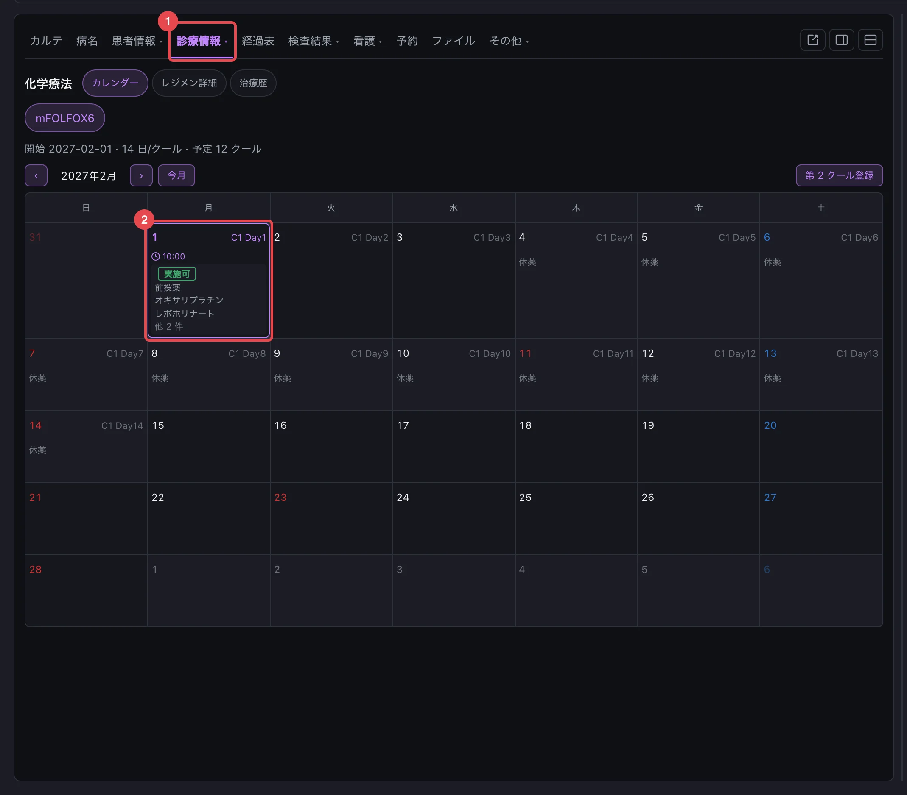

# 外来化学療法室

外来化学療法室が、その日の予約の時間順に化学療法の患者を確かめ、投与の準備と投与を進めるための一覧です。
化学療法の流れ全体は、業務フローの[化学療法](../flows/chemotherapy.md)を見てください。レジメンの適用と予約は[化学療法](chemotherapy.md)のページです。

- 外来化学療法室は、画面の上の「部門業務」>「外来化学療法室」>「外来化学療法室」で開きます。
- 一覧に出るのは、その日に外来化学療法室の枠を予約した投与日だけです。予約は、医師が投与日の「化学療法(投与日)」から取ります。
- 投与する薬の受付・払出は薬剤部の[注射一覧](injection-worklist.md)、投与の記録は[注射の実施入力](nursing-injection.md)で行います。

## 外来化学療法室の見方

{ .screen }

1. 「予約日」を選びます。「<」「>」で 1 日ずつ動かし、「今日」で今日に戻ります。
2. 予約の時刻の順に並びます。
3. 「レジメン」に、レジメン名とクール・投与日(「C1 Day1」は第 1 クールの 1 日目)が出ます。
4. 「投与可否」に、医師の確認の状態が出ます。「実施可」は医師が投与してよいと確かめた日です。確かめていなければ「未確認」、確認のあとで移動・編集した日は「要再確認」で、医師に確かめます。
5. 「投与内容」に、その日に投与する薬が並びます。
6. 「ステータス」に、薬剤部の作業と投与の進み具合(依頼済・受付済・払出済・実施済など)が出ます。
7. 「カルテで確認」を押すと、その患者のカルテの化学療法タブが開きます。

- 患者氏名の後ろに、注意区分・アレルギー・感染症の印が出ます。
- 適用が休止中の日は、投与可否の代わりに「休止中」が出ます。

## カルテで投与日を確かめる

{ .screen width="1069" }

1. カルテの「診療情報」>「化学療法」のタブが開きます。
2. 暦の投与日のマスに、予約の時刻・投与可否と投与する薬が出ます。マスを押すと、その日のオーダーと投与可否の記録が開きます。

投与日を動かす・中止する・投与可否を記録するのは医師の操作です。外来化学療法室では、気になる日は医師に確かめます。
