# 化学療法

医師が、施設で承認したレジメンを患者に適用し、投与日ごとの投与可否の確認・化学療法室の予約・次のクールの登録をする操作です。
投与日のオーダーが薬剤部で払い出され、施用されるまでの流れは業務フローの[化学療法](../flows/chemotherapy.md)を見てください。

このページで使う呼び名です。

- **レジメン**: 化学療法の治療計画の雛形です。施設が登録して承認したものだけを選べます。
- **クール**: 投与期間と休薬期間を合わせた 1 回りです。クールの何日目かを Day 1、Day 8 のように呼びます。
- **適用**: 1 人の患者に 1 つのレジメンを使うことです。
- **投与日のオーダー**: 適用すると、投与日ごとに注射と内服のオーダーができます。通常の注射・処方と同じく、薬剤部の一覧に並びます。

## レジメンを適用する

### 化学療法を開く

患者のカルテを開いておきます。投与前の検査値と身長・体重を、先に登録しておきます。

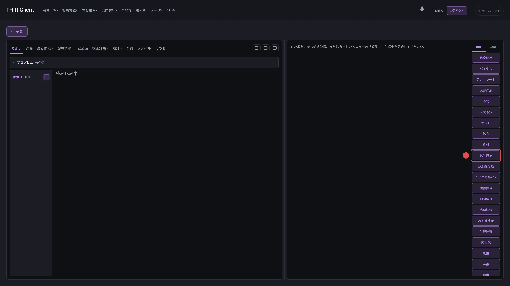{ .screen }

1. カルテの右側に並ぶボタンから「化学療法」を押します。右側に「化学療法(レジメン適用)」が開きます。

### レジメンを選ぶ

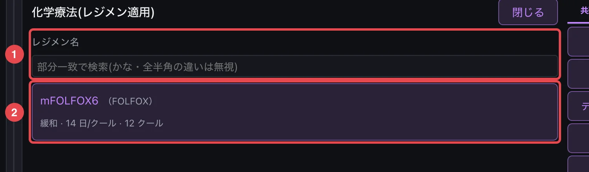{ .screen width="750" }

1. 「レジメン名」に名前の一部を入れて絞り込みます。かなと全角・半角の違いは区別しません。
2. 使うレジメンを押します。治療目的・1 クールの日数・予定クール数が添えて出ます。

並ぶのは、承認済で有効期間内のレジメンだけです。

### 投与前チェックを確かめる

上に、レジメンの投与基準と患者の検査値を突き合わせた結果が出ます。行を押すと開きます。

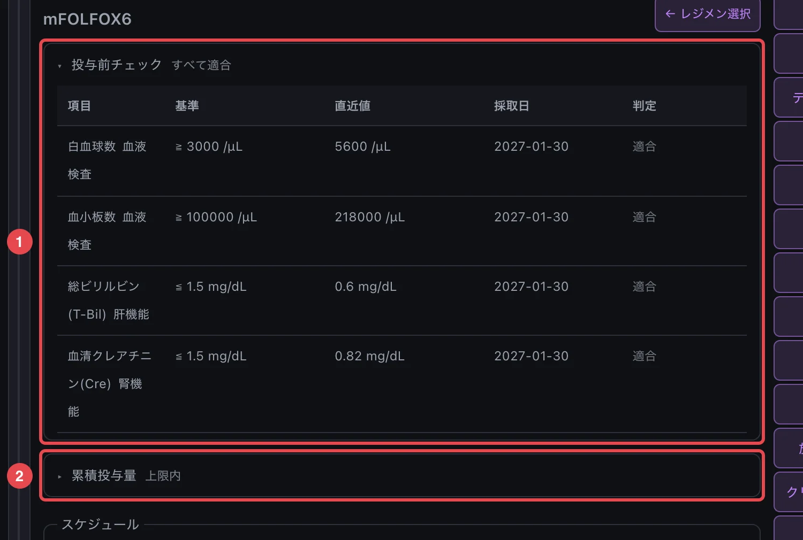{ .screen width="750" }

1. 「投与前チェック」で、基準の項目ごとに直近の値・採取日・判定を確かめます。基準を外れた項目があると、見出しにその件数が出ます。
2. 「累積投与量」で、上限のある薬剤について、これまでの登録済みの量と今回の量の合計が上限に収まるかを確かめます。

値が無いときや、採取日が 7 日より前のときも判定の欄に出ます。

### スケジュールとオーダーを入れる

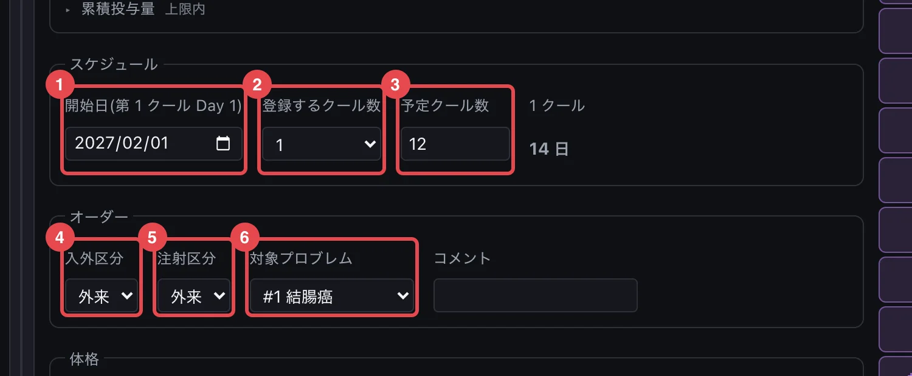{ .screen width="750" }

1. 「開始日」に、第 1 クールの Day 1 を入れます。初期値は今日です。
2. 「登録するクール数」で、一度に登録するクールの数を選びます。3 クールまで選べます。
3. 「予定クール数」に、全部で何クール行うかを入れます。空欄にすると、終わりを決めずに続けます。
4. 「入外区分」で「入院」か「外来」を選びます。
5. 「注射区分」を選びます。内服のあるレジメンは、横に「処方区分」も出ます。
6. 「対象プロブレム」で、対象の病名を選びます。

伝えることがあれば「コメント」に入れます。

### 体格を確かめる

投与量は、ここの身長・体重から計算します。

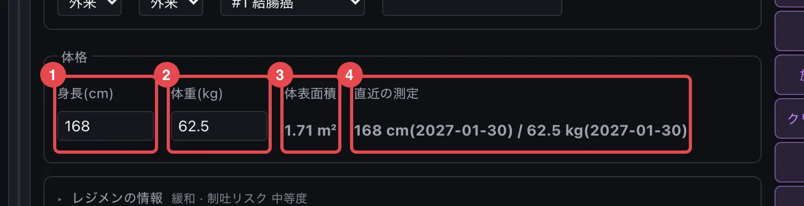{ .screen width="750" }

1. 「身長(cm)」を確かめます。
2. 「体重(kg)」を確かめます。
3. 「体表面積」に、身長と体重から計算した値が出ます。
4. 「直近の測定」に、カルテに登録した最新の身長・体重と測定日が出ます。初期値はこの値です。

身長・体重を直すと、体表面積と投与量が計算し直されます。
カルボプラチンのように腎機能から量を決める薬剤があるときは、「GFR(mL/分)」も出ます。

### 投与量を確かめる

「投与内容」に、レジメンの投与の組(ステップ)ごとに医薬品と投与量が並びます。

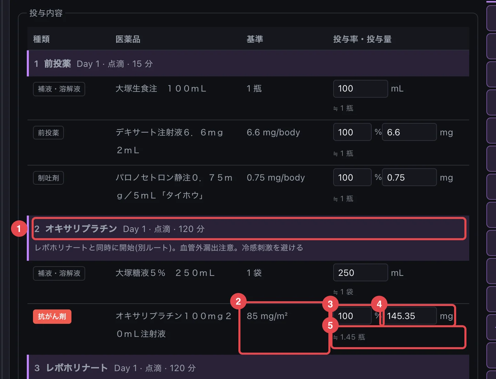{ .screen width="722" }

1. ステップの見出しに、投与する Day・点滴かワンショットか・点滴時間が出ます。下に、レジメンに書いた投与時の注意が出ます。
2. 「基準」に、レジメンの基準量(体表面積あたり・体重あたりなど)が出ます。上限があるときは添えて出ます。
3. 減量するときは、投与率(%)を下げます。量が計算し直されます。
4. 投与量が出ます。量を直接直すこともできます。
5. 量を製剤の数に直した目安が出ます。オーダーには製剤の数で載ります。

減量すると、下に「減量理由」の欄が出るので、理由を入れます。

### 適用する

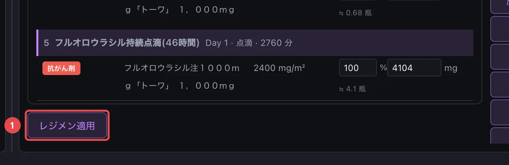{ .screen width="750" }

1. 「レジメン適用」を押します。

確かめが要る警告(基準を外れた検査値、薬剤アレルギー、累積投与量の超過、同じレジメンの二重の適用など)があると、
確認の画面が出ます。警告ごとに理由を選んで「登録」を押します。警告の一覧は、業務フローの[登録の判定](../flows/chemotherapy.md#登録の判定)を見てください。

適用すると右側が閉じ、カルテに投与日の注射のカードが出ます。見出しに「mFOLFOX6 C1 Day1」のように、レジメン・クール・Day が付きます。

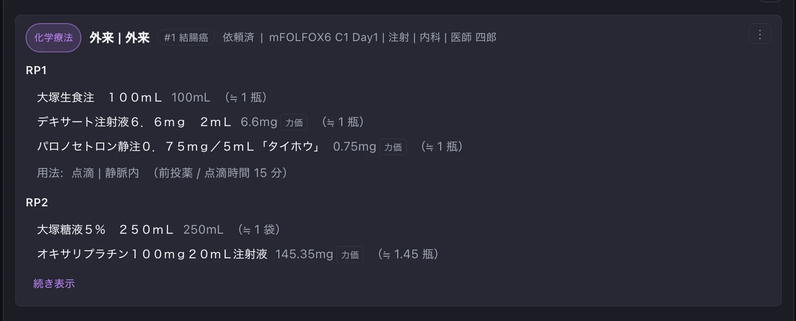{ .screen width="841" }

投与日のオーダーは、通常の注射・処方と同じく、薬剤部の監査・払出・調剤に進みます。
DO(同じ内容で出し直す)はできません。同じ内容をもう一度出すときは、次のクールを登録します。

## 化学療法タブを開く

適用したレジメンの投与予定は、カルテの左側の「化学療法」タブで見ます。

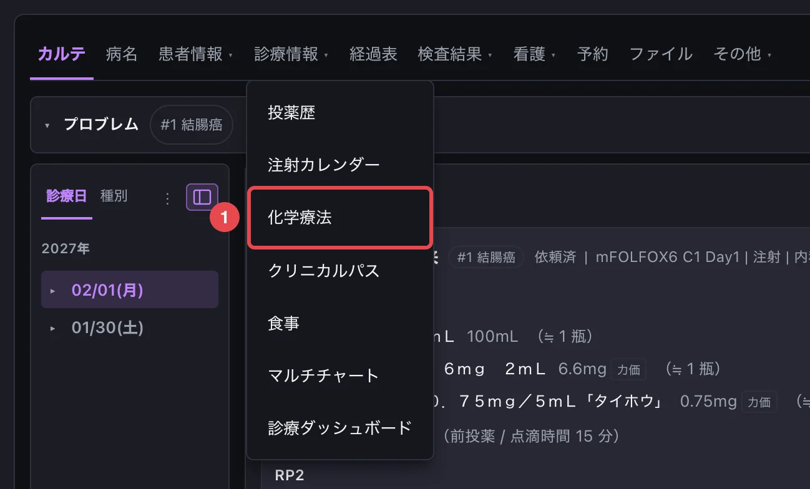{ .screen width="649" }

1. 「診療情報」にマウスを載せ、「化学療法」を押します。

## 投与日の操作

タブの暦の投与日を押すと、「化学療法(投与日)」が開きます。

### 投与可否を確かめる

その日に投与してよいかを、投与日ごとに医師が記録します。

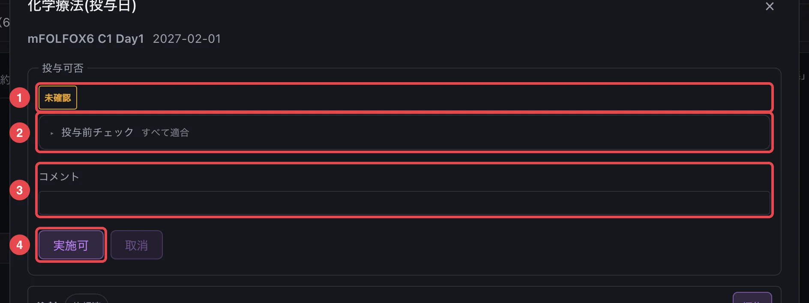{ .screen width="944" }

1. いまの状態が出ます。

    | 印 | 意味 |
    |---|---|
    | 未確認 | 実施可の記録が無い |
    | 実施可 | 医師が確かめた |
    | 要再確認 | 確かめたあとで、投与日を移動・編集した |

2. 「投与前チェック」で、その日までの検査値で判定し直した結果を確かめます。
3. 必要なら「コメント」を入れます。
4. 投与してよければ「実施可」を押します。基準を外れた検査値があるときは、確認のダイアログで「OK」を押します。

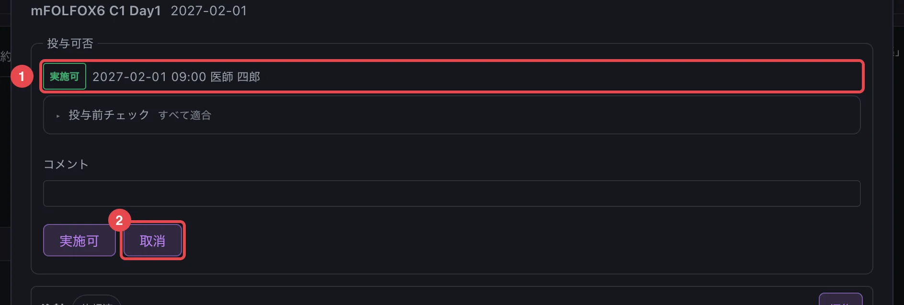{ .screen width="944" }

1. 「実施可」の印と、確かめた日時・医師が出ます。
2. 取り消すときは「取消」を押します。未確認に戻ります。

投与可否を記録できるのは、医師・歯科医師のログインだけです。代行入力はできません。
実施可は、その日の注射と内服の両方に記録されます。未確認のままでも、薬剤部の払出と施用は止まりません。
その日の投与を見合わせるときは、日を移すなら移動、やめるなら中止にします(下の「投与日を移動する・中止する」)。

### 外来化学療法室を予約する

外来の投与日は、外来化学療法室の枠を予約します。「外来化学療法室」の欄の「予約」を押すと、予約の画面が開きます。

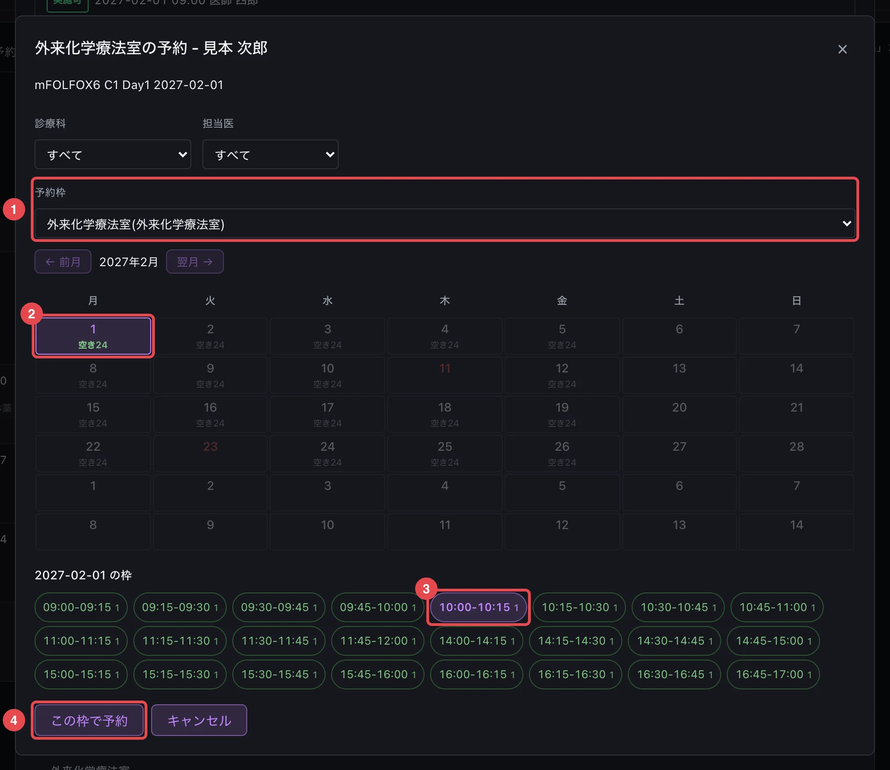{ .screen width="954" }

1. 「予約枠」で外来化学療法室を選びます。
2. 暦は、その投与日だけを選べます。空いている枠の数が出ます。
3. 予約する時間の枠を押します。
4. 「この枠で予約」を押します。

予約は、適用とは別に取ります。枠が空いていなくても適用はできます。
予約を別の日にしたいときは、投与日を移動してから予約を取り直します。

### 投与日を移動する・中止する

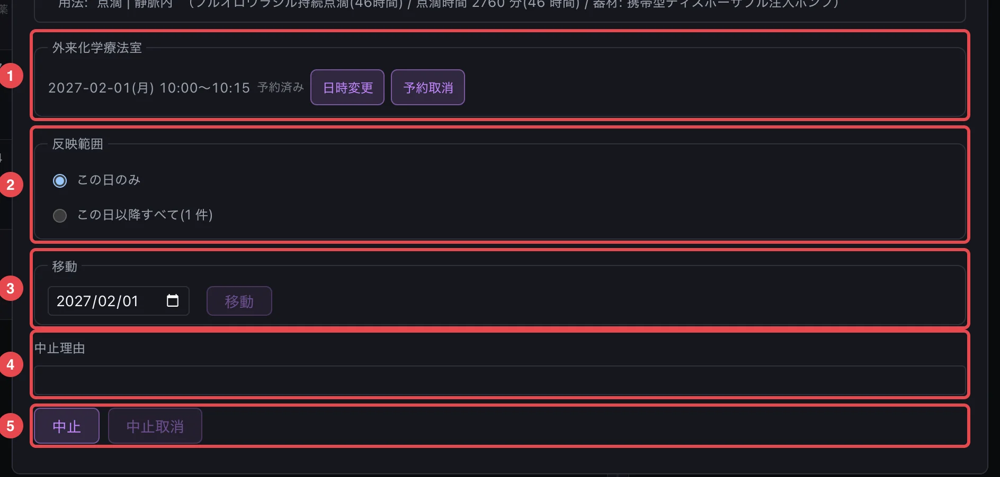{ .screen width="944" }

1. 「外来化学療法室」に予約の日時が出ます。「日時変更」で同じ日の別の枠に変え、「予約取消」で予約を取り消します。
2. 「反映範囲」で、この日だけにするか、この日以降の投与日すべてにするかを選びます。
3. 日を移すときは、「移動」に移す先の日を入れて「移動」を押します。確認のダイアログで「OK」を押します。
4. 中止するときは「中止理由」を入れます。
5. 「中止」を押し、確認のダイアログで「OK」を押すと、投与日を中止します。中止した日は「中止取消」で、中止する前の状態に戻せます。

- 移動と中止をすると、その日の外来化学療法室の予約は取り消されます。中止取消をしても予約は戻らないので、取り直します。
- 実施済の投与日は、移動も中止もできません。
- 移動しても、投与量と薬剤部の作業の進み具合は変わりません。薬剤部が受付・払出を済ませた日を移すときは、
  確認の画面にその件数が出ます。薬剤部に日付の変更を伝えます。
- 最初の投与日を移動すると、適用の開始日も合わせて動きます。

その日の注射・内服の中身を直すときは、オーダーの右上の「編集」を押します。右側に注射・処方の編集が開きます。
編集と移動をすると、投与可否は要再確認に戻ります。

## 暦で予定を見る

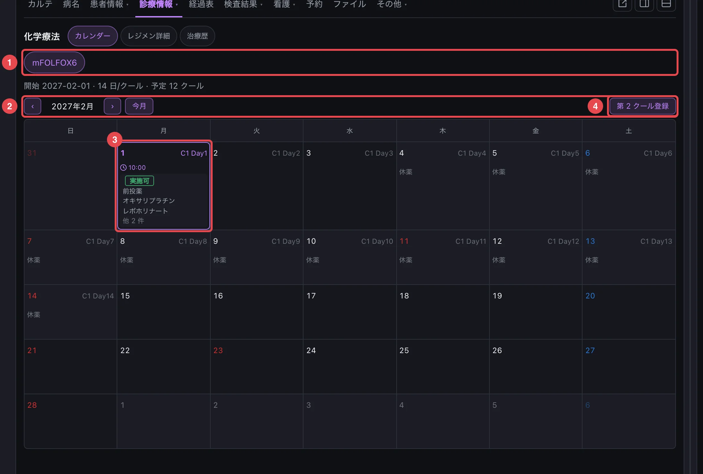{ .screen width="1059" }

1. 患者に適用したレジメンが並びます。押すと、そのレジメンの暦に切り替わります。
2. 「‹」「›」で月を送ります。「今月」で今月に戻ります。
3. 投与日のマスに、クールと Day・投与するステップ・投与可否の印・予約の時刻が出ます。休薬の日には「休薬」と出ます。
   マスを押すと「化学療法(投与日)」が開きます。マスをドラッグして別の日に落とすと、投与日を移動します。
4. 「第 N クール登録」を押すと、次のクールを登録します(下の「次のクールを登録する」)。

ドラッグ中に「‹」「›」にかざすと、前後の月へ送れます。上の「治療歴」では、この患者に適用したレジメンをすべて並べます。

## レジメン詳細

タブの上の「レジメン詳細」で、適用の内容とクールの一覧を見ます。

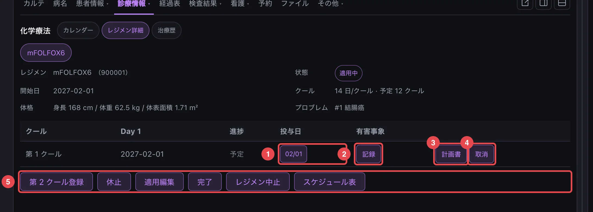{ .screen width="1059" }

1. 投与日を押すと、「化学療法(投与日)」が開きます。
2. 「記録」を押すと、そのクールの有害事象を記録します(下の「有害事象を記録する」)。
3. 「計画書」を押すと、そのクールの化学療法実施計画書を新しいタブで開きます。
4. 「取消」を押すと、そのクールの投与日のオーダーをすべて削除します。登録の誤りを片付けるときに使います。
5. 適用全体の操作です。

    | ボタン | すること |
    |---|---|
    | 第 N クール登録 | 次のクールを登録する |
    | 休止 | 適用を休止中にする。休止中は「再開」に変わる |
    | 適用編集 | 予定クール数などを直す |
    | 完了 | 治療を終える。未実施の投与日はすべて中止になる |
    | レジメン中止 | 理由を選んで治療をやめる。未実施の投与日はすべて中止になる |
    | スケジュール表 | 患者に渡す月ごとの予定表を新しいタブで開く |

- 「取消」が出るのは、どの投与日も依頼済か中止のクールだけです。薬剤部の作業が進んだクールは、投与日ごとに中止します。
- 休止しても、登録済みの投与日はそのまま残ります。投与を止めるときは、投与日を中止します。休止の間は次のクールを登録できません。
- 予定クール数に達しても、自動では完了になりません。最後のクールを終えたら「完了」を押します。

## 有害事象を記録する

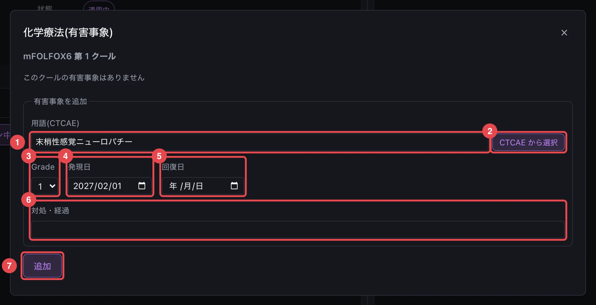{ .screen width="954" }

1. 「用語(CTCAE)」に有害事象の名前を入れます。
2. 「CTCAE から選択」を押すと、CTCAE の用語から探して選べます。Grade の定義を読みながら選べます。
3. 「Grade」を選びます。
4. 「発現日」を入れます。
5. 回復したら「回復日」を入れます。空欄のあいだは継続中として出ます。
6. 必要なら「対処・経過」を入れます。
7. 「追加」を押します。

記録した有害事象は上に並び、「編集」「削除」で直せます。カルテには発現日の日にカードが出ます。
次のクールの登録画面にも、前のクールの有害事象が出ます。

## 次のクールを登録する

暦の「第 N クール登録」か、レジメン詳細の「第 N クール登録」を押すと、「化学療法(クール登録)」が開きます。
入れる項目と確かめることは、適用と同じです。

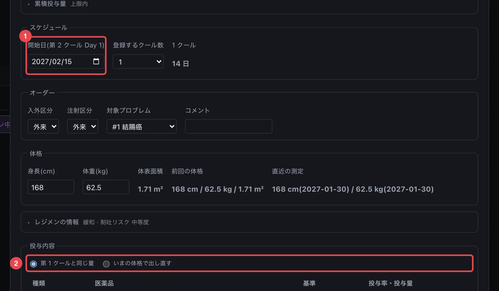{ .screen width="944" }

1. 「開始日」に、前のクールの Day 1 から 1 クール後の日が入っています。延期するときは直します。
2. 投与量は、前のクールと同じ量が初期値です。新しい身長・体重で計算し直すときは「いまの体格で出し直す」を選びます。

前のクールから体重が 10% 以上変わったときは、警告が出ます。最後に「クール登録」を押します。
