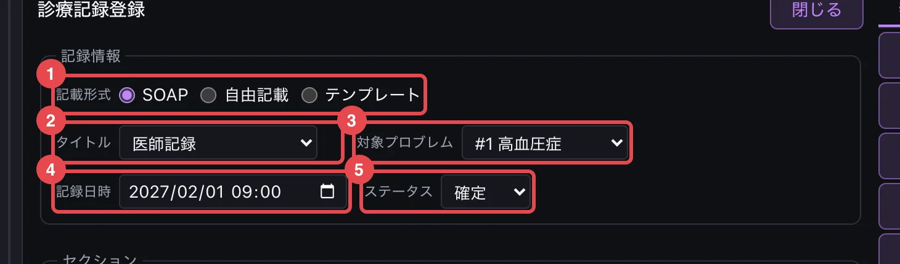
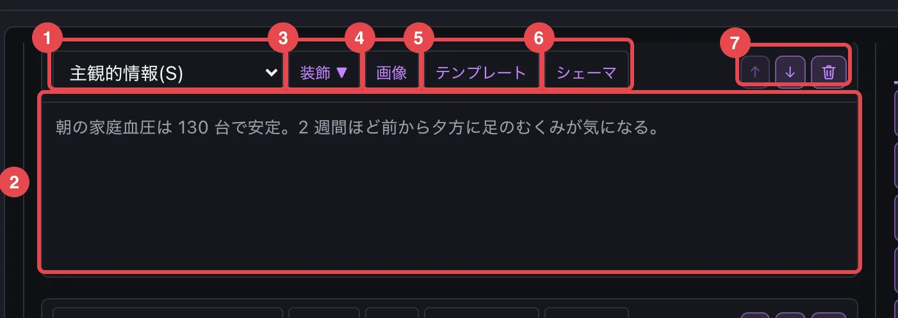
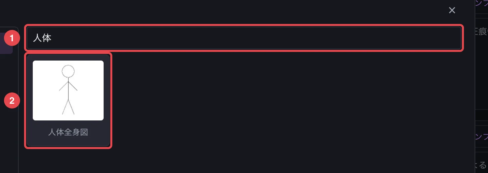
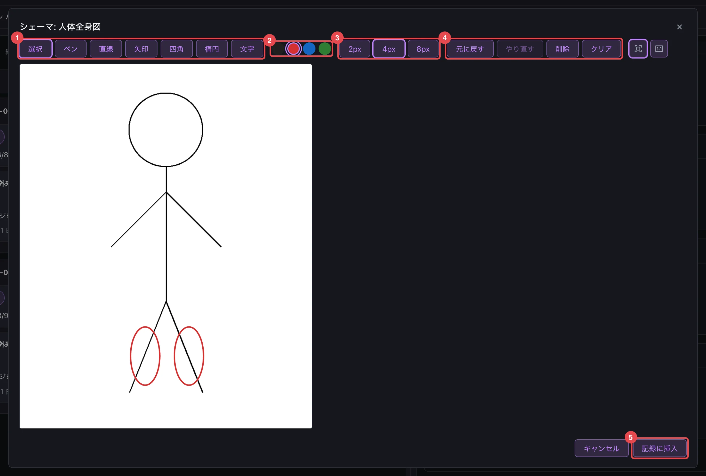
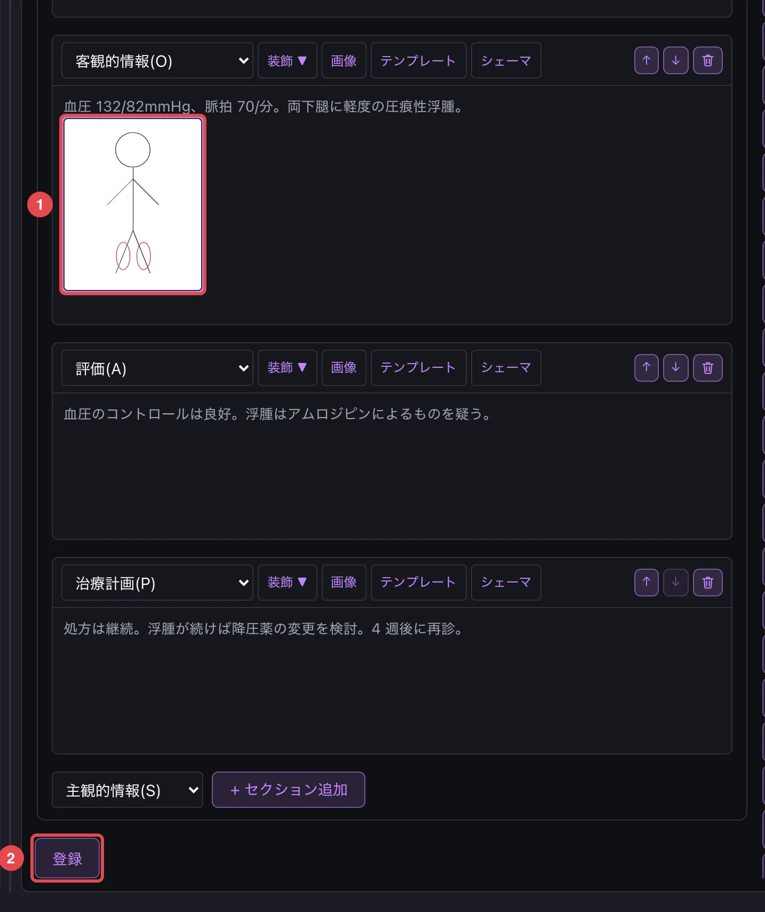
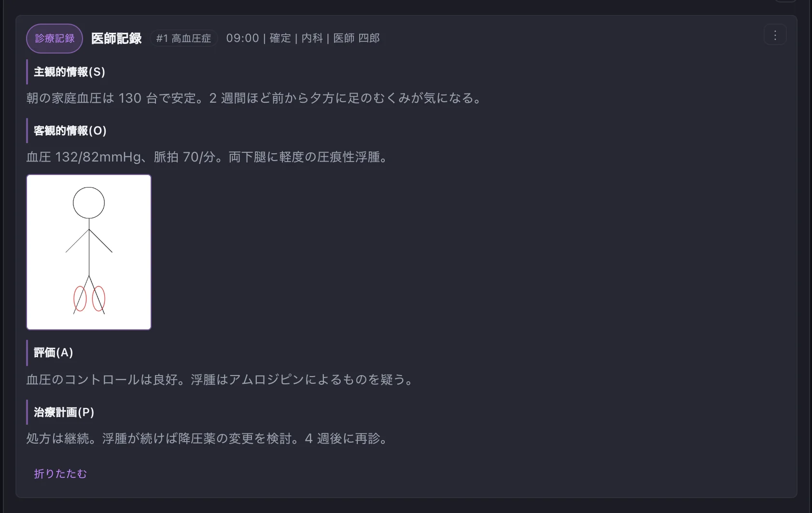
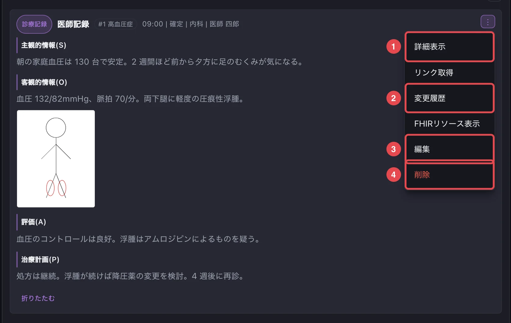

# 診療記録

医師がカルテに診療の記録(経過記録)を書いて登録する操作です。SOAP の形で書き、シェーマ(人体などの図)に描き込んで本文に貼れます。

このページで使う呼び名です。

- **SOAP**: 主観的情報(S)・客観的情報(O)・評価(A)・治療計画(P)の 4 つの区分で書く記録の形です。
- **セクション**: S・O・A・P のような、本文の区切りです。

## 診療記録登録を開く

患者のカルテを開き、右側の登録のボタンから「診療記録」を押します。右側に「診療記録登録」が開きます。

カルテの上のプロブレムの帯でプロブレムを選んでから「診療記録」を押すと、そのプロブレムが「対象プロブレム」に入った状態で開きます。

## 記録情報を入れる

{ .screen width="730" }

1. 「記載形式」を選びます。

    | 記載形式 | 本文 |
    |---|---|
    | SOAP | S・O・A・P のセクションに分けて書きます |
    | 自由記載 | 区切りの無い 1 つの本文に書きます |
    | テンプレート | 選んだテンプレート(決まった書式の入力画面)に記入します |

2. 「タイトル」を選びます。タイトルによっては、記載形式やテンプレートが決まっているものがあり、選ぶと切り替わります。
3. 「対象プロブレム」で、この記録で扱うプロブレムを選びます。1 つの記録に 1 つのプロブレムです。いくつかのプロブレムを扱うときは、記録を分けて登録します。
4. 「記録日時」を確かめます。初期値はいまの日時です。
5. 「ステータス」を選びます。書き終えた記録は「確定」、あとで書き足す記録は「下書き」にします。

「確定」で登録すると、ログインしている医師が確定者として記録に残ります。

## 本文を書く

セクションごとに、種類の選択・道具のボタン・本文の欄が並びます。

{ .screen width="701" }

1. セクションの種類です。S・O・A・P などから選び直せます。
2. 本文を入れます。Tab で次のセクションの本文へ、Shift+Tab で前のセクションの本文へ移ります。
3. 「装飾」で、太字・文字の大きさ・文字の色を変える道具を出します。
4. 「画像」で、手元の画像ファイルを本文に貼ります。
5. 「テンプレート」で、このセクションをテンプレートで記入します。テンプレートで記入したセクションは、以後テンプレートからだけ直せます。
6. 「シェーマ」で、シェーマに描き込んで本文に貼ります(下の「シェーマを描き込む」)。
7. セクションの並べ替え(↑・↓)と削除(ゴミ箱)です。

セクションを足すときは、セクションの並びの下で種類を選び、「+ セクション追加」を押します。

## シェーマを描き込む

貼りたい位置に本文のカーソルを置いてから、そのセクションの「シェーマ」を押します。「シェーマを選択」が開きます。

{ .screen width="730" }

1. 名称の一部を入れて探します。左の分類を押して絞り込むこともできます。
2. 使うシェーマを押します。描き込みの画面が開きます。

{ .screen width="1354" }

1. 描く道具を選びます。「選択」は描いたものを選んで動かす・大きさを変えるとき、「文字」は文字を書き込むときに使います。
2. 色を選びます。
3. 線の太さを選びます。
4. 「元に戻す」「やり直す」で操作を戻し、「削除」で選んだものを消し、「クリア」で描いたものをすべて消します。
5. 「記録に挿入」を押すと、描き込んだシェーマが本文のカーソルの位置に入ります。

右上の 2 つのボタンで、シェーマを画面に合わせて出すか、原寸大で出すかを切り替えます。

## 登録する

{ .screen width="717" }

1. 貼ったシェーマを確かめます。
2. 「登録」を押します。

登録すると右側が閉じ、カルテに診療記録のカードが出ます。長い記録は途中で畳まれ、「続き表示」で全文を出します。

{ .screen width="841" }

## 登録した記録を見る・直す

カルテの診療記録のカードの「⋮」から操作します。

{ .screen width="841" }

1. 「詳細表示」で、記録の内容と、確定者・確定日時を見られます。
2. 「変更履歴」で、記録を直すたびに残る版を見られます。版を選ぶとその時点の内容が出て、「差分」で 1 つ前の版と比べられます。
3. 「編集」を押すと、右側に記録が開きます。直して「更新」を押します。確定した記録を直すと「修正済み」になり、直した人が確定者になります。
4. 「削除」を押すと、理由を入れて記録を削除します。理由は「誤入力」「患者間違い」「重複登録」から選ぶか、文字で入れます。下書きの記録は、確認だけで削除します。

「リンク取得」は、ほかの診療記録の本文にこの記録へのリンクを貼るときに使います。
