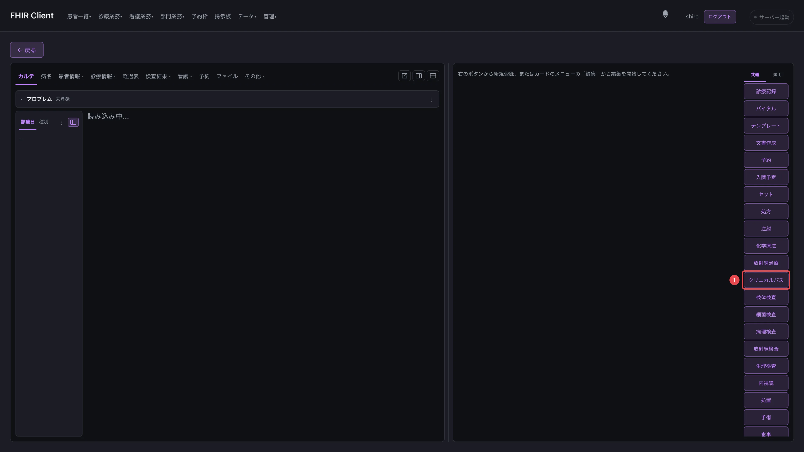
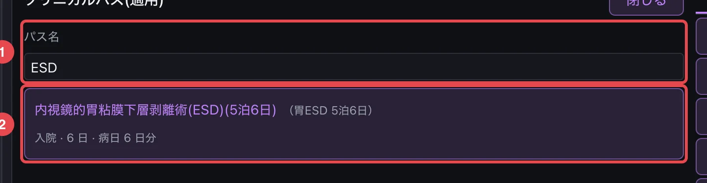
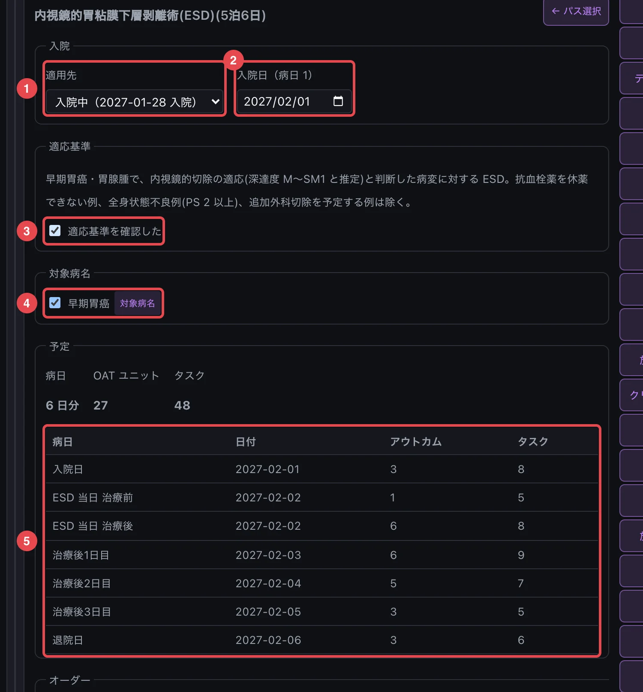
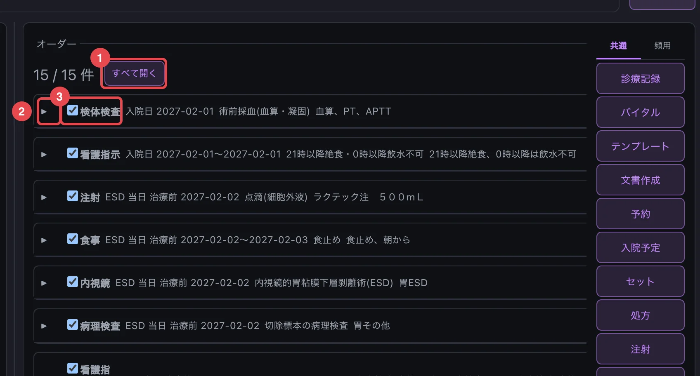
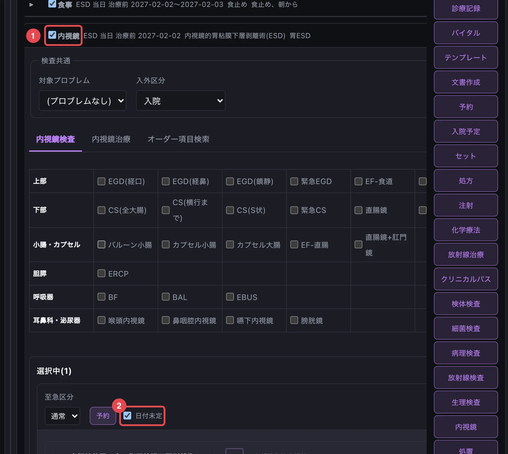
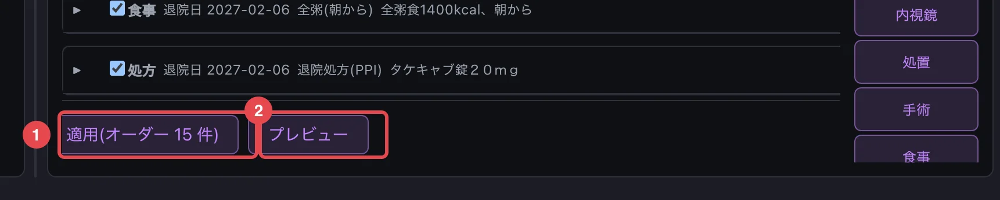
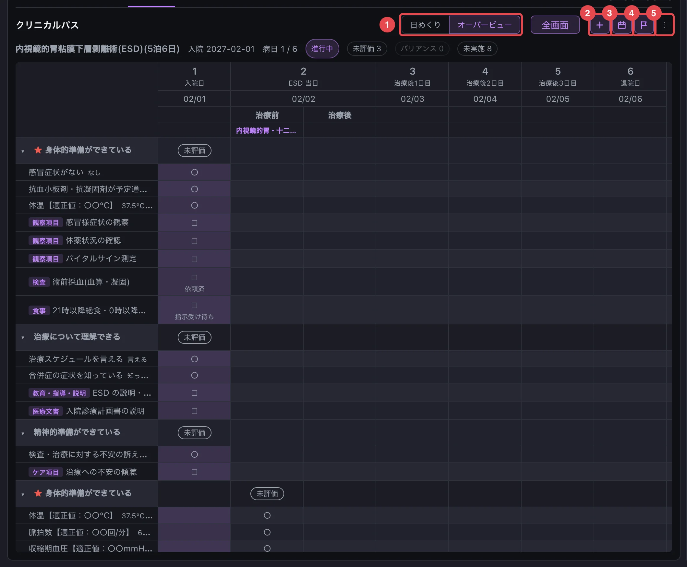
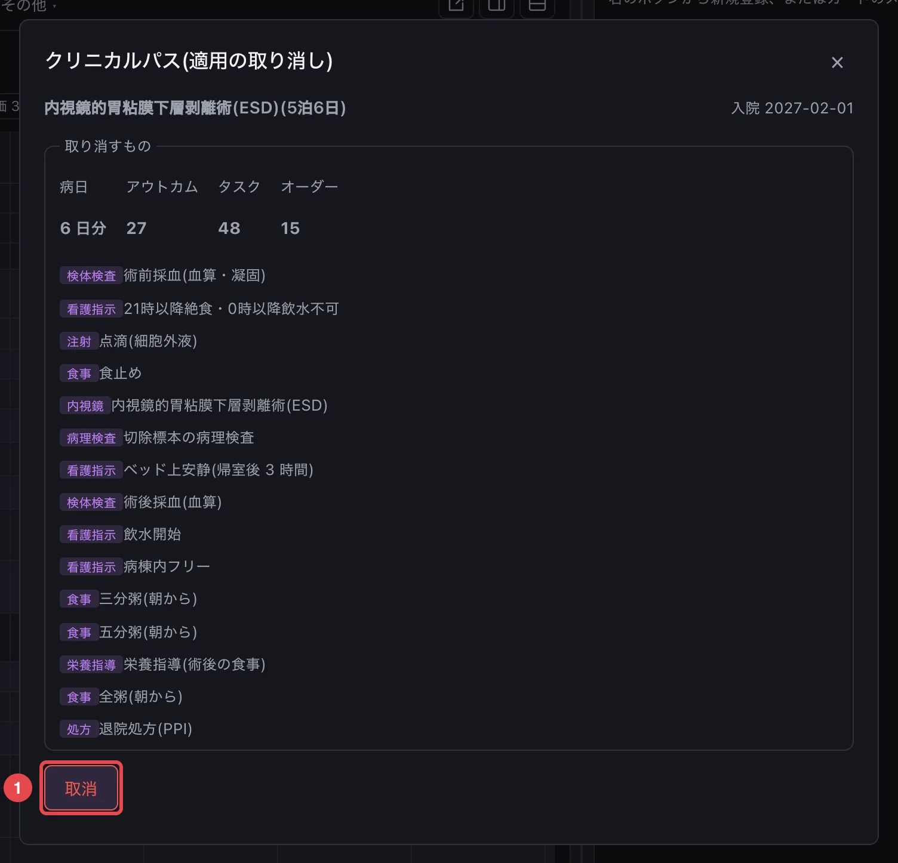

# クリニカルパス

医師が、施設で承認したクリニカルパスを入院中の患者に適用する操作です。
適用すると、パスシート(病日ごとのアウトカムとタスク)ができ、パスに入っているオーダーがまとめて出ます。
日々の評価と実施・フェーズの進行・終了までの流れは、業務フローの[クリニカルパス](../flows/clinical-pathway.md)を見てください。

このページで使う呼び名です。

- **病日**: 入院日を病日 1 として数えた日です。「ESD 当日」のように名前の付いた病日もあります。
- **アウトカム**: その病日に目指す患者の状態です(「身体的準備ができている」など)。
- **タスク**: 観察・ケア・説明などの作業と、パスから出るオーダーです。

## クリニカルパスを開く

入院中の患者のカルテを開いておきます。

{ .screen }

1. カルテの右側に並ぶボタンから「クリニカルパス」を押します。右側に「クリニカルパス(適用)」が開きます。

## パスを選ぶ

{ .screen width="718" }

1. 「パス名」に名前の一部を入れて絞り込みます。
2. 使うパスを押します。入院・外来の区分と日数が添えて出ます。

並ぶのは、承認済で有効期間内のパスだけです。

## 適用先と対象病名を確かめる

{ .screen width="750" }

1. 「適用先」を確かめます。初期値は、いまの入院です。入院予定に適用することもできます。
2. 「入院日(病日 1)」を確かめます。変えると、病日ごとの日付とオーダーの開始日も変わります。
3. 適応基準を読み、「適応基準を確認した」にチェックを付けます。チェックが無いと適用できません。
4. 「対象病名」で、パスの対象の病名にチェックを付けます。パスの対象病名と一致する病名には、初めからチェックが付いています。
5. 「予定」に、病日ごとの日付と、アウトカム・タスクの数が出ます。

## オーダーを確かめる

「オーダー」の区画に、パスから出るオーダーが病日の順に並びます。

{ .screen width="848" }

1. 「すべて開く」を押すと、全部のオーダーの入力欄が開きます。
2. 「▶」を押すと、そのオーダーの入力欄が開きます。通常のオーダーと同じ欄で中身を直せます。
3. 出さないオーダーは、チェックを外します。

予約が必須の項目(内視鏡・CT など)は、オーダーを開いて予約を取るか、「日付未定」にチェックを付けます。

{ .screen width="846" }

1. 予約が必須の項目のオーダーを開きます。
2. 予約を後で取るときは「日付未定」にチェックを付けます。予約は、適用したあとに部門の一覧で取ります。

## 適用する

{ .screen width="861" }

1. 「適用(オーダー N 件)」を押します。
2. 「プレビュー」を押すと、パスの内容(フェーズを分けたパスは続くフェーズまで)をパスシートの形で見られます。

オーダーの入力に誤りのある行が 1 つでもあると、何も登録されず、その行が開いて内容が出ます。直してからもう一度押します。
同じ入院に別のパスが進んでいるときは注意が出ますが、そのまま適用できます。

## パスシートを見る

適用すると、カルテの左側の「診療情報」の「クリニカルパス」タブにパスシートが出ます。患者の帯にもパス名が出ます。

{ .screen width="1059" }

1. 「オーバービュー」で全体のパスシートを、「日めくり」で 1 病日ずつアウトカムとタスクを見ます。日めくりでは、その日の達成状態・実績値・タスクの実施をまとめて入れます。
2. 「予定外を追加」で、予定に無いアウトカムを足します。
3. 「日程の変更」で、ある病日から後ろの日程をまとめてずらします。
4. 「終了・中止」で、パスを終えたとき・途中でやめたときの記録をします。退院しても自動では終わらないので、退院の前後に記録します。
5. 「⋮」の「適用の取り消し」で、まだ何も記録していないパスを取り消します。

パスシートのセルを押すと、そのアウトカムやタスクを開いて、評価や実施を記録できます。

## 適用を取り消す

適用を間違えたときは、パスシートの「⋮」の「適用の取り消し」を押します。

{ .screen width="752" }

1. 取り消すもの(病日・アウトカム・タスク・オーダー)を確かめて「取消」を押します。パスシートと、パスから出たオーダーが消えます。

評価や実施を記録したあとは取り消せません。途中でやめるときは「終了・中止」で中止を記録します。
