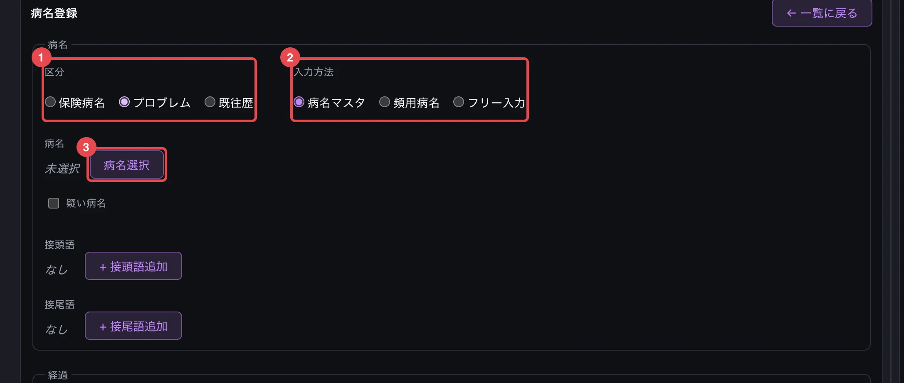
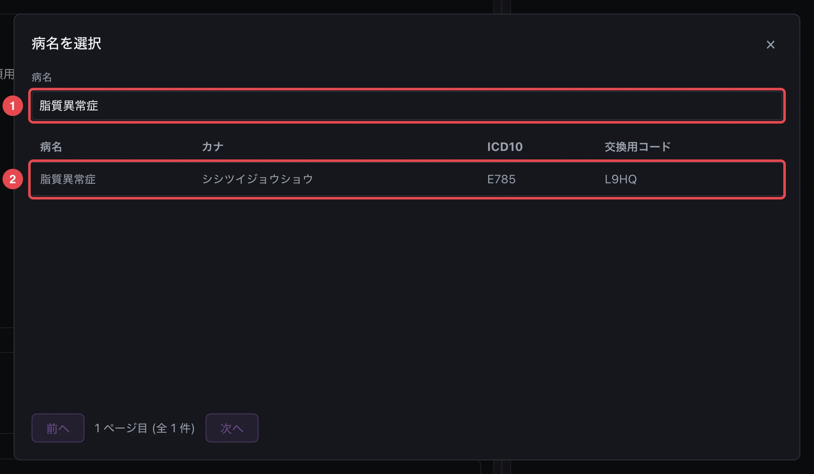
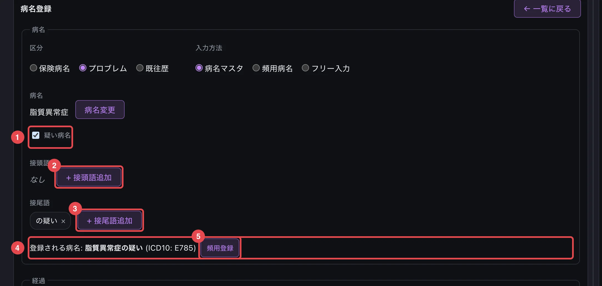
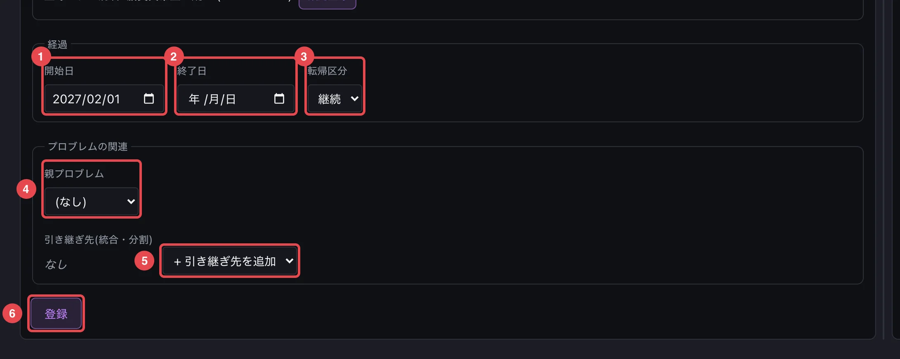
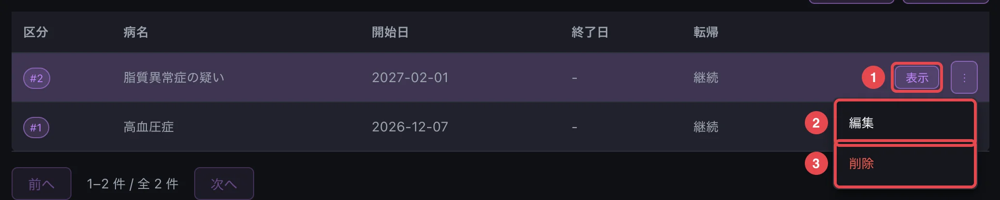
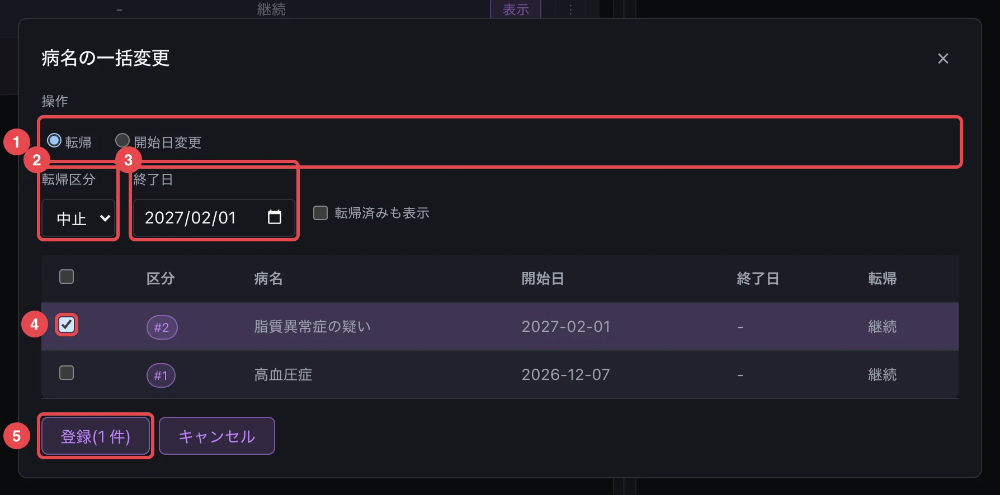

# 病名

医師がカルテの「病名」タブで、患者の病名を登録して直す操作です。病名は区分ごとに使い道が分かれます。

| 区分 | 使い道 |
|---|---|
| プロブレム | いま診ている問題です。番号(#1、#2 …)が付き、カルテの上のプロブレムの帯に並びます。診療記録やオーダーの「対象プロブレム」で選べます |
| 既往歴 | 過去の病歴です。番号は付かず、プロブレムの帯にも出ません |
| 保険病名 | 診療報酬の請求に使う病名です |

## 病名タブを開く

患者のカルテを開いておきます。

{ .screen width="1059" }

1. タブの「病名」を押します。患者の病名が一覧で並びます。
2. 「新規登録」を押します。「病名登録」が開きます。

## 区分と入力方法を選ぶ

{ .screen width="1087" }

1. 「区分」で「保険病名」「プロブレム」「既往歴」から選びます。
2. 「入力方法」を選びます。

    | 入力方法 | 使うとき |
    |---|---|
    | 病名マスタ | 標準の病名から探して選びます。ふつうはこれを使います |
    | 頻用病名 | 登録しておいた病名(修飾語の組み合わせを含む)から選びます。選んだあとは病名マスタと同じように直せます |
    | フリー入力 | 具体的な病名が分からない既往歴など、標準の病名に無いものを文字で入れます。修飾語と疑い病名は付けられません |

3. 「病名選択」を押します。フリー入力のときは、ここに病名を文字で入れます。

## 病名を選ぶ

{ .screen width="954" }

1. 「病名」に病名の一部を入れます。読みや別名(索引語)でも探せます。かなと全角・半角の違いは区別しません。
2. 使う病名の行を押します。

## 疑い病名と修飾語を付ける

{ .screen width="1087" }

1. 確定していない病名は「疑い病名」に印を付けます。接尾語に「の疑い」が付きます。
2. 病名の前に付ける語(「急性」「左」など)は「+ 接頭語追加」を押して選びます。
3. 病名の後ろに付ける語は「+ 接尾語追加」を押して選びます。
4. 「登録される病名」で、修飾語を付けた病名を確かめます。
5. よく使う組み合わせは「頻用登録」で頻用病名に登録できます。保存先(院内共通・診療科・自分)を選んで登録すると、次からは入力方法の「頻用病名」で選べます。

付けた修飾語は、名前の横の「×」で外せます。「の疑い」の「×」を押すと、「疑い病名」の印も外れます。

## 経過を入れて登録する

{ .screen width="1091" }

1. 「開始日」を確かめます。初期値は今日です。
2. 治った・中止したなど病名を閉じるときは「終了日」を入れます。
3. 「転帰区分」を選びます。続いている病名は「継続」のままにします。終了日を入れたときは「継続」以外を選びます。
4. プロブレムのとき、ほかのプロブレムの下にまとめるなら「親プロブレム」で選びます。
5. 症状で立てたプロブレムが 1 つの診断にまとまった(統合)・分かれた(分割)ときは、「+ 引き継ぎ先を追加」で引き継ぎ先のプロブレムを選びます。
6. 「登録」を押します。

「プロブレムの関連」は、区分が「プロブレム」のときだけ出ます。

## 登録した病名を見る・直す

登録すると病名の一覧に戻ります。

{ .screen width="1035" }

1. 「表示」を押すと、病名の内容を見られます。
2. 「⋮」の「編集」を押すと、「病名登録」と同じ画面で直せます。直して「更新」を押します。
3. 「⋮」の「削除」を押すと、確認のあと病名を削除します。誤って登録したときだけ使い、治った病名は削除せずに転帰を入れます。

プロブレムに登録した病名は、カルテのプロブレムの帯に番号付きで並びます。

{ .screen width="1059" }

1. 登録したプロブレムが番号付きで出ます。押すと、そのプロブレムに関係しない記録が薄くなります(操作マニュアルの[カルテ画面の見方](karte.md#プロブレムで絞り込む))。

転帰を入れたプロブレムは、帯の「解決済み」にまとめられます。

## まとめて転帰を入れる

退院や終診のときに、いくつかの病名を同じ日付で閉じるときは、一覧の上の「一括転帰」を押します。「病名の一括変更」が開きます。

{ .screen width="894" }

1. 「操作」で「転帰」を選びます。開始日をそろえるときは「開始日変更」を選びます。
2. 「転帰区分」を「軽快」「治癒」「中止」から選びます。
3. 「終了日」を確かめます。初期値は今日です。
4. 閉じる病名に印を付けます。初めは転帰が「継続」の病名だけが並びます。転帰を入れた病名も直すときは「転帰済みも表示」に印を付けます。
5. 「登録」を押します。

終了日が開始日より前になる病名があると、その行に理由が出て登録できません。日付を直すか、その病名の印を外します。
