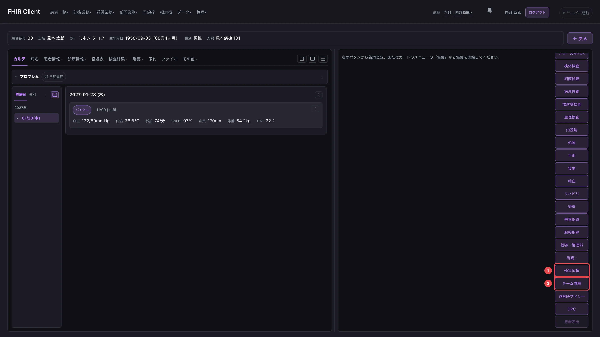
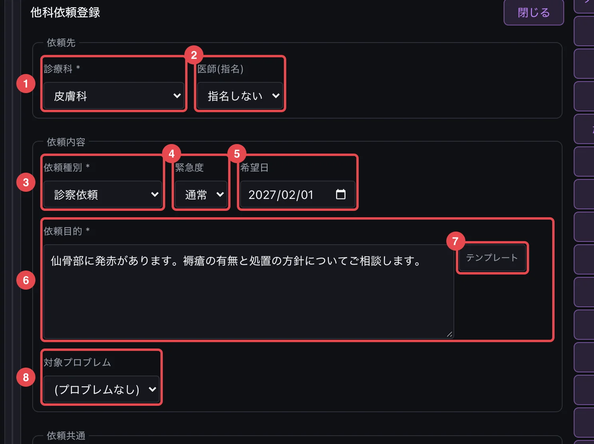
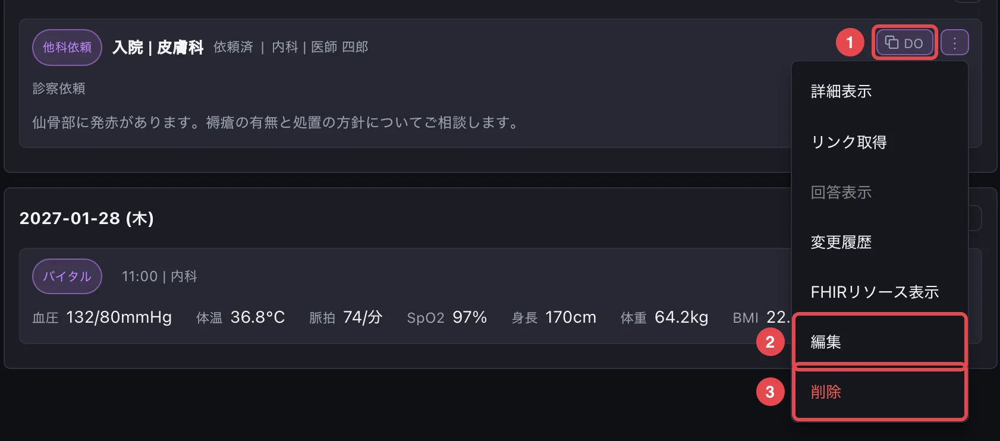
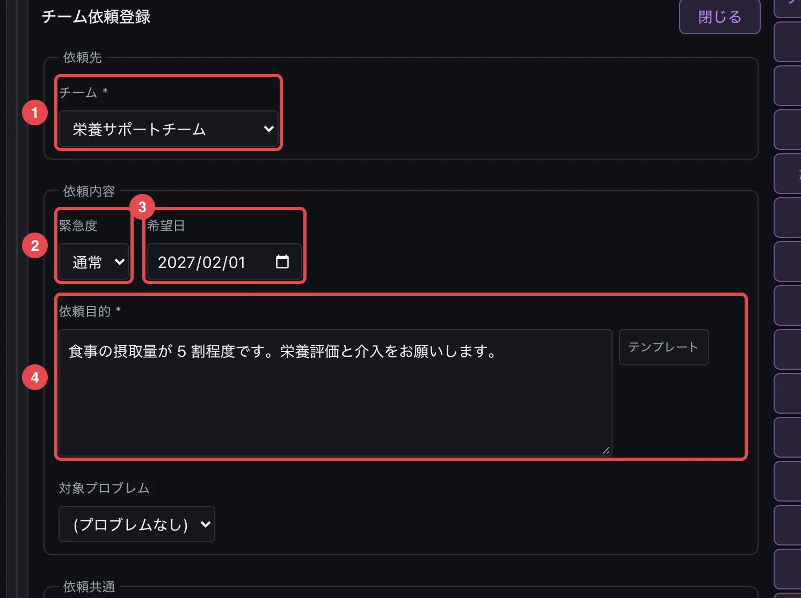
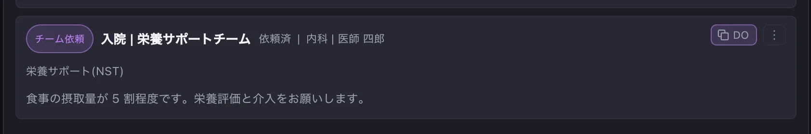

# 他科依頼・チーム依頼

医師が、ほかの診療科に診察や意見を頼む「他科依頼」と、栄養サポートチームなどのチームに介入を頼む「チーム依頼」を出す操作です。
依頼先での受付・回答・回診記録までの流れは、業務フローの[他科依頼・チーム依頼](../flows/consult-team.md)を見てください。

| | 他科依頼 | チーム依頼 |
|---|---|---|
| 依頼先 | 診療科(医師を指名できる) | 施設が登録したチーム |
| 返ってくるもの | 回答(1 件の診療記録) | 回診記録(何度でも書かれる) |
| 依頼先が断るとき | 「取消」 | 「却下」(理由つき) |

## 依頼を開く

患者のカルテを開いておきます。

{ .screen }

1. 他科依頼は、カルテの右側に並ぶボタンから「他科依頼」を押します。右側に「他科依頼登録」が開きます。
2. チーム依頼は「チーム依頼」を押します。右側に「チーム依頼登録」が開きます。

## 他科依頼を出す

項目名に「*」が付いたものは必ず入れます。

{ .screen width="746" }

1. 「診療科」で、依頼先の診療科を選びます。
2. 診てほしい医師が決まっていれば、「医師(指名)」で選びます。決めないときは「指名しない」のままにします。
3. 「依頼種別」を「診察依頼」「意見のみ」「検査依頼」「転科相談」から選びます。
4. 「緊急度」で「通常」か「至急」を選びます。
5. 「希望日」を入れます。初期値は今日です。カルテのカードは希望日のところに出ます。
6. 「依頼目的」に、聞きたいことを書きます。
7. 「テンプレート」を押すと、依頼先の科が決めた項目に沿って依頼目的を記入できます。
8. 「対象プロブレム」で、対象の病名を選びます。

書き添えることがあれば、下の「＋補足」を押して入れます。最後に「登録」を押します。

登録すると右側が閉じ、カルテに他科依頼のカードが出ます。依頼先の科の「他科依頼一覧」に、未回答の依頼として並びます。

{ .screen width="841" }

1. 「DO」を押すと、依頼先・依頼種別・依頼目的が右側に入ります。希望日は今日になります。
2. 「⋮」の「編集」を押すと、右側に編集が開きます。直して「更新」を押します。回答のあとでも直せます。
3. 「⋮」の「削除」を押すと、理由を入れて依頼を削除します。

依頼先が回答すると、「⋮」の「回答表示」で回答を開けます。回答が無いあいだは押せません。
回答済の依頼は削除できません。依頼医の側に「中止」はないので、要らなくなった依頼は削除するか、依頼先に「取消」をしてもらいます。

## チーム依頼を出す

{ .screen width="746" }

1. 「チーム」で、依頼先のチームを選びます。
2. 「緊急度」で「通常」か「至急」を選びます。
3. 「希望日」を入れます。初期値は今日です。
4. 「依頼目的」に、頼みたいことを書きます。「テンプレート」で記入することもできます。

「対象プロブレム」と「＋補足」は他科依頼と同じです。最後に「登録」を押します。

登録すると、チームのメンバー全員に通知が届きます。カルテにはチーム依頼のカードが出ます。

{ .screen width="841" }

チームが受け付けると「介入中」になり、回診のたびに回診記録が書かれます。カードの「DO」「編集」「削除」は他科依頼と同じです。
介入中・終了のチーム依頼は削除できません。
