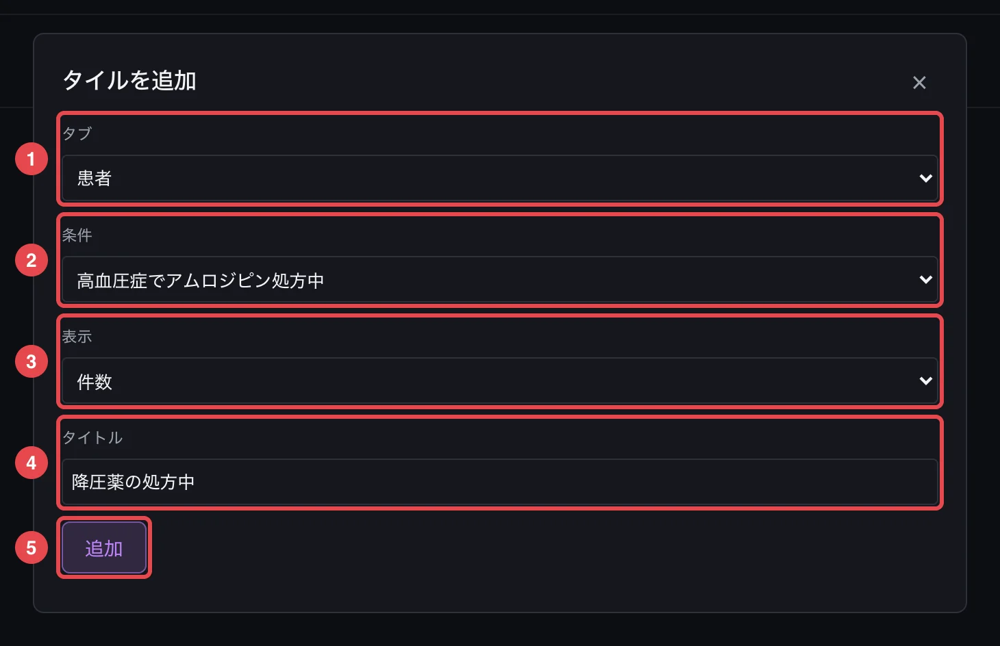
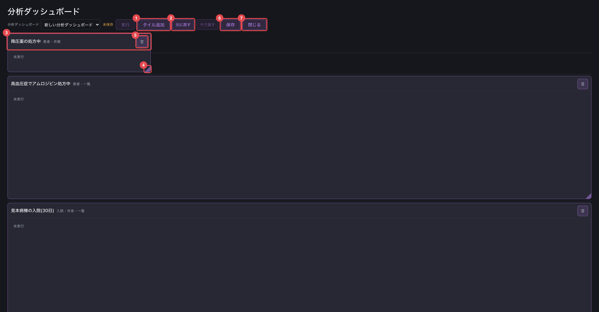
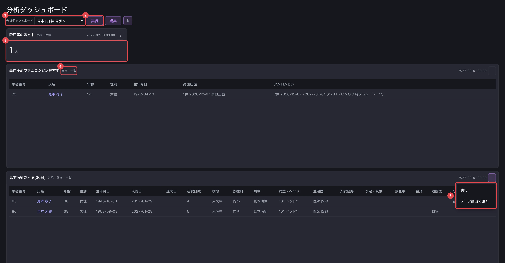

# 分析ダッシュボード

[データ抽出](data-extract.md)に保存した条件をタイルとして並べ、1 画面で見渡す操作です。受け持ち患者の見張りや、病棟・部門の定点観測に使います。

- 分析ダッシュボードは、画面の上の「データ」>「分析ダッシュボード」で開きます。
- タイルに置けるのは、データ抽出に保存した条件です。先にデータ抽出で条件を組んで保存しておきます。
- 開いただけでは抽出しません。「実行」を押したときに、その時点のカルテの記録で抽出します。結果は保存されません。
- 院内共通に、見本の分析ダッシュボード(「糖尿病外来」「入退院・部門オーダー」)が入っています。

## タイルを置く

「分析ダッシュボード」で「新しい分析ダッシュボード」を選び、「編集」を押します(既存のダッシュボードを選んで「編集」を押すと、それを直します)。
「タイル追加」を押します。

{ .screen width="730" }

1. 条件を保存したデータ抽出の「タブ」を選びます。
2. 「条件」で、保存した条件を選びます。
3. 「表示」を選びます。「件数」は人数・件数だけ、「内訳」は内訳の表とグラフ、「一覧」は結果の表です。
4. 「タイトル」を入れます。入れないと、条件の名前が出ます。
5. 「追加」を押します。

- 内訳のタイルは、条件と一緒に保存した内訳の切り口(行・列・値)で出ます。切り口はタイルの中では変えられないので、データ抽出で直して保存し直します。
- 指標のタブの条件は、「件数」で直近の割合、「内訳」で割合の推移が出ます。

## タイルを並べる

{ .screen }

1. 「タイル追加」で、タイルを足します。
2. 「元に戻す」「やり直す」で、直前の追加・移動・大きさの変更・削除を戻します。
3. タイルの見出しをつかんで動かします。ほかのタイルにぶつかると、ぶつかったタイルが下に押し出されます。
4. 右下の角をつかんで、大きさを変えます。
5. ゴミ箱で、タイルを外します。
6. 「保存」で、名前と保存先(院内共通・診療科・自分・チーム)を選んで保存します。院内共通と診療科のダッシュボードは医師だけが保存できます。
7. 「閉じる」で編集を終えます。

- 保存したダッシュボードを直したときは、「保存」で上書きし、「別名保存」で別のダッシュボードとして保存します。

## 実行して見る

{ .screen }

1. 「分析ダッシュボード」で、保存したダッシュボードを選びます。
2. 「実行」を押すと、上のタイルから順に抽出します。同じ条件のタイルは 1 回の抽出を分け合います。
3. 件数のタイルには、当たった人数が出ます。
4. タイルの見出しの横に、条件のタブと表示が出ます。右には実行した日時が出ます。
5. タイルの「⋮」で、そのタイルだけを「実行」したり、条件を「データ抽出で開く」で開いて直したりします。

- 一覧のタイルの氏名を押すと、その患者のカルテが開きます。
- 抽出に時間がかかるときは、「実行」が「中止」に変わり、押すと止められます。
- 選んでいるダッシュボードを消すときは、「編集」の横のゴミ箱を押します。
