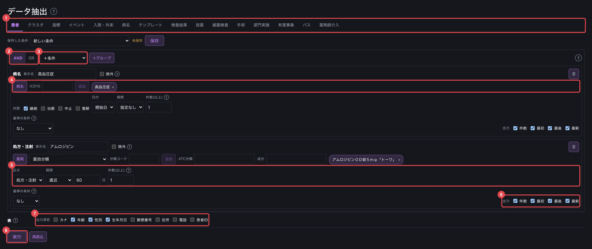
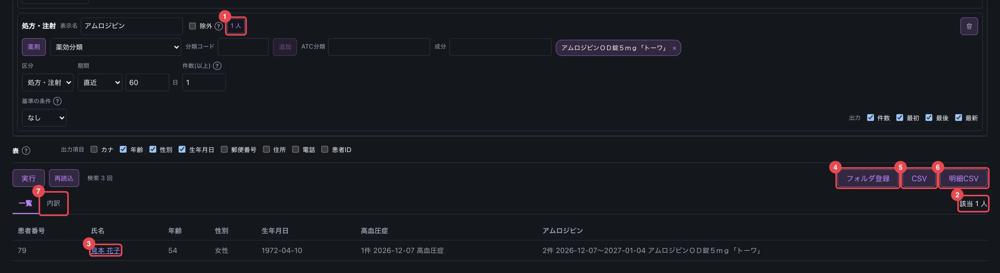
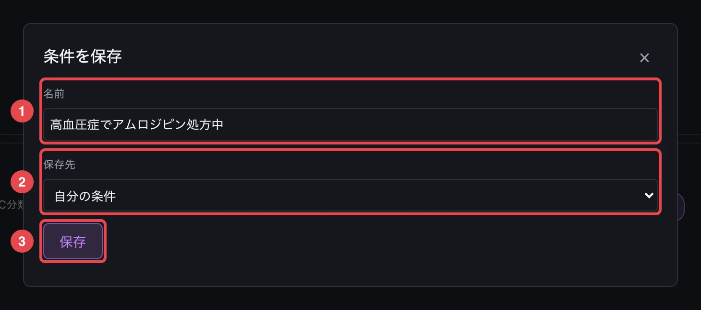
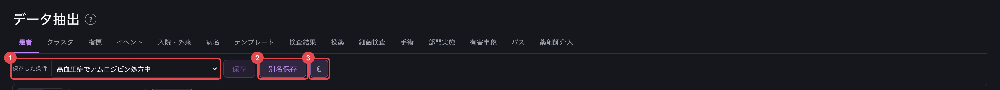
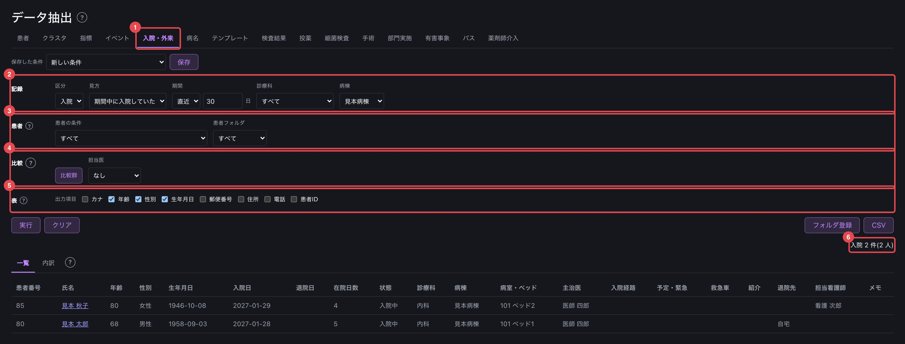
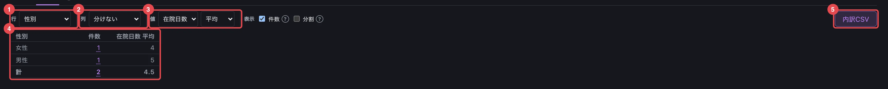

# データ抽出

患者を条件で抜き出して一覧にし、人数の内訳や CSV を出す操作です。入院・外来受診・病名・検査結果・投薬などの記録を表にして数えることもできます。
受け持ち患者の洗い出し、統計の集計、質の定点観測に使います。

- データ抽出は、画面の上の「データ」>「データ抽出」で開きます。
- 抽出は、実行した時点のカルテの記録を読みます。結果は保存されません。同じ抽出を繰り返すときは、条件を保存しておきます。
- 画面の見出しの横の「?」を押すと、使い方の説明が開きます。条件の木・結果の横の「?」からは、その場所の説明が開きます。

## タブの使い分け

| タブ | 内容 |
|---|---|
| 患者 | 患者属性・病名・検査結果・処方/注射・部門オーダー・入院・外来受診の条件を組み合わせて、当たる患者を 1 人 1 行で出す |
| クラスタ | 保存した条件や患者フォルダをクラスタにして、人数・年齢と、病名・検査などの指標を比べる |
| 指標 | 分母と分子の条件から、割合(再入院率など)の推移を月・四半期・年度ごとに出す |
| イベント | 基準の記録(退院など)から結果の記録(再入院など)までの日数と累積発生率を出す |
| 入院・外来 / 病名 / テンプレート / 検査結果 / 投薬 / 細菌検査 / 手術 / 部門実施 / 有害事象 / パス / 薬剤師介入 | その記録を 1 件 1 行の表にする(記録のタブ) |

## 患者を条件で抜き出す

「患者」タブで条件を組みます。例は「高血圧症で、直近 60 日にアムロジピンを処方した患者」です。

{ .screen }

1. 「患者」のタブを選びます。
2. 条件のつなぎ方を選びます。「AND」はすべての条件に当たる患者、「OR」はどれかに当たる患者です。
3. 「＋条件」で条件の種類(患者属性・病名・検査結果・バイタル・処方・注射・部門オーダー・入院・外来受診)を選んで足します。
   「＋グループ」で、AND と OR を入れ子にできます。
4. 病名の条件は「病名」を押して病名マスタから選ぶか、「ICD10」にコードを入れて「追加」を押します(3 桁のコードは細分類まで広げます)。
   処方・注射の条件は「薬剤」で医薬品を選ぶか、薬効分類・ATC 分類・成分で指定します。
5. 期間を「直近 N 日」か日付で入れます。「件数(以上)」を 2 以上にすると、期間内にその件数以上の記録がある患者だけが当たります。
6. 結果の表に出す、条件ごとの列(件数・最初・最後・最新)を選びます。
7. 結果の表に出す患者の項目を選びます。
8. 「実行」を押します。

- 「表示名」に入れた名前が、結果の表の列の見出しになります。
- 「除外」に印を付けると、その条件に当たる患者を除きます(AND の中で、ほかに除外でない条件があるときだけ付けられます)。
- 「基準の条件」で同じ AND のほかの条件を選ぶと、その記録の日から何日以内の記録だけを数えます(退院後 30 日以内の再入院など)。
- 条件の右上のゴミ箱で、その条件を外します。

## 結果を見る

{ .screen }

1. 実行すると、条件ごとに当たった人数が出ます。
2. すべての条件を合わせて当たった人数です。
3. 氏名を押すと、その患者のカルテが開きます。
4. 「フォルダ登録」で、結果の患者をまとめて患者フォルダに入れます([患者フォルダ](patient-folder.md))。
5. 「CSV」で、表を患者 1 人 1 行の CSV に出します。
6. 「明細CSV」で、条件に当たった記録(検査の値・処方の用法など)を 1 件 1 行の CSV に出します。
7. 「内訳」で、性別 × 年齢階級と、条件ごとの月別・診療科別の件数を出します。

## 条件を保存する

組んだ条件は、名前を付けて保存しておくと、次から選ぶだけで使えます。

{ .screen width="730" }

1. 「保存」を押し、「名前」を入れます。
2. 「保存先」を選びます。院内共通・診療科・自分の条件があり、院内共通と診療科の条件は医師だけが保存できます。
3. 「保存」を押します。

{ .screen }

1. 「保存した条件」で選ぶと、その条件が読み込まれます。もとから院内共通の見本の条件(「退院後30日以内の再入院」など)が入っています。
2. 条件を直して「保存」を押すと上書きし、「別名保存」で別の条件として保存します。
3. ゴミ箱で、保存した条件を削除します。

- 保存した条件は、[分析ダッシュボード](dashboard.md)のタイルに置けます。

## 記録を表にする

記録のタブでは、記録を 1 件 1 行の表にします。例は「入院・外来」タブで、直近 30 日に見本病棟に入院していた入院を出したところです。

{ .screen }

1. 表にする記録のタブを選びます。
2. 「記録」の行で、何の記録をどの期間で読むかを選びます。入院・外来のタブでは、区分(入院・外来・救急)・入院の見方・期間・診療科・病棟を選びます。
3. 「患者」の行で、患者タブに保存した条件や患者フォルダを選ぶと、その患者の記録だけに絞ります。
4. 「比較」の行で、患者を比較群に分けたり(薬剤の群ごとなど)、担当医を決めたりすると、結果に「比較群」「担当医」の列が付きます。
5. 「表」の行で、結果の表に出す患者の項目を選びます。
6. 「実行」を押すと、件数と人数が出て、下に表が並びます。

- タブごとの条件も、患者タブと同じく「保存」で保存できます。保存した条件は、そのタブの「保存した条件」にだけ並びます。
- 「フォルダ登録」「CSV」は患者タブと同じです。

## 内訳を出す

結果の「内訳」で、行と列に分けて件数や平均を出します。例は、性別ごとの在院日数の平均です。

{ .screen }

1. 「行」に、表の行に並べる項目を選びます。期間を選ぶと、刻み(年・年度・四半期・月・週・日)を選べ、推移のグラフも出ます。
2. 「列」で、さらに分ける項目を選びます。分けないこともできます。
3. 「値」で、件数・患者数・割合か、数値の列(在院日数など)の合計・平均・中央値・最小・最大を選びます。
4. 内訳の表です。数を押すと、その記録だけの一覧に切り替わり、その記録だけでフォルダ登録・CSV ができます。
5. 「内訳CSV」で、内訳の表を CSV に出します。

- 数値の列を行や列にしたときは、「区切り」(例: 7,8 → 7未満 / 7以上8未満 / 8以上)で区間に分けます。
- 内訳の切り口は、条件と一緒に保存されます。
