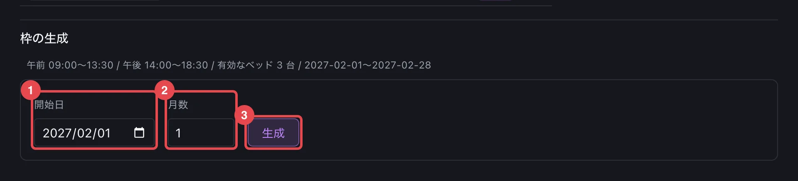
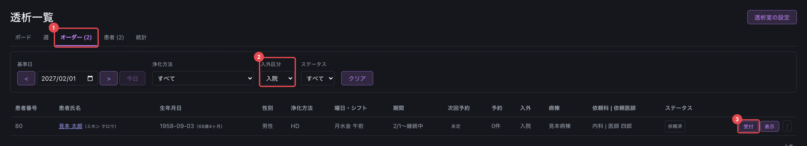
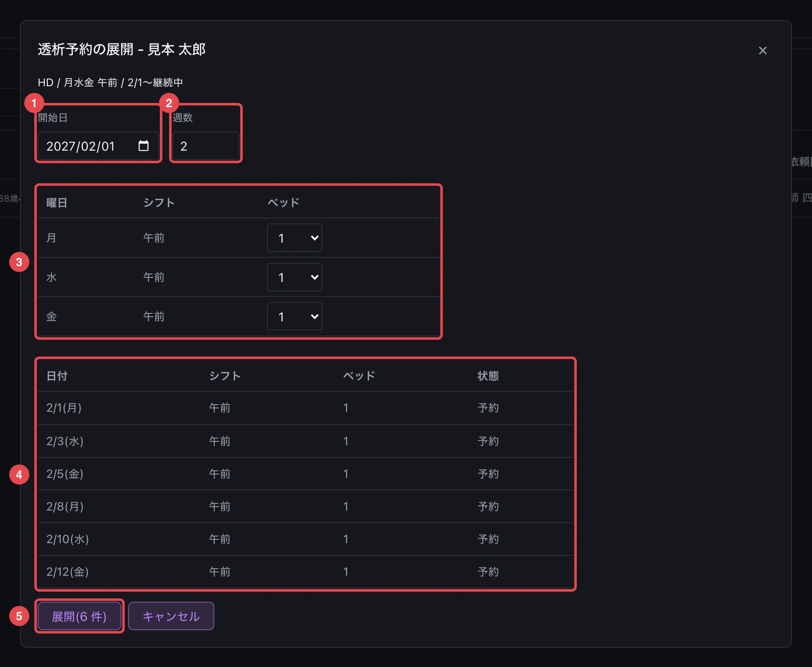
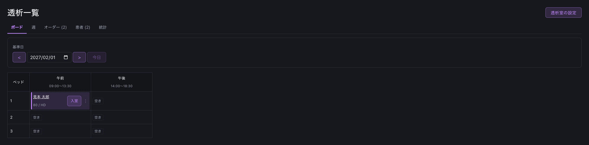
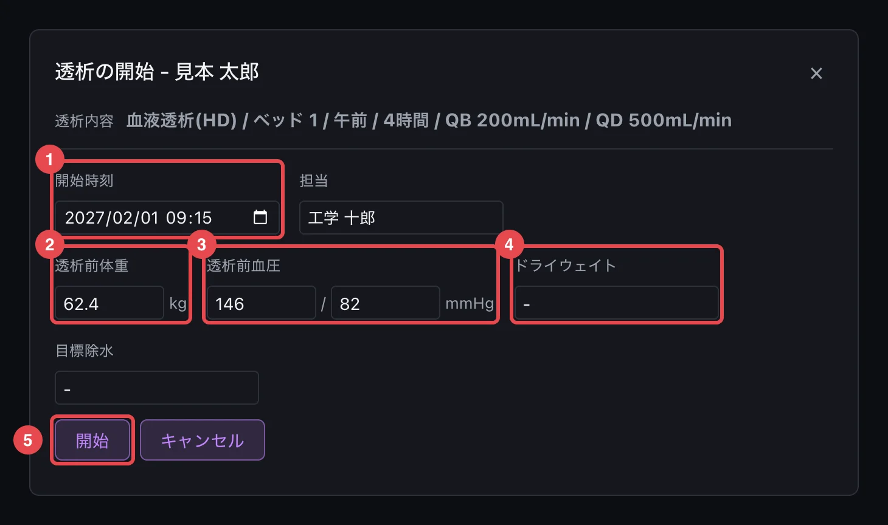
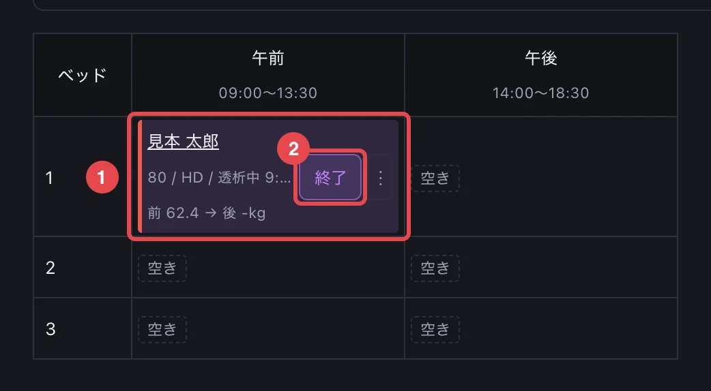
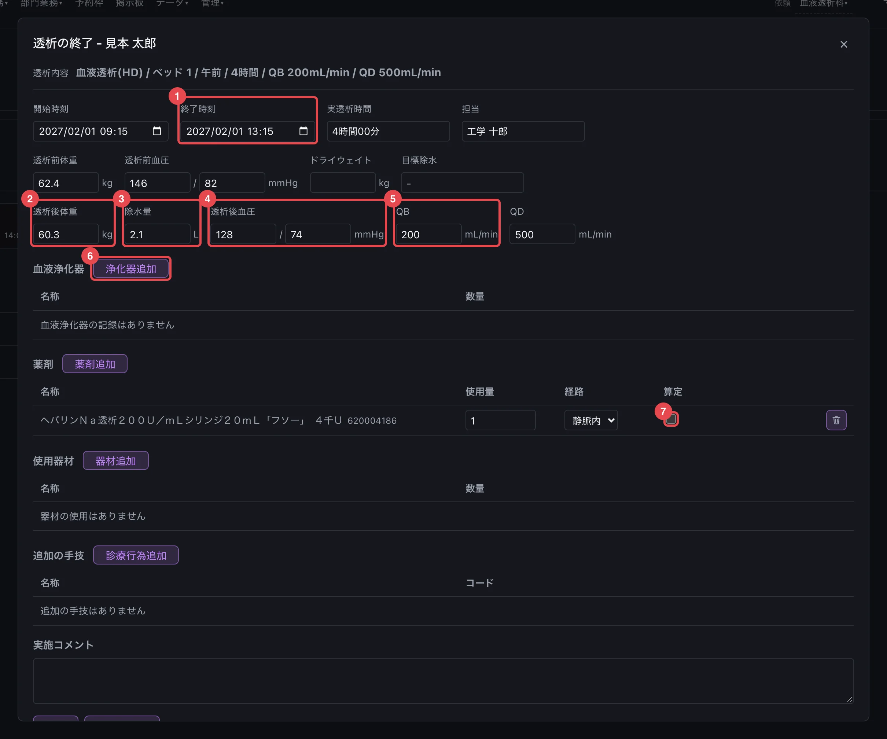
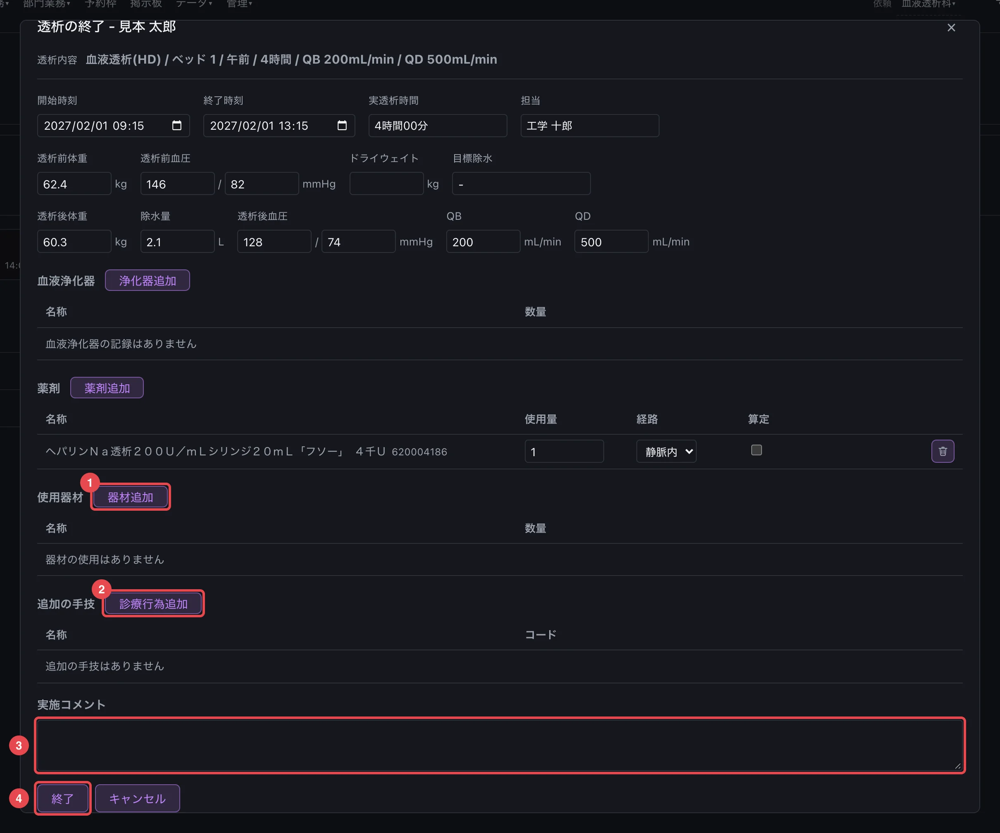
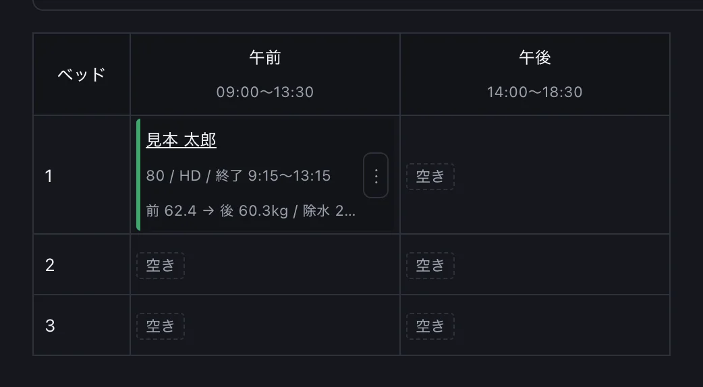

# 透析一覧

透析室が、医師の透析の依頼を透析一覧で受け付けて予約を展開し、各回の入室・開始・終了を記録する操作です。
透析の流れ全体は、業務フローの[透析オーダー](../flows/dialysis.md)を見てください。依頼は[透析](dialysis.md)のページです。

- 透析一覧は、画面の上の「部門業務」>「透析部門」>「透析一覧」で開きます。ホームの「透析」のカードからも開けます。
- 透析の依頼は、曜日 × シフト(午前・午後)で何か月も続く依頼です。予約は依頼の曜日 × シフトから展開し、ベッド × シフトの「ボード」で各回を進めます。
- 依頼は「依頼済」→(受付)→「実施中」と進み、各回の予約が「予約済」→「来院」→「実施済」と進みます。

## 透析室の枠を作る

予約は、ベッド × 日 × シフトの枠に入れます。枠の無い日は「枠なし」になり予約できないので、先の月の枠を作っておきます。
「透析一覧」の右上の「透析室の設定」(「部門業務」>「透析部門」>「透析室の設定」)で行います。

{ .screen width="960" }

1. 「開始日」を選びます。上に、シフトの時間帯・有効なベッドの台数と、作る期間が出ます。
2. 「月数」を入れます。
3. 「生成」を押します。既に枠のある日 × シフトは飛ばすので、何度押しても重なりません。

シフト・ベッドの追加と、血液浄化器などのマスタも、この画面で設定します。

## 受け付けて予約を展開する

{ .screen }

1. 「オーダー」のタブに、基準日に期間の入っている依頼が並びます。
2. 「浄化方法」「入外区分」「ステータス」で絞り込めます。写真は入院に絞っています。
3. 新しい依頼は「受付」で受け付けます。受け付けると「展開」「臨時」が出ます。

「展開」を押すと、依頼の曜日 × シフトから予約を取る画面が開きます。

{ .screen width="970" }

1. 「開始日」は、まだ予約が無ければ依頼の開始日、予約があれば最後の予約の翌日です。
2. 「週数」(1〜12)を入れます。
3. 曜日 × シフトごとに「ベッド」を選びます。同じ曜日 × シフトの直近の予約のベッドが初めに入ります。
4. 取る日の一覧が出ます。日ごとに「予約」「枠なし」「既に予約あり」が出て、既に予約のある日は取りません。
5. 「展開(〜件)」を押します。

- 1 回に取れるのは 40 件までです。
- 先に別の患者が取った枠があると、1 件も予約されません。表が読み直されるので、ベッドを選び直します。
- 予定外の回は「臨時」で 1 回ぶんを取ります。

## ボードで各回を進める

「ボード」のタブに、基準日のベッド × シフトの表が並びます。

{ .screen }

予約のカードに、患者・患者番号・浄化方法と、その回で押すボタンが出ます。空いた枠の「空き」を押すと、その枠に入れる患者を選べます。カードは掴んで別の枠へ動かせます(同じ日 × シフトのカードに落とすとベッドの入れ替え)。

患者が来たら、カードの「入室」を押します。透析を始めるときに「開始」を押します。

{ .screen width="730" }

1. 「開始時刻」は今の時刻が入っています。
2. 「透析前体重」を入れます。
3. 「透析前血圧」を入れます(収縮期と拡張期の両方)。
4. 「ドライウェイト」と「目標除水」が見られます。
5. 「開始」を押します。

{ .screen width="521" }

1. カードに、透析中と、透析前の体重が出ます。
2. 透析が終わったら「終了」を押します。

{ .screen width="1210" }

1. 「終了時刻」は、開始時刻 + 依頼の透析時間と今の時刻の早いほうが入っています。実透析時間は自動で出ます。
2. 「透析後体重」を入れます。
3. 「除水量」には、透析前後の体重の差が入ります。手で直せます。
4. 「透析後血圧」を入れます。
5. QB・QD は依頼の値が入っています。
6. 使った血液浄化器は「浄化器追加」で入れます。
7. 薬剤は依頼の抗凝固薬が入っています。維持透析の抗凝固薬は人工腎臓の点数に含まれるので、「算定」が外れています。

{ .screen width="1210" }

1. 使った器材は「器材追加」で入れます。
2. 追加の手技は「診療行為追加」で入れます。
3. 「実施コメント」を書きます。
4. 「終了」を押します。

{ .screen width="521" }

カードに、終了と時間、透析前後の体重と除水量が出ます。

- 開始と終了を後からまとめて入れるときは、カードの「⋮」の「一括記録」を使います。
- 記録を直すときは「⋮」の「実施取消」で回の記録を消し、もう一度入れます。
- 予約は「⋮」の「予約変更」「予約取消」で直します。実施記録のある予約は取り消せません。
- 透析中の血圧などの経過は、カードの「⋮」から透析経過表に記録します。
