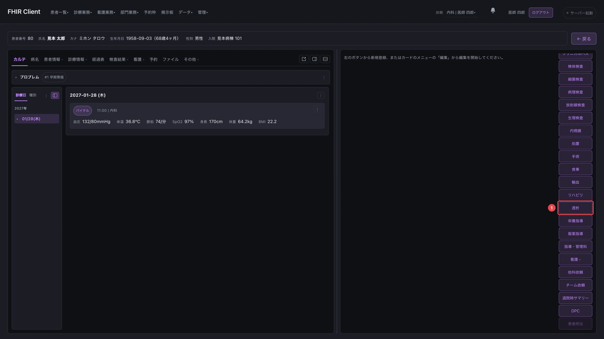
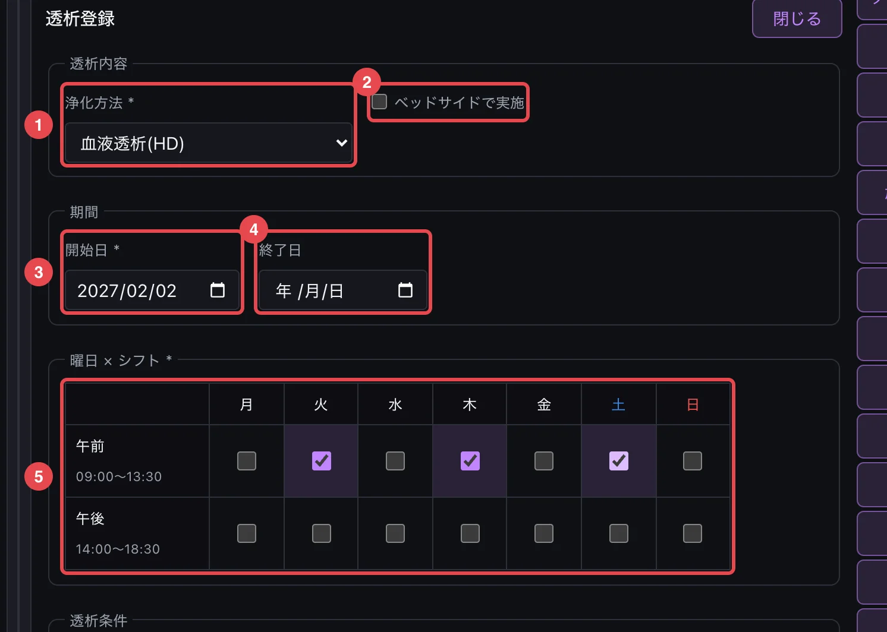
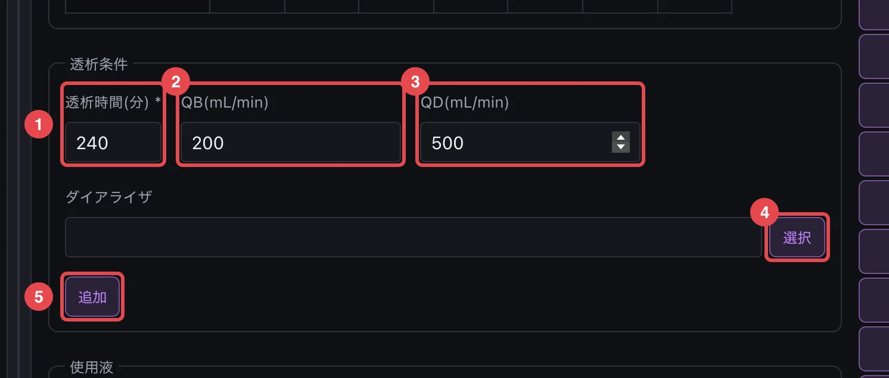
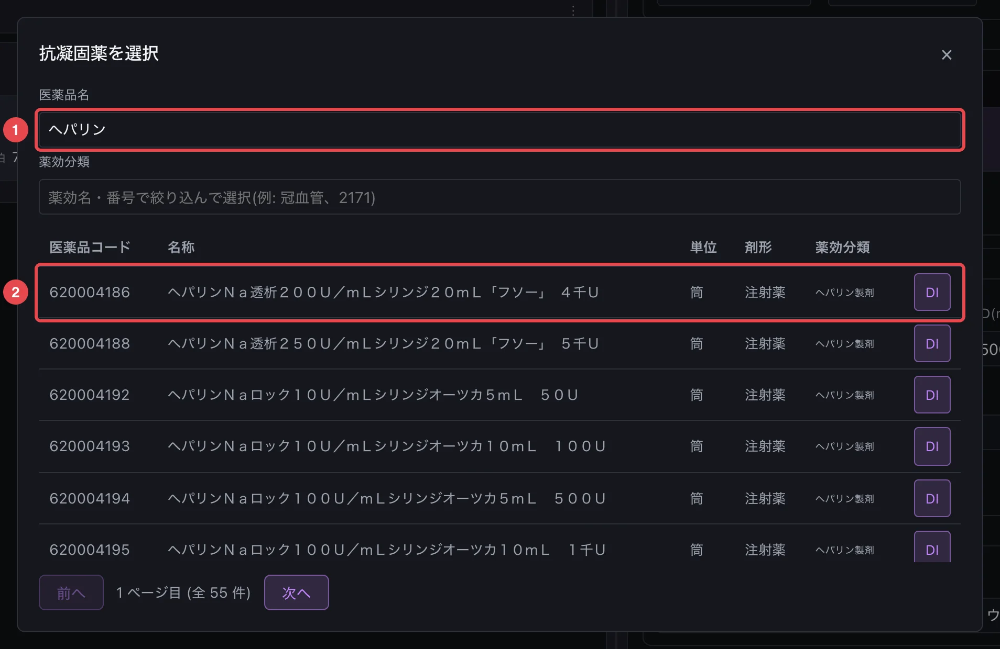
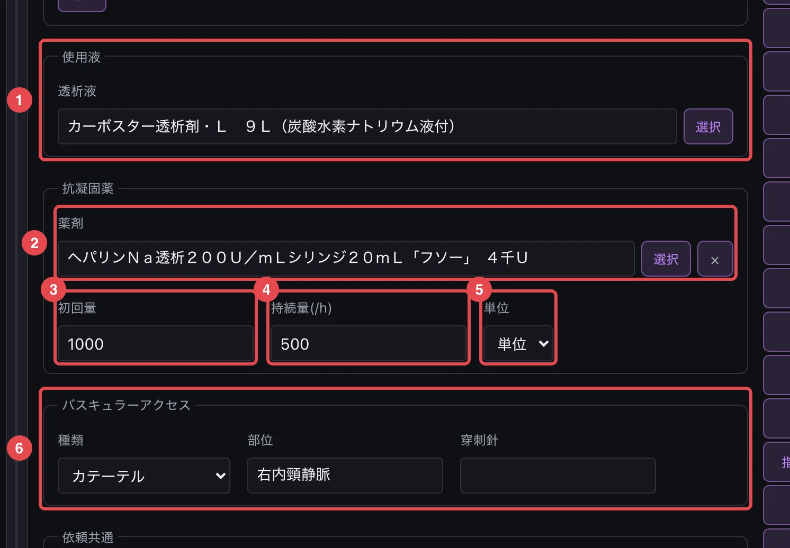
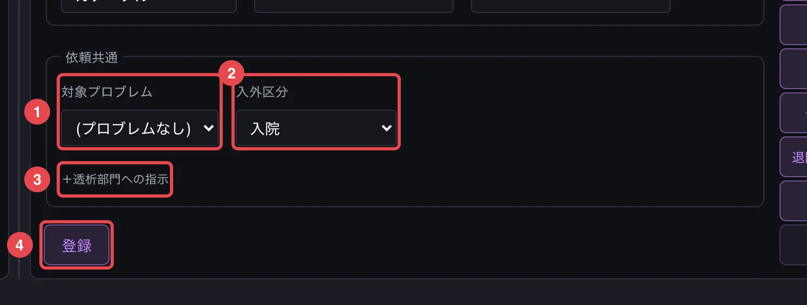
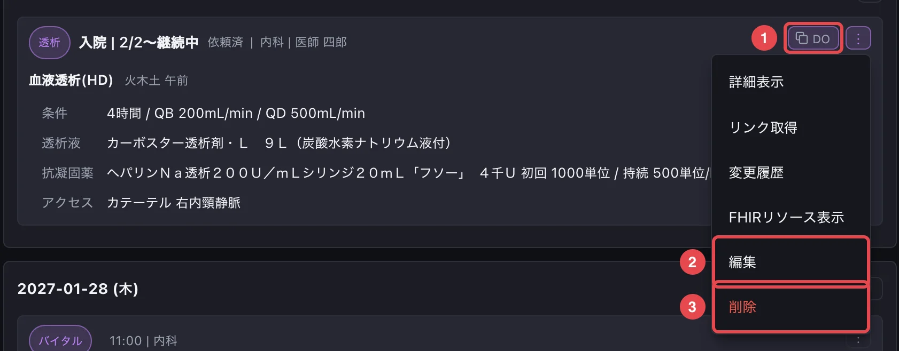

# 透析

医師がカルテから透析(血液浄化)を依頼する操作です。透析は、1 つのオーダーで週 3 回のような透析を何か月も続けて依頼します。
透析室での受付・予約の展開・各回の実施・透析経過表・終了までの流れは、業務フローの[透析オーダー](../flows/dialysis.md)を見てください。

オーダーには浄化方法と透析条件、曜日とシフト、期間を書きます。どのベッドで行うかは透析室が予約で決めます。

## 透析登録を開く

患者のカルテを開いておきます。

{ .screen }

1. カルテの右側に並ぶボタンから「透析」を押します。右側に「透析登録」が開きます。

## 浄化方法と日程を入れる

項目名に「*」が付いたものは必ず入れます。

{ .screen width="746" }

1. 「浄化方法」を選びます。浄化方法によって、血液浄化器の種類や、透析液・補充液・置換液の欄が変わります。
2. 病棟のベッドで行う急性血液浄化のときは「ベッドサイドで実施」にチェックを付けます。透析室の予約は作られず、曜日とシフト・透析時間は入れなくてかまいません。
3. 「開始日」を入れます。
4. 終わりが決まっていれば「終了日」を入れます。空のときは、終了するまで続きます。
5. 「曜日 × シフト」で、透析を行う曜日とシフトにチェックを付けます。

## 透析条件を入れる

{ .screen width="746" }

1. 「透析時間(分)」を入れます。
2. 「QB(mL/min)」に血流量を入れます。
3. 「QD(mL/min)」に透析液流量を入れます。
4. 血液浄化器(血液透析ではダイアライザ)の「選択」を押し、種別と製品名で探して選びます。
5. 血液浄化器を足すときは「追加」を押します。

## 使用液・抗凝固薬・アクセスを入れる

透析液と抗凝固薬は、「選択」を押して医薬品から選びます。

{ .screen width="954" }

1. 「医薬品名」に名前の一部を入れます。「薬効分類」で絞り込むこともできます。
2. 使う医薬品の行を押します。

{ .screen width="746" }

1. 「透析液」に、選んだ透析液が出ます。血液透析濾過では「補充液」、血漿交換では「置換液」の欄が出ます。
2. 抗凝固薬の「薬剤」に、選んだ薬が出ます。「×」で外します。
3. 「初回量」を入れます。
4. 「持続量(/h)」を入れます。
5. 「単位」を「単位」「IU」「mg」から選びます。量を入れたときは、薬も選びます。
6. 「バスキュラーアクセス」の種類・部位・穿刺針を入れます。

## 登録する

{ .screen width="748" }

1. 「対象プロブレム」で、対象の病名を選びます。
2. 「入外区分」を確かめます。入院中の患者は「入院」が入っています。
3. 透析室へ伝えることがあれば「＋透析部門への指示」を押して入れます。
4. 「登録」を押します。

登録すると右側が閉じ、カルテの開始日のところに透析のカードが出ます。浄化方法・曜日とシフト・条件・透析液・抗凝固薬・アクセスが並びます。
透析室が受け付けて、曜日とシフトから数週間ぶんの予約を取ります。

## 登録した透析を使う・直す

カルテの透析のカードから操作します。

{ .screen width="841" }

1. 「DO」を押すと、同じ内容が右側の「透析登録」に入ります。開始日は今日になり、終了日は空になります。
2. 「⋮」の「編集」を押すと、右側に編集が開きます。直して「更新」を押します。受付や予約、実施の記録は変わりません。
3. 「⋮」の「削除」を押すと、理由を入れて透析を削除します。取ってある予約も取り消されます。

- 実施の記録がある透析は削除できません。やめるときは、透析室の透析一覧の行のメニューの「中止」で止めます。
- 入院から外来に変わって続けるときは、新しい透析を出します。
