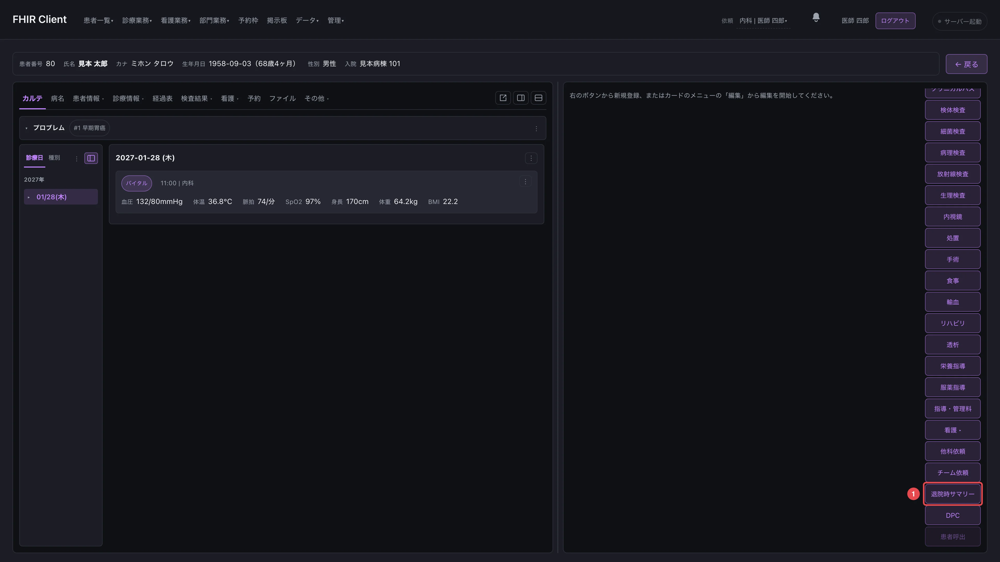
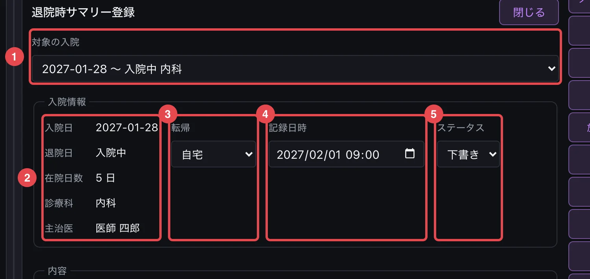
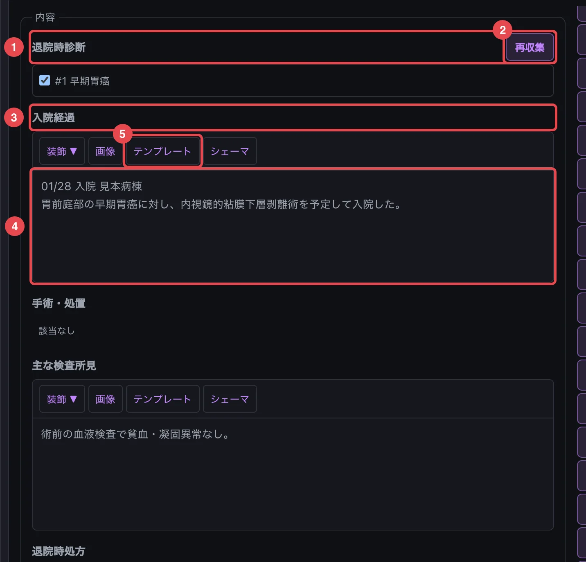
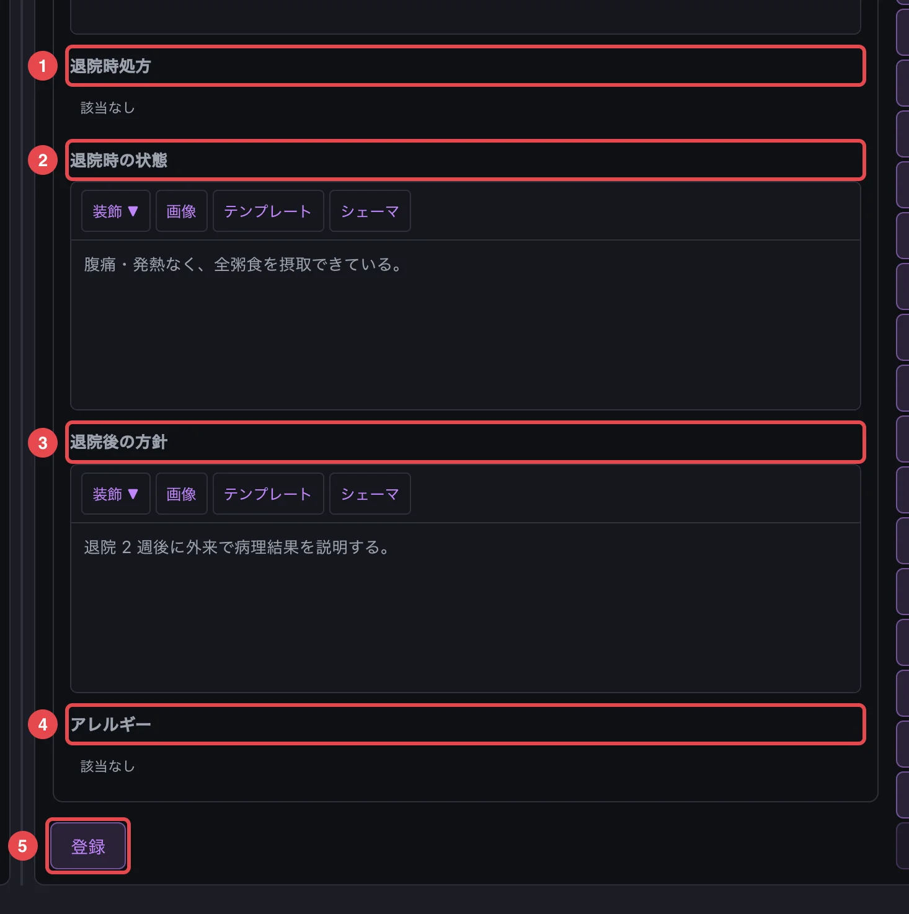
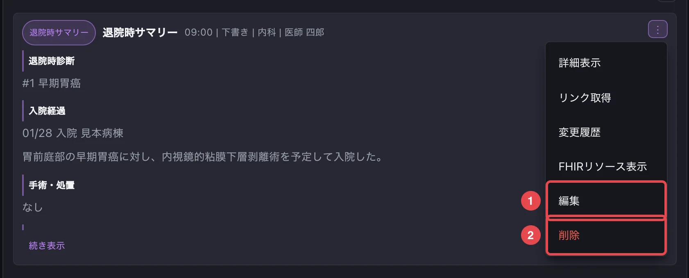

# 退院時サマリー

主治医が、入院 1 件ごとに退院時サマリーを書く操作です。退院前から書き始められます。
退院すると、主治医に「文書作成」の通知(督促)が届きます。期限は、施設の設定で退院日から 14 日です。
入院から退院までの流れは、業務フローの[入院から退院まで](../flows/admission-discharge.md)を見てください。

## 退院時サマリー登録を開く

患者のカルテを開いておきます。退院後の督促の通知から開くこともできます。

{ .screen }

1. カルテの右側に並ぶボタンから「退院時サマリー」を押します。右側に「退院時サマリー登録」が開きます。

## 対象の入院と入院情報を確かめる

{ .screen width="750" }

1. 「対象の入院」で、サマリーを書く入院を選びます。入院中の入院も選べます。その入院にもうサマリーがあれば、編集に切り替わります。
2. 入院日・退院日・在院日数・診療科・主治医が出ます。
3. 「転帰」で、退院先(自宅・転院・施設入所など)を選びます。
4. 「記録日時」を確かめます。
5. 「ステータス」で「下書き」か「確定」を選びます。書き終えたら「確定」にします。

## 内容を書く

内容には、入院期間の記録から、病名・入院経過・手術と処置・退院時処方・アレルギーが初めから入っています。

{ .screen width="716" }

1. 「退院時診断」で、サマリーに載せる病名にチェックを付けます。
2. 「再収集」を押すと、入院期間の記録から候補を集め直します。書いた本文とチェックはそのまま残ります。
3. 「入院経過」には、入院・転棟・外泊・退院などの記録が入っています。
4. 本文に、経過を書き足します。
5. 診療記録と同じく、「装飾」「画像」「テンプレート」「シェーマ」が使えます。

{ .screen width="733" }

1. 「退院時処方」に、退院の処方が出ます。載せるものにチェックを付けます。
2. 「退院時の状態」を書きます。
3. 「退院後の方針」を書きます。
4. 「アレルギー」に、患者に登録されたアレルギーが出ます。載せるものにチェックを付けます。
5. 「登録」を押します。

「主な検査所見」も同じように書きます。「手術・処置」は、入院中の手術・処置から選びます。

登録すると右側が閉じ、カルテに退院時サマリーのカードが出ます。確定で登録すると、退院時サマリーの督促の通知は対応済になります。

## 登録した退院時サマリーを直す

カルテの退院時サマリーのカードから操作します。

{ .screen width="841" }

1. 「⋮」の「編集」を押すと、右側に編集が開きます。下書きのあいだは何度でも直せます。直して「更新」を押します。
2. 「⋮」の「削除」を押し、確認のダイアログで「OK」を押すと、削除します。

- 確定したサマリーは、カードの「PDF」で A4 の PDF を新しいタブに開けます。下書きには出ません。
- 確定・修正・変更履歴の扱いは、診療記録と同じです([診療記録](clinical-note.md))。
- 退院時サマリーが要らない入院は、督促の通知を通知の一覧の「対応済」で閉じます。
