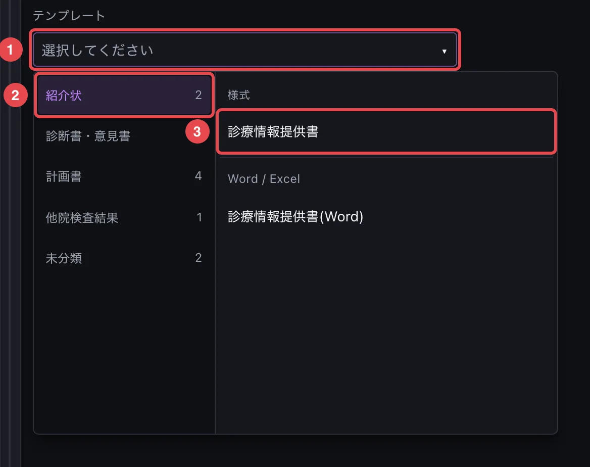
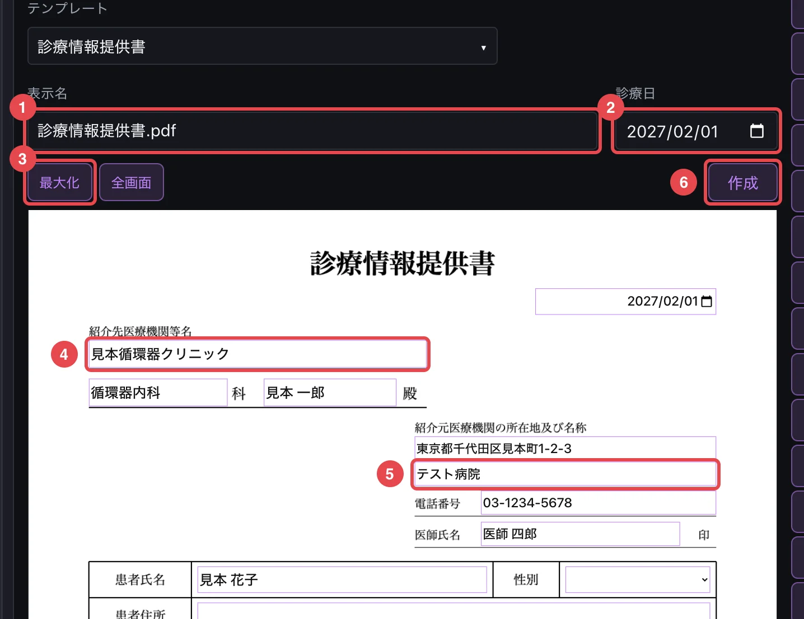
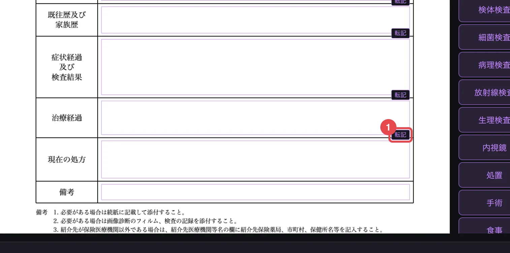
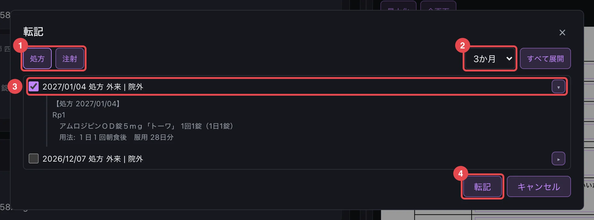
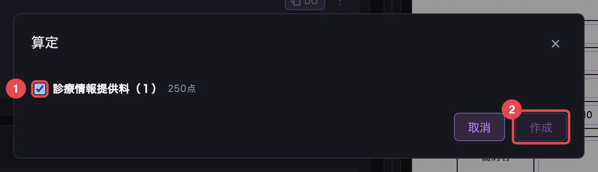
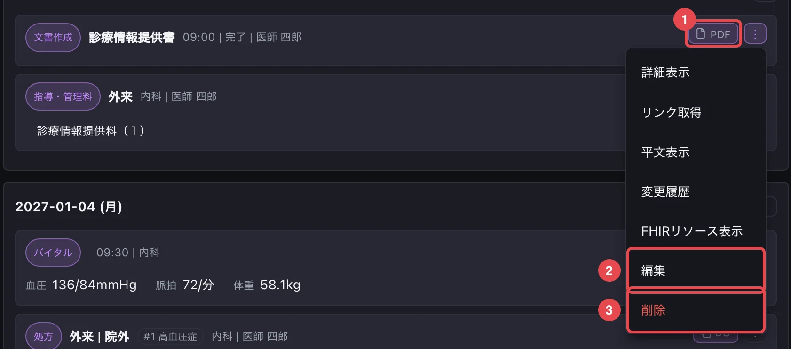

# 文書作成

診療情報提供書・診断書・計画書などの文書を、施設で登録した書式に入力して作る操作です。患者の氏名や病名などはカルテから初めから入り、
処方や検査結果はカルテから選んで書き写せます(転記)。作った文書はカルテの「ファイル」タブに入ります。

書式には 2 種類あります。

| 種類 | 作り方 |
|---|---|
| 様式 | 紙の書式の見た目のまま画面で入力し、PDF にします。このページで説明します |
| Word / Excel | カルテの値を入れた Word・Excel のファイルを作ってダウンロードします。続きは手元の Word・Excel で書き、「ファイル」タブの「差し替え」で戻します |

## 書式を選ぶ

患者のカルテを開き、右側の登録のボタンから「文書作成」を押します。右側に「文書作成」が開きます。

{ .screen width="584" }

1. 「テンプレート」の欄を押します。左に文書の分類、右にその分類の書式が「様式」「Word / Excel」に分けて並びます。
2. 分類を押します。
3. 使う書式を押します。

## 様式に入力する

{ .screen width="718" }

1. 「表示名」は、「ファイル」タブに入るときの文書の名前です。初期値は書式の名前です。
2. 「診療日」を確かめます。文書はこの日の記録としてカルテに出ます。
3. 書式が見づらいときは「最大化」で右側全体に、「全画面」で画面の幅いっぱいに広げます。Escape で元に戻ります。
4. 空いている欄に入力します。
5. 患者・自院・医師の情報や病名など、カルテから分かる欄には初めから値が入っています。違うところは直せます。
6. 入力し終えたら「作成」を押します(下の「作成する」)。

同じ患者に同じ書式で作った文書があると、「前回値複写」が出ます。押すと前回の入力が入ります。

## カルテから書き写す(転記)

処方・注射・部門のオーダー・病名・検査結果を、選んで欄に書き足せます。

{ .screen width="757" }

1. 書き足したい欄の右上の「転記」を押します。「転記」が開きます。

{ .screen width="954" }

1. 書き写すものの種類を選びます。欄によって選べる種類が違います。
2. 期間を選びます。「1か月」「3か月」「6か月」「1年」「全期間」から選び、初期値は「3か月」です。
3. 書き写すものに印を付けます。右端の「▸」(または「すべて展開」)で、書き写される文章を確かめられます。
4. 「転記」を押すと、欄の終わりに書き足されます。

## 作成する

「作成」を押すと PDF ができて、「ファイル」タブに入ります。

作る文書が指導料・管理料の算定の条件になっているときは、「算定」が開きます。

{ .screen width="714" }

1. 算定する項目に印を付けます。算定しないときは印を外します。
2. 「作成」を押します。文書と一緒に、指導・管理料が登録されます。

作成すると、カルテに「文書作成」のカードが出ます。算定したときは、「指導・管理料」のカードも出ます。

## 作った文書を見る・直す

カルテの「文書作成」のカードから操作します。

{ .screen width="841" }

1. 「PDF」で、作った文書を開きます。
2. 「⋮」の「編集」を押すと、入力した書式が開きます。直して「更新」を押すと、PDF が作り直されます。
3. 「⋮」の「削除」を押すと、文書と入力した内容をまとめて削除します。

「ファイル」タブで文書を開き、「内容編集」から直すこともできます。
