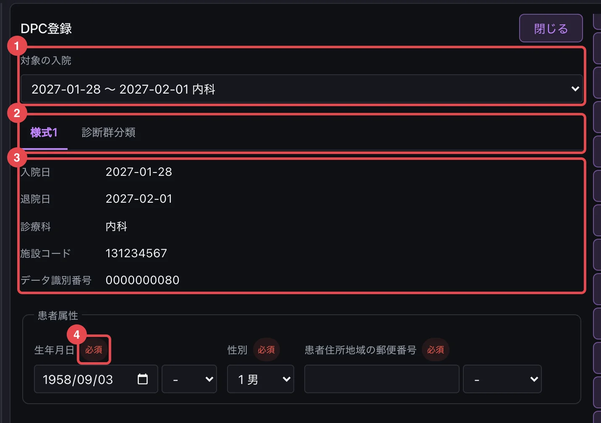
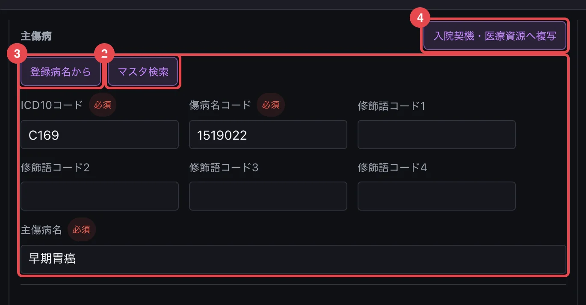
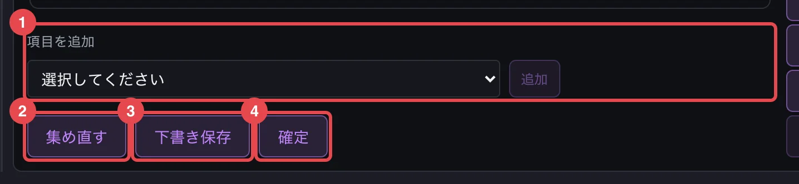
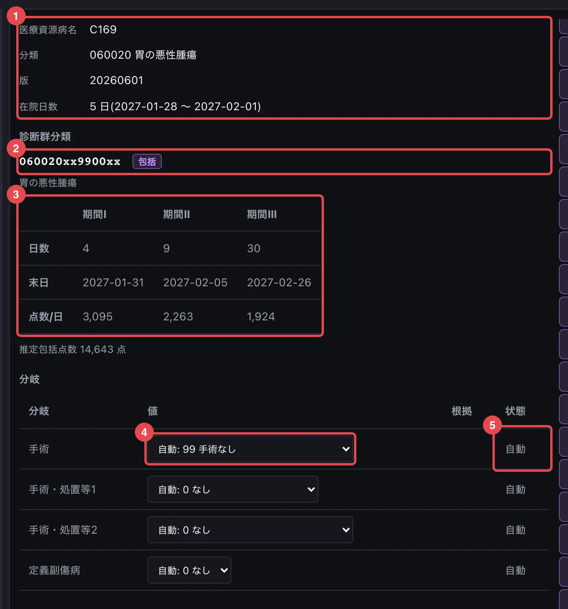
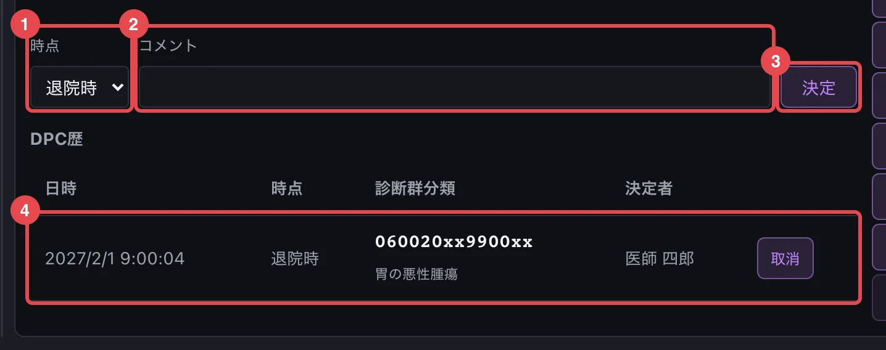
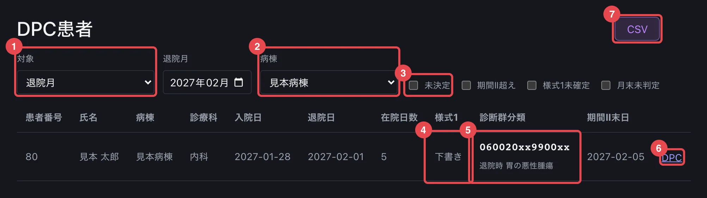

# DPC

入院 1 件ごとに、DPC 退院患者調査の様式1 を作り、診断群分類(14 桁)を判定して決める操作です。
DPC患者の一覧で、入院中・退院した患者の様式1 と診断群分類の状況を確かめます。

- 様式1 と診断群分類は、患者のカルテの右ペインの「DPC」で開きます。
- DPC患者の一覧は、画面の上の「データ」>「DPC患者」で開きます。
- 確定した様式1 を提出用のファイルにするのは、「データ」>「DPC様式1」です。退院月を選んで出力します。
- 判定には、厚生労働省の DPC 電子点数表を取り込んでおく必要があります(管理者の作業です)。退院日(入院中は今日)の時点の版で判定します。
- 包括請求(レセプトコンピューターへの送信)は扱いません。

## 様式1 を書く

右ペインの「DPC」を押すと、「様式1」のタブが開きます。

{ .screen width="716" }

1. 「対象の入院」で、様式1 を作る入院を選びます。
2. 「様式1」「診断群分類」のタブを切り替えます。
3. 入院日・退院日・診療科と、施設コード・データ識別番号が出ます。
4. 「必須」の付いた項目は、確定するときに入っている必要があります。

- 開いたときは、患者の基本情報・入院の記録・身長と体重などから、分かる項目が入っています。
- 項目は退院日(入院中は今日)の時点の実施説明資料の版で並びます。2026 年 6 月 1 日以降の退院は 2026 年度版です。

### 病名を入れる

「診断情報」に、主傷病・入院契機・医療資源を最も投入した傷病などの病名を入れます。

{ .screen width="685" }

1. 「登録病名から」で、カルテに登録した病名から選びます。
2. 「マスタ検索」で、病名マスタから選びます。
3. ICD10 コード・傷病名コード・病名が入ります。修飾語があれば修飾語コードも入ります。
4. 主傷病と同じ病名を、「入院契機・医療資源へ複写」で入院契機と医療資源を最も投入した傷病にまとめて写します。

- 併存症・続発症は「+ 行追加」で行を足して入れます。
- 手術の行では、点数表のコードから手術基幹コード(STEM7)の候補が出ます。候補が 1 つなら自動で入り、複数なら注意点を見て選びます。

### 保存する

{ .screen width="718" }

1. 最初は出ていない項目(JCS・脳卒中の発症時期など)は、「項目を追加」で選んで「追加」を押すと出ます。
2. 「集め直す」で、カルテの記録から項目を入れ直します。
3. 「下書き保存」で、途中のまま保存します。
4. 「確定」で、必須の項目を確かめて確定します。足りない項目があると、上に一覧で出ます。確定したあとは「更新」で直します。

## 診断群分類を決める

「診断群分類」のタブを開くと、様式1 の医療資源を最も投入した傷病名から判定します(保存前の様式1 の内容でも判定します)。

{ .screen width="718" }

1. 医療資源病名(ICD-10)・分類(上 6 桁)・点数表の版・在院日数が出ます。
2. 判定した診断群分類(14 桁)と、包括か出来高かが出ます。
3. 入院期間Ⅰ〜Ⅲの日数・末日・1 日あたりの点数が出ます。下に、在院日数ぶんの推定包括点数が出ます。
4. 分岐(手術・手術・処置等1/2・定義副傷病など)ごとに、値を自動で決めます。値を選んで上書きできます。
5. 「状態」は、自動で決めたか、選んで上書きしたかです。

- 手術・処置・薬剤は、入院期間の実施記録から読みます。決めた根拠は「根拠」の列に出ます。
- 手術・処置等2 の薬剤は候補として出るので、「手術・処置等の候補」で確定するか除外します。候補を決めるまでは決定できません。
  実施記録に無い処置は「コード」に入れて足します。
- 下の「同じ分類の候補」に、同じ分類の 14 桁と、入院期間の日数・推定点数が並びます。
- 施設設定に医療機関別係数があれば、金額も出ます。

{ .screen width="718" }

1. 「時点」(入院時・転棟時・月末・退院時・その他)を選びます。
2. 必要なら「コメント」を入れます。
3. 「決定」を押します。
4. 決めた分類が「DPC歴」に並びます。いちばん新しいものが、いまの診断群分類です。間違えたときは「取消」を押します。

- 転科・転棟で病棟が変わると、主治医に「DPC再判定」の通知が届きます。転棟時か退院時の決定をすると、通知は閉じます。
- 月末が近づくと、その月の「月末」の決定が無い入院に「月末判定」の印が付きます(DPC患者と入院患者一覧)。

## DPC患者の一覧

{ .screen width="1003" }

1. 「対象」で、入院中の患者か、退院月を選んでその月に退院した患者かを選びます。
2. 「病棟」で絞ります。
3. 「未決定」「期間Ⅱ超え」「様式1未確定」「月末未判定」に印を付けると、その患者だけに絞ります。
4. 様式1 の状態(未作成・下書き・確定)が出ます。
5. いまの診断群分類と、決めた時点が出ます。決めていなければ「未決定」です。
6. 「DPC」で、その患者のカルテの診断群分類を開きます。
7. 「CSV」で、表示している一覧を CSV に出します。

- 入院期間Ⅱを超えた患者と、期間Ⅱの末日が近い患者には印が付きます。
