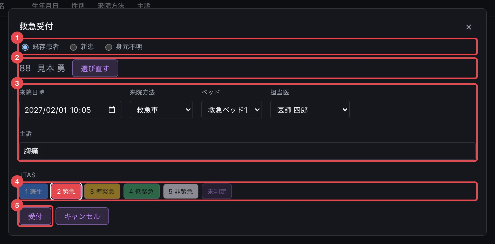
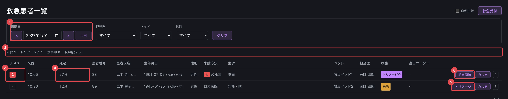
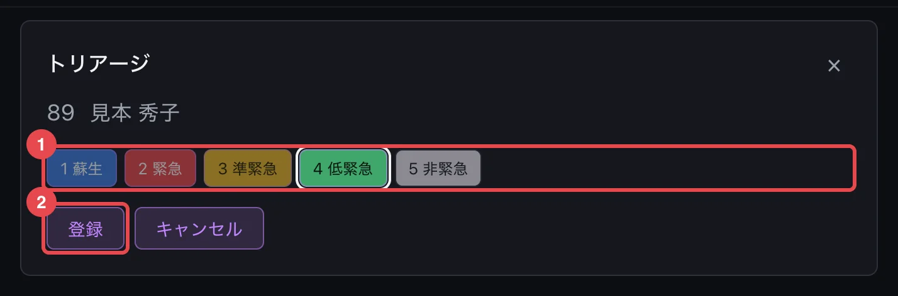
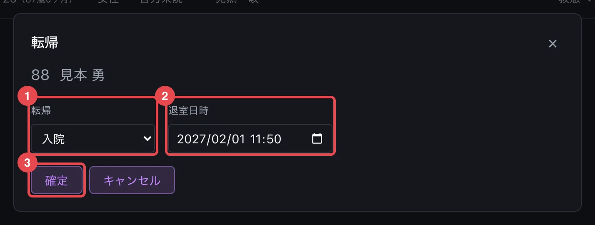
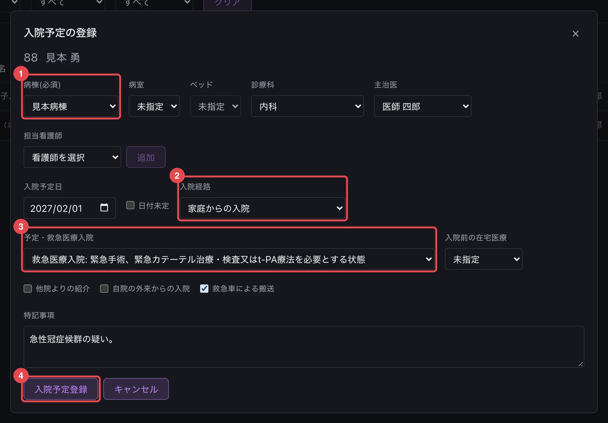
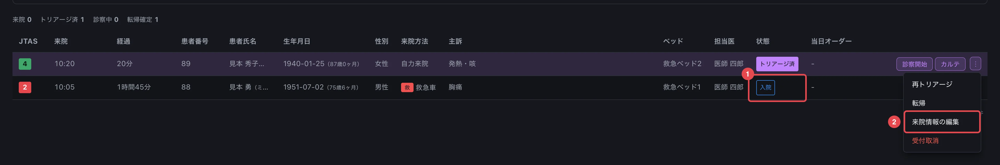

# 救急患者一覧

救急外来に来た患者を、来院からトリアージ・診察・転帰(帰宅・入院など)まで追う一覧です。
転帰が入院のときの入院予定から入院までは、業務フローの[入院から退院まで](../flows/admission-discharge.md)を見てください。

- 救急患者一覧は、画面の上の「患者一覧」>「救急患者一覧」で開きます。
- 1 行が 1 回の救急の受診です。滞在中(来院・トリアージ済・診察中)の受診は、来院した日を問わず一覧に出ます。転帰を確定した受診は、来院した日の一覧に残ります。

## 救急受付

{ .screen width="800" }

1. 「救急受付」を押し、患者を「既存患者」「新患」「身元不明」から選びます。
2. 既存患者は、患者番号か氏名で探して選びます。新患は、その場で患者の基本情報を入れて登録します。
3. 「来院日時」「来院方法」「ベッド」「担当医」「主訴」を入れます。来院日時は、開いた時刻が入っています。ほかの患者が使っているベッドには「(使用中)」が付きます。
4. その場でトリアージをしたときは、「JTAS」の緊急度を選びます。あとで判定するときは「未判定」のままにします。
5. 「受付」を押します。

- 「身元不明」は、性別だけで仮の患者(氏名は「不明」)を登録して受け付けます。身元が分かったら、行の「⋮」の「身元判明」で氏名・生年月日などを入れます。

## 一覧の見方

{ .screen }

1. 「来院日」を選びます。「担当医」「ベッド」「状態」でも絞り込めます。
2. 状態(来院・トリアージ済・診察中・転帰確定)ごとの件数が出ます。
3. 「JTAS」に緊急度が色付きで出ます。滞在中の受診は、緊急度の高い順、同じなら来院の順に並びます。
4. 「経過」に、来院からの経過が出ます。転帰を確定した受診は、滞在した長さが出ます。
5. トリアージがまだの受診には「トリアージ」が出ます。
6. トリアージが済んだら「診察開始」を押します。その患者のカルテが開きます。

- 「来院方法」が救急車・ドクターヘリなどのときは、印が付きます。
- 行を押すと、右に患者の情報が出ます。
- 「自動更新」にチェックを入れると、一覧を 1 分ごとに読み直します。

## トリアージ

{ .screen width="700" }

1. 緊急度(JTAS の 1 蘇生〜5 非緊急)を選びます。
2. 「登録」を押します。状態がトリアージ済になります。

判定し直すときは、行の「⋮」の「再トリアージ」を使います。判定の履歴(判定日時・緊急度・判定者)が、トリアージの画面の下に並びます。

## 転帰

{ .screen width="700" }

診察中の行の「転帰」を押します。

1. 「転帰」を「帰宅」「入院」「転院」「死亡」「診察前離院」「その他」から選びます。
2. 「退室日時」を確かめます。開いた時刻が入っています。
3. 「確定」を押します。状態が転帰確定になり、ベッドが空きます。

トリアージ済で診察を始める前の受診(診察前に帰った患者など)は、行の「⋮」の「転帰」から確定します。

## 入院予定の登録

{ .screen width="800" }

転帰に「入院」を選んで確定すると、続けて入院予定の登録が開きます。

1. 「病棟」を選びます(必須)。病室・ベッドが決まっていれば選びます。決まっていなければ、病棟で入院実施のときに選びます。
2. 「入院経路」を選びます。
3. 「予定・救急医療入院」を選びます。選ぶと「入院前の在宅医療」と、「他院よりの紹介」「自院の外来からの入院」「救急車による搬送」の印が出ます。救急車で来た患者は「救急車による搬送」に印を付けます。
4. 「入院予定登録」を押します。入院予定は、病棟の入院患者一覧の「入院予定」に並びます。

## 転帰を確定した行

{ .screen }

1. 転帰を確定した受診は、「状態」に転帰(入院・帰宅など)が出て、一覧の下に移ります。
2. 行の「⋮」の「来院情報の編集」で、来院日時・来院方法・ベッド・担当医・主訴を直します。

- 「⋮」には、ほかに「診察開始取消」「転帰取消」「受付取消」が、その行でできるものだけ出ます。転帰取消で、滞在中に戻ります。
