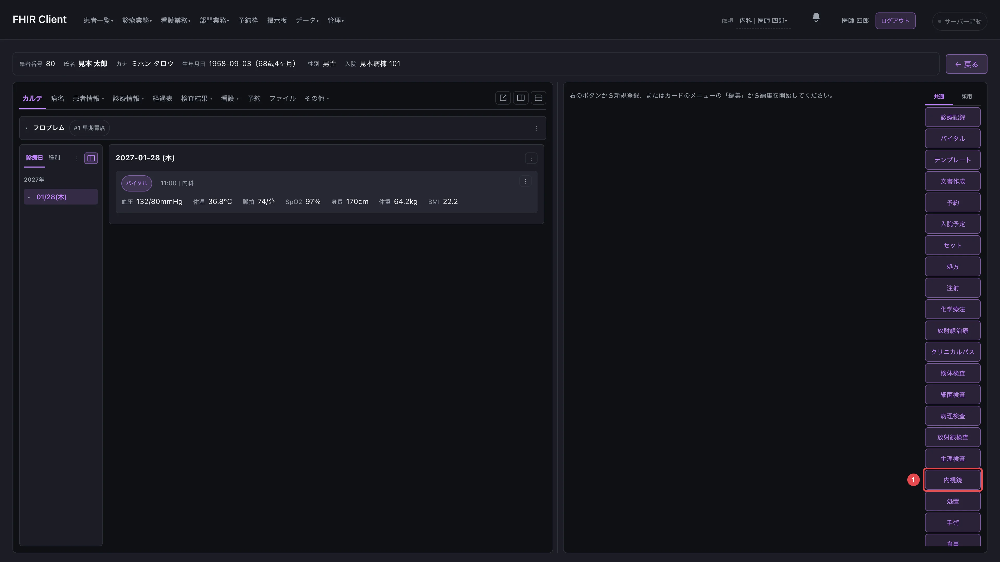
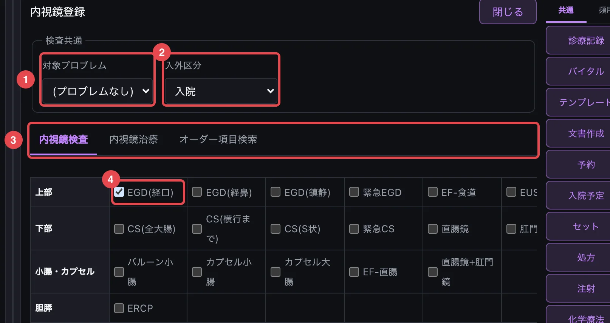
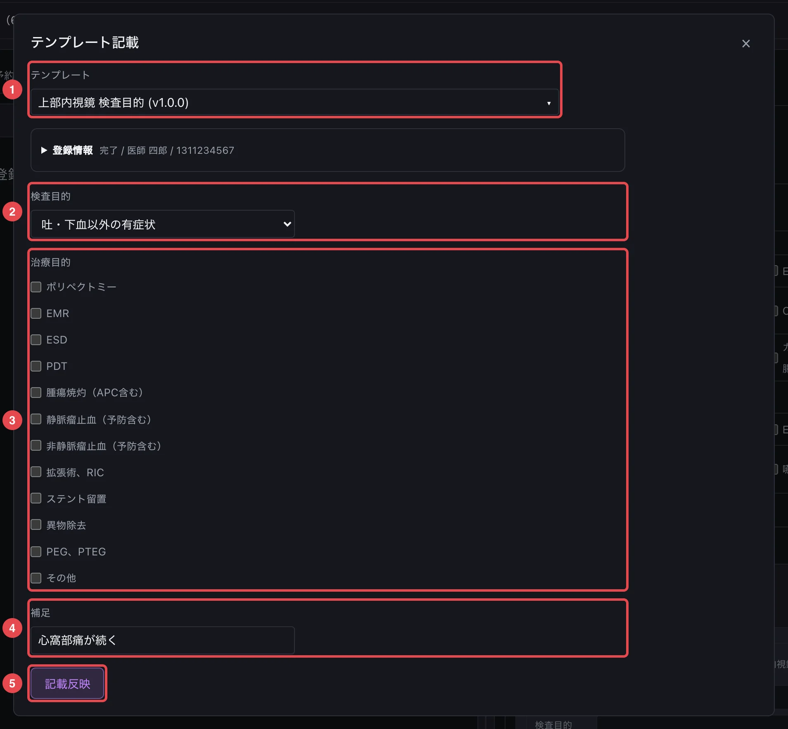
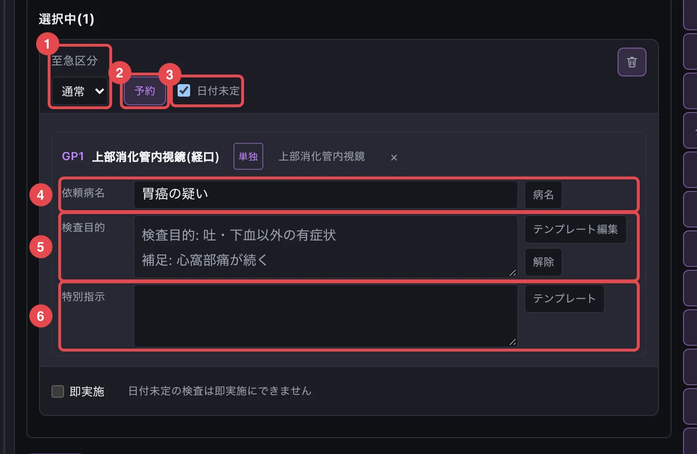
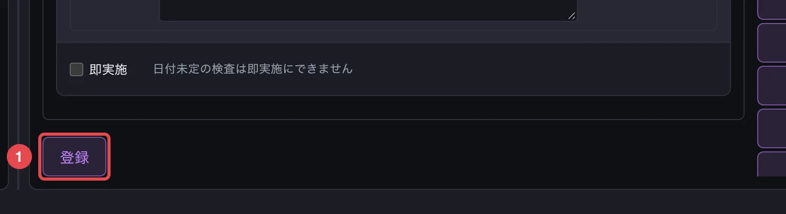
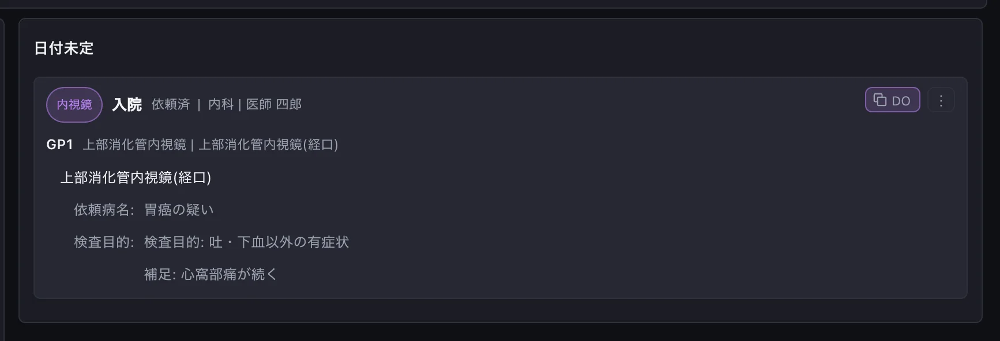
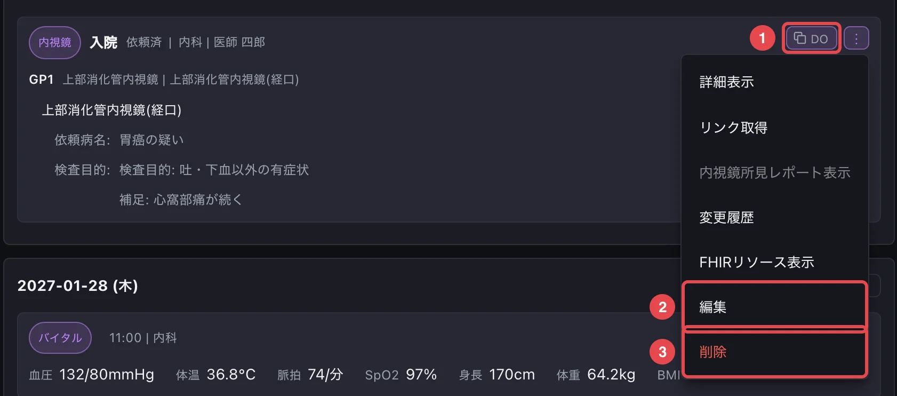

# 内視鏡

医師がカルテから内視鏡の検査・治療を選び、検査目的を JED の用語で記入して登録する操作です。
予約・受付・実施・所見レポート・結果の確認までの流れは、業務フローの[生理検査・内視鏡・処置オーダー](../flows/physio-endoscopy-treatment.md)を見てください。
内視鏡で採った組織は、別に[病理検査](patho.md)を出します。

入力の形は放射線検査・生理検査と同じです。このページでは、予約を後で取る「日付未定」での登録を例にします。
登録するときに予約を取る操作は、[生理検査](physio.md#予約する)と同じです。

## 内視鏡登録を開く

患者のカルテを開いておきます。

{ .screen }

1. カルテの右側に並ぶボタンから「内視鏡」を押します。右側に「内視鏡登録」が開きます。

## オーダー項目を選ぶ

{ .screen width="807" }

1. 「対象プロブレム」で、この検査の対象の病名を選びます。
2. 「入外区分」で「入院」か「外来」を選びます。
3. 伝票のタブ(「内視鏡検査」「内視鏡治療」)を切り替えます。伝票に無い項目は「オーダー項目検索」で名前から探します。
4. 行う検査・治療にチェックを付けます。

## 検査目的を記入する

内視鏡の検査目的は、JED(日本消化器内視鏡学会のデータベース)の用語から選んで記入します。
選んだ項目の「検査目的」の横の「テンプレート」を押すと、「テンプレート記載」が開きます。

{ .screen width="954" }

1. 「テンプレート」に、検査の種類(上部・下部・小腸・ERCP)に合ったテンプレートが選ばれています。
2. 「検査目的」を選びます。
3. 治療を行うときは「治療目的」にチェックを付けます。
4. 書き添えることがあれば「補足」に入れます。
5. 「記載反映」を押します。選んだ内容が「検査目的」に入ります。

## 予約か日付未定を選ぶ

{ .screen width="724" }

1. 「至急区分」を「通常」「至急」「事後」から選びます。
2. 予約を取るときは「予約」を押し、検査室の枠を選びます(操作は[生理検査](physio.md#予約する)と同じです)。
3. 日がまだ決まらないときは「日付未定」にチェックを付けます。至急区分が「通常」のときだけ選べます。
4. 「依頼病名」を入れます。「病名」を押すと、患者に登録された病名から選べます。
5. 「検査目的」に、テンプレートで記入した内容が出ます。直すときは「テンプレート編集」、記入をやめるときは「解除」を押します。
6. 前処置・鎮静の指示など、内視鏡室へ伝えることを「特別指示」に入れます。「テンプレート」で記入することもできます。

予約する検査と日付未定の検査は、「即実施」にできません。

## 登録する

{ .screen width="750" }

1. 「登録」を押します。

施設で決めた規則や感染症の警告が出ることがあります。確かめが要る警告は、理由を選んで登録します。

登録すると右側が閉じ、カルテに内視鏡のカードが出ます。日付未定で登録した検査は、カルテの時系列の一番上の「日付未定」に出ます。

{ .screen width="867" }

予約は、内視鏡室の内視鏡一覧の「日付未定」タブの「予約」か、カードの編集で取ります。予約を取ると、カードは予約の日に移ります。

## 登録した内視鏡を使う・直す

カルテの内視鏡のカードから操作します。

{ .screen width="841" }

1. 「DO」を押すと、同じ内容が右側の「内視鏡登録」に入ります。検査目的の文言は写りますが、テンプレートの記入内容とのつながりは写りません。予約・実施記録・所見レポートも写りません。
2. 「⋮」の「編集」を押すと、右側に編集が開きます。予約の日時を決める・変えるときも、ここで枠を選びます。直して「更新」を押します。
3. 「⋮」の「削除」を押すと、理由を入れて内視鏡を削除します。

- 実施を記録した検査や、所見レポートのある検査は削除できません。
- 所見レポートができると、「⋮」の「内視鏡所見レポート表示」でレポートを開けます。
- 検査をやめるときの「中止」は、カルテのカードではなく、内視鏡一覧の行のメニューで行います。
