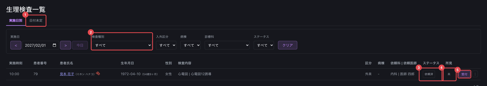
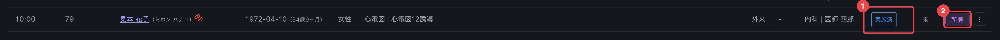
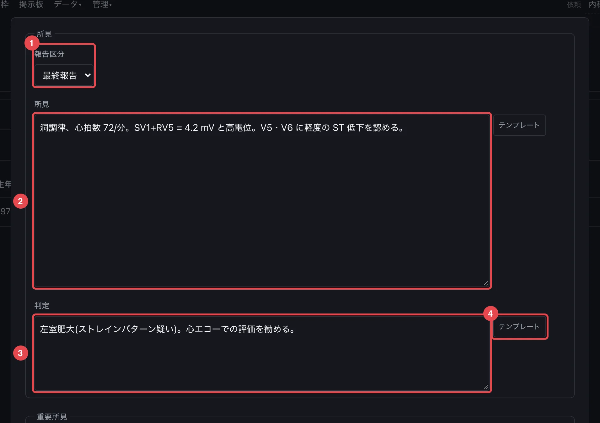
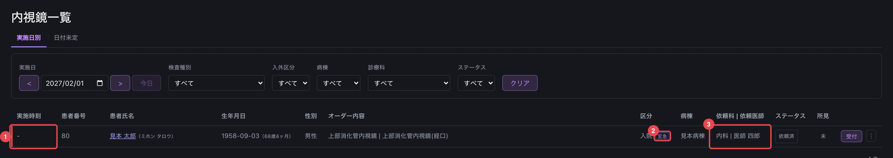
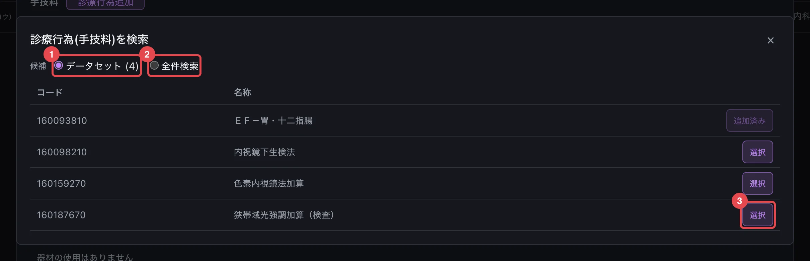
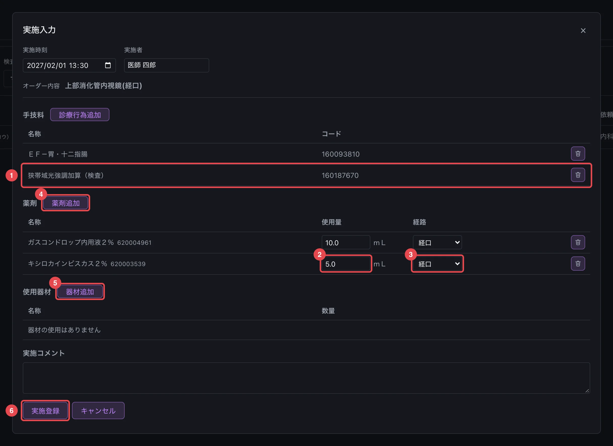
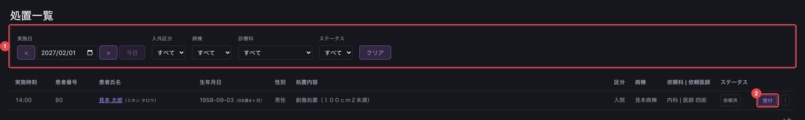
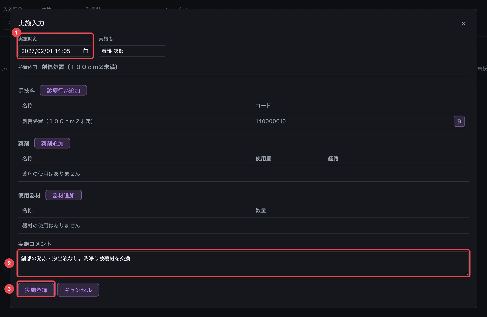

# 生理検査・内視鏡・処置の一覧

生理検査室・内視鏡室・処置を行う部署が、医師の出したオーダーを部門の一覧で受け付けて実施を記録し、
生理検査・内視鏡は記載医が所見レポートを書く操作です。流れ全体は、業務フローの[生理検査・内視鏡・処置オーダー](../flows/physio-endoscopy-treatment.md)を見てください。

- 一覧は、画面の上の「部門業務」>「生理検査部門」>「生理検査一覧」、「内視鏡部門」>「内視鏡一覧」、「処置」>「処置一覧」で開きます。
  ホームに部門のカード(「生理検査」「内視鏡」「処置」)を出していれば、そこからも開けます。
- 3 つの一覧は、[放射線検査一覧](rad-worklist.md)と同じ作りです。作業は「依頼済」→(受付)→「受付済」→(実施入力)→「実施済」と進みます。
- 所見レポートがあるのは生理検査と内視鏡だけです。処置は実施済で終わります。
- オーダーが登録されても、部門への通知は出ません。実施日の一覧で確かめます。

## 生理検査一覧

{ .screen }

1. 実施日を決めずに出された検査は「日付未定」のタブに並びます。「予約」で検査室の枠を取ると、その日の一覧に移ります。
2. 「検査種別」(心電図・超音波など)で絞り込めます。「実施日」「入外区分」「病棟」「診療科」「ステータス」でも絞り込めます。
3. 「ステータス」に作業の状態が出ます。
4. 「所見」に所見レポートの状態が出ます。まだ書いていなければ「未」です。
5. 患者が来たら「受付」を押します。検査が済んだら「実施」を押して実施入力を開き、「実施登録」を押します。

- 実施時刻の順に並び、時刻の無い検査は後ろに並びます。至急の検査は「区分」に「至急」が付き、行の色が変わります。
- 「⋮」の「取消」で 1 つ前の状態に戻し、「中止」で検査を取りやめます。
- 実施入力の手技・薬剤・器材の欄は、内視鏡と同じです(下の「[実施を記録する](#実施を記録する)」)。生理検査の薬剤は、負荷試験などの吸入薬を入れます。

### 所見レポートを書く

実施済になった行には「所見」が出ます。記載医が所見レポートを書きます。カルテの生理検査のカードの「⋮」からも開けます。

{ .screen }

1. ステータスが「実施済」になります。
2. 「所見」を押すと、所見レポートの入力画面が開きます。

{ .screen width="956" }

画面の上に、依頼内容と実施情報が畳んで出ます。

1. 「報告区分」を選びます。先に所見だけ返すときは「暫定報告」にします。
2. 「所見」を書きます。心電図の各間隔や心エコーの EF のような計測値も、所見の文章に書きます。
3. 「判定」を書きます。最終報告には判定が必要です。
4. 所見・判定は「テンプレート」からも記入できます。

この下の「重要所見あり」「フォロー推奨あり」「+画像添付」と「登録」は、放射線検査の読影レポートと同じです([読影レポートを書く](rad-worklist.md#読影レポートを書く))。
最終報告で登録すると、依頼医に検査結果確認の通知が届きます。書き直すときは、行の「所見編集」を押します。

## 内視鏡一覧

{ .screen }

1. 実施時刻の決まっていない検査は「-」で、後ろに並びます。
2. 至急の検査は「区分」に「至急」が付き、行の左端に色が付きます。
3. 依頼した診療科と医師が出ます。

絞り込み・「日付未定」のタブ・行のボタンとメニューは、生理検査一覧と同じです。

### 実施を記録する

「実施」を押すと実施入力が開きます。手技・薬剤・器材は、検査項目ごとに決めてある初期の行が並んでいます。

足りない手技は「診療行為追加」で足します。

{ .screen width="1210" }

1. 「データセット」には、その検査項目でよく使う手技が並びます。
2. 候補に無いときは「全件検索」で、名称と点数表の章から探します。
3. 足す手技の「選択」を押します。すでに入っている手技は「追加済み」になっています。

{ .screen width="1210" }

1. 足した手技が「手技料」に並びます。使わなかった手技は、行のゴミ箱のボタンで外します。会計に送る手技は、ここに並んだものです。
2. 薬剤の「使用量」を確かめます。
3. 「経路」を選びます。内視鏡では、静注・筋注・外用・直腸内が先頭に並びます。
4. 初期の行に無い薬剤は「薬剤追加」で足します。
5. 使用した器材は「器材追加」で足します。マスタに無い器材は名称を手で入れられます(名称だけの器材は会計に送れません)。
6. 内容を確かめて「実施登録」を押します。

- 「実施時刻」は今の時刻、「実施者」はログインしている人が入っています。
- 鎮静薬などロット番号を記録する薬を入れると、ロット番号の欄が出ます。
- 実施済になると「所見」が出ます。内視鏡の所見レポートは、生理検査と同じ画面で、「判定」の代わりに「診断」を書きます。

## 処置一覧

{ .screen }

1. 「実施日」「入外区分」「病棟」「診療科」「ステータス」で絞り込めます。処置には「日付未定」のタブと検査種別の絞り込みはありません。
2. 患者が来たら(病棟ではベッドサイドへ行くときに)「受付」を押し、処置が済んだら「実施」を押します。

{ .screen width="1210" }

1. 「実施時刻」を確かめます。
2. 創部の状態などは「実施コメント」に書きます。処置には所見レポートがないので、所見はここに残します。
3. 「実施登録」を押すと、実施済で終わります。

手技・薬剤・器材の欄は、内視鏡と同じです。処置の薬剤は、外用が先頭に並びます。
