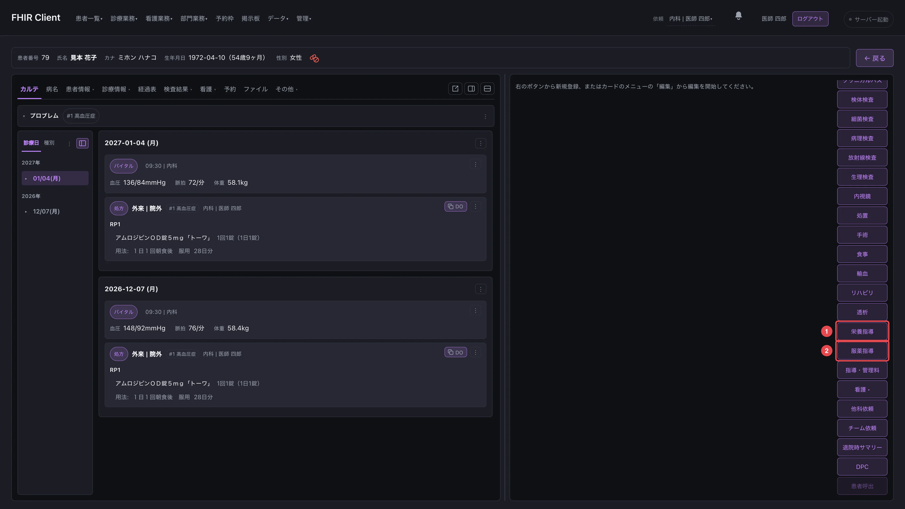
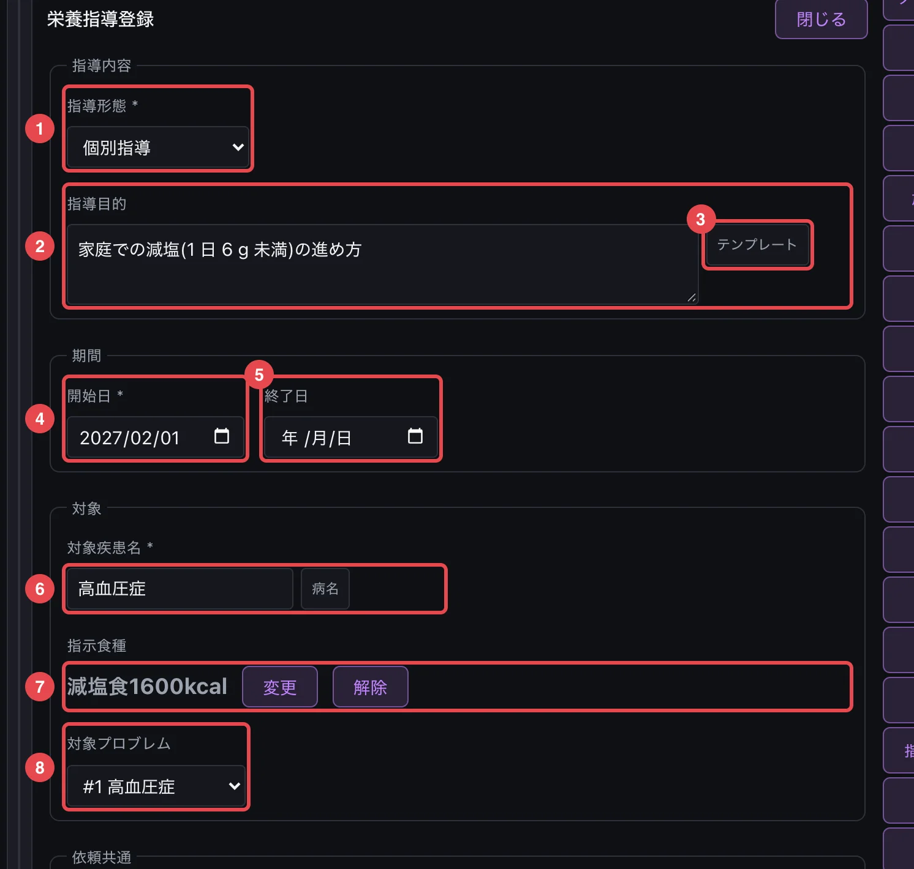
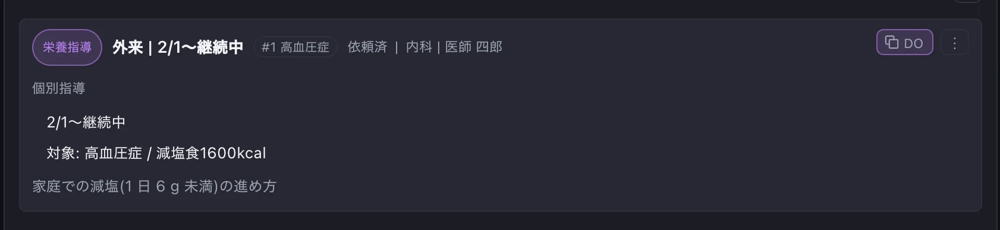
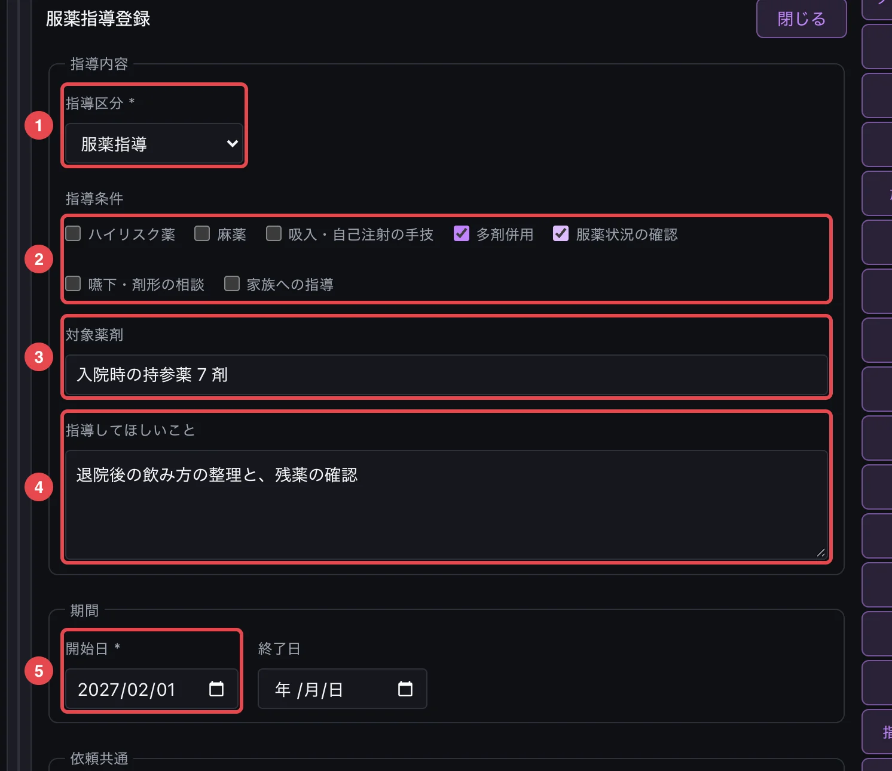
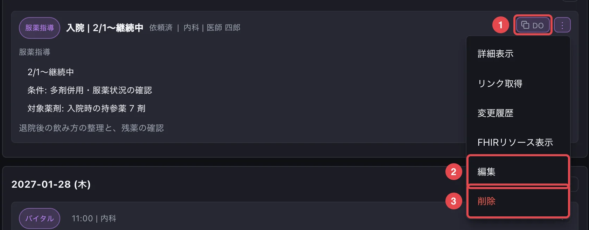

# 栄養指導・服薬指導

医師がカルテから、管理栄養士の栄養指導と、薬剤師の服薬指導を依頼する操作です。
どちらも 1 つのオーダーで期間を決めて依頼し、栄養部門・薬剤部が受け付けて、指導のたびに実施を記録します。
受付・予約・実施・終了までの流れは、業務フローの[栄養指導・服薬指導](../flows/guidance.md)を見てください。

## 登録を開く

患者のカルテを開いておきます。

{ .screen }

1. 栄養指導は、カルテの右側に並ぶボタンから「栄養指導」を押します。右側に「栄養指導登録」が開きます。
2. 服薬指導は「服薬指導」を押します。右側に「服薬指導登録」が開きます。

## 栄養指導を依頼する

項目名に「*」が付いたものは必ず入れます。

{ .screen width="746" }

1. 「指導形態」で「個別指導」か「集団指導」を選びます。
2. 「指導目的」に、指導してほしい内容を入れます。
3. 「テンプレート」を押すと、施設で用意したテンプレートで指導目的を記入できます。
4. 「開始日」を入れます。
5. 終わりが決まっていれば「終了日」を入れます。
6. 「対象疾患名」を入れます。特別食加算の算定に要るので、必ず入れます。「病名」を押すと、患者に登録された病名から写せます。
7. 「指示食種」で、指導する食種を選びます。「食種選択」で食事と同じ食種の一覧から選び、「変更」で選び直し、「解除」で外します。
8. 「対象プロブレム」で、対象の病名を選びます。

入院中で食事が出ているときは、いまの食種が横に出ます。「指示食種へ複写」で写せます。
栄養部門へ伝えることがあれば、下の「＋栄養部門への指示」を押して入れます。最後に「登録」を押します。

登録すると右側が閉じ、カルテに栄養指導のカードが出ます。予約は、栄養部門が受け付けたあとに取ります。

{ .screen width="841" }

## 服薬指導を依頼する

{ .screen width="746" }

1. 「指導区分」で「服薬指導」か「退院時指導」を選びます。
2. 「指導条件」で、当てはまるものにチェックを付けます。いくつでも選べます。「ハイリスク薬」を付けると、薬剤師の実施の記録でハイリスク薬の指導が初期値になります。
3. 「対象薬剤」に、指導してほしい薬を入れます。
4. 「指導してほしいこと」に、薬剤師に頼みたい内容を入れます。
5. 「開始日」を入れます。終わりが決まっていれば「終了日」も入れます。

薬剤部へ伝えることがあれば、下の「＋薬剤部への連絡事項」を押して入れます。最後に「登録」を押します。

## 登録した指導を使う・直す

カルテの栄養指導・服薬指導のカードから操作します。どちらも同じです。

{ .screen width="841" }

1. 「DO」を押すと、同じ内容が右側に入ります。開始日は今日になり、終了日は空になります。
2. 「⋮」の「編集」を押すと、右側に編集が開きます。直して「更新」を押します。受付・実施の記録・予約・受け持ちの人は変わりません。
3. 「⋮」の「削除」を押すと、理由を入れて削除します。栄養指導は、取ってある予約も取り消されます。

- 実施の記録がある指導は削除できません。やめるときは、栄養部門・薬剤部の一覧の行のメニューの「中止」で止めます。
