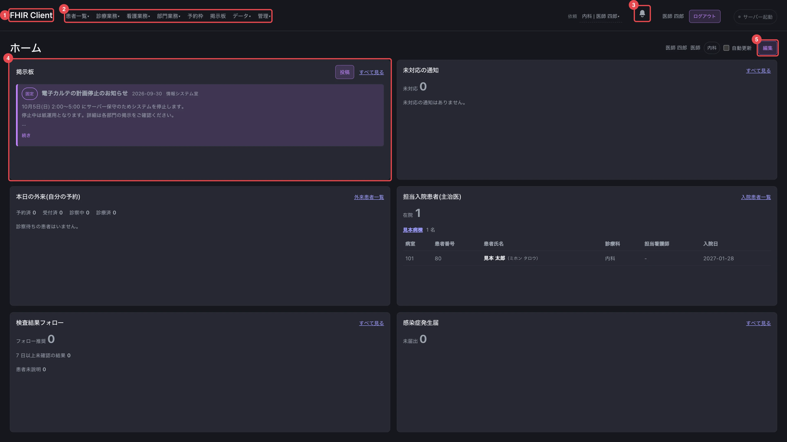
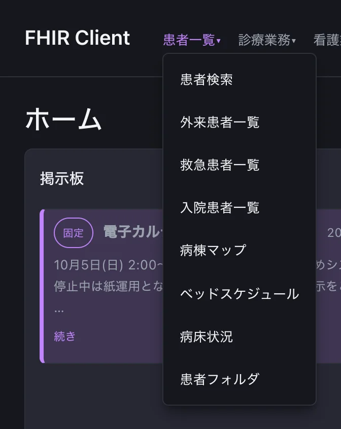
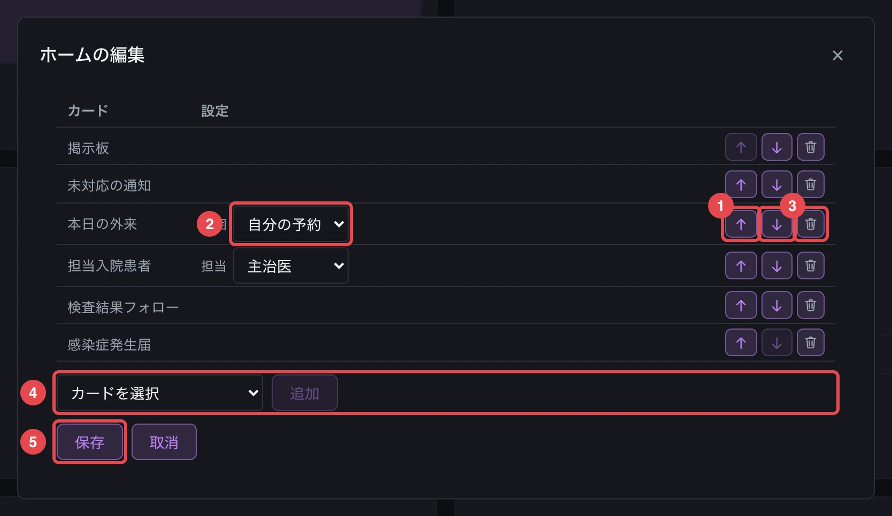
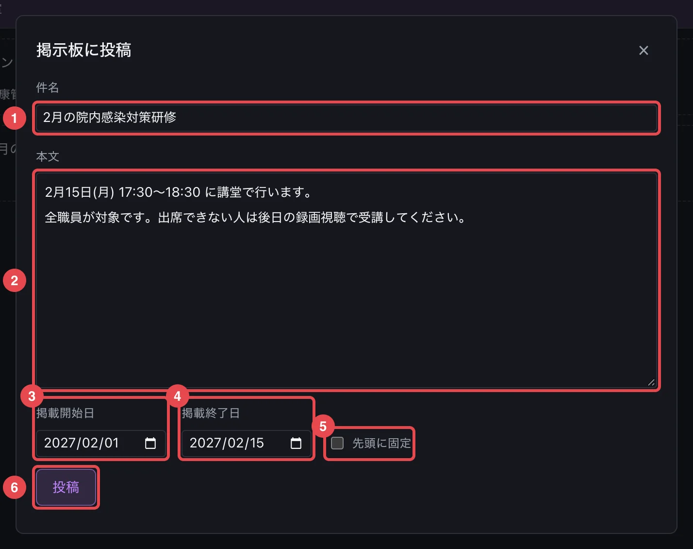
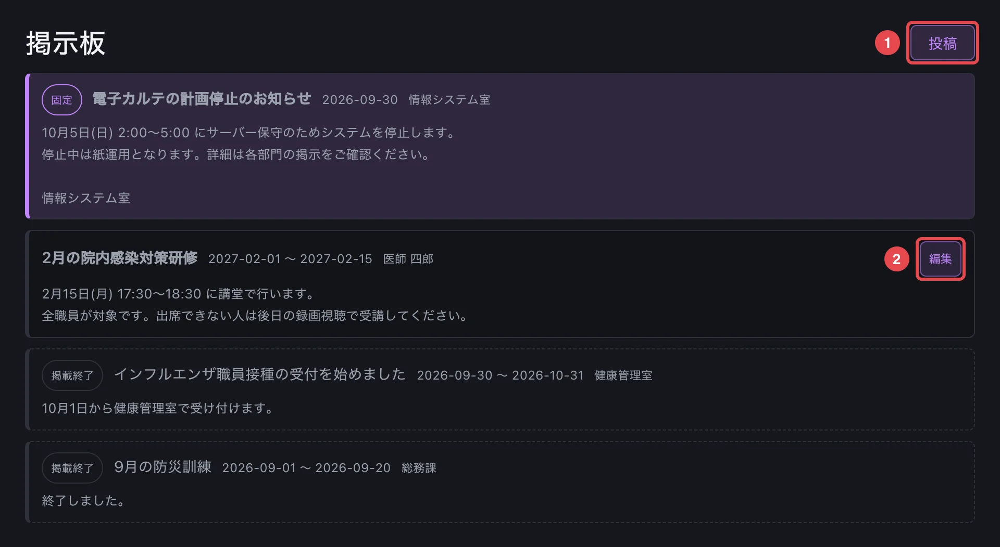
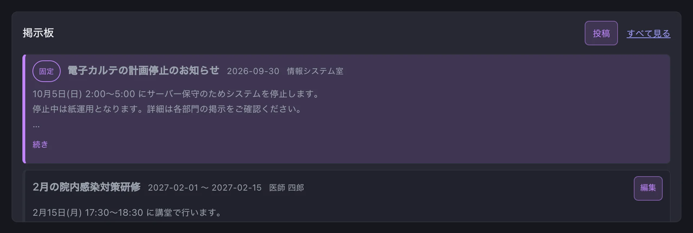

# ホーム・掲示板

ログインすると、最初にホームが開きます。ホームには、ログインした人のその日の仕事がカードで並びます。
院内のお知らせは掲示板に貼り、ホームでも読めます。

## ホームの見方

{ .screen }

1. 左上の「FHIR Client」を押すと、どの画面からでもホームに戻ります。
2. 上の帯のメニューから、ほかの画面を開きます(下の「メニューから画面を開く」)。
3. ベルに、自分あての未対応の通知の件数が出ます(操作マニュアルの[通知](notifications.md))。
4. カードに、その日の仕事が出ます。カードの「すべて見る」や一覧へのリンクで、その一覧の画面に移ります。
   カードの患者の行を押すと、その患者のカルテが開きます。
5. 「編集」で、並べるカードを変えます(下の「ホームを編集する」)。

並ぶカードは職種で決まっています。医師は掲示板・未対応の通知・本日の外来(自分の予約)・担当入院患者(主治医)・
検査結果フォロー・感染症発生届が並びます。
看護師は担当の入院患者と指示受けの件数、薬剤部や検査部などの部門の人は部門の一覧の件数が並びます。

「自動更新」に印を付けると、外来と救急のカードを 1 分ごとに読み直します。印を付けないときは、画面を開いたときに読みます。

## メニューから画面を開く

{ .screen width="336" }

1. 上の帯のメニュー(「患者一覧」「診療業務」など)にマウスを載せると、その下の画面の一覧が開きます。
2. 開きたい画面を押します。

## ホームを編集する

並べるカードと順番は、自分で変えられます。変えた並びは自分だけのもので、別の端末でログインしても同じホームになります。

{ .screen width="834" }

1. 「↑」「↓」で、カードの順番を変えます。
2. 設定のあるカードは、ここで中身を選びます(本日の外来の「自分の予約」「全体」、担当入院患者の「主治医」「担当看護師」など)。
3. ゴミ箱で、カードを外します。
4. 足したいカードを選んで「追加」を押します。
5. 「保存」を押します。

- 病棟・診療科・チームなどを選ぶカードは、選ばないと保存できません。病棟ごとのカードなど、設定で区別できるものは同じ種類を何枚も置けます。
- 一度保存すると「既定に戻す」が出ます。押すと、保存した並びを消して職種の既定に戻ります。

## 掲示板に投稿する

掲示板は、計画停止や研修の案内など、患者に関係しない院内のお知らせを貼る場所です。ログインした人なら誰でも投稿できます。

上の帯の「掲示板」で掲示板を開き、「投稿」を押します。ホームの掲示板のカードの「投稿」からも投稿できます。

{ .screen width="714" }

1. 「件名」を入れます。
2. 「本文」を入れます。
3. 「掲載開始日」を入れます。この日からホームに出ます。
4. 期限のあるお知らせは「掲載終了日」を入れます。空のままにすると、ずっと出ます。
5. ほかの投稿より上に出し続けたいときは「先頭に固定」に印を付けます。
6. 「投稿」を押します。

## 掲示板を読む・直す

{ .screen width="960" }

掲示板の画面には、掲載前・掲載終了のものも含めて、すべての投稿が新しい順に並びます。固定した投稿は先頭に出ます。
掲載前・掲載終了の投稿には、そのことが印で出ます。

1. 「投稿」で、新しく投稿します。
2. 自分の投稿には「編集」が出ます。押すと内容を直せます。消すときは、開いた画面の「削除」を押します。

ほかの人の投稿は直せません。直すときは、投稿した人か管理者に頼みます。

ホームの掲示板のカードには、その日に掲載中の投稿だけが、固定したものを先頭に 5 件まで出ます。
長い本文は途中までになるので、「続き」で全部を読みます。

{ .screen width="960" }
