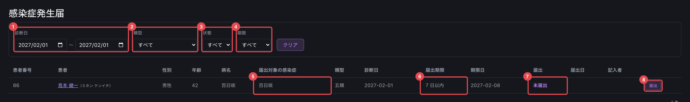
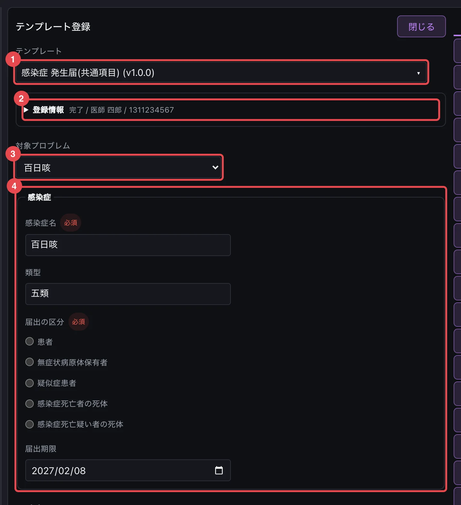
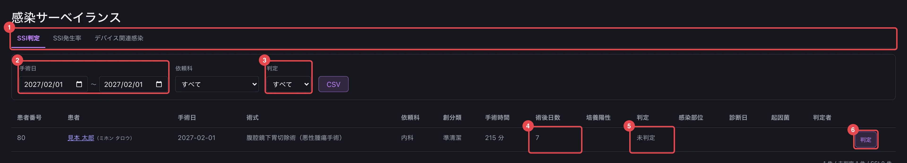
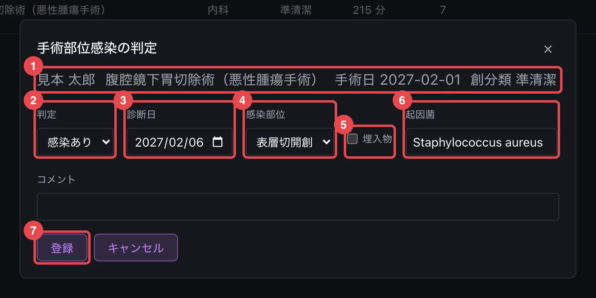
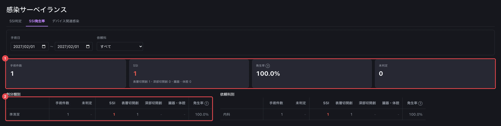

# 感染症発生届・感染サーベイランス

感染症発生届は、感染症法の届出(全数把握)の対象になる病名を一覧にし、発生届の記入と届出の期限を追う操作です。
感染サーベイランスは、手術部位感染(SSI)とデバイス関連感染(中心静脈カテーテル・尿道留置カテーテル・気管チューブ)の判定を残し、発生率を出す操作です。

- 感染症発生届は画面の上の「診療業務」>「感染症発生届」、感染サーベイランスは「診療業務」>「感染サーベイランス」で開きます。
- 医師のホームには「感染症発生届」のカードがあり、直近 90 日の未届出と期限超過の件数が出ます。

## 感染症発生届

### 届出の対象を見る

届出の対象になる感染症の病名(ICD-10 で判定)を登録すると、一覧に並びます。

{ .screen }

1. 「診断日」(病名の開始日)の期間で絞ります。開いたときは直近 90 日です。
2. 「類型」(一類〜五類・新型インフルエンザ等)で絞ります。
3. 「状態」で、未届出・記入中・記入済・届出済に絞ります。
4. 「期限」で、期限を過ぎた行に絞ります。
5. 届出の対象になる感染症の名前と類型が出ます。
6. 届出の期限です。一類〜四類は「直ちに」、五類は「7 日以内」で、右に期限日が出ます。届出が済まないまま期限を過ぎた行は赤で出ます。
7. 届出の状態です。発生届を書いていない病名は「未届出」です。
8. 「届出」で、その病名の発生届を書き始めます。書いた行は「開く」になり、書いた内容を見られます。

- 耐性菌の感染症(ICD-10 で表せないもの)と、定点把握の感染症は並びません。

### 発生届を書く

一覧の「届出」を押すと、その患者のカルテが開き、右側に発生届のテンプレートが出ます。

{ .screen width="718" }

1. 施設設定の発生届のテンプレートが選ばれています。
2. 「登録情報」を押すと、ステータス・記入者名・保険医療機関番号を直せます。
3. 「対象プロブレム」に、一覧で選んだ病名が入っています。
4. 感染症名・類型・届出期限と、診断日・患者・医療機関・医師の項目に初期値が入っています。

- 届出の区分・症状・診断方法などを入れて、下の「登録」を押します。書きかけのまま残すときは「下書き保存」を押します(一覧の「記入中」)。入れ方は[テンプレート](template.md)と同じです。
- 保健所に届け出たら、カルテのテンプレートのカードの「編集」で開き、「届出状況」を届出済にします。
- 保健所への送信と、様式の PDF の作成はこの画面では行いません。

## 感染サーベイランス

### SSI を判定する

「SSI判定」のタブには、手術の実施記録(手術一覧で実施入力をした手術)が 1 件 1 行で並びます。

{ .screen }

1. 「SSI判定」「SSI発生率」「デバイス関連感染」のタブを切り替えます。
2. 「手術日」の期間で絞ります。開いたときは直近 90 日です。「依頼科」でも絞れます。
3. 「判定」で、未判定・感染なし・SSI に絞ります。
4. 手術日からの日数です。観察期間(術後 30 日、埋入物ありは 90 日)を過ぎて未判定の行は赤で出ます。
5. 判定の状態です。
6. 「判定」で判定を書きます。

- 「培養陽性」は、手術の翌日から観察期間の終わりまでの細菌検査で菌が出た件数です。カーソルを合わせると内訳が出ます。
- 「CSV」で、表示している行を CSV に出します。

{ .screen width="730" }

1. 患者・術式・手術日・創分類が出ます。
2. 「判定」で「感染あり」か「感染なし」を選びます。
3. 感染ありのときは「診断日」、感染なしのときは「判定日」を入れます。
4. 感染ありのときは「感染部位」(表層切開創・深部切開創・臓器・体腔)を選びます。
5. 埋入物のある手術は「埋入物」に印を付けます。観察期間が 90 日になります。
6. 感染ありのときは「起因菌」を入れます。培養陽性の菌が候補に出ます。
7. 「登録」を押します。直すときは、もう一度「判定」を押して「更新」します。

### SSI 発生率を見る

{ .screen }

1. 期間の手術件数・SSI の件数(感染部位ごと)・発生率・未判定の件数が出ます。
2. 創分類別と依頼科別に、手術件数・未判定・SSI・感染部位ごとの件数・発生率が並びます。

- 期間の手術を読み切れていないときは、発生率を出しません。

### デバイス関連感染

「デバイス関連感染」のタブでは、病棟と月を選ぶと、中心静脈カテーテル・尿道留置カテーテル・気管チューブごとに、デバイス日数・感染件数・
感染率(1000 デバイス日あたり)・使用比が上に出ます。下には、その月の対象の留置がデバイスごとに並び、行の「判定」で SSI と同じように判定します。
抜去区分が「感染疑い」で未判定の留置は赤で出ます。留置の記録は[留置物管理](nursing-line-drain.md)で入れます。
