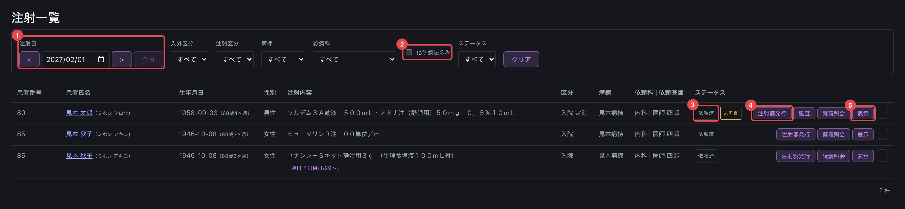
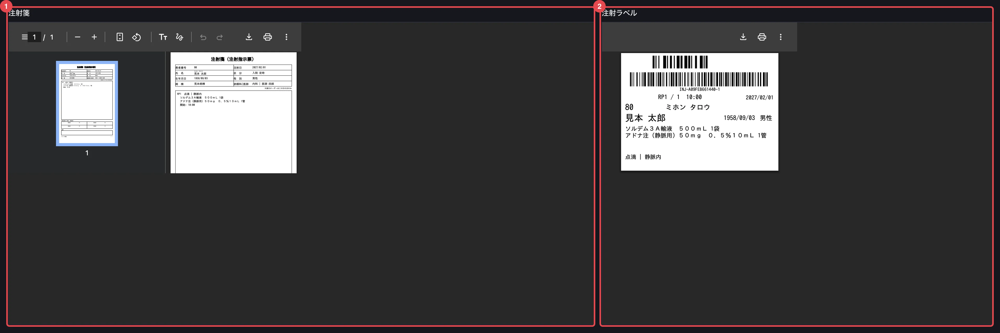
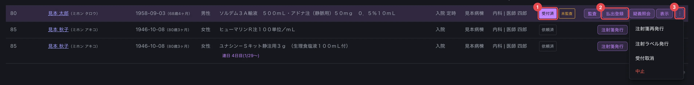
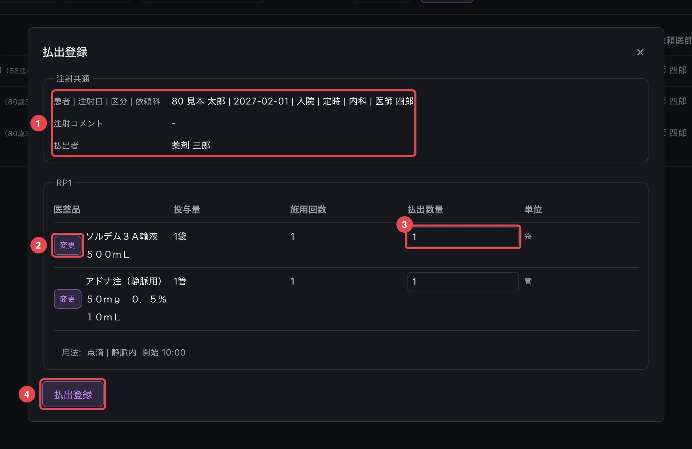
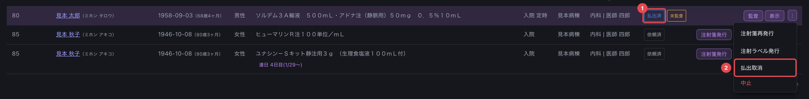

# 注射一覧と払出

薬剤部が、医師の出した注射を注射一覧で受け、注射箋と注射ラベルを発行して薬を払い出す操作です。
注射の流れ全体は、業務フローの[注射オーダー](../flows/injection.md)を見てください。

- 注射一覧は、画面の上の「部門業務」>「薬剤部門」>「注射一覧」で開きます。ホームの「注射」のカードからも開けます。
- 薬剤部の作業は「依頼済」→(注射箋発行)→「受付済」→(払出登録)→「払出済」と進みます。病棟で実施を記録すると「実施済」になります。
- 連日の注射は、注射日ごとに 1 行ずつ並び、1 日ずつ受け付けて払い出します。
- 注射の内容を確かめる処方監査は、払出と並行して行います。操作は[処方監査](rx-verification.md)を見てください。

## 注射一覧の見方

{ .screen }

1. 「注射日」で、注射をする日を選びます。「<」「>」で 1 日ずつ動かし、「今日」で今日に戻ります。
   ほかに「入外区分」「注射区分」「病棟」「診療科」「ステータス」で絞り込めます。
2. 「化学療法のみ」にチェックを付けると、化学療法の注射だけになります。化学療法の注射には、内容の下にレジメン名・クール・Day が出ます。
3. 「ステータス」に薬剤部の作業の状態が出ます。横には処方監査の「未監査」「監査済」の印が出ます。
4. 依頼済の注射は「注射箋発行」を押して注射箋と注射ラベルを刷ります。
5. 「表示」を押すと、用法・投与速度などを含めた注射の内容が開きます。

連日の注射は、内容の下に「連日 N日目(開始日〜)」が出ます。

## 注射箋と注射ラベルを発行して受け付ける

行の「注射箋発行」を押すと、注射箋と注射ラベルが別のタブに並んで開き、その注射が受付済になります。

{ .screen }

1. 左が注射箋(注射指示票を兼ねます)です。上の印刷のボタンで印刷します。
2. 右が注射ラベルです。RP ごとに 1 枚で、患者番号と RP のバーコードが入ります。病棟の注射バーコード実施で読み取ります。

用紙が違うので、注射箋と注射ラベルはそれぞれのボタンから印刷します。

## 受付済の注射

{ .screen }

1. ステータスが「受付済」になります。
2. 「払出登録」が出ます。薬を揃えたら押します。
3. 「⋮」から「注射箋再発行」「注射ラベル発行」で刷り直せます。「受付取消」で依頼済に戻し、「中止」で注射を中止します。

- 施設の設定で「監査済まで調剤登録・払出登録を出さない」にしていると、監査が済むまで「払出登録」は出ません。
- 疑義照会中の注射は「払出登録」が出ません。操作は[疑義照会](rx-inquiry.md)を見てください。

## 払出登録

「払出登録」を押すと、払出登録の画面が開きます。初期値は注射の内容のままです。

{ .screen width="1002" }

1. 患者・注射日・区分・依頼科と注射コメントが出ます。「払出者」はログインしている薬剤師です。
2. 別の銘柄で払い出すときは、「変更」を押して医薬品を選び直します。
3. 「払出数量」を確かめます。初期値は、投与量にその日の施用回数を掛けた数です。
4. 「払出登録」を押します。注射が払出済になります。

## 払い出したあと

{ .screen }

1. ステータスが「払出済」になります。病棟は注射の実施を記録します(看護の[注射の実施入力](nursing-injection.md))。
2. 間違えたときは「⋮」の「払出取消」で受付済に戻せます。登録した払出の記録は残ります。

中止した注射は「⋮」の「中止取消」で依頼済に戻せます。
