# 注射オーダー

医師がカルテから注射を入力して登録する操作です。登録した注射が薬剤部で払い出され、病棟・外来で実施されるまでの流れは
業務フローの[注射オーダー](../flows/injection.md)を見てください。

このページで使う呼び名です。

- **RP**: 同じルートから同時に投与する薬剤の組(混注)です。用法と開始時刻は RP ごとに入れます。
- **連日の注射**: 期間と実施パターンで登録した注射です。登録すると、日ごとに 1 つずつの注射に分かれます。

## 注射登録を開く

患者のカルテを開いておきます。

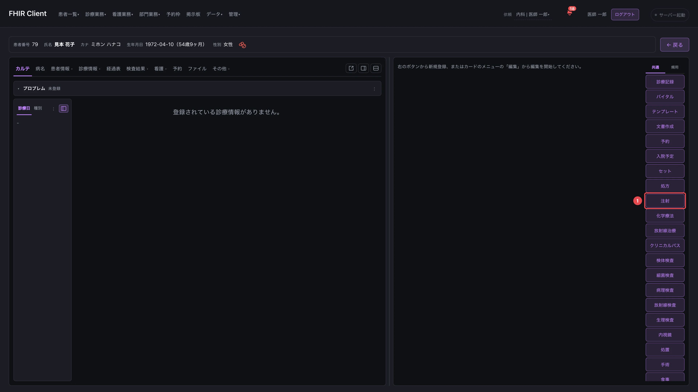{ .screen }

1. カルテの右側に並ぶボタンから「注射」を押します。右側に「注射登録」が開きます。

## 注射共通を入れる

注射全体にかかる項目です。

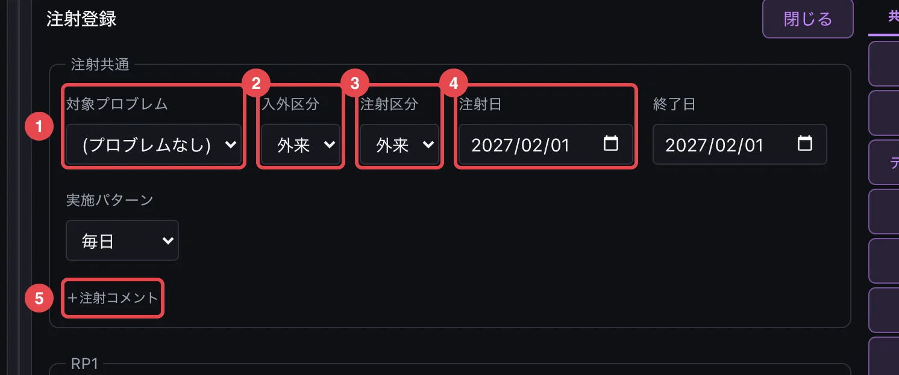{ .screen width="746" }

1. 「対象プロブレム」で、この注射の対象の病名を選びます。プロブレムを選ばないときは「(プロブレムなし)」のままにします。
2. 「入外区分」で「入院」か「外来」を選びます。
3. 「注射区分」を選びます。入院は「定時」「臨時」「緊急」、外来は「外来」です。
4. 「注射日」を確かめます。初期値は今日です。
5. 注射全体に書き添えることがあれば「＋注射コメント」を押して入れます。

1 日だけの注射は、「終了日」を注射日と同じ日のままにします。

## 連日の注射にする

同じ注射を何日か続けるときは、期間と実施パターンを入れます。

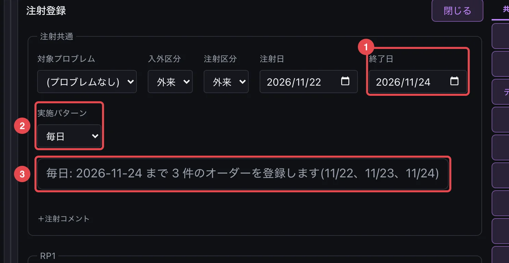{ .screen width="746" }

1. 「終了日」に最後の日を入れます。
2. 「実施パターン」を選びます。

    | 実施パターン | 注射する日 |
    |---|---|
    | 毎日 | 注射日から終了日まで毎日 |
    | N日ごと | 「間隔」に入れた日数ごと(2 なら隔日) |
    | 曜日指定 | 「曜日」で選んだ曜日 |

3. 何日に注射が立つかが出るので、確かめます。

一度に登録できるのは 14 日分まで、期間は 90 日までです。超えるときは期間を短くします。

## 医薬品を選ぶ

RP の医薬品の行にある薬のアイコン(「医薬品を選択」)を押すと、「医薬品を選択」が開きます。注射薬だけが並びます。

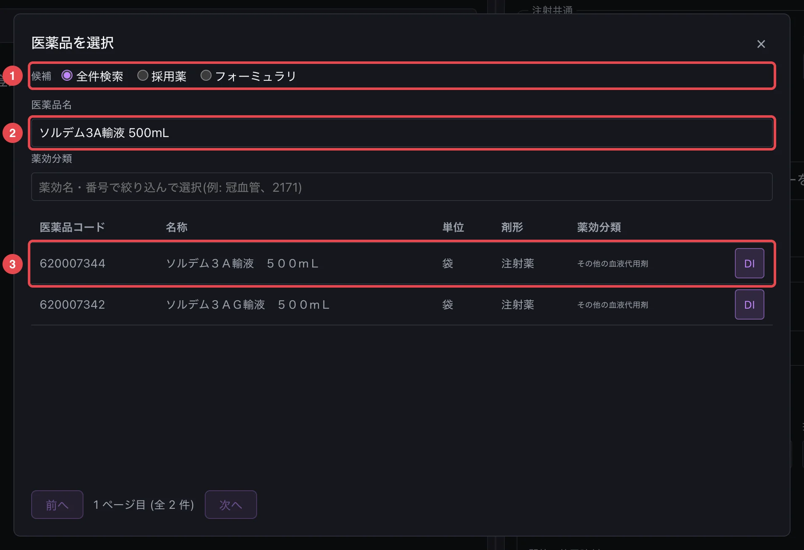{ .screen width="954" }

1. 「候補」で探し方を選びます。

    | 候補 | 並ぶもの |
    |---|---|
    | 全件検索 | すべての注射薬 |
    | 採用薬 | 院内で採用している注射薬 |
    | フォーミュラリ | 院内で定めた推奨薬の一覧 |

2. 「医薬品名」に名前の一部を入れます。かなと全角・半角の違いは区別しません。「薬効分類」で絞り込むこともできます。
3. 使う医薬品の行を押します。

## 投与量を入れる

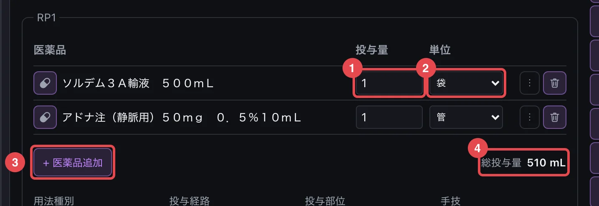{ .screen width="717" }

1. 「投与量」を入れます。
2. 単位を確かめます。袋・管・瓶などの単位のほか、力価(mg)や容量(mL)で入れられる医薬品は、ここで単位を切り替えます。
3. 同じ RP に混ぜる医薬品を足すときは「+ 医薬品追加」を押し、医薬品を選びます。「+ 医薬品追加」は、RP に医薬品を 1 つ選ぶと出ます。
4. 「総投与量」に、RP の医薬品を mL に直した合計が出ます。

容量が分からない医薬品(粉末の瓶など)は総投与量に含まれず、その件数が横に出ます。

インスリンを選ぶと、量の単位が「単位」になり、「+ スケール」が出ます。血糖値や食事量に応じて量を変えるときは、
「+ スケール」を押してスケールを入れます。施設で登録したスケールは「セット」から選べます。

## 用法を入れる

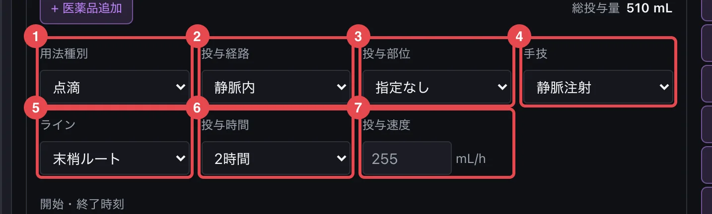{ .screen width="717" }

1. 「用法種別」で「点滴」か「ワンショット」を選びます。医薬品を選ぶと、輸液の袋なら「点滴」のように初期値が入ります。
2. 「投与経路」を選びます。点滴にすると「静脈内」が入ります。
3. 必要なら「投与部位」を選びます。
4. 「手技」を選びます。筋肉内・皮下などは投与経路を選ぶと入ります。静脈内は「静脈注射」か「中心静脈注射」を選びます。
5. 必要なら「ライン」を選びます。
6. 点滴は「投与時間」を選びます。
7. 「投与速度」に、総投与量と投与時間から計算した速度(mL/h)が出ます。速度を直接入れるときは、投与時間を「指定なし(速度を直接入力)」にします。

「投与時間」と「投与速度」は、点滴のときだけ出ます。

## 開始時刻を入れる

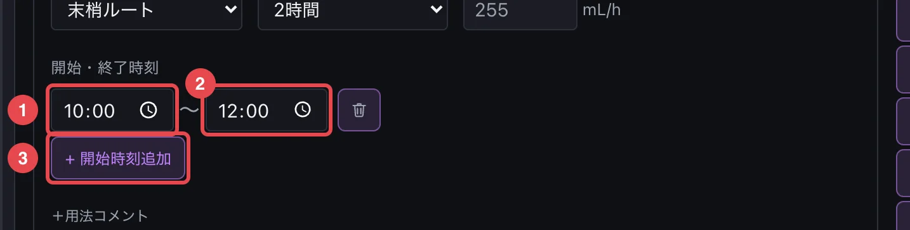{ .screen width="717" }

1. 「+ 開始時刻追加」を押し、開始時刻を入れます。日付は注射日です。
2. 点滴は、投与時間か投与速度から終了時刻が入ります。違うときは直します。開始より前の時刻は翌日の終了になります。
3. 1 日に何回か注射するときは、「+ 開始時刻追加」で時刻を足します。

ワンショットは終了時刻を入れません。

## 補足を入れる・RP を足す

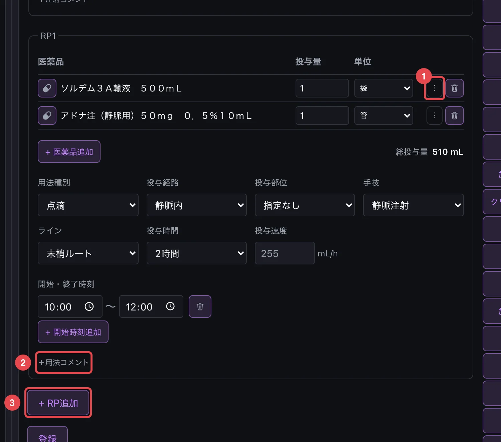{ .screen width="750" }

1. 医薬品の行の「⋮」の「薬剤コメント」で、その医薬品へのコメントを入れます。
2. 「＋用法コメント」を押すと、RP の用法へのコメントを入れます。
3. 別のルートや別の時刻の注射を足すときは「+ RP追加」を押し、新しい RP に医薬品と用法を入れます。

付けたコメントは、行の下に入力欄が出ます。消すときは、その欄の横のゴミ箱を押します。開始時刻もゴミ箱で消せます。医薬品の行と RP は、2 つ以上あるときにゴミ箱で消せます。

## 登録する

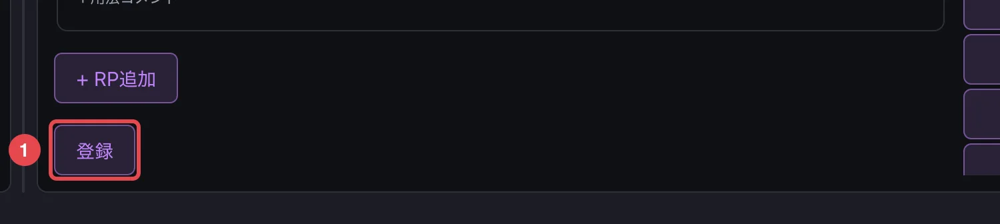{ .screen width="750" }

1. 「登録」を押します。

入力に足りないところがあると、上に内容が出て、その項目に印が付きます。直してからもう一度「登録」を押します。

登録すると右側が閉じ、カルテに注射のカードが出ます。連日の注射は、日ごとに 1 枚ずつカードが出ます。
2 日目からのカードには「連日 2日目(2/1〜)」「隔日(2/1〜)」のように、何日目か・どのパターンかが付きます。

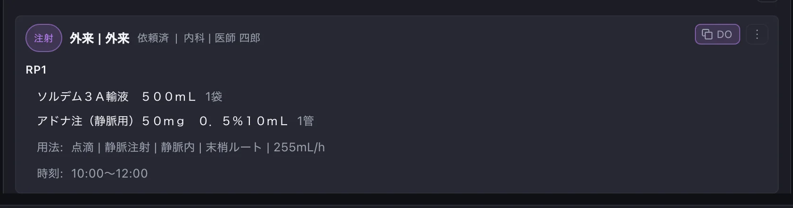{ .screen width="841" }

## 警告が出たとき

医薬品を選ぶと、アレルギー・重複投与・相互作用・用量の上限などに当たるとき、その医薬品の行に警告が出ます。
警告の色の意味と、「警告の確認」で理由を選んで登録する操作は処方と同じです。処方オーダーの[警告が出たとき](prescription.md#警告が出たとき)を見てください。

## 登録した注射を使う・直す

カルテの注射のカードから操作します。

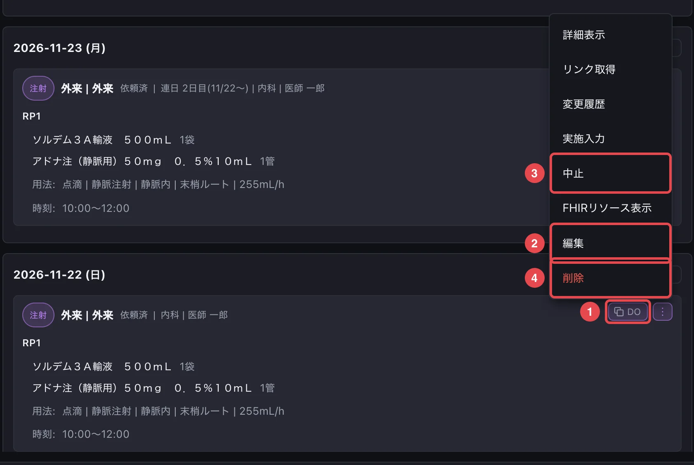{ .screen width="841" }

1. 「DO」を押すと、同じ内容が右側の「注射登録」に入ります。注射日などを直して「登録」を押します。
2. 「⋮」の「編集」を押すと、右側に「注射編集」が開きます。直して「更新」を押します(下の「連日の注射を編集する」)。
3. 「⋮」の「中止」を押すと、注射を中止します(下の「中止する」)。
4. 「⋮」の「削除」を押すと、注射を削除します(下の「削除する」)。

「⋮」の「詳細表示」では、注射の内容と、登録日時・警告の確認などの記録を見られます。
「実施入力」は、病棟・外来で施用を記録する操作です(業務フローの[実施の流れ](../flows/injection.md#実施の流れ))。

- 薬剤部が監査を済ませた注射を編集すると、監査をやり直すことになります。
- 編集や中止をしても、薬剤部へ通知は届きません(業務フローの[変更・中止・削除・継続](../flows/injection.md#変更中止削除継続))。

### 連日の注射を編集する

編集では、注射日を 1 日ずつ直します。連日の注射で後ろに日が続くときは、上に「反映範囲」が出ます。

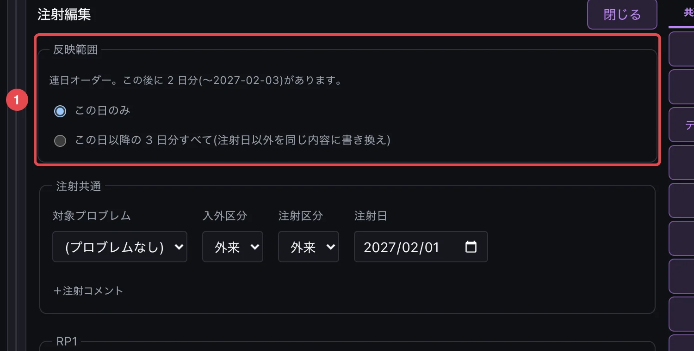{ .screen width="750" }

1. 「この日のみ」か「この日以降の N 日分すべて」を選びます。この日以降を選ぶと、後ろの日も注射日以外を同じ内容に書き換えます。

### 中止する

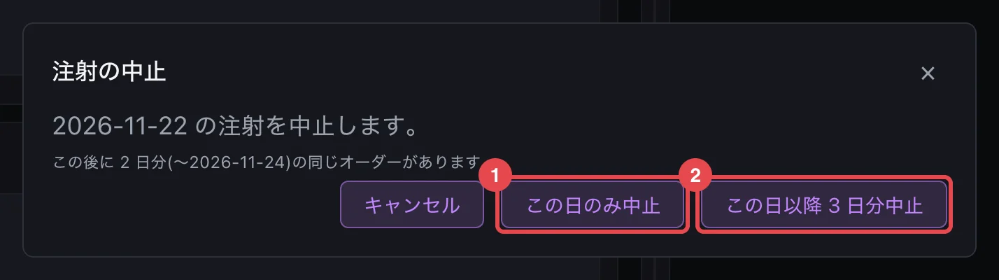{ .screen width="714" }

1. その日だけ止めるときは「この日のみ中止」を押します。
2. 後ろの日もまとめて止めるときは「この日以降 N 日分中止」を押します。実施済の日は中止しません。

後ろに日が続かない注射は、「中止」のボタンだけが出ます。実施済の注射は中止できません。
中止した注射は、カードの「⋮」の「中止取消」で依頼済に戻せます。

### 削除する

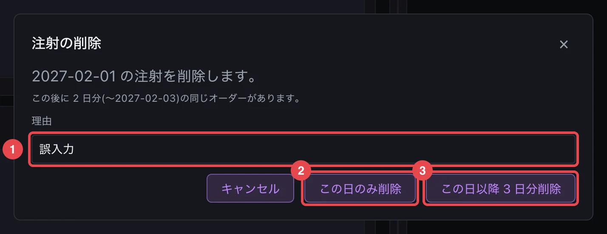{ .screen width="714" }

1. 「理由」を入れます。「誤入力」「患者間違い」「重複登録」から選ぶか、文字で入れます。
2. その日だけ消すときは「この日のみ削除」を押します。
3. 後ろの日もまとめて消すときは「この日以降 N 日分削除」を押します。

後ろに日が続かない注射は、「削除」のボタンだけが出ます。
実施を記録した注射は削除できません。先にカードの「⋮」の「実施取消」で実施の記録を取り消します。
