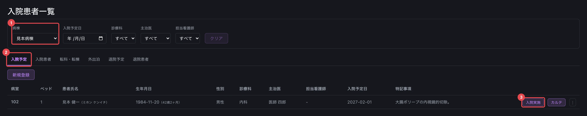
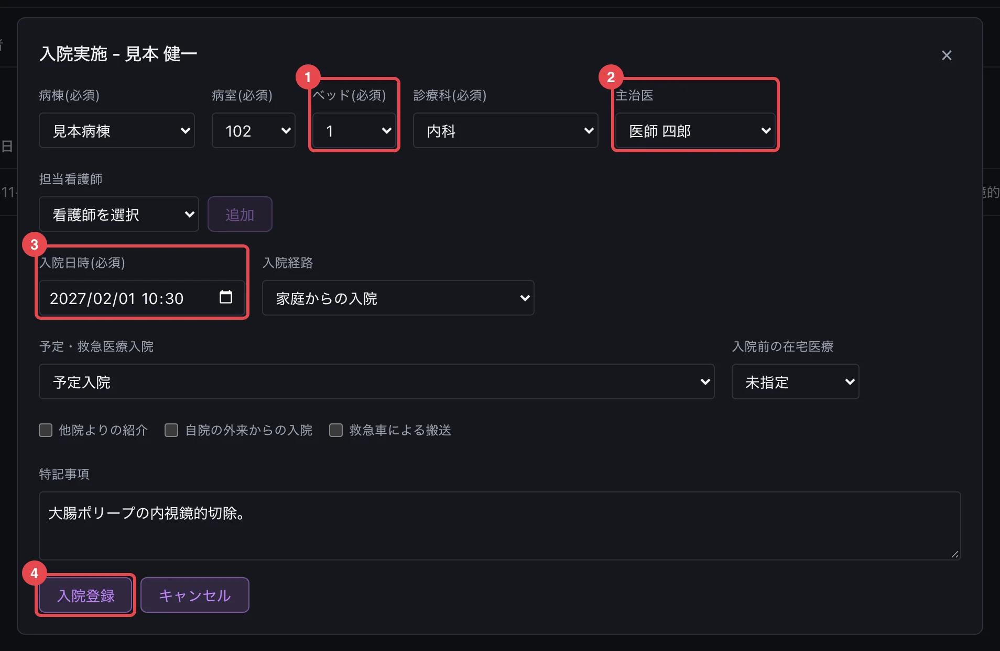
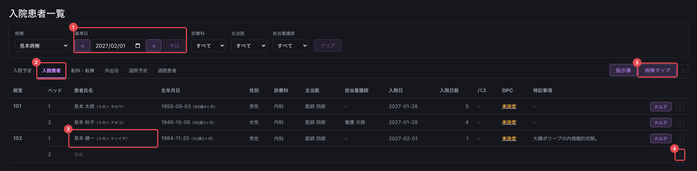
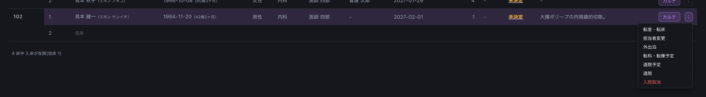
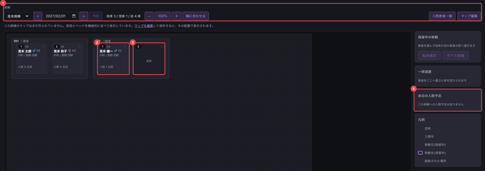
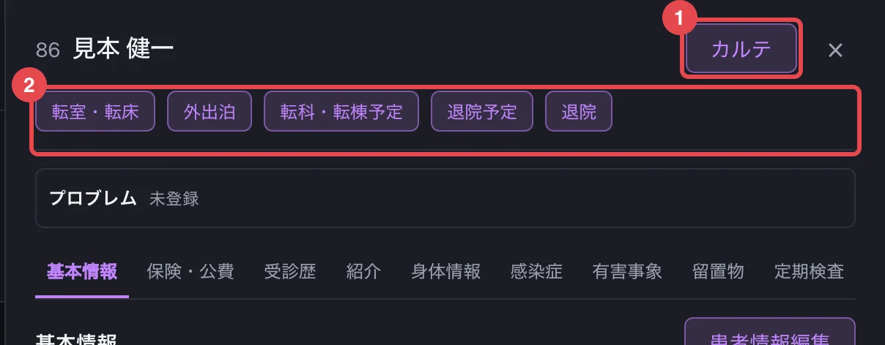
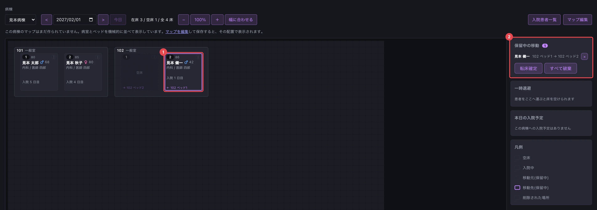

# 入院患者一覧・病棟マップ

病棟のベッドごとに入院中の患者を並べ、入院予定の患者の入院・転室・退院などを行う画面です。
病棟マップは同じ内容を病棟の間取りの上に出し、患者のカードを空床へ運んで転床できます。
入院から退院までの流れ全体は、業務フローの[入院から退院まで](../flows/admission-discharge.md)を見てください。入院予定の入れ方は[入院予定](admission-plan.md)のページです。

- 入院患者一覧は、画面の上の「患者一覧」>「入院患者一覧」、病棟マップは「患者一覧」>「病棟マップ」で開きます。
- 病棟を選ばずに開くと、先頭の病棟が開きます。

## 入院予定から入院する

{ .screen }

1. 「病棟」を選びます。
2. 「入院予定」のタブに、その病棟への入院予定が並びます。「入院予定日」で日を絞れます。
3. 入院する患者の「入院実施」を押します。

予約の無い入院は、「新規登録」から入院予定を入れるか、「入院患者」のタブの空床の「⋮」の「入院登録」で直接入院します。

{ .screen width="800" }

入院予定の内容が入った状態で開きます。

1. 「病棟」「病室」「ベッド」を確かめます。入院予定でベッドが決まっていなければ、ここで選びます。ほかの患者が居るベッドは選べません。
2. 「診療科」「主治医」「担当看護師」を確かめます。担当看護師は、選んで「追加」を押すと何人でも加えられます。
3. 「入院日時」を確かめます。開いた時刻が入っています。
4. 「入院登録」を押します。

## 入院患者の一覧

{ .screen }

1. 「基準日」に、その日の在院の状況が出ます。「<」「>」で 1 日ずつ動かし、「今日」で今日に戻ります。過去の日を選ぶと、その日にベッドに居た患者が出ます。
2. 「入院患者」のタブに、病室・ベッドの順に 1 行 1 床で並びます。
3. 入院中の患者の行に、主治医・担当看護師・入院日・入院日数などが出ます。
4. 空いているベッドは「空床」と出ます。「⋮」の「入院登録」で、そのベッドに患者を選んで入院させます。
5. 「病棟マップ」で、同じ病棟の病棟マップを開きます。「指示簿」で、その病棟の指示簿を開きます。

- 「診療科」「主治医」「担当看護師」で絞り込むと、空床は出なくなります。
- 右上の「⋮」から、ベッドスケジュール・病床状況・入退院文書や、看護の画面(ワークシート・看護必要度・業務分担など)を、同じ病棟で開けます。「表示項目変更」で、パス・DPC・NEWS2 の列を出すかどうかを選びます。

ほかのタブには、次のものが並びます。

| タブ | 並ぶもの |
|---|---|
| 入院予定 | その病棟への入院予定 |
| 入院患者 | 病棟のベッドと、入院中の患者 |
| 転科・転棟 | 転科・転棟の予定(その病棟から出る、その病棟に入る) |
| 外出泊 | 外出・外泊の予定と、外出泊中の患者 |
| 退院予定 | 退院予定のある患者 |
| 退院患者 | 退院した患者 |

## 行の操作

{ .screen }

入院中の患者の行の「⋮」から、次の操作をします。

| 操作 | 内容 |
|---|---|
| 転室・転床 | 同じ病棟の中で病室・ベッドを移る |
| 担当者変更 | 主治医と担当看護師を替える |
| 外出泊 | 外出・外泊の予定を入れる |
| 転科・転棟予定 | ほかの診療科・病棟へ移る予定を入れる。移る日に「転科・転棟」のタブから実施する |
| 退院予定 | 退院予定日を入れる |
| 退院 | 退院日を入れて退院する |
| 入院取消 | 誤って登録した入院を取り消す |

一度でも移った入院には「移動取消」が出ます。直前の 1 回の移動を取り消して、移る前のベッドと診療科に戻します。

## 病棟マップ

{ .screen }

1. 「病棟」と日付を選びます。在床・空床の数が出ます。「−」「+」「幅に合わせる」で表示の大きさを変えます。
2. 入院中の患者は、ベッドの位置にカード(患者番号・氏名・性別・年齢・診療科と主治医・入院日数)で出ます。退院予定・転棟予定・外出泊中の患者には札が付きます。
3. 空いているベッドは「空床」と出ます。
4. 「本日の入院予定」に、その病棟への今日の入院予定が並びます。空床へ運ぶと、そのベッドを選んだ状態で入院実施が開きます。

- 病棟の間取り(病室とベッドの配置、ナースステーションなどの設備)は「マップ編集」で作ります。作っていない病棟は、病室とベッドを機械的に並べて出します。
- カードの「⋮」から、転室・転床・外出泊・転科・転棟予定・退院予定・退院ができます。空床の「⋮」からは入院登録ができます。

{ .screen width="700" }

カードを押すと、右に患者の情報が出ます。もう一度押すと閉じます。

1. 「カルテ」で、その患者のカルテを開きます。
2. 転室・転床などの操作を、ここからも行えます。

## 病棟マップで転床する

{ .screen }

今日の病棟マップでは、患者のカードを掴んで、空床やほかの患者のベッドへ運べます。運んだだけでは登録されません。

1. 運んだ先のベッドに患者が出て、移動元が分かる印が付きます。ほかの患者のベッドへ運ぶと、2 人が入れ替わります。
2. 「保留中の移動」に、運んだ移動が並びます。「×」で 1 件ずつ、「すべて破棄」でまとめて取りやめます。いくつか運んでから、まとめて「転床確定」を押します。

- ベッドを空けるために、いったん「一時退避」へ運べます。一時退避に残したままでは確定できません。
- 病棟や日付を変えると、保留中の移動は捨てられます。

{ .screen width="700" }

「転室・転床日」を確かめ、移動の一覧を見て「1 件確定」(移動の件数が出ます)を押します。確定の直前に入院を読み直し、ほかの端末で変わっていれば止まります。
