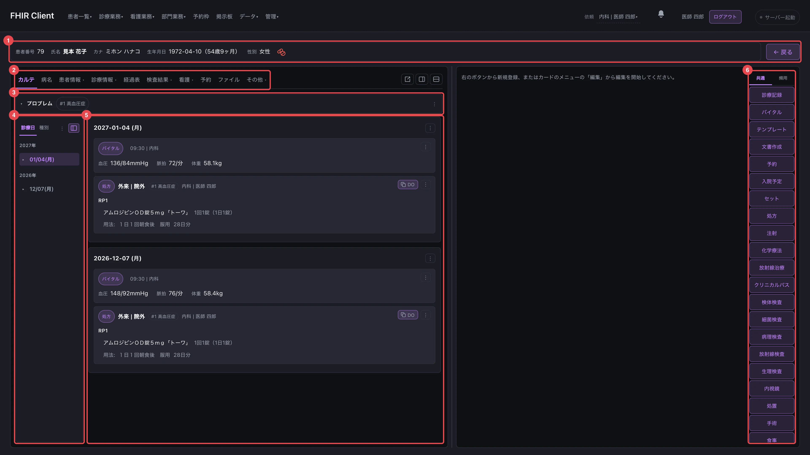
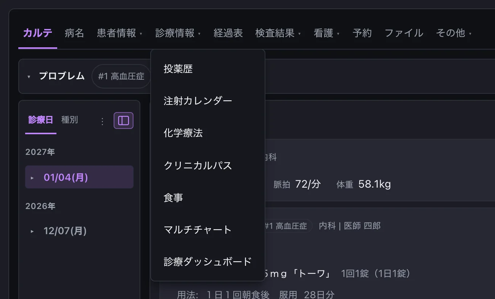
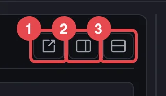
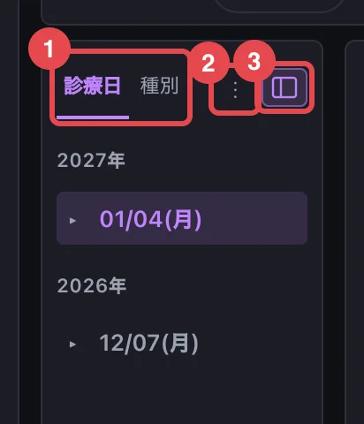
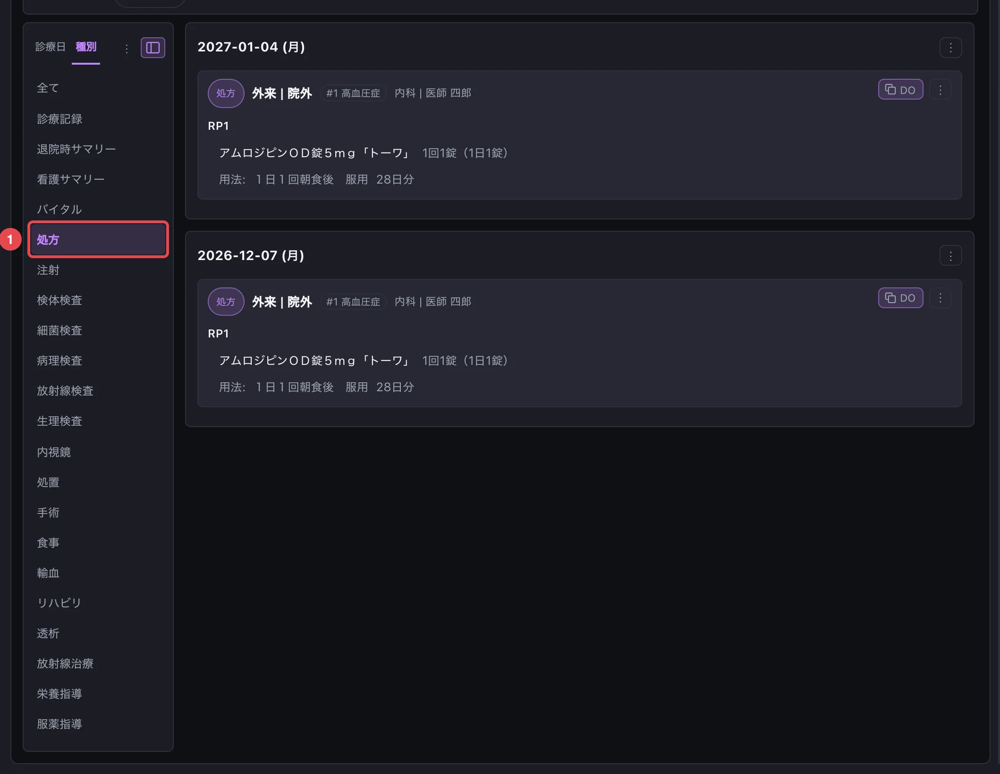
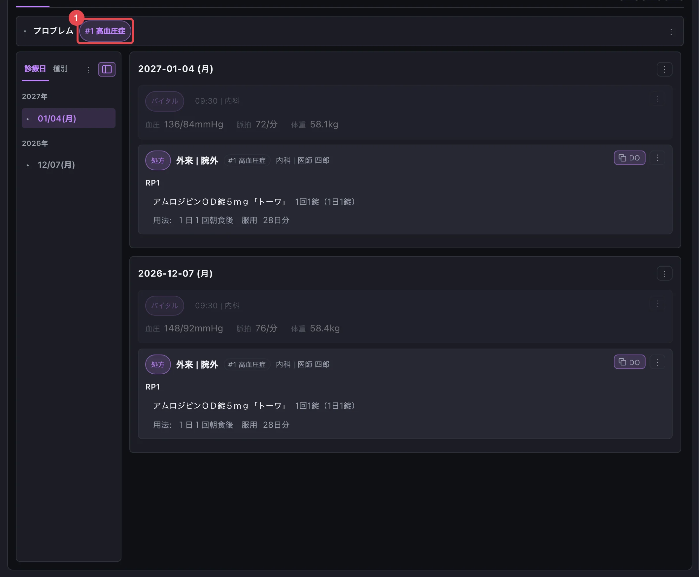

# カルテ画面の見方

患者のカルテを開いたときの画面の見方と、記録を探す操作です。カルテの開き方は、操作マニュアルの[患者検索とカルテを開く](patient-search.md)を見てください。

カルテは、左側で登録済の記録を見て、右側で新しく登録する 2 つの区画に分かれています。

## 画面の全体

{ .screen }

1. **患者の情報**: 患者番号・氏名・カナ・生年月日(年齢)・性別と、アレルギーなどの注意の印です。印を押すと内容が出ます。
   その日に受付済の外来の予約があると「診察開始」、診察中は「診察終了」が出ます。「← 戻る」で、カルテを開いた元の一覧に戻ります。
2. **タブ**: 左側に出す内容を切り替えます(下の「タブを切り替える」)。
3. **プロブレム**: 患者のプロブレム(いま診ている病名)が番号付きで並びます(下の「プロブレムで絞り込む」)。
4. **左の欄**: 記録のある診療日の一覧です。押すと、その日の記録まで移ります(下の「診療日と種別で探す」)。
5. **時系列**: 記録とオーダーが、診療日ごとに新しい日を上にして並びます。今日より先の予定の日は今日より上に並びます。
   カードの「⋮」から、そのカードの操作(編集・削除など)をします。処方などのカードの「DO」は、同じ内容を右側に写して登録を始めます。
6. **登録のボタン**: 診療記録・バイタル・処方・注射・各種のオーダーなどを新しく登録するボタンです。押すと、右側に登録の画面が開きます。
   「頻用」に切り替えると、自分で選んだボタンだけが並びます。

## タブを切り替える

「カルテ」「病名」「経過表」などのタブを押すと、左側の内容が切り替わります。▾ の付いたタブは、いくつかのタブをまとめたものです。

{ .screen width="649" }

1. ▾ の付いたタブにマウスを載せると、まとめたタブの一覧が開きます。
2. 開きたいタブを押します。

| タブ | まとめた中身 |
|---|---|
| 患者情報 | プロファイル・アレルギー・持参薬・口腔診査情報 |
| 診療情報 | 投薬歴・注射カレンダー・化学療法・クリニカルパス・食事・マルチチャート・診療ダッシュボード |
| 検査結果 | 検体検査・検体検査時系列・細菌検査・病理検査・放射線検査・生理検査・内視鏡 |
| 看護 | 看護プロファイル・指示簿・看護計画 |
| その他 | カルテ印刷・DICOMビューア・SMARTアプリ |

## 画面の分け方を変える

タブの行の右端のボタンで、左側の分け方を変えます。

{ .screen width="162" }

1. 左側だけを別のタブに開きます。別の画面に出しておき、記録を見ながら登録するときに使います。別のタブで押した「編集」「DO」は、元のタブの右側で開きます。
2. 今日の記録だけを並べた欄を、時系列の右に並べます。過去の記録を読みながら、今日の記録を見られます。もう一度押すと閉じます。
3. カルテとほかのタブを上下に並べます。上にカルテ、下にほかのタブが出ます。もう一度押すと、タブで切り替える表示に戻ります。

## 診療日と種別で探す

左の欄は「診療日」と「種別」を切り替えて使います。

{ .screen width="206" }

1. 「診療日」は、記録のある日を年ごとに並べます。日を押すと、時系列がその日の記録まで移ります。いま時系列の上に見えている日に色が付きます。
   「種別」に切り替えると、記録の種類ごとに絞り込めます。
2. 「⋮」で、時系列に出す記録を「全て」「自科」「個人」から選びます。「自科」は上の帯で選んでいる診療科の記録だけ、
   「個人」は自分が書いた記録・出したオーダーだけを出します。「全て」以外を選んでいる間は、「⋮」に色が付きます。
3. 左の欄を隠します。隠したあとも細い帯に同じボタンが残るので、押すと元に戻ります。

### 種別で絞り込む

{ .screen width="1059" }

1. 「種別」で記録の種類(診療記録・バイタル・処方など)を押すと、時系列がその種類のカードだけになります。
   もう一度押すか「全て」を押すと、絞り込みを外します。テンプレートは、テンプレートの名前まで選べます。

## プロブレムで絞り込む

{ .screen width="1059" }

1. プロブレムの帯でプロブレムを押すと、そのプロブレムに関係しない記録が薄くなります。もう一度押すと元に戻ります。

- 帯の右端の「⋮」で、薄くする代わりに関係する記録だけを出すように切り替えられます。そのときは、時系列の上にプロブレムの経過の要約が出ます。
- 解決したプロブレムは畳まれていて、帯の「解決済み N 件表示」で開きます。
- プロブレムの登録と直し方は「病名」タブで行います。
