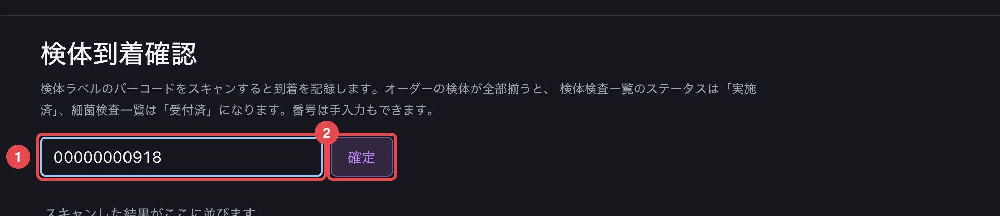
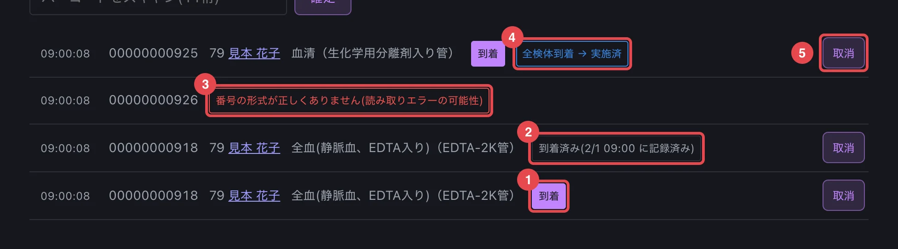
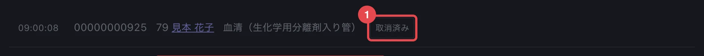

# 検体到着確認

検査室が、届いた管の検体ラベルを 1 本ずつ読んで、到着を記録する操作です。
オーダーの管が全部届くと、検体検査は「実施済」になり、検体検査一覧から結果を登録できます。
検体検査の流れ全体は、業務フローの[検体検査オーダー](../flows/lab.md)を見てください。

- 検体到着確認は、画面の上の「部門業務」>「臨床検査部門」>「検体到着確認」で開きます。
- 検体検査の管と、細菌検査の容器を同じ画面で読みます。病理検査の容器は[病理](patho-worklist.md)の「病理受付」で読みます。
- 検体ラベルの発行は[検体検査一覧とラベル](lab-worklist.md)を見てください。

## ラベルを読む

{ .screen }

1. バーコードリーダーで管のラベルを読みます。読んだ番号が入力欄に入り、そのまま確定します。
   リーダーが使えないときは、ラベルの下に刷られた 11 桁の番号を手で打ちます。
2. 手で打ったときは「確定」を押すか、Enter キーを押します。

確定すると入力欄は空になり、続けて次の管を読めます。日付に関係なく、届いた管を次々に読めます。

## 読んだ結果を確かめる

読んだ結果は、入力欄の下に新しいものから並びます。患者氏名と検体が出るので、読んだ管と食い違っていないか確かめます。

{ .screen }

1. 「到着」は、到着を記録したことを示します。
2. 同じ管をもう一度読むと、「到着済み」と最初に記録した日時が出ます。記録は重ねません。
3. 到着を記録できないラベルは、理由が赤く出ます。番号が正しくない(読み取りの誤り)、発行の記録が無い、病理検査の容器、
   刷り直す前の細菌検査のラベル、などです。管を確かめて読み直します。
4. オーダーの管が全部揃うと、「全検体到着 → 実施済」が添えられます。細菌検査の容器が全部揃ったときは「全容器到着 → 受付済」です。
5. 読み間違えたときは「取消」を押します。

- 中止されたオーダーの管も到着は記録し、「このオーダーは中止されています」と添えます。オーダーを直して外れた検体の管にも注意が出ます。
- 患者氏名を押すとカルテが開きます。
- 読んだ結果の並びは、画面を開き直すと消えます。到着の記録は残ります。

## 到着を取り消す

{ .screen }

1. 「取消」を押すと到着の記録が消え、行が「取消済み」になります。

管が揃って実施済になっていた検体検査は、受付済に戻ります。細菌検査は依頼済に戻ります(結果が付いた細菌検査は戻しません)。
