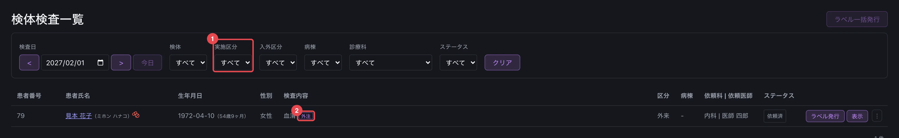
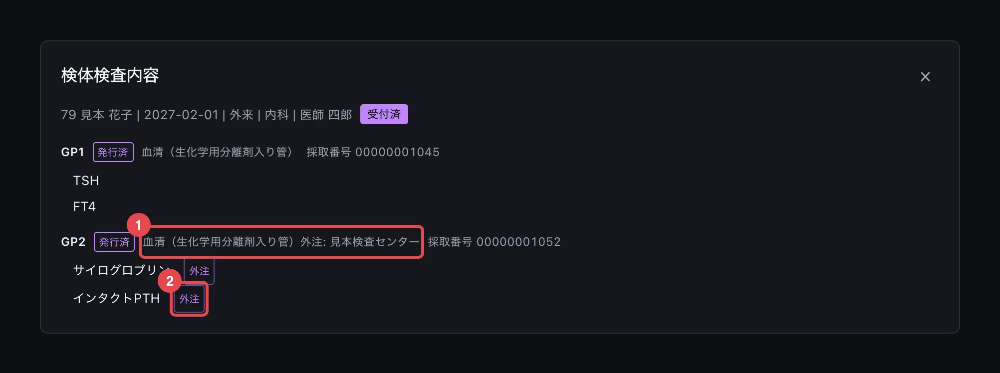
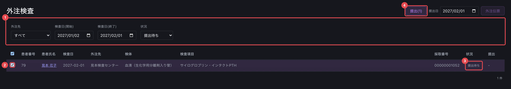
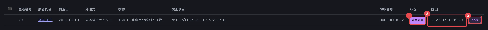
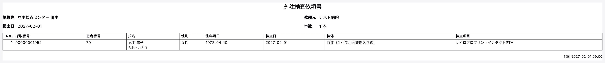
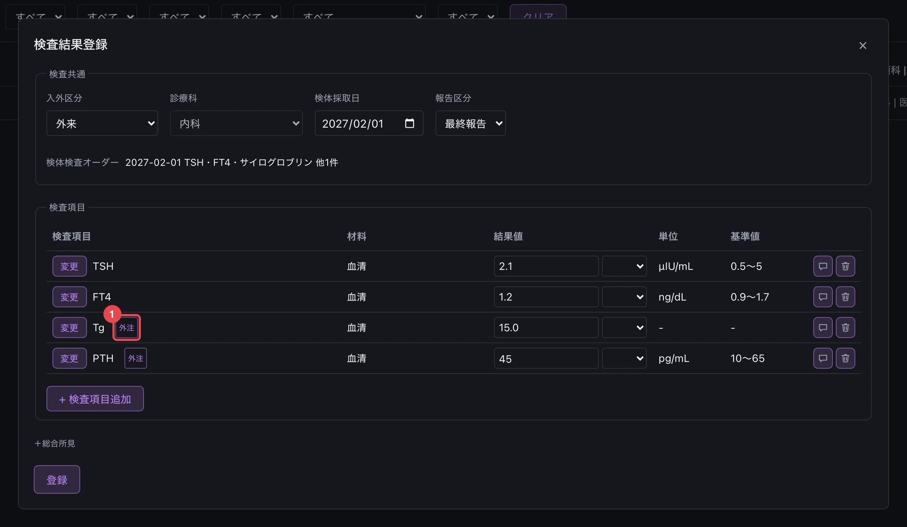
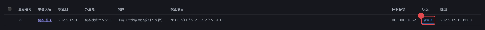

# 外注検査

外部の検査センター(外注先)に出す検体検査を、検査室が外注先へ提出し、結果が返ってくるまでを追う操作です。
外注の検査も、ラベル発行・採取・到着確認までは院内の検査と同じです。流れ全体は、業務フローの
[検体検査オーダー](../flows/lab.md)の「外注検査の流れ」を見てください。

- 外注検査は、画面の上の「部門業務」>「臨床検査部門」>「外注検査」で開きます。
- どの検査項目を外注にするか、どこに出すかは、マスタと施設設定で決めてあります。医師がオーダーを登録した時点で、外注の項目と外注先が決まります。
- 外注先から届いた結果のファイルは、[検査結果取込](lab-result-import.md)で外注先を選んで読み込みます。

## 検体検査一覧での見え方

外注の項目を含む検体検査は、[検体検査一覧](lab-worklist.md)にも院内の検査と一緒に並びます。

{ .screen }

1. 「実施区分」で「院内」か「外注」に絞れます。院内と外注の項目が混ざる検査は、どちらで絞っても出ます。
2. 外注の項目を含む検査は、「検査内容」に「外注」の印が付きます。印にマウスを重ねると外注先の名前が出ます。

行の「表示」で、管ごとの内容を見ます。

{ .screen width="1002" }

1. 外注の管は、見出しに「外注:」と外注先の名前が付きます。同じ検体でも、院内で測る管とは別の管になり、ラベルも別に刷られます。
2. 外注の項目には「外注」の印が付きます。

外注の管のラベルには「外注」と外注先の名前が刷られます。

## 外注検査の画面の見方

外注の管が 1 本 1 行で並びます。

{ .screen }

1. 「外注先」「検査日(開始)」「検査日(終了)」「状況」で絞り込みます。検査日ははじめ今日までの 30 日、状況ははじめ「提出待ち」です。
2. 提出する管にチェックを付けます。チェックは提出待ちの行にだけ出ます。見出しのチェックで、並んでいる提出待ちの管をまとめて選べます。
3. 「状況」に、管がどこまで進んだかが出ます。
4. 「提出」を押すと、選んだ管を外注先に提出したことを記録します。

「状況」は次の 4 つです。中止した検査は並びません。

| 状況 | 意味 |
|---|---|
| ラベル未発行 | まだラベルを刷っていない。提出できない |
| 提出待ち | ラベルを刷ったが、まだ提出していない |
| 結果未着 | 提出したが、その管の結果がまだ確定していない |
| 結果済 | その管の結果が確定した |

## 提出する

外注先に渡す管を選んで「提出」を押すと、行が「結果未着」に変わります。はじめの絞り込みは提出待ちなので、
提出した行は一覧から消えます。「状況」を「結果未着」にすると見られます。

{ .screen }

1. 「状況」が「結果未着」になります。
2. 「提出」に、提出した日時が出ます。
3. 間違えて提出したときは「取消」を押すと、提出待ちに戻ります。

- 提出は到着確認とは別の操作です。到着を記録していない管も提出できます。
- 提出した人も記録されます。

## 外注伝票を刷る

外注先へ検体と一緒に渡す一覧(外注検査依頼書)を刷ります。外注先 1 つ・提出日 1 日ぶんで 1 枚です。

{ .screen }

1. 「外注先」で外注先を選んでから、「提出日」に提出した日を入れます。
2. 「外注伝票」を押すと、別のタブで外注伝票が開きます。外注先を選ぶまでは押せません。

{ .screen }

外注伝票には、依頼先・依頼元・提出日・本数と、管ごとに採取番号・患者・検査日・検体・検査項目が並びます。
上の「印刷」を押して、A4 縦で印刷します。その日に提出した管だけが載るので、先に「提出」を済ませておきます。

## 結果を入れる

外注先から結果が返ってきたら、結果を入れます。

- **ファイルで届いたとき**: [検査結果取込](lab-result-import.md)で、「外注先」に結果の届いた外注先を選んで読み込みます。
- **紙などで届いたとき**: 検体検査一覧の「結果登録」で、院内の結果とまとめて入れます。管が全部届いて「実施済」になった検査で押せます。
- 院内の結果を先に登録したあとに、カルテで外注の項目を「+ 検査項目追加」で足すと、院内の結果として残ります。外注検査の画面でも「結果未着」のままです。

{ .screen width="1210" }

1. 外注の項目には「外注」の印が付きます。院内の項目と一緒に、オーダーの項目が並んだ状態で開きます。

外注先で測った項目は、結果の内容表示でも「外注」の印で分かります。

## 結果が届いたかを確かめる

結果が確定した管は「結果済」になります。結果の届いていない管を追うときは、「状況」を「結果未着」にして見ます。

{ .screen }

1. その管の結果が確定すると「結果済」になります。

- 院内の項目だけを先に確定しても、外注の管は「結果未着」のまま残ります。
- 外注先が一部の項目だけ先に返したときも、1 項目でも確定すれば「結果済」になります。
- 外注の結果として数えられるのは、検査結果取込で外注先を選んで読み込んだ結果と、オーダーの項目が並んだ状態から入れた結果です。画面で項目を足して入れた結果は、院内の結果になります。
